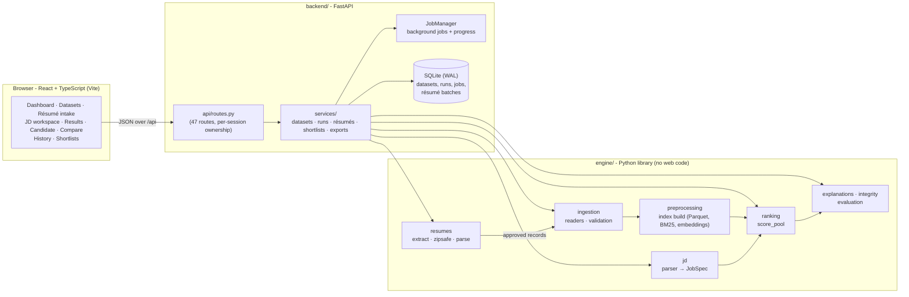
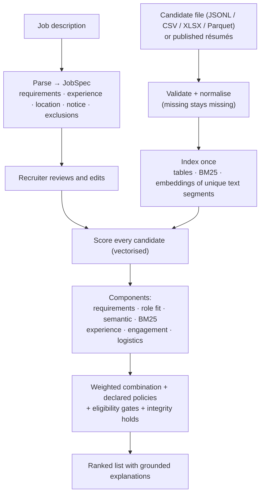
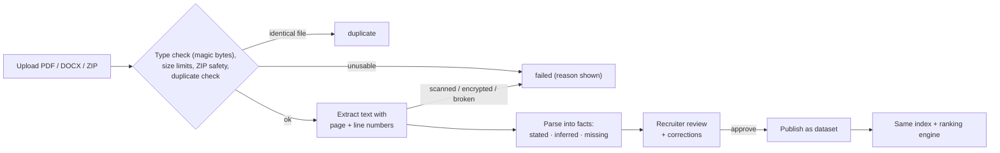
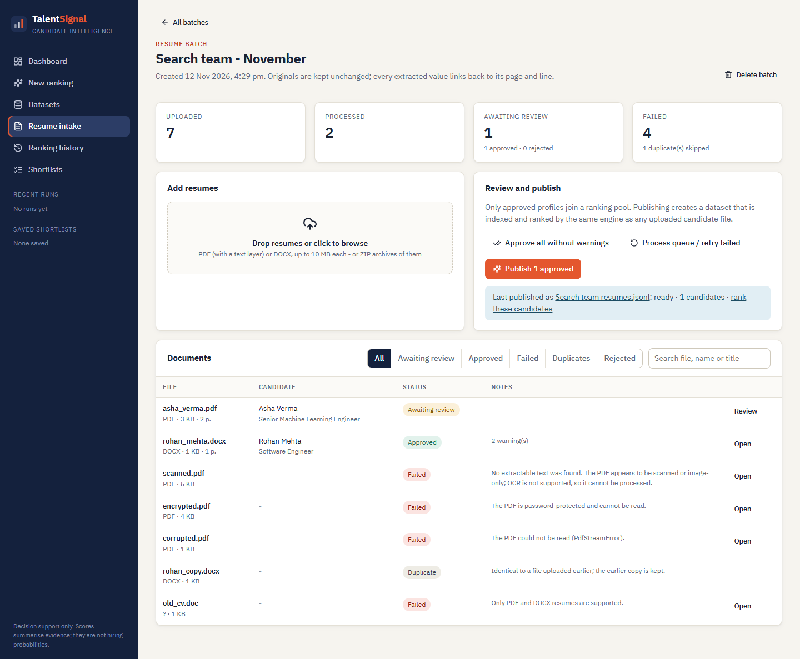
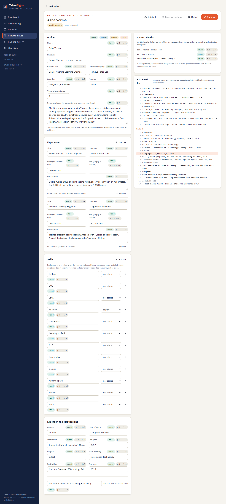

# TalentSignal

**Explainable candidate ranking and résumé intake for recruiters.** TalentSignal reads a job description,
turns it into an editable list of requirements, and ranks a candidate pool by the evidence in each profile:
skills, career history, semantic similarity, keyword relevance and availability signals. Every score comes
with an explanation built from facts in the candidate's own record. Résumés (PDF, DOCX or ZIP) can be
converted into reviewed candidate profiles and ranked by the same engine.

TalentSignal is decision support. It orders and explains evidence for a human reviewer; it does not make
hiring decisions, and its scores are not probabilities of hiring success.


> Status: a working local application (FastAPI + React), tested and benchmarked on one Windows machine.
> It is not deployed publicly and has no user authentication - see [Limitations](#privacy-security-and-limitations).

---

## Contents

- [The problem](#the-problem)
- [What TalentSignal does](#what-talentsignal-does)
- [Architecture](#architecture)
- [How ranking works](#how-ranking-works)
- [How résumé ingestion works](#how-résumé-ingestion-works)
- [Technology stack](#technology-stack)
- [Repository structure](#repository-structure)
- [Getting started (Windows)](#getting-started-windows)
- [Testing](#testing)
- [Performance](#performance)
- [Privacy, security and limitations](#privacy-security-and-limitations)
- [Documentation](#documentation)
- [Project origin](#project-origin)
- [Future work](#future-work)
- [License and third-party material](#license-and-third-party-material)

## The problem

A recruiter with one opening and tens of thousands of profiles needs a short, *defensible* list. Keyword
search rewards whoever lists the most buzzwords, and an opaque model score cannot be checked or argued with.
TalentSignal was built around three questions a recruiter should be able to answer for every candidate in a
shortlist: *which requirements does this person meet, where in their profile is the evidence, and what is
missing or suspicious?*

## What TalentSignal does

| Area | What it does |
|---|---|
| **Job description understanding** | Rule-based parser (no LLM) that extracts must-haves vs nice-to-haves, the experience band, locations, work mode, notice period, visa constraints and declared exclusions. Each item keeps the sentence it came from, and everything is editable before ranking. |
| **Candidate ranking** | Seven scoring components: requirement evidence, role fit, semantic similarity, BM25 keyword relevance, experience fit, engagement and logistics. They are combined with configurable weights, declared policies (ignore / penalise / exclude) and a deterministic tie-break. |
| **Semantic matching** | A pretrained sentence-embedding model (`BAAI/bge-small-en-v1.5`) runs locally. Similarity is calibrated into evidence rather than used as a raw score. |
| **Lexical retrieval** | BM25 over candidate text, used as one bounded component rather than the ranking itself. |
| **Explanations** | Per-requirement evidence (verified vs self-reported), score composition, concerns, missing information, and what separates a candidate from neighbouring ranks. Every claim is checked against the source record by a validator. |
| **Integrity and fairness** | Impossible profiles, such as expert skills used for zero months or stated years that contradict the listed roles, are held for human review and are never labelled as fraud. Protected attributes and institution prestige are not used, and missing optional data is treated as unknown rather than negative. |
| **Résumé ingestion** | PDF/DOCX/ZIP upload, safe text extraction and rule-based parsing. Every value is marked *stated*, *inferred* or *missing*, with its page and line. The pipeline handles duplicates and failures and has a processing dashboard. |
| **Recruiter review** | Correct extracted profiles field by field, approve or reject them, and publish the approved ones as a dataset. |
| **Recruiter workflow** | Datasets with quality reports, results table and cards, server-side filters and sorting, side-by-side comparison (2–6 candidates), ranking history, shortlists with notes, and exports (CSV, XLSX, JSON, JSONL, Parquet, PDF). |
| **Competition mode** | A separate command that produces the 100-row submission format of the original challenge, validated, with network access blocked during ranking. |

## Architecture



The engine is a plain Python package, so it is used directly by the backend, the command-line scripts
(index build, competition mode, evaluation) and the tests. Indexes are stored on disk, keyed by a full-file
fingerprint: an identical file is never indexed twice, and a changed file never reuses a stale index. More
detail is in [docs/ARCHITECTURE.md](docs/ARCHITECTURE.md).

## How ranking works



1. **Requirement evidence.** For each requirement, take the strongest matching skill. The skill counts more
   when it was used for longer and when it is corroborated by the person's titles. Add assessment results
   and career text, then combine the sources with a noisy-OR so that repeating synonyms cannot inflate the
   score.
2. **Role fit, experience, engagement and logistics** are bounded features: title relevance to the target
   role families, years against the JD's band, recent activity and responsiveness, and location, work-mode
   and notice fit.
3. **Semantic and BM25** similarity capture wording that the taxonomy does not know. Each is one bounded
   component, not the whole ranking.
4. **Weights** default to 0.34 / 0.20 / 0.12 / 0.05 / 0.10 / 0.11 / 0.08, are shown in the UI, and can be
   changed per run. Missing values drop out of the weighted mean instead of counting as zero.

**What this is not:** there is no custom-trained ranking model. TalentSignal combines a *pretrained*
embedding model (used as-is), BM25, hand-engineered features and configurable weighted scoring. Parameters
such as the calibration windows and the default weights were set by hand and checked against the evaluation
harness. The harness uses *proxy* labels, because no ground-truth relevance labels were available.

The full mathematics and a worked example computed by the real engine are in the
[Technical Handbook](docs/learning/01_TalentSignal_Complete_Technical_Handbook.pdf) (Parts 6–7).

## How résumé ingestion works



- **Nothing is invented.** A proficiency level is filled in only when the résumé states it, and skill
  durations, endorsements and platform signals stay empty. The engine already treats empty as unknown.
- **Provenance.** Every value records the page and line it came from. The review page highlights the source
  line, and any field a reviewer changes is marked *edited*.
- **Privacy.**
  - Contact details are shown to the reviewer but are never copied into the candidate record, so they never
    reach an index, a ranking run or an export.
  - Lines stating date of birth, gender, marital status, religion and similar attributes are redacted
    before parsing.
- **Safety.**
  - File types are checked by content, not by extension. Each résumé is limited to 10 MB, enforced while
    streaming.
  - ZIP archives are checked for bombs, path traversal ("zip slip"), encrypted entries and nested archives.
  - Macros and embedded scripts are never executed.
- **No OCR.** Scanned, image-only PDFs fail with a clear message instead of being guessed.

The complete pipeline, limits and failure codes are in [docs/RESUME_INGESTION.md](docs/RESUME_INGESTION.md).

| Batch dashboard | Review with provenance |
|---|---|
|  |  |

## Technology stack

| Layer | Technology |
|---|---|
| Ranking engine | Python 3.11+ (tested on 3.14), NumPy, SciPy (sparse BM25), pandas, PyArrow/Parquet, scikit-learn utilities |
| Semantic model | `sentence-transformers` with `BAAI/bge-small-en-v1.5` (pretrained, MIT), PyTorch CPU, run locally |
| Documents | `pypdf` (résumé PDFs), DOCX read as XML, ReportLab (PDF exports), openpyxl (XLSX) |
| Backend | FastAPI, Pydantic v2, Uvicorn, SQLite (WAL) via the standard library, thread-pool background jobs |
| Frontend | React 18, TypeScript 5, Vite 5, React Router, lucide-react icons, plain CSS design tokens |
| Tests | pytest + FastAPI TestClient, Vitest + Testing Library |
| Docs tooling | Markdown → HTML → PDF (python-markdown, Mermaid, KaTeX, headless Edge), with code excerpts pulled from the source at build time |

## Repository structure

```text
TalentSignal/
├── engine/                  # ranking engine (pure Python library)
│   ├── ingestion/           # streaming readers, validation, fingerprints
│   ├── preprocessing/       # index build and loading
│   ├── jd/                  # job-description parser and JobSpec model
│   ├── retrieval/           # BM25 and embeddings
│   ├── features/            # evidence, titles, signals, constraints, calibration
│   ├── ranking/             # scorer and competition mode
│   ├── explanations/        # grounded explanations + validator
│   ├── integrity/           # consistency checks
│   ├── resumes/             # résumé extraction, ZIP safety, parsing
│   ├── evaluation/          # metrics, proxy labels, adversarial set
│   └── resources/           # taxonomy and the sample job description
├── backend/app/             # FastAPI app: routes, services, database, schemas
├── backend/tests/           # API tests
├── frontend/src/            # React app: pages, components, API client, tests
├── scripts/                 # index build, competition mode, evaluation, benchmarks, screenshots
├── tests/                   # engine tests, synthetic factories, résumé fixtures (fictional people)
└── docs/
    ├── learning/            # three PDF books + editable Markdown sources and build tooling
    ├── reports/             # evaluation report and benchmark results
    ├── screenshots/         # UI screenshots
    ├── ARCHITECTURE.md · RESUME_INGESTION.md · STATUS.md
    └── 01_… 02_… 03_…       # earlier Markdown versions of the learning documents
```

## Getting started (Windows)

**Prerequisites:** Python 3.11+ (tested on 3.14), Node.js 20+ (tested on 24), Git. Commands are for
PowerShell from the repository root.

### 1. Backend environment

```powershell
python -m venv .venv
# CPU-only PyTorch first, so pip does not pull a multi-GB CUDA build
.venv\Scripts\python -m pip install torch==2.11.0 --index-url https://download.pytorch.org/whl/cpu
.venv\Scripts\python -m pip install -r requirements-dev.txt
```

### 2. Embedding model (optional, one-time, ~130 MB)

```powershell
.venv\Scripts\python scripts\download_model.py
```

This downloads `BAAI/bge-small-en-v1.5` into `artifacts/models/` (not committed). After this step ranking runs
fully offline. Without the model, everything still works: the semantic component is disabled and the
remaining weights are renormalised.

### 3. Frontend

```powershell
cd frontend
npm install
npm run build        # production bundle in frontend/dist, served by the backend
cd ..
```

### 4. Run

```powershell
cd backend
..\.venv\Scripts\python -m uvicorn app.main:app --port 8000
# open http://127.0.0.1:8000
```

For frontend development with hot reload, keep the backend running and start `npm run dev` in `frontend/`
(http://localhost:5173, which proxies `/api` to port 8000).

### 5. Try it with data

No candidate data is included in the repository. To try the app:

- Generate a small fictional pool and upload it on the **Datasets** page:
  ```powershell
  .venv\Scripts\python scripts\make_sample_dataset.py     # writes data\sample_candidates.jsonl
  ```
- Or upload your own JSONL / JSON / CSV / XLSX / Parquet file in the same schema.
- Or open **Résumé intake** and upload PDF/DOCX résumés. `tests/fixtures/resumes/` contains fictional samples.

On **New ranking**, load the bundled sample job description (or paste your own), review the extracted
requirements, and rank.

### Configuration

| Variable | Default | Meaning |
|---|---|---|
| `TALENTSIGNAL_DATA_DIR` | `./data` | SQLite database, uploads, stored résumés |
| `TALENTSIGNAL_ARTIFACTS_DIR` | `./artifacts` | indexes, run results, model |
| `TALENTSIGNAL_MAX_UPLOAD_MB` | `2048` | candidate-file upload limit |
| `TALENTSIGNAL_MAX_RESUME_ZIP_MB` | `2048` | résumé upload / ZIP limit (each résumé is capped at 10 MB) |
| `TALENTSIGNAL_IMPORT_DIRS` | `../reference material` | server directories allowed for path imports (`;`-separated on Windows) |
| `TALENTSIGNAL_LIBRARY_DATASETS` | `../reference material/candidates.jsonl` if it exists | shared datasets registered at start-up |
| `TALENTSIGNAL_MODEL_DIR` | `artifacts/models/bge-small-en-v1.5` | embedding model directory |
| `TALENTSIGNAL_JOB_WORKERS` | `2` | concurrent background jobs |

No secrets or API keys are needed, and no hosted AI service is called.

### Command-line tools

| Command | Purpose |
|---|---|
| `python scripts/make_sample_dataset.py` | Write a small fictional candidate pool |
| `python scripts/build_index.py --candidates FILE` | Build an index (prints timings and peak memory) |
| `python scripts/competition_rank.py --candidates FILE --jd JD.docx --out submission.csv` | Competition mode (needs the original challenge files, which are not included) |
| `python scripts/run_evaluation.py` | Evaluation suite → `docs/reports/EVALUATION_REPORT.md` (needs the challenge dataset) |
| `python scripts/benchmark_resumes.py --n 10000` | Résumé ingestion throughput and memory benchmark |
| `python scripts/smoke_test.py` | End-to-end API workflow against a running server |
| `python scripts/screenshots.py`, `screenshots_resumes.py` | UI screenshots via headless Edge (developer tools) |

## Testing

```powershell
.venv\Scripts\python -m pytest          # engine + API + résumé ingestion
cd frontend
npm test                                # UI workflow tests (Vitest)
npm run typecheck                       # TypeScript
npm run build                           # production build
```

The suite has **91 Python tests**: 59 engine tests (including 25 for résumé ingestion) and 32 API tests
(including 11 for résumé ingestion). There are also **11 frontend tests**. All of them run on synthetic
data and generated documents, so no external data is needed. They cover scoring formulas, gates and
tie-breaks, keyword-stuffing resistance, missing-data neutrality, explanation grounding, competition-file
validation, upload limits, session isolation, every export format, the résumé pipeline (provenance,
redaction, ZIP attacks, duplicates, review, publish → rank) and the database migration.

## Performance

Measured on one development laptop (16 logical CPUs, 15.7 GB RAM, Windows 11, Python 3.14, CPU only). The
numbers come from the scripts in `scripts/`; they describe this machine, not a guarantee.

| What was measured | Result |
|---|---|
| Cold index build, 100,000 candidates (465 MB JSONL), including embeddings | 137 s, peak 1.99 GB |
| Warm scoring of all 100,000 candidates for one JD | 2.85 s (mean of 3 runs) |
| Competition ranking step (load, score, 100 explanations, validate) | 11.9–13.6 s, peak ≈1.4 GB, machine otherwise idle |
| API: results page / filtered page / candidate detail, 100-row run | ≈19 / 22 / 16 ms (≈150–270 ms on a 99,932-row run) |
| Résumé ingestion, 10,000 **synthetic** résumés in one ZIP | upload + unpack 17 s; processing 178 s (56 docs/s; 152 s when idle); publish 1.3 s; index 43 s; peak 834 MB |

**Ranking quality** was measured only against *proxy labels*, because the hidden competition labels were
never available. On those labels TalentSignal scores 0.951 on the challenge's composite metric. The earlier
hackathon implementation ([redrob-candidate-ranking](https://github.com/Harshdeep47/redrob-candidate-ranking))
scores 0.982, and BM25 alone scores 0.825. Proxy labels share information with the scorer, so these figures
are useful for comparing variants and catching regressions, not as a claim of real-world accuracy. Ablations,
stability tests and an adversarial keyword-stuffing set are in
[docs/reports/EVALUATION_REPORT.md](docs/reports/EVALUATION_REPORT.md).

The résumé benchmark uses template-generated documents: it measures throughput and memory, **not** extraction
accuracy on real résumés, which has not been measured.

## Privacy, security and limitations

**What exists**
- All processing is local. No candidate data is sent to an external service, and the embedding model runs
  on the machine.
- Uploads are validated:
  - extension and content checks, with size limits enforced while streaming;
  - server-chosen file names;
  - an allow-list of directories for path imports.
- Parameterised SQL, CSV/XLSX formula-injection protection, security headers with a Content Security Policy,
  and uniform JSON errors.
- Each browser session sees only its own datasets, runs, shortlists and résumé batches.
- Résumé contact details are kept out of candidate records, indexes and exports, and personal-attribute
  lines are redacted.

**Limitations - read before using this for anything real**
1. **No authentication.** A session is a random ID stored in the browser, not a login. Do not expose the
   server to untrusted users without adding real authentication.
2. **No ground-truth evaluation.** Quality figures use proxy labels, and on them the earlier implementation
   scores higher.
3. **Candidate claims are not verified.** Integrity checks catch internal contradictions; they cannot confirm
   that a skill or job is real.
4. **Rule-based parsing.**
   - The JD parser depends on a hand-built taxonomy.
   - The résumé parser is tuned on common English layouts. Multi-column PDFs, tables and unusual layouts
     need manual correction.
   - There is no OCR.
5. **Hand-set parameters.** Weights, affinities and calibration windows are documented and editable, not
   learned.
6. **Scale.** Benchmarked up to 100,000 candidates on a single node (SQLite, in-process jobs). Larger pools
   would need chunked index builds and a job queue.
7. **Personal data.** For datasets created from résumés, the `anonymized_name` field holds the real name.
   Stored originals and extraction files under `data/` are personal data, and there is no encryption at
   rest or retention policy yet.

A fuller list with proposed fixes is in [docs/STATUS.md](docs/STATUS.md).

## Documentation

| Document | What it covers |
|---|---|
| [Technical Handbook (PDF)](docs/learning/01_TalentSignal_Complete_Technical_Handbook.pdf) | The problem, architecture, data, JD understanding, the ranking mathematics, a worked example, explanations, performance, security and fairness |
| [Developer Code Mastery Guide (PDF)](docs/learning/02_TalentSignal_Developer_Code_Mastery_Guide.pdf) | Every module, endpoint and table; important code (inserted from the repository at build time); testing; exercises |
| [Interview & Technical Defense Guide (PDF)](docs/learning/03_TalentSignal_Interview_and_Technical_Defense_Bible.pdf) | Explaining and defending the design, practice questions, limitations |
| [docs/learning/](docs/learning/README.md) | Editable Markdown sources of the three books and how to rebuild them |
| [docs/ARCHITECTURE.md](docs/ARCHITECTURE.md) | Components, data flow, key design decisions |
| [docs/RESUME_INGESTION.md](docs/RESUME_INGESTION.md) | Résumé pipeline, safety, privacy, failure codes, benchmark, limitations |
| [docs/STATUS.md](docs/STATUS.md) | Acceptance criteria, known limitations, next steps |
| [docs/reports/EVALUATION_REPORT.md](docs/reports/EVALUATION_REPORT.md) | Proxy-label evaluation, ablations, stability, adversarial tests |
| [DEVELOPMENT_LOG.md](DEVELOPMENT_LOG.md) | Chronological decisions, measurements and fixes |

## Project origin

TalentSignal started from the **Redrob / India Runs Data & AI Challenge**. The challenge was to rank a
synthetic pool of 100,000 candidate profiles for a "Senior AI Engineer" job description and submit the top
100. My hackathon submission is a separate repository,
[redrob-candidate-ranking](https://github.com/Harshdeep47/redrob-candidate-ranking).

TalentSignal is a fresh implementation written afterwards, not a copy of that code. It keeps a few ideas that
held up: a one-time precompute followed by fast ranking, trusting skills that a person's job titles
corroborate, and explicit disqualifiers. It rebuilds the rest as a general product:
- any job description instead of one;
- any shortlist size instead of exactly 100;
- grounded explanations, integrity holds and fairness safeguards;
- a full web application;
- résumé ingestion with human review;
- tests, an evaluation harness, and learning documentation.

The original 100-row competition output is still available as a separate competition mode. The challenge's
data and documents are not part of this repository.

## Future work

- Learn the weights from recruiter feedback (shortlist and reject decisions) with a learning-to-rank model
  over the existing features.
- Re-rank the top few hundred candidates with a cross-encoder, measured with the same evaluation harness.
- Add authentication (OIDC), per-organisation data, an audit log and encryption at rest.
- Résumés: OCR for scanned files, layout-aware PDF reading, a labelled set of real résumés to measure parsing
  accuracy, and fuzzy duplicate detection.
- Chunked, multi-process index builds and a proper job queue for pools beyond 100,000 candidates.

## License and third-party material

The TalentSignal source code and documentation are released under the [MIT License](LICENSE).

- **Embedding model:** `BAAI/bge-small-en-v1.5` (MIT) is downloaded by `scripts/download_model.py`; it is
  not stored in this repository.
- **Challenge materials:** the Redrob / India Runs challenge dataset, job description and documents belong to
  their owners and are **not** included. Competition mode and the evaluation read them from a local copy.
  The bundled job description (`engine/resources/jobs/sample_senior_ai_engineer.txt`) is original sample
  text written for this project. The learning books quote a few sentences of the challenge JD to explain how
  the parser handles it.
- **Sample people:** all names and contact details in tests, fixtures and screenshots are fictional or come
  from the challenge's synthetic dataset.
