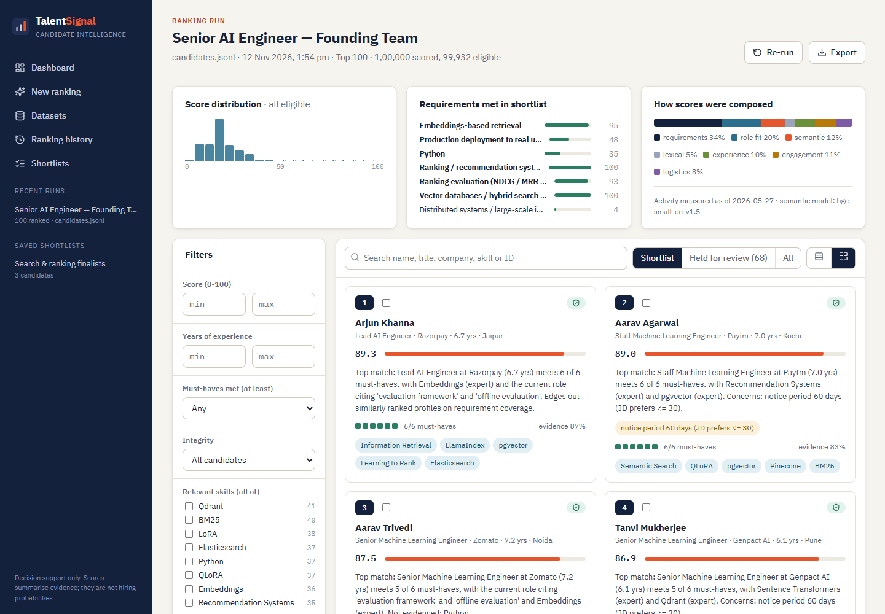

# TalentSignal

**Explainable candidate intelligence and ranking.** TalentSignal reads a job description, turns it into an
editable set of requirements, and ranks a candidate pool using evidence from skills, platform assessments,
career history, semantic similarity and behavioural signals - explaining every score with facts taken from
the candidate's own record.

It is a decision-support tool, not an ATS and not an automated hiring authority: scores summarise evidence;
they are not probabilities of hiring success.



## What it does

| Area | Capability |
|---|---|
| Job understanding | Rule-based JD parser (no LLM needed): must-haves vs nice-to-haves, experience band, locations, notice, visa, declared exclusions - each traced to its source sentence; fully editable before ranking |
| Candidate understanding | Streaming ingestion of JSONL / JSON / CSV / XLSX / Parquet, tolerant validation, missing data kept as "unknown" |
| Resume intake | PDF (text layer) and DOCX resumes, singly or in ZIP archives: safe extraction, rule-based parsing where every value is marked stated / inferred / missing with its page and line, duplicate and failure handling, a processing dashboard, recruiter review and correction, then publishing approved profiles as a normal dataset. No OCR - scanned PDFs are reported as failed. See [docs/RESUME_INGESTION.md](docs/RESUME_INGESTION.md) |
| Ranking | Bounded requirement evidence (skills + assessments + title-trusted career text + embeddings), role relevance, BM25, experience, engagement, logistics; declared policies; deterministic order |
| Explainability | Per-requirement evidence with verified/self-reported markers, score composition, concerns, missing information, differentiators vs neighbours; every claim validated against the record |
| Integrity & fairness | Impossible-profile checks hold candidates for human review (never labelled fraud); no protected attributes used; institution prestige not used; missing optional data is neutral |
| Product | Dashboard, datasets & quality reports, JD workspace, results table/cards with filters, candidate profile, compare, history, shortlists with notes, exports (CSV, XLSX, JSON, JSONL, Parquet, PDF) |
| Competition mode | Separate CLI/export producing the original 100-row Redrob CSV, validated, with no network during ranking |

## Quick start (Windows, PowerShell or Git Bash)

Prerequisites: Python 3.11+ (tested on 3.14), Node.js 20+ (tested on 24.22.3).

```bash
cd TalentSignal
python -m venv .venv
.venv/Scripts/python -m pip install torch==2.11.0 --index-url https://download.pytorch.org/whl/cpu
.venv/Scripts/python -m pip install -r requirements-dev.txt
.venv/Scripts/python scripts/download_model.py          # one-time, ~130 MB, needs network

cd frontend && npm install && npm run build && cd ..

cd backend
../.venv/Scripts/python -m uvicorn app.main:app --port 8000
# open http://127.0.0.1:8000
```

On macOS/Linux use `.venv/bin/python`. If Node is not installed globally, a portable copy can be unpacked
into `.tools/node` (see the Developer Guide).

At start-up the server registers `../reference material/candidates.jsonl` (if present) as a shared library
dataset and indexes it in the background (about 2-3 minutes cold; reused afterwards via its fingerprint).

**Development mode** (hot reload): run the backend as above and `npm run dev` in `frontend/`
(http://localhost:5173, proxies `/api` to port 8000).

## Command-line tools

| Command | Purpose |
|---|---|
| `python scripts/build_index.py --candidates FILE` | Build an index (prints timings and peak memory) |
| `python scripts/competition_rank.py --candidates FILE --out submission.csv` | COMPETITION MODE: exactly 100 rows, validated, network blocked during ranking |
| `python scripts/run_evaluation.py` | Evaluation suite -> `docs/reports/EVALUATION_REPORT.md` |
| `python scripts/smoke_test.py` | End-to-end API workflow against a running server, with latencies |
| `python scripts/screenshots.py` | UI screenshots via headless Edge (dev tool) |
| `python scripts/screenshots_resumes.py` | Screenshots of the resume-intake pages (dev tool) |
| `python scripts/benchmark_resumes.py --n 10000` | Resume ingestion throughput / memory benchmark through the API |
| `python scripts/calibrate_semantic.py --index DIR` | Inspect embedding similarity distributions |

## Tests

```bash
.venv/Scripts/python -m pytest              # engine + API + resume ingestion (91 tests)
cd frontend && npm test                     # UI workflow tests (11 tests)
```

## Configuration (environment variables)

| Variable | Default | Meaning |
|---|---|---|
| `TALENTSIGNAL_DATA_DIR` | `./data` | SQLite database and uploads |
| `TALENTSIGNAL_ARTIFACTS_DIR` | `./artifacts` | indexes, run results, model |
| `TALENTSIGNAL_MAX_UPLOAD_MB` | `2048` | upload size limit |
| `TALENTSIGNAL_IMPORT_DIRS` | `../reference material` | server directories allowed for path imports (`;`-separated on Windows) |
| `TALENTSIGNAL_LIBRARY_DATASETS` | reference `candidates.jsonl` | shared datasets registered at start-up |
| `TALENTSIGNAL_MODEL_DIR` | `artifacts/models/bge-small-en-v1.5` | embedding model directory |
| `TALENTSIGNAL_JOB_WORKERS` | `2` | concurrent background jobs |
| `TALENTSIGNAL_MAX_RESUME_ZIP_MB` | `2048` | resume upload / ZIP archive limit (each resume is capped at 10 MB) |

No secrets are required. **Security note:** sessions are a random id kept in the browser (history is
separated per browser), not authentication. Put the app behind real authentication before exposing it to
untrusted users.

## Measured results (this machine: 16 logical CPUs, 15.7 GB RAM, Windows 11)

| Measure | Result |
|---|---|
| Cold index build, 100,000 candidates (465 MB) | 137 s, peak 1.99 GB (embedding 5,802 unique text segments: 108 s) |
| Warm scoring of 100,000 candidates | 2.85 s mean (3 runs) |
| Competition ranking step (load + score + 100 explanations + validate) | 11.9 s, peak 1.39 GB when the machine was otherwise idle |
| API: results page / filtered page / candidate detail | ~19 / 22 / 16 ms (100-row run); ~150-270 ms on a 99,932-row "all eligible" run |
| Resume ingestion, 10,000 synthetic resumes (ZIP) | 17 s upload/unpack, 178 s processing (56 docs/s; 152 s on an idle run), 1.3 s publish, 43 s index; peak 834 MB; the 148 planted scanned/corrupted files all reported as failed |
| Tests | 91 Python + 11 frontend, all passing |

Ranking quality is reported against **proxy labels** (not ground truth) in
[docs/reports/EVALUATION_REPORT.md](docs/reports/EVALUATION_REPORT.md), including where the reference
implementation scores higher.

## Documentation

- [docs/01_COMPLETE_TECHNICAL_HANDBOOK.md](docs/01_COMPLETE_TECHNICAL_HANDBOOK.md) - concepts, mathematics, design decisions
- [docs/02_DEVELOPER_LEARNING_AND_CODE_GUIDE.md](docs/02_DEVELOPER_LEARNING_AND_CODE_GUIDE.md) - how the code works
- [docs/03_INTERVIEW_AND_PROJECT_DEFENSE_BIBLE.md](docs/03_INTERVIEW_AND_PROJECT_DEFENSE_BIBLE.md) - defending the project
- [docs/ARCHITECTURE.md](docs/ARCHITECTURE.md) - architecture overview
- [docs/RESUME_INGESTION.md](docs/RESUME_INGESTION.md) - resume ingestion pipeline, safety and limitations
- [docs/learning/](docs/learning/README.md) - the three learning books (PDF + Markdown sources)
- [docs/STATUS.md](docs/STATUS.md) - completed and pending work, limitations
- [DEVELOPMENT_LOG.md](DEVELOPMENT_LOG.md) - chronological decisions and findings

## Provenance and licensing

TalentSignal is an independent implementation. The reference repository (`reference material/redrob-hackathon`)
has no licence file and its commits are authored by another identity, so **no code was copied from it**; its
documented ideas (two-stage precompute/rank, title-based trust, multiplicative disqualifiers) were reimplemented
and changed where measurement or fairness required it. The reference ranker is only *executed/read* as an
evaluation baseline. The embedding model BAAI/bge-small-en-v1.5 is MIT-licensed. Challenge materials
(JD text in `engine/resources/jobs/`) belong to their authors.
