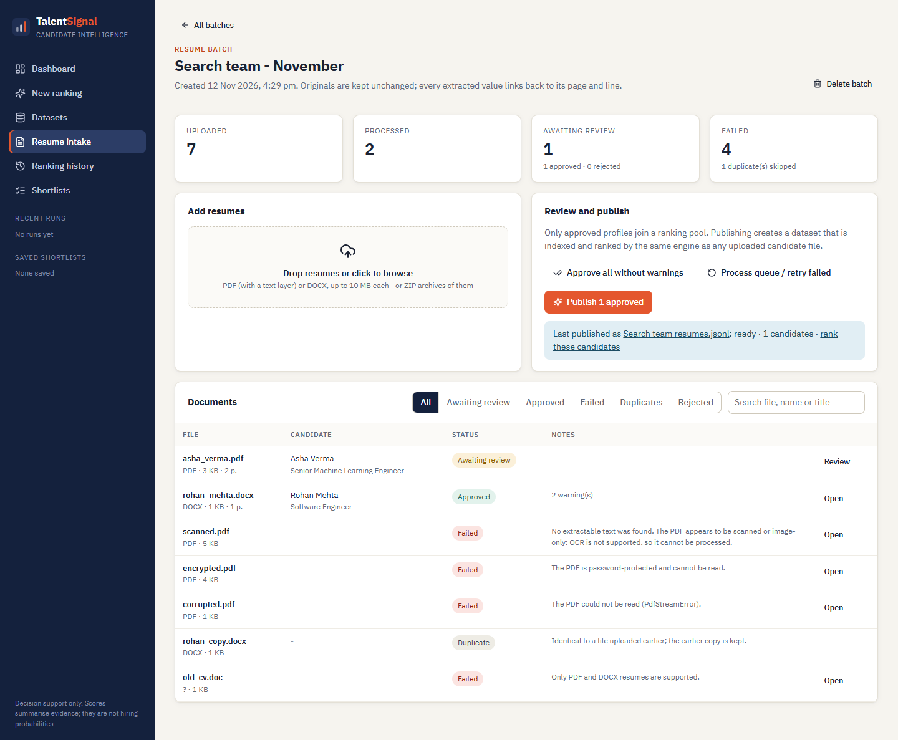
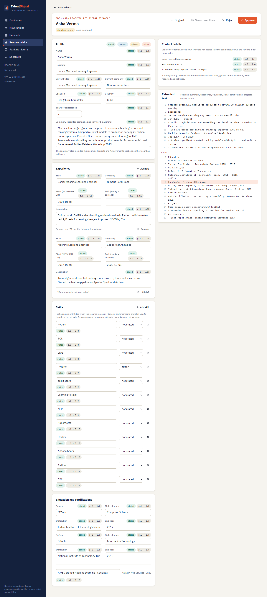

# Resume ingestion

TalentSignal can turn PDF and DOCX resumes into candidate profiles, let a recruiter review and correct them,
and publish the approved profiles as an ordinary dataset. Ranking, explanations, integrity checks, fairness
safeguards and exports are then **the existing engine, unchanged** - resume ingestion only produces candidate
records in the existing schema.

Implemented in:

| Layer | Files |
|---|---|
| Engine (no web code) | `engine/resumes/extract.py` (safe text extraction), `zipsafe.py` (archive safety), `parse.py` (rule-based parsing + mapping to the candidate schema) |
| Backend | `backend/app/services/resumes.py` (`ResumeService`), routes in `api/routes.py` (`/api/resume-batches…`, `/api/resume-documents…`), schema v2 in `database/db.py` |
| Frontend | `pages/ResumesPage.tsx` (batches + processing dashboard), `pages/ResumeReviewPage.tsx` (review/correct), "Source résumé" link on the candidate page |
| Tests | `tests/test_resume_ingestion.py` (25), `backend/tests/test_resumes_api.py` (11), `frontend/src/test/resumes.test.tsx` (3); fixtures in `tests/fixtures/resumes/` (fictional people, generated by `make_fixtures.py`) |
| Benchmark | `scripts/benchmark_resumes.py` → `docs/reports/resume_ingestion_benchmark.json` |



## Pipeline

```
upload (PDF / DOCX / ZIP, many files)
  │  stream to disk with a byte limit, SHA-256 while copying, file type from magic bytes (not the name)
  │  ZIP: members listed and checked first (count, total size, ratio, encryption, nesting, type);
  │       each member streamed into a server-named file - names from the archive never become paths
  │  byte-identical file already uploaded by this session  → status "duplicate" (earlier copy kept)
  │  unsupported / oversized / unsafe                      → status "failed" with a reason
  ▼
queued ──(background job "resume", one document at a time)──► processing
  │  extract: pypdf text layer (PDF, ≤30 pages) or document.xml (DOCX); personal-attribute lines redacted
  │  parse:   sections → facts (stated / inferred / missing) with page + line provenance
  │  map:     facts → candidate record → the same Normalizer that validates JSONL/CSV/XLSX rows
  │  contact key: SHA-256 of the e-mail (else phone) → "possible duplicate candidate" warning
  ▼
needs_review ──recruiter edits / approves / rejects──► approved
  ▼
publish: approved records → JSONL in data/uploads → DatasetService.register_file → existing index job
  ▼
ordinary dataset → New ranking → results, explanations, compare, shortlists, exports
```

Statuses: `queued`, `processing`, `needs_review` (awaiting review), `approved`, `rejected`, `failed`,
`duplicate`. The dashboard shows uploaded / processed / awaiting review / failed (plus approved, rejected,
duplicates and job progress), and the documents table filters by status.

## Stated, inferred and missing

Every extracted value is a *fact*:

```json
{"value": "Asha Verma", "status": "stated",
 "source": {"page": 1, "line": 1, "text": "Asha Verma"}, "note": null}
```

| Status | Meaning | Examples |
|---|---|---|
| **stated** | the text appears in the resume; `source` is the page (PDF; DOCX has no fixed pages) and line | name, titles, companies, dates, degrees, skills listed in a skills section, "7 years of experience", "PyTorch (Expert)" |
| **inferred** | derived from stated text by a documented rule; `note` says which | role duration from its dates; year-only dates (January / December assumed); country from a known city; total years from merged role intervals when not stated; skills found in the text when there is no skills section |
| **missing** | nothing usable was found; the value stays empty | company size, industry, proficiency not stated, any platform signal |

**Nothing is invented.** In particular: skill proficiency is set only when the resume states it; skill
durations, endorsements, assessments, education tier and all platform behaviour signals (response rate,
notice period, …) stay empty. The ranking engine already treats missing values as *unknown* (neutral), not
as zero, so resume candidates are not penalised for data a resume cannot contain - but they also cannot earn
credit for it.

In the review page each field shows its status badge and a clickable `p.N · l.M` chip that highlights the
source line in the extracted text. Fields a reviewer changes are marked **edited** (computed by comparing
with the parsed record), and the corrected record is validated again by the `Normalizer` before it is saved.



## Mapping into the candidate schema

| Candidate field | From |
|---|---|
| `profile.anonymized_name` | stated name (else the file name). **For resume datasets this is the real name** - the field name comes from the original schema |
| `headline`, `location`, `country`, `current_title`, `current_company` | identity facts / current (or most recent) role |
| `years_of_experience` | stated, else inferred from the roles |
| `summary` | summary section + "Projects: …" + "Achievements: …" (so these sections count as text evidence) |
| `career_history[]` | title, company, start/end, duration (inferred), current flag, description lines |
| `education[]` | degree, field, institution, years, grade; `tier` always empty |
| `skills[]` | name (canonicalised to the taxonomy spelling when known), stated proficiency or empty |
| `certifications[]` | name, issuer (when a known issuer is named), year |
| `redrob_signals` | empty → every signal unknown |
| candidate id | `RES_<batch id[:6]>_<document id[:8]>` |

**Contact details** (e-mail, phone, LinkedIn/GitHub links) are shown to the recruiter in the review page but
are *not* part of the candidate record, so they never reach an index, a ranking run or an export (tested).
Only a SHA-256 of the normalised e-mail/phone (with a fixed prefix) is stored in the database, for duplicate
warnings. That keeps the raw value out of the database, but it is not strong anonymisation: an e-mail address
that is already known can be hashed and matched.

## Safety and privacy

- **Upload validation**: file type by magic bytes (`%PDF-`, ZIP container + `.docx`); a `.pdf` that is not a
  PDF, legacy `.doc`, images, text files etc. are recorded as failed (`unsupported_format`).
- **Size limits**: 10 MB per resume (also enforced while copying ZIP members, not trusting declared sizes);
  ZIP uploads `TALENTSIGNAL_MAX_RESUME_ZIP_MB` (default 2048); ≤20,000 files per archive and per batch; ≤6 GiB
  uncompressed per archive; members over 1 MB with a compression ratio above 100 are rejected (zip bombs);
  ≤500 files per multi-file request; PDFs read up to 30 pages; DOCX body XML ≤20 MB.
- **No execution of embedded content**: pypdf only interprets text operators (no JavaScript, forms or
  attachments are run); DOCX is read as XML text with regular expressions (no entity expansion); macros
  (`vbaProject.bin`) are never touched - their presence produces a warning.
- **Zip slip**: archive paths are reduced to a display name; stored files always get server-chosen names.
- **Redaction**: lines stating date of birth, age, gender, marital status, nationality, religion, caste,
  parents' or spouse's names, passport number or blood group are replaced by a redaction marker before
  parsing and storage; they are never used. (Pattern-based - it catches "Label: value" lines, not free prose.)
- **Isolation**: every batch and document belongs to the browser session that created it; other sessions get
  404 (tested). The original download is always `Content-Disposition: attachment`.
- **Stored data**: originals and extraction JSON (which includes contact details) live under
  `data/resumes/<batch>/`. Deleting a batch removes them; datasets already published are kept (they contain no
  contact details). Sessions are not authentication - see the README security note.

## Failure handling

| Situation | Result |
|---|---|
| Scanned / image-only PDF | failed, `no_text_layer` - **OCR is not implemented**, so these are reported, not guessed |
| Password-protected PDF | failed, `encrypted` |
| Damaged PDF / DOCX without a body | failed, `corrupted` |
| DOCX with too little text | failed, `no_text` |
| Oversized file or archive entry | failed, `too_large` |
| Wrong type, `.doc`, nested archive, encrypted ZIP entry, suspicious ratio | failed, specific code |
| Same bytes as an earlier upload (this session) | `duplicate`, linked to the original |
| Same e-mail/phone as another resume | processed, warning "possible duplicate candidate"; excluded from bulk approval |
| Unexpected error in one document | that document fails (`processing_failed`); the batch continues |
| Server restart mid-batch | documents in `processing` return to `queued`; "Process queue" resumes |

Failed documents whose original was stored (e.g. scanned PDFs) can be downloaded and retried.

## Scale and memory

Processing is a single background job per batch that handles one document at a time (one document's text in
memory; results written immediately) and fetches queued rows in pages of 200. Publishing streams approved
records from SQLite in pages of 1,000 into a JSONL file; indexing is the existing streaming index build.

Measured with `scripts/benchmark_resumes.py --n 10000` (synthetic template resumes, 70% PDF / 29% DOCX /
1% scanned / 0.5% corrupted; this machine: 16 logical CPUs, Windows 11), through the real API in one process:

| Stage | Result |
|---|---|
| Upload of the 13.5 MB ZIP + unpacking 10,000 members (hashing, type checks, duplicate checks) | 17.0 s |
| Background processing (extract + parse + validate + store), one worker | 178.3 s (56 documents/s); an earlier run without other load: 151.7 s (66/s) |
| Outcome | 9,852 profiles awaiting review; 148 failed - exactly the 97 scanned + 51 corrupted files planted, each with its reason |
| Bulk approve (no warnings) / publish 9,852 records | 0.7 s / 1.3 s (first version: 228 s, see below) |
| Index build of the published dataset (existing engine, with embeddings) | 43.3 s, 9,852 candidates |
| Peak memory of the whole process (API + processing + embedding model + index build) | 834 MB |

The second run happened while a screenshot server and a headless browser were also running, hence the slower
processing figure; both runs are reported.

The synthetic resumes are far more regular than real ones: these numbers measure throughput and memory, not
parsing accuracy. On Windows, opening a freshly written file was measured at about 20 ms (likely on-access
antivirus scanning); this dominates per-document cost, which is why publishing reads records from SQLite
instead of from per-document files (publishing 396 records: 9.0 s → 0.03 s).

## Limitations

1. **No OCR.** Scanned or photographed resumes fail with `no_text_layer`.
2. **Heuristic parsing.** Section headings, date ranges and title/company splits are recognised by rules
   tuned on common English layouts. Multi-column PDFs (whose text order pypdf may interleave), tables, text
   in images, unusual headings and non-English resumes produce missing facts or mis-assigned values. This is
   why every profile goes through review before publishing; bulk approval only takes documents without
   warnings.
3. **No measured accuracy on real resumes.** No labelled set of real resumes was available; correctness is
   tested on fixtures and synthetic documents only.
4. **Experience-mismatch flag.** If a resume states, say, "15 years of experience" but lists only recent
   roles, the integrity checks will hold the candidate for review (the parser warns about this in advance).
   Correct the value, or accept the review hold.
5. **Signals are unknown.** Engagement and logistics components have no data for resume candidates;
   rankings mixing resume candidates with platform candidates compare evidence of different completeness.
6. **Duplicates** are detected by identical bytes and by matching e-mail/phone only - not by fuzzy name or
   content similarity, and only within the uploading session.
7. **`anonymized_name` holds the real name** for resume datasets, and the summary includes the resume's own
   wording; treat published resume datasets as personal data.
8. **Uploads are synchronous up to storage**: a large ZIP is unpacked (not parsed) during the request; parsing
   happens in the background.
9. **Single worker** per batch; throughput could be raised with a process pool, not needed for the measured
   10,000-document case.
