<!-- Generated by docs/learning/build/build.py from docs/learning/src/book1/ - edit the chapter files there. -->

# Understanding the Problem

Before we look at a single line of code, we need to understand the job TalentSignal is trying to do and why that job is harder than it first appears. Every design decision later in this book is an answer to one of the difficulties described in this part.

## What TalentSignal is, in one paragraph

TalentSignal is a software system that helps a recruiter decide **which candidates to look at first** for a particular job. The recruiter gives it two things: a *job description* (the text an employer writes to describe a role) and a *candidate pool* (a file containing many candidate profiles - in the reference dataset, 100,000 of them). TalentSignal reads the job description, turns it into a list of requirements the recruiter can review and edit, then scores every candidate against those requirements and returns an **ordered list** - a *ranking* - with an explanation for every position.

Three words in that paragraph matter a great deal:

- **Decide** - TalentSignal does not hire anyone. It is a *decision-support* tool. A human makes the decision.
- **Ordered** - the output is a ranking, not a yes/no filter. Rank 1 is the candidate the system believes deserves attention first.
- **Explanation** - every score comes with the evidence that produced it, taken from the candidate's own record.

!!! note "Where this lives in the code"
    The whole system sits in the `TalentSignal/` folder. The ranking logic is a Python library in `engine/`, the web server is in `backend/app/`, and the user interface is in `frontend/src/`. You do not need to open any of them yet.

## A recruiter's day without a ranking system

Imagine Priya, a recruiter at a fast-growing product company. Her manager asks her to find a *Senior Search Engineer*. She posts the job, buys access to a candidate database, and is now looking at 100,000 profiles. If she spends just 30 seconds per profile, reading all of them takes

\[
100{,}000 \times 30 \text{ s} = 3{,}000{,}000 \text{ s} \approx 833 \text{ hours} \approx 21 \text{ working weeks.}
\]

That is obviously impossible. So in practice recruiters do one of three things:

1. **Read the first few hundred** profiles in whatever order the database returns them - which is effectively random with respect to fit.
2. **Search by keywords** such as "Elasticsearch" or "ranking" and read whatever matches.
3. **Use filters** such as "5-9 years of experience, located in Pune".

Each of these helps a little and fails in predictable ways. Understanding those failures is the best way to understand TalentSignal.

## Why keyword search is not enough

Keyword search answers the question *"does this text contain these words?"*. A ranking system needs to answer a different question: *"how strong is the evidence that this person can do this job?"*. Those two questions diverge in at least four ways.

### Failure 1: keywords can be added by anyone

A candidate profile is mostly *self-reported*: the candidate typed it. Nothing stops someone from listing "Elasticsearch, Pinecone, RAG, LoRA, Learning to Rank" as expert skills. A keyword search rewards this behaviour, which is called **keyword stuffing**.

The reference dataset contains this trap on purpose. In the 100,000 records, **4,179** candidates whose job title has nothing to do with machine learning (for example *Civil Engineer* or *Sales Executive*) list five or more core AI skills. A naive "count matching skills" ranker puts them at the top. TalentSignal's evaluation measured exactly this: a baseline that ranks by the number of job-relevant skills listed achieved a quality score of **0.006** out of 1, because its top 100 consisted almost entirely of non-technical people with stuffed skill lists (98 of the 100 had non-technical titles).

### Failure 2: the right people may not use the right words

The opposite problem is just as real. Consider this role description, taken from the reference dataset:

> *"Built systems that understand what users are looking for and connect them to the most relevant matches across a large dataset."*

That person built a search and matching system. Yet the sentence contains none of the words a keyword search for "search engine ranking retrieval" would use: no "search", no "ranking", no "retrieval". The job description the dataset was built around explicitly warns that such "plain-language" candidates exist and should be found.

To find them, a system must compare **meaning**, not spelling. That is what *semantic matching* means, and it is why TalentSignal uses an embedding model (explained in Part 6).

### Failure 3: the same word means different things in different places

"Python" in the skills list of a data scientist and "Python" in the skills list of an accountant who once automated a spreadsheet are the same word. They are not the same evidence. Context - especially the person's actual job titles - changes how much a claim should be believed.

TalentSignal encodes this idea directly: evidence found in a role's description is **trusted in proportion to how relevant that role's job title is** to the position. Part 6 shows the formula.

### Failure 4: keyword matches ignore whether a person is available

The job description behind the reference dataset says it plainly: a perfect-on-paper candidate who has not logged in for six months and replies to 5% of recruiter messages is, for hiring purposes, not available. Keyword search knows nothing about behaviour. TalentSignal uses behavioural signals - last activity, response rate, interview attendance - as one component of the score.

## Why many matching keywords is not the same as the best candidate

Let us make the point concrete with three people applying for the Senior Search Engineer role. (These are the same three hypothetical candidates used in the full worked example of Part 7, where every number is produced by the real engine.)

| Candidate | Current title | What their profile says | Keyword matches |
|---|---|---|---|
| **Asha** | Search Engineer | Built a learning-to-rank search system in production; Elasticsearch skill verified by a platform assessment (84/100) | Many |
| **Ravi** | Sales Executive | Sells cloud software; lists seven search and ranking skills, all "expert" | The most |
| **Meera** | Senior Software Engineer | Describes rebuilding "which listings each shopper sees first" - search ranking in plain language - but lists only Python and Java | Few |

A keyword ranker orders them Ravi, Asha, Meera. A thoughtful recruiter orders them Asha, then probably Meera, and treats Ravi with suspicion. Part 7 shows how TalentSignal orders them, and - importantly - where it agrees with the recruiter and where it does not.

## What "ranking" actually means

A **ranking** is an ordering of items by estimated relevance to a need. Web search, product search, music recommendations and candidate shortlists are all rankings. Three properties make ranking different from classification:

1. **Only the order matters at the top.** Nobody reads rank 9,000. A ranking that gets the first 10 right and the rest wrong is far more useful than one that is mediocre everywhere. This is why ranking quality is measured with metrics such as *NDCG@10* that weight the top positions heavily (Part 6 and Book 3 explain NDCG from scratch).
2. **Scores are relative.** A score of 0.82 means "more relevant than 0.71 for this job", not "82% chance of being hired". TalentSignal deliberately uses absolute, interpretable scales for most components, but the overall score is still an evidence summary, **not a probability**.
3. **Ties must be broken deterministically.** If two candidates have identical scores, the system must still put one first, and it must do so the same way every time. TalentSignal breaks ties by mandatory-requirement coverage, then engagement, then candidate ID.

## What "understanding a job description" means

A job description is written for humans. It mixes requirements with marketing, history and logistics. Consider these sentences from the reference job description:

- *"Production experience with embeddings-based retrieval systems ... deployed to real users."* - a **must-have** requirement.
- *"LLM fine-tuning experience (LoRA, QLoRA, PEFT)"* under the heading *"Things we'd like you to have but won't reject you for"* - a **nice-to-have**.
- *"People who have only worked at consulting firms ... in their entire career."* - a **declared exclusion**.
- *"We work async-first and write a lot."* - culture, not something a profile can evidence.
- The closing note mentions "Pinecone" and "RAG" only as *examples of a trap* - mentioning them must **not** create a requirement.

"Understanding" the JD therefore means turning that text into a structured object - which requirements, how important, which conditions, what experience band, which locations - and doing it in a way the recruiter can check. TalentSignal's parser records, for every extracted item, **the sentence it came from**, so the recruiter can verify it. Part 5 walks through the whole process.

## Search engine, ATS, recommender, candidate intelligence platform

People often confuse these four kinds of system. The table compares them.

| | Search engine | Applicant Tracking System (ATS) | Recommendation system | Candidate intelligence platform (TalentSignal) |
|---|---|---|---|---|
| Main question | Which documents match my query? | Where is each applicant in our hiring process? | What might this user like next? | Who should I look at first for this job, and why? |
| Input | A short query | Applications to posted jobs | A user's history of clicks/purchases | A job description and a candidate pool |
| Output | Matching documents | Pipeline stages, schedules, emails | Suggested items | An explained, filterable ranking |
| Core technique | Lexical matching (e.g. BM25) | Workflow / database software | Learned models from behaviour data | Evidence aggregation over skills, history, meaning, signals |
| Explains decisions? | Rarely | Not applicable | Rarely | Yes - evidence for every requirement |

TalentSignal deliberately does **not** implement ATS features such as interview scheduling, job posting or email pipelines. It borrows *techniques* from search (BM25) and from recommendation and semantic search (embeddings), but its purpose is decision support for one hiring decision at a time.

## The five difficulties, and where this book answers them

| Difficulty | Answered in |
|---|---|
| The JD means more than it says | Part 5 - Job description intelligence |
| Profiles are self-reported and can be stuffed | Part 6 - bounded skill evidence, title trust, credibility |
| Right people use different words | Part 6 - semantic embeddings |
| Availability and logistics matter | Part 6 - engagement and logistics components |
| Some records are impossible or incomplete | Part 4 (data) and Part 8 (integrity) |

!!! tip "How to read the rest of this book"
    Part 2 gives you the map of the whole system. Part 3 teaches just enough programming to read the code. Parts 4-8 are the heart of the book: data, job understanding, ranking, a full worked example, and explanations. Parts 9-11 cover performance, responsibility and a complete walkthrough. If you already program, skim Part 3.


# The Complete Architecture

An *architecture* is the answer to "what are the big pieces, what is each piece responsible for, and how do they talk to each other?". This part gives you that map. Keep it in mind for the rest of the book; every later part zooms into one box of these diagrams.

## The three layers

TalentSignal is split into three layers, each in its own folder:

| Layer | Folder | Language | Responsibility |
|---|---|---|---|
| **Frontend** | `frontend/src/` | TypeScript + React | Everything the recruiter sees and clicks: pages, tables, forms, charts |
| **Backend** | `backend/app/` | Python + FastAPI | A web server: receives requests, stores runs and shortlists, runs long jobs in the background, returns JSON |
| **Engine** | `engine/` | Python (NumPy, pandas, scikit-learn, sentence-transformers) | The intelligence: reading candidate files, understanding the job, scoring, explaining, evaluating |

The most important architectural rule is **the engine knows nothing about the web**. It is a plain Python library. The backend *calls* the engine; the engine never imports anything from the backend. This rule is why the same engine can be used by the web app, by command-line scripts, by the competition mode and by the evaluation harness.

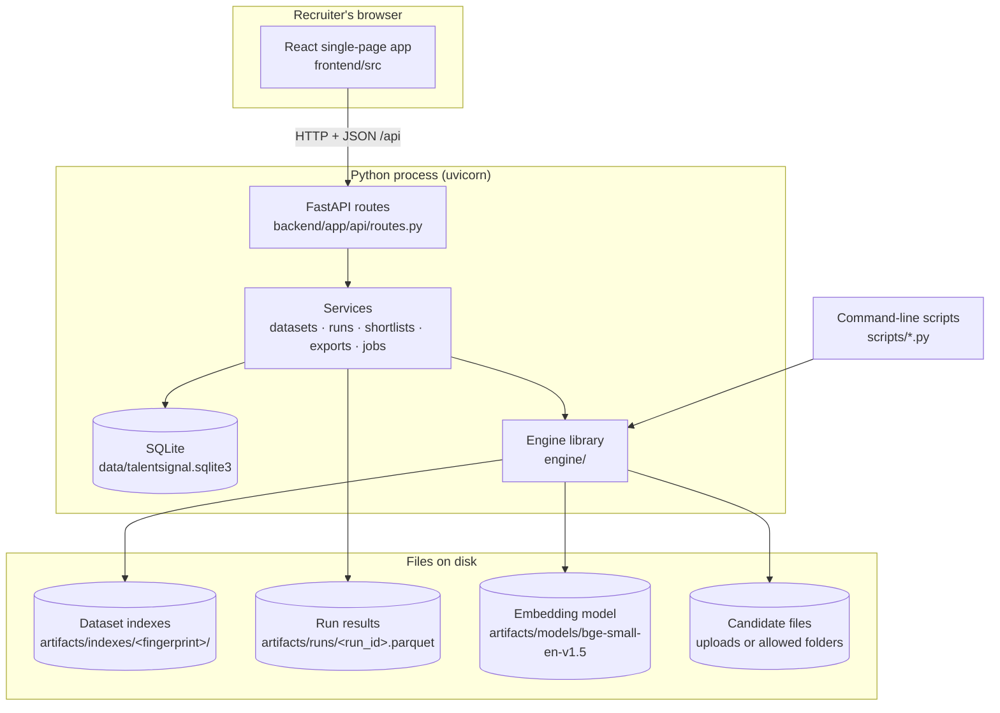
<p class="caption">Figure 2.1 - Overall architecture. Boxes are components; cylinders are stored data. Arrows point from the caller to what it uses.</p>

Read the figure from top to bottom. The browser only ever talks to the API over HTTP. The API delegates all real work to *services*. Services store small structured facts (who ran what, when) in SQLite, and call the engine for heavy work. The engine reads candidate files, writes and reads indexes, and loads the embedding model. Command-line scripts bypass the web entirely and call the engine directly.

## Each component: responsibility, inputs, outputs

| Component | Key files | Input | Output | Talks to |
|---|---|---|---|---|
| React app | `frontend/src/App.tsx`, `pages/*.tsx` | User clicks, typed JD text, uploaded files | Pages; HTTP requests | Backend API only |
| API routes | `backend/app/api/routes.py` | HTTP requests with `X-Session-Id` | JSON responses, files | Services |
| Dataset service | `backend/app/services/datasets.py` | Uploaded file stream or a server path | Dataset record; background index job | Engine (`build_index`), SQLite |
| Run service | `backend/app/services/runs.py` | Dataset id, `JobSpec`, shortlist size | Run record; result table (Parquet); explanations | Engine (`score_pool`, `explain_candidate`), SQLite |
| Export service | `backend/app/services/exports.py` | Run id, format | CSV / XLSX / JSON / JSONL / Parquet / PDF bytes | Run service, engine competition module |
| Job manager | `backend/app/services/jobs.py` | A function to run in the background | Job record with progress and status | SQLite |
| Database | `backend/app/database/db.py` | SQL statements | Rows | File `data/talentsignal.sqlite3` |
| Ingestion | `engine/ingestion/*.py` | A candidate file (JSONL, JSON, CSV, XLSX, Parquet) | Normalised records + validation issues | - |
| Index builder | `engine/preprocessing/index.py` | Candidate file | Index directory (tables, BM25, embeddings, quality report) | Ingestion, integrity, retrieval |
| JD parser | `engine/jd/parser.py` | JD text | `JobSpec` (editable requirements and settings) | Taxonomy |
| Scorer | `engine/ranking/scorer.py` | Index + `JobSpec` | `ScoredPool` (every candidate scored and ordered) | Features, retrieval |
| Explainer | `engine/explanations/explain.py` | Scored pool + candidate id | Explanation dictionary | Validator |

## How the components interact

The next diagram shows *which code calls which code* inside the Python process. It is a dependency picture: an arrow from A to B means "A imports or calls B".

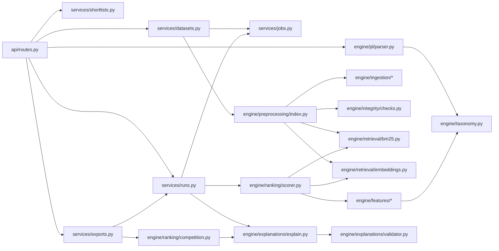
<p class="caption">Figure 2.2 - Component interaction (import/call dependencies). Backend modules are on the left, engine modules on the right. No engine module points back to the backend.</p>

## How the frontend talks to the backend

The frontend and backend communicate only through **HTTP requests that carry JSON**. Every request includes a header named `X-Session-Id` containing a random identifier the browser generated the first time it opened the app (stored in the browser's `localStorage`). The backend uses that identifier to keep each browser's runs and shortlists separate. It is *not* a login system - Part 10 explains why that matters.

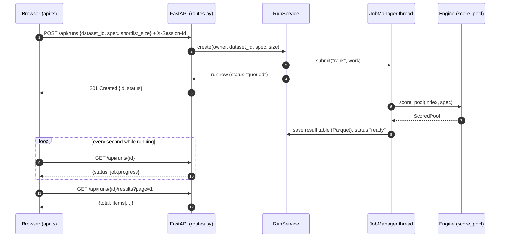
<p class="caption">Figure 2.3 - Frontend-to-backend communication when the recruiter starts a ranking. The request returns immediately; the heavy work happens in a background thread while the browser polls for progress.</p>

The key idea is **asynchronous work**. Scoring 100,000 candidates takes a few seconds; building an index takes about two minutes. A web request should not hang that long, so the backend answers immediately with a run whose status is `queued`, does the work in a background thread, and the browser asks for the status once a second (*polling*) until it becomes `ready`.

## The complete request lifecycle

What happens, step by step, when the browser asks for one page of results? This is the most frequent request in the application.

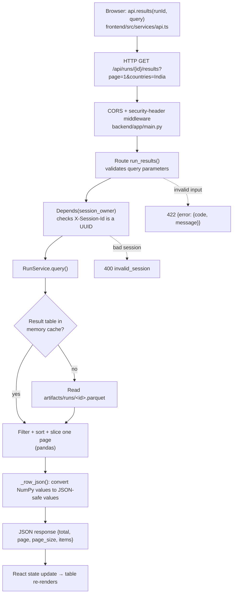
<p class="caption">Figure 2.4 - Lifecycle of a results request. Dotted arrows are error paths; every error returns the same JSON shape.</p>

## How candidate data flows through the system

A candidate file travels a long way before a recruiter sees a ranked row. The next diagram follows one file from upload to screen.

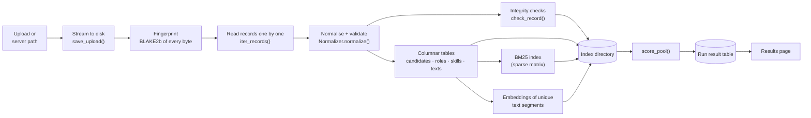
<p class="caption">Figure 2.5 - Candidate data flow. Everything left of the index directory happens once per file; everything right of it happens once per ranking run.</p>

The split in Figure 2.5 is the **precompute / rank** pattern. Expensive work that does not depend on the job (parsing, cleaning, tokenising, embedding) happens once per candidate file and is saved. Work that depends on the job (scoring) is cheap because it reuses that saved work. On the reference machine, the one-time index build took **137 seconds**; scoring the same 100,000 candidates against a job takes about **2.9 seconds**.

## The ranking pipeline at a glance

Part 6 explains every box in detail. Here is the overview.

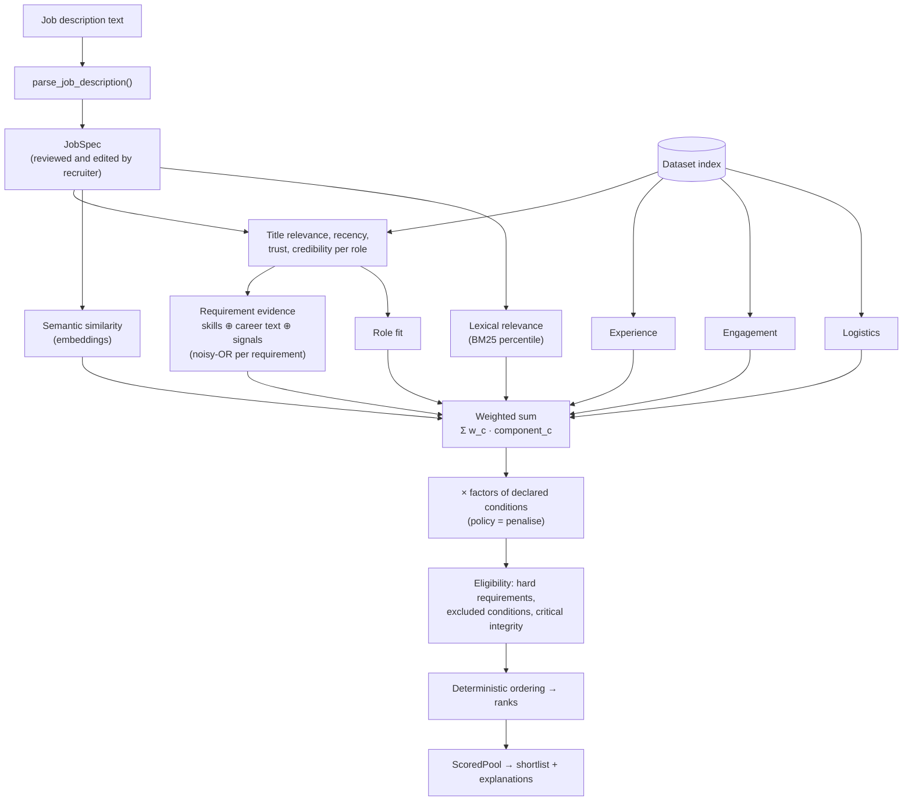
<p class="caption">Figure 2.6 - Ranking pipeline overview. Seven components are computed for every candidate, combined by a weighted sum, adjusted by declared policies, filtered for eligibility, then ordered.</p>

## Where data is stored, and why in different places

TalentSignal uses three kinds of storage, each chosen for what it holds:

| Storage | What it holds | Why this kind |
|---|---|---|
| SQLite database (`data/talentsignal.sqlite3`) | Datasets, jobs, runs, shortlists, activity - small structured records | Relationships (a shortlist belongs to a run), transactions, zero setup |
| Index directory (`artifacts/indexes/<fingerprint>/`) | Normalised records, Parquet tables, BM25 matrix, embeddings, quality report | Large numeric/columnar data read in bulk by NumPy and pandas |
| Run results (`artifacts/runs/<run_id>.parquet`) | One row per shortlisted (or held) candidate with all component scores | Fast columnar filtering and sorting of up to ~100,000 rows |

The index directory is named after the **fingerprint** of the candidate file - a hash of every byte. Two consequences follow: an identical file is never indexed twice, and a file that changed even by one byte gets a new index instead of silently reusing a stale one.

## How exports fit in

Exports are produced on demand from the run's result table: CSV, XLSX, JSON, JSONL and Parquet copy rows; the PDF report adds explanation summaries for the top candidates; the *competition* export produces exactly 100 rows in the original challenge format and validates them before returning. Part 11 traces an export end to end, and Book 2 documents each format.

!!! note "Summary of Part 2"
    Three layers (frontend, backend, engine) with a strict rule that the engine is a plain library. Communication is HTTP + JSON with a session header. Heavy work runs in background jobs while the browser polls. Data is processed once per file (index) and cheaply per job (scoring). Storage is split by purpose: SQLite for records, Parquet/NumPy files for bulk data.


# Programming Foundations for Reading the Code

This part teaches the programming ideas you need to read TalentSignal's source. It is not a general programming course: every concept is introduced because the project uses it, and every example is either taken from the project or written in its style. If you already program in Python and TypeScript, skim the tables and move on.

## Python in five minutes: values, variables and functions

A *program* is a list of instructions. Python executes them top to bottom. A **variable** is a name for a value; a **function** is a named, reusable block of instructions that takes inputs (*parameters*) and returns an output.

```python
# runnable
def notice_fit(notice_days, ideal_max=30):
    """Return 1.0 when the notice period is within the ideal, less otherwise."""
    if notice_days <= ideal_max:
        return 1.0
    return 0.7

print(notice_fit(15))   # 1.0
print(notice_fit(90))   # 0.7
```

The real `notice_fit` in `engine/features/signals.py` is more detailed (it decays smoothly and works on thousands of candidates at once), but the shape is the same: inputs in, a number between 0 and 1 out. Most of TalentSignal's scoring is built from small functions like this.

!!! tip "Docstrings"
    The text in triple quotes right under `def` is a *docstring* - documentation attached to the function. TalentSignal uses docstrings heavily to explain *why* code exists; read them first when you open a file.

## Type hints

Python does not require you to declare types, but you may *annotate* them. These **type hints** are not enforced at run time; they document intent and let tools catch mistakes.

```python
def title_relevance(title: str, spec: "JobSpec", tax: "Taxonomy") -> float:
    ...
```

Read this as: "`title_relevance` takes a string, a `JobSpec` and a `Taxonomy`, and returns a float". You will also see `list[str]` (a list of strings), `dict[str, float]` (a dictionary from strings to floats), `str | None` (a string or nothing), and `np.ndarray` (a NumPy array).

## The four core data structures

| Structure | Python syntax | Ordered? | Mutable? | Lookup by | Used in TalentSignal for |
|---|---|---|---|---|---|
| list | `[1, 2, 3]` | yes | yes | position | career history roles, requirement lists |
| tuple | `(1, 2)` | yes | no | position | fixed pairs such as `(lo, hi)` calibration bounds |
| dict | `{"a": 1}` | insertion order | yes | key | a candidate record, JSON objects, lookup tables |
| set | `{"a", "b"}` | no | yes | membership | "which skills does the requirement accept?" |

The most important is the **dictionary** (often called a *hash map*). Looking up a key is fast regardless of size because Python computes a *hash* of the key and jumps almost directly to it. TalentSignal uses this constantly, for example `DatasetIndex.id_to_idx` maps each candidate ID to its row number so a candidate can be found among 100,000 in constant time.

```python
# runnable
skills = [{"name": "Python", "proficiency": "expert"}, {"name": "FAISS", "proficiency": "advanced"}]
wanted = {"faiss", "pinecone", "milvus"}            # a set: fast membership tests
matches = [s for s in skills if s["name"].lower() in wanted]
print(matches)                                        # [{'name': 'FAISS', 'proficiency': 'advanced'}]
```

The last line before `print` is a **list comprehension**: "make a list of `s` for each `s` in `skills` where the condition holds". You will see comprehensions everywhere in the code.

## Classes and objects

A **class** is a blueprint that bundles data (*attributes*) with functions that act on it (*methods*). An **object** is one instance built from the blueprint. TalentSignal uses classes for things that hold state:

- `DatasetIndex` (`engine/preprocessing/store.py`) holds the path of an index and lazily loads its tables.
- `BM25Index` (`engine/retrieval/bm25.py`) holds a sparse matrix and knows how to score a query.
- `JobManager` (`backend/app/services/jobs.py`) holds a thread pool and the cancel flags of running jobs.

Two special kinds of class appear often:

- **Dataclasses** (`@dataclass`) automatically generate the boring parts of a class from field declarations. `ScoredPool` and `RoleContext` in the engine are dataclasses: they are mostly containers of arrays.
- **Pydantic models** (classes that inherit from `BaseModel`) add *validation*: when you build one, every field is checked against its declared type and constraints. `JobSpec` and `Requirement` (`engine/jd/spec.py`) are Pydantic models, so a weight of 7 or a negative minimum coverage is rejected automatically.

```python
from pydantic import BaseModel, Field

class Requirement(BaseModel):            # excerpt (simplified from engine/jd/spec.py)
    id: str
    label: str
    importance: str = "preferred"
    weight: float = Field(1.0, ge=0.0, le=1.0)   # must lie between 0 and 1
```

## Modules and packages

A **module** is one `.py` file; a **package** is a folder of modules with an `__init__.py` file. `import` brings code from one module into another:

```python
from engine.ranking.scorer import score_pool       # function score_pool from engine/ranking/scorer.py
```

The dotted path mirrors the folder path. The backend adds the project root to Python's search path at start-up (`backend/app/main.py`) precisely so that `import engine` works.

## JSON and JSONL

**JSON** (JavaScript Object Notation) is a text format for structured data: objects in `{}`, arrays in `[]`, strings in double quotes, numbers, `true`/`false`, and `null`. It maps directly onto Python dicts, lists, strings, numbers, booleans and `None`.

**JSONL** (JSON Lines) puts one JSON object on each line. The reference candidate file is JSONL: 100,000 lines, one candidate per line. JSONL matters for scale: you can read **one line at a time** without loading the whole 465 MB file into memory. A normal JSON array cannot be read that way - you have to parse it whole.

```python
# runnable
import io, json
jsonl = io.StringIO('{"candidate_id": "CAND_0000001"}\n{"candidate_id": "CAND_0000002"}\n')
for line in jsonl:                      # one line at a time: memory use stays small
    record = json.loads(line)
    print(record["candidate_id"])
```

TalentSignal uses the faster `orjson` library instead of the standard `json` module, but the idea is identical (`engine/ingestion/readers.py`).

## Files and streaming

Opening a file and iterating over it yields one line at a time. For binary data (uploads, hashing) the code reads fixed-size *chunks*:

```python
import hashlib

def file_fingerprint(path):                         # excerpt (engine/ingestion/fingerprint.py, simplified)
    h = hashlib.blake2b(digest_size=20)
    with open(path, "rb") as f:                     # "rb" = read bytes
        for chunk in iter(lambda: f.read(4 * 1024 * 1024), b""):   # 4 MB at a time
            h.update(chunk)
    return h.hexdigest()
```

The `with` statement guarantees the file is closed even if an error happens. `iter(callable, sentinel)` keeps calling `f.read(...)` until it returns the empty bytes `b""` (end of file).

## Exceptions and error handling

When something goes wrong Python *raises* an **exception**. Code can *catch* it with `try`/`except` and respond. TalentSignal follows two rules:

1. **Never hide failures.** For example, when the embedding model fails to load, `get_embedder` records the error in `last_error` and logs it instead of silently returning nothing (this was added after a real silent failure; see the development log).
2. **Convert internal errors to clear user messages.** The backend defines `AppError(status, code, message)` in `backend/app/core/errors.py`; every service raises it for expected problems (file too large, dataset not ready), and a single handler turns it into the JSON `{"error": {"code", "message"}}`.

```python
# runnable
class AppError(Exception):
    def __init__(self, status, code, message):
        super().__init__(message)
        self.status, self.code, self.message = status, code, message

def check_size(n_bytes, limit):
    if n_bytes > limit:
        raise AppError(413, "file_too_large", f"File exceeds the {limit} byte limit.")

try:
    check_size(5_000, 1_000)
except AppError as e:
    print(e.status, e.code, e.message)
```

## NumPy: thinking in whole columns

NumPy is the library that makes scoring 100,000 candidates take seconds rather than hours. Its central idea is **vectorisation**: instead of looping over candidates one by one in Python, you write one expression that operates on whole arrays at once, and NumPy runs the loop in fast compiled code.

```python
# runnable
import numpy as np
years = np.array([2.0, 6.5, 12.0])              # three candidates
in_band = (years >= 5) & (years <= 9)            # element-wise comparison -> [False True False]
score = np.where(in_band, 1.0, 0.5)              # pick 1.0 where in band, else 0.5
print(score)                                     # [0.5 1.  0.5]
```

Almost every function in `engine/features/` works this way. When you read them, imagine each variable as a whole column of a spreadsheet, not a single number.

**pandas** builds on NumPy with *DataFrames* - tables with named columns (like a spreadsheet in memory). TalentSignal stores candidates, roles and skills as DataFrames saved in **Parquet**, a compact columnar file format.

## APIs, HTTP and REST

An **API** (Application Programming Interface) is a defined way for one program to ask another for something. A **web API** does this over **HTTP**, the protocol browsers use. Every HTTP request has:

| Part | Example in TalentSignal |
|---|---|
| Method (verb) | `GET` (read), `POST` (create/act), `DELETE` (remove) |
| URL path | `/api/runs/3f2a.../results` |
| Query parameters | `?page=2&countries=India` |
| Headers | `X-Session-Id: 6d1c...` , `Content-Type: application/json` |
| Body (optional) | `{"dataset_id": "...", "spec": {...}, "shortlist_size": 100}` |

The response carries a **status code** (`200` OK, `201` Created, `204` No Content, `400` bad request, `404` not found, `409` conflict, `413` too large, `415` unsupported type, `422` invalid input, `500` server error) and usually a JSON body.

**REST** (Representational State Transfer) is a style of designing web APIs around *resources* named by URLs: `/api/runs` is the collection of runs, `/api/runs/{id}` one run, `/api/runs/{id}/results` that run's results. TalentSignal follows this style, with a few action endpoints such as `POST /api/runs/{id}/compare` where an action does not fit neatly into create/read/delete.

**FastAPI** is the Python framework that turns decorated functions into endpoints:

```python
@router.get("/runs/{run_id}")                       # excerpt (backend/app/api/routes.py)
def get_run(request: Request, owner: Owner, run_id: str):
    return services(request).runs.get(run_id, owner)
```

FastAPI reads the type hints to validate inputs and converts the returned dict to JSON.

## SQL and relational databases

A **relational database** stores data in **tables** of rows and columns. **SQL** (Structured Query Language) asks questions of those tables. TalentSignal uses **SQLite**, a database that lives in a single file and needs no server.

```sql
SELECT id, name, status FROM datasets WHERE owner IS NULL OR owner = ? ORDER BY created_at DESC;
```

Key ideas used in the project:

- **Primary key** - a column whose value uniquely identifies a row (`id`).
- **Foreign key** - a column that refers to another table's primary key (`runs.dataset_id` → `datasets.id`). With `ON DELETE CASCADE`, deleting a dataset automatically deletes its runs.
- **Parameterised queries** - the `?` placeholders. Values are passed separately, never pasted into the SQL text, which prevents *SQL injection* attacks.
- **Transactions** - a group of changes that either all happen or none happen.

Book 2, Part 5 shows the full schema and an entity-relationship diagram.

## Asynchronous work and background jobs

Some work takes a long time. If the web server did it *inside* the request, the browser would wait (and might time out). TalentSignal therefore:

1. Responds to the request immediately with a job or run whose status is `queued`.
2. Runs the work in a **background thread** managed by `JobManager` (a *thread* is a second line of execution inside the same program).
3. Lets the browser **poll** - ask again every second - until the status is `ready`.

In the frontend you will also see `async`/`await`: a function marked `async` can pause at `await` while waiting for a network response without freezing the page.

## React fundamentals

**React** is a JavaScript library for building user interfaces from **components** - functions that return a description of what should appear on screen. Components receive inputs called **props** and keep private **state**. When state changes, React re-runs the component and updates the page.

```tsx
function RankPill({ rank }: { rank: number }) {          // excerpt (frontend/src/components/ui.tsx)
  if (!rank) return <span className="rank-pill" title="Held for review">-</span>;
  return <span className={`rank-pill ${rank <= 10 ? "top" : ""}`}>{rank}</span>;
}
```

The syntax mixing HTML-like tags and code is **JSX**. `className` is HTML's `class`. Curly braces `{...}` insert JavaScript values.

Two React **hooks** appear everywhere:

- `useState` - remember a value between renders (`const [page, setPage] = useState(1)`).
- `useEffect` - run code after rendering, for example to fetch data when the page number changes.

TalentSignal wraps data loading in its own hook, `useAsync` (`frontend/src/hooks/useAsync.ts`), which returns `{data, error, loading, reload}` so every page handles loading and error states the same way.

## TypeScript fundamentals

**TypeScript** is JavaScript with types. The compiler checks that, for example, a `ResultRow` really has an `overall` number before the code ever runs. All the shapes of data returned by the API are declared in one file, `frontend/src/types/api.ts`:

```ts
export interface ResultRow {        // excerpt
  rank: number;
  candidate_id: string;
  overall: number;
  relevant_skills: string[];
  flag_codes: string[];
}
```

If the backend renamed `overall`, the TypeScript build would fail everywhere the old name is used - a cheap, early warning.

## State management in this project

"State management" means deciding where data lives in the frontend and who may change it. TalentSignal deliberately keeps it simple:

| State | Where it lives | Example |
|---|---|---|
| Server data | fetched per page with `useAsync`, kept in component state | the run, one page of results |
| UI choices | `useState` in the page | current filters, table vs card layout, selected rows |
| Session identity | browser `localStorage` | `talentsignal.session` |
| Cross-page refresh signal | a tiny event bus (`bus.emit("runs")`) | the sidebar reloads recent runs after a new run |

There is no global store library (such as Redux) because no data needs to be shared across many unrelated components. That is a deliberate simplicity choice; Book 2 discusses when it would change.

## Virtual environments and dependencies

A **dependency** is someone else's code your project uses (NumPy, FastAPI, React). Projects pin exact versions so they behave the same on every machine:

- Python dependencies: `requirements.txt` (runtime) and `requirements-dev.txt` (tests and tools).
- JavaScript dependencies: `frontend/package.json` (and the exact resolved tree in `package-lock.json`).

A **virtual environment** (`.venv/`) is a private folder of Python packages for one project, so different projects cannot break each other. JavaScript's equivalent is the `node_modules/` folder. Both are excluded from version control and recreated from the pinned files.

!!! note "Check yourself"
    You should now be able to read a line such as `wanted = [vocab[s.lower()] for s in req.skills if s.lower() in vocab]` (a list comprehension over a requirement's skills, looking each up in a dictionary) and `np.where(arg >= 0, rows[arg], -1)` (an element-wise choice across a whole array). If either is unclear, re-read the data-structure and NumPy sections.


# Understanding Candidate Data

Ranking can only be as good as the data it reads. This part explains what a candidate record contains, how TalentSignal reads and repairs it, and how raw fields become the *features* the scorer uses.

## The candidate record

The reference dataset (`reference material/candidates.jsonl`) contains 100,000 records that follow `candidate_schema.json`. Each record is one JSON object with these top-level parts:

| Part | Type | What it holds |
|---|---|---|
| `candidate_id` | string | Unique identifier, format `CAND_` + 7 digits in the reference data |
| `profile` | object | Name, headline, summary, location, country, years of experience, current title/company/industry |
| `career_history` | list of objects | One entry per job: company, title, dates, duration in months, whether current, industry, description |
| `education` | list | Institution, degree, field of study, years, grade, institution *tier* |
| `skills` | list | Name, self-reported proficiency (beginner/intermediate/advanced/expert), endorsements, months used |
| `certifications` | list | Name, issuer, year |
| `languages` | list | Language and proficiency |
| `redrob_signals` | object | 23 behavioural signals from the platform (see below) |

Here is a real record from the dataset, shortened with `...` where text was cut. The names in the dataset are already synthetic ("anonymized_name").

```json
{
  "candidate_id": "CAND_0000001",
  "profile": {
    "anonymized_name": "Ira Vora",
    "headline": "Backend Engineer | SQL, Spark, Cloud",
    "summary": "Software / data professional with 6.9 years of experience building data pipelines ...",
    "location": "Toronto", "country": "Canada", "years_of_experience": 6.9,
    "current_title": "Backend Engineer", "current_company": "Mindtree",
    "current_company_size": "10001+", "current_industry": "IT Services"
  },
  "career_history": [
    {"company": "Mindtree", "title": "Backend Engineer", "start_date": "2024-03-08", "end_date": null,
     "duration_months": 27, "is_current": true, "industry": "IT Services", "company_size": "10001+",
     "description": "Implemented streaming data pipelines on Kafka and Spark Streaming ..."},
    {"company": "Dunder Mifflin", "title": "Analytics Engineer", "start_date": "2019-07-03",
     "end_date": "2024-01-08", "duration_months": 55, "is_current": false, "...": "..."}
  ],
  "skills": [{"name": "SQL", "proficiency": "advanced", "endorsements": 12, "duration_months": 40}, "..."],
  "redrob_signals": {"last_active_date": "2026-04-30", "recruiter_response_rate": 0.62, "...": "..."}
}
```

## Field by field: what the ranking uses

Not every field is used for ranking, and some are deliberately excluded. This table is the authoritative summary (verified against `engine/ranking/scorer.py` and `engine/features/*.py`).

| Field | Used for | Notes |
|---|---|---|
| `profile.current_title` | Role fit, seniority, title trust | Mapped to a *role family* by `taxonomy.yaml` patterns |
| `career_history[].title` | Career relevance, trust of each role's description | Every role counts, weighted by months and recency |
| `career_history[].description` | Text evidence (phrases + embeddings), holistic semantic match | Trusted in proportion to the role title's relevance |
| `career_history[].duration_months`, dates | Relevant years, recency, integrity checks | Missing months default to 12 for weighting |
| `profile.years_of_experience` | Experience band fit; integrity check | Missing → neutral |
| `profile.summary`, `headline` | Text evidence at reduced weight (0.6 × credibility) | Self-description, not a work record |
| `skills[]` | Skill evidence | Best matching skill only (no summing) |
| `redrob_signals.skill_assessment_scores` | Blended into skill evidence (50/50) | Platform-verified evidence |
| Engagement signals | Engagement component | See next section |
| `profile.location`, `country`, `willing_to_relocate` | Location fit; work-authorization condition | Only as the job states |
| `education[].field_of_study` | Displayed, filterable ("academic branch") | **Not scored** |
| `education[].tier` | Nothing | **Never used** - institution prestige is excluded |
| `profile.anonymized_name` | Display only | Never a feature |
| `languages`, `certifications` | Display only | Not part of any score component |

!!! note "What goes into the keyword index"
    The index builder (`engine/preprocessing/index.py`) adds the *headline, summary, role titles, role descriptions, current title and skill names* to the BM25 documents. Certifications and languages are stored for display (`candidates.parquet` column `certifications`) but are **not** part of the lexical index or any score.

## The 23 platform signals

The `redrob_signals` object contains behaviour recorded by the recruiting platform. The table shows each signal, its range and whether TalentSignal scores it.

| Signal | Range | Used in score? | How |
|---|---|---|---|
| `last_active_date` | date | Yes (engagement) | Half-life decay of 90 days from the dataset's as-of date |
| `recruiter_response_rate` | 0-1 | Yes (engagement) | Used directly |
| `avg_response_time_hours` | ≥ 0 | Yes (engagement) | \(1/(1 + h/48)\) |
| `open_to_work_flag` | bool | Yes (engagement) | Open = 1.0, not open = 0.4 |
| `interview_completion_rate` | 0-1 | Yes (engagement) | Used directly |
| `offer_acceptance_rate` | -1 or 0-1 | Yes (engagement, small) | -1 means "no offers yet" → treated as missing |
| `saved_by_recruiters_30d` | ≥ 0 | Yes (engagement, 5% share) | \(1 - e^{-x/5}\) |
| `skill_assessment_scores` | dict skill → 0-100 | Yes (skill evidence) | Blended with self-reported claim |
| `github_activity_score` | -1 or 0-100 | Only for an open-source requirement | -1 means not linked → missing |
| `notice_period_days` | 0-180 | Yes (logistics) | Piecewise decay |
| `preferred_work_mode` | onsite/hybrid/remote/flexible | Yes (logistics) | Compared to the job's mode |
| `willing_to_relocate` | bool | Yes (logistics; work-authorization) | |
| `verified_email`, `verified_phone`, `linkedin_connected`, `profile_completeness_score` | bool / 0-100 | No - shown as *evidence completeness* | Not a quality signal of the person |
| `signup_date` | date | No - data-quality check only | |
| `profile_views_received_30d`, `search_appearance_30d`, `applications_submitted_30d`, `connection_count`, `endorsements_received` | counts | No | Popularity or volume, not fit |
| `expected_salary_range_inr_lpa` | min/max | No | A negotiation matter, and 18.9% of records have min > max |

Why are popularity signals excluded? If being viewed often made you rank higher, ranking higher would make you viewed more often - a *feedback loop* that entrenches early luck. The only popularity-like signal kept (`saved_by_recruiters_30d`) has a 5% share of the engagement component, which itself has an 11% share of the total.

## What the reference data actually looks like

These facts were measured on the full file during the audit (Book 2, Part 9 shows how to reproduce them):

| Measurement | Value |
|---|---|
| Records | 100,000 (no duplicate IDs, all 23 signals present) |
| File size | 465 MB (487,259,903 bytes) |
| Distinct job titles | 48 |
| Distinct skill names | 133 |
| Career roles | 300,171 |
| **Distinct role descriptions** | **44** |
| Distinct summaries / headlines | 3,241 / 2,469 |
| Current titles that are non-technical | 68.8% |
| Current titles directly in ML/AI/search | 1,179 (1.2%) |
| Candidates outside India | 24.9% |
| GitHub not linked / no offer history | 64.6% / 59.6% |
| Salary minimum above maximum | 18,865 records |
| Last activity before sign-up | 7,496 records |

Two observations shaped the design:

1. **The data is synthetic and heavily templated.** Only 44 different role descriptions are reused across 300,171 roles. TalentSignal exploits this for speed (it processes each *unique* text once) without depending on it for correctness.
2. **Descriptions attached to non-technical titles come from an unrelated pool.** A "HR Manager" role may carry a description about sales or support. This is why description evidence is weighted by how believable the title makes it.

## Raw data, processed data and features

These three words describe three stages. Confusing them causes most data bugs.

| Stage | Definition | Example | Where |
|---|---|---|---|
| **Raw data** | Exactly what was in the file | `"github_activity_score": -1`, `"recruiter_response_rate": "0.7"` (a string in a CSV) | The uploaded file |
| **Processed data** | Cleaned, typed, validated, repaired | `github_activity_score: None` (missing), `recruiter_response_rate: 0.7` (a float) | `records.jsonl` and Parquet tables in the index |
| **Features** | Numbers computed *for a specific job* that the scorer combines | title relevance 1.0, requirement coverage 0.93, engagement 0.87 | Computed by `score_pool` for each run |

Raw and processed data do not depend on the job description; features do. That is exactly the split between the one-time index build and the per-job scoring.

## The ingestion pipeline

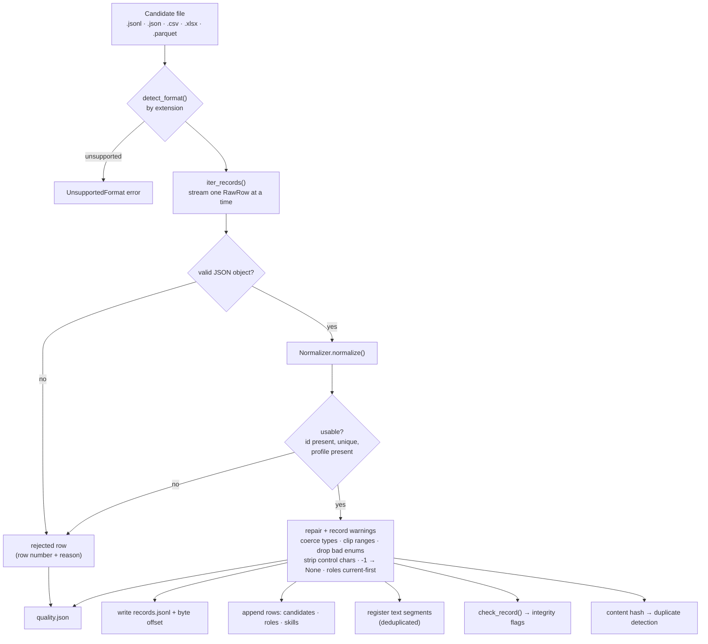
<p class="caption">Figure 4.1 - Ingestion pipeline (engine/ingestion and the first half of engine/preprocessing/index.py). Rejected rows never stop the build; they are counted and listed in the quality report.</p>

### Step 1 - streaming readers

`iter_records(path)` in `engine/ingestion/readers.py` chooses a reader by file extension and yields one `RawRow(row, record, error)` at a time.

| Format | How it is read | Notes |
|---|---|---|
| JSONL / NDJSON / TXT | line by line | Fully streamed: memory does not grow with file size |
| JSON | parsed whole | A JSON array cannot be streamed with the standard parser, so it is capped at 512 MB and the error message suggests JSONL |
| CSV | row by row | Nested fields either as dotted columns (`profile.headline`) or as JSON text in a cell (`skills`) |
| XLSX | row by row (openpyxl read-only mode) | Same column conventions as CSV |
| Parquet | in batches of 2,048 rows | Nested columns or JSON text |

The conversion of flat rows back into nested objects is done by `unflatten()`: a column `profile.headline` becomes `record["profile"]["headline"]`, and a cell whose text starts with `[` or `{` is parsed as JSON.

### Step 2 - normalisation and validation

`Normalizer.normalize()` in `engine/ingestion/validation.py` follows one philosophy: **reject only what cannot be used; repair and report everything else.**

A record is **rejected** only if it is not an object, has no usable `candidate_id` (1-64 characters of letters, digits, `_ . -`), repeats an ID already seen in the file, or has no `profile` object. Everything else is repaired with a *warning*:

- strings such as `"0.7"` or `"yes"` are converted to numbers and booleans;
- values outside the documented range are clipped (a response rate of 1.7 becomes 1.0);
- unknown enumeration values (such as an invalid work mode) become `None`;
- control characters are stripped and long text is capped (6,000 characters);
- roles are reordered so the current role comes first, then past roles newest first;
- the documented sentinel `-1` for `github_activity_score` and `offer_acceptance_rate` becomes `None`.

### Step 3 - missing data stays missing

This is one of the most important rules in the project. **A missing value is stored as `None`, never as 0.** Later, every sub-score that combines several signals uses a *missing-aware weighted mean*:

\[
\text{combined} = \frac{\sum_k w_k\, x_k\, a_k}{\sum_k w_k\, a_k}, \qquad a_k = \begin{cases}1 & \text{if } x_k \text{ is available}\\ 0 & \text{if missing}\end{cases}
\]

Here \(w_k\) is the weight of sub-signal \(k\), \(x_k\) its value, and \(a_k\) an availability indicator. A missing signal simply drops out of both the numerator and the denominator, so it neither helps nor hurts. If *nothing* is available the result is 0.5 - "no information". Part 6 gives a numerical example, and Part 7 shows it in action for a candidate with no offer history.

!!! example "Why not fill missing values with 0?"
    64.6% of candidates have no GitHub account linked. If "no GitHub" counted as an activity score of 0, two-thirds of the pool would be penalised for something that says nothing about their ability - and the penalty would fall hardest on people who work on closed-source products. Treating it as unknown avoids that unfairness.

### Step 4 - the quality report

Every index build writes `quality.json`: rows read, valid and rejected (with the first 25 reasons), counts of each repair, the missing rate of every signal, integrity counts by severity, duplicates, unique text segments, top titles, countries and an experience histogram. The Datasets page in the UI renders it, so a recruiter can judge a dataset before trusting its rankings.

## From one record to several tables

The index builder splits each record into rows of separate tables, because the scorer needs to process all roles (or all skills) of all candidates at once.

| Table | One row per | Key columns |
|---|---|---|
| `candidates.parquet` | candidate | `idx`, `candidate_id`, `name`, `title`, `company`, `city`, `country`, `years_experience`, `fields_of_study`, `skills` (pipe-joined), `headline_tid`, `summary_tid`, and every signal as `sig_<name>` |
| `roles.parquet` | career role | `idx` (owner), `order` (0 = current), `title`, `company`, `industry`, `start_date`, `end_date`, `months`, `is_current`, `text_id` (description) |
| `skills.parquet` | (candidate, skill) | `idx`, `skill`, `proficiency`, `level` (0.25-1.0), `months`, `endorsements`, `assessed` (score or NaN) |
| `texts.parquet` | unique text segment | `text`, `kind` (headline / summary / title / description / skill) |
| `integrity.parquet` | integrity finding | `idx`, `code`, `severity`, `title`, `detail`, `evidence` |

`idx` is the candidate's row number (0 to n-1); it links all tables together and is how NumPy arrays are indexed. `text_id` and the `*_tid` columns point into `texts.parquet`, which is the key to the unique-segment optimisation explained in Part 9.

## Data quality issues found, and how each is treated

| Issue (count in reference data) | Treatment |
|---|---|
| Expert skills with 0 months of use (21 candidates with 2+) | Critical integrity finding → held for human review |
| Stated years differ from summed role months by > 3 years (47) | Critical integrity finding → held for human review |
| Assessment for a skill not listed (36) | Warning, shown on the profile |
| Salary min > max (18,865) | Info only - salary is not used |
| Last activity before sign-up (7,496) | Info only |
| Missing GitHub / offer history | Missing, neutral |
| Non-tech title with five or more AI skills (4,179) | No flag by itself; skill credibility halves their skill evidence, and a JD-specific "uncorroborated skills" warning appears when 4+ job skills are claimed with no related role |

Part 8 explains the integrity checks and their severities in detail.


# Job Description Intelligence

The ranking can only be as good as its understanding of the job. This part explains how TalentSignal turns free text into a structured, editable **JobSpec**, and how each part of that JobSpec later influences the score.

## Why a structured representation

A scorer cannot "read" prose. It needs concrete answers: *which capabilities, how important, what experience band, where, how soon, what must be avoided?* TalentSignal's answer is the `JobSpec` class (`engine/jd/spec.py`), a Pydantic model with these parts:

| Field | Type | Meaning |
|---|---|---|
| `title` | str | Role title, e.g. "Senior AI Engineer - Founding Team" |
| `seniority_level` | int | 0 intern … 5 principal/director; 2 if the title has no seniority word |
| `role_families` | dict family → weight | Which kinds of job titles count as relevant (e.g. `ml_engineering: 1.0`) |
| `responsibilities` | list[str] | Lines from the "what you'll do" section |
| `requirements` | list[Requirement] | Each capability: label, skills, phrases, semantic sentence, importance, weight, hard flag, minimum coverage, **source sentence** |
| `experience` | ExperienceSpec | min/max years, ideal band, relevant-years target, hard minimum flag |
| `location` | LocationSpec | preferred and acceptable cities, countries, work mode, relocation, visa sponsorship |
| `notice` | NoticeSpec | ideal and acceptable notice days |
| `constraints` | list[ConstraintSpec] | Declared conditions (e.g. consulting-only careers) with a **policy** and factor |
| `weights` | ComponentWeights | Relative influence of the seven score components |
| `integrity_policy` | "exclude" / "flag" | What happens to critical integrity findings |
| `as_of_date` | date or None | Reference date for recency (default: newest activity date in the dataset) |
| `focus_text` | str | Text compared semantically with candidate work descriptions |
| `extraction_notes` | list[str] | Warnings from the parser, e.g. "no must-have section found" |

The same model is used by the parser (to create it), the UI (to edit it, as JSON), the API (to validate it) and the scorer (to read it). Because it is a Pydantic model, an invalid edit - a weight of 3, a duplicate requirement id - is rejected before any scoring happens.

## The knowledge base: concepts and role families

The parser recognises capabilities through a knowledge base, `engine/resources/taxonomy.yaml`, loaded by `engine/taxonomy.py`. It contains three things:

1. **Concepts** - about 25 capabilities. Each has a label, a list of **skills** (names that appear in skill lists), a list of **phrases** (words that appear in prose), and a one-sentence **semantic** description used by the embedding model.
2. **Role families** - groups of job titles recognised by ordered regular-expression patterns (`search_ranking`, `ml_engineering`, `data_science`, `backend`, … `non_technical`). The first matching pattern wins, so "Senior Software Engineer (ML)" is matched by the ML pattern before the generic software one.
3. **Family affinity** - a symmetric table saying how transferable experience in one family is to another (same family 1.0; ML ↔ search 0.9; backend ↔ ML 0.35; anything ↔ non-technical 0).

An excerpt of one concept:

```yaml
vector_search_infra:
  label: Vector databases / hybrid search infrastructure
  skills: [Pinecone, Weaviate, Qdrant, Milvus, FAISS, pgvector, OpenSearch, Elasticsearch, ...]
  phrases: [vector database, faiss, hybrid search, hybrid retrieval, index refresh, elasticsearch, ...]
  semantic: Ran vector database and hybrid lexical plus dense search infrastructure in production, including index refresh.
```

Because this is *data*, not code, supporting a new domain (say, nursing) is an edit to the YAML file rather than a code change - though Part 11 and Book 3 discuss how far that really goes.

## The parsing pipeline

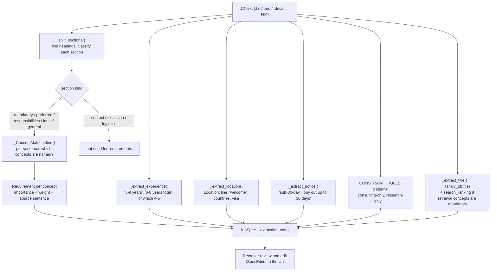
<p class="caption">Figure 5.1 - Job description processing (engine/jd/parser.py). Every extracted item keeps the sentence it came from.</p>

### Step 1 - turning a document into text

`engine/jd/documents.py` accepts `.txt`, `.md` and `.docx`. A `.docx` file is a ZIP archive of XML; the function `docx_to_text` reads `word/document.xml` directly with regular expressions (no external library), converting paragraph ends to line breaks. Before decompressing, it checks the declared size against a 20 MB limit to block "zip bombs" - tiny files that expand to enormous sizes. PDF job descriptions are **not** supported.

### Step 2 - sectioning

A JD is split into sections at *headings*. The function `_is_heading` treats a line as a heading if it is short (at most 90 characters and 12 words), starts with a capital letter and does not end in sentence punctuation - or if it starts with `#` or ends with `:`. Lines of the form "Key: value" (for example `Experience Required: 5-9 years`) are explicitly **not** headings.

Each heading is classified by keyword rules (`SECTION_RULES`), checked in this order:

| Kind | Example heading keywords |
|---|---|
| exclusion | "do not want", "not a fit", "disqualif", "red flag" |
| preferred | "nice to have", "preferred", "bonus", "won't reject", "we'd like" |
| mandatory | "absolutely need", "must have", "requirement", "qualification" |
| responsibilities | "what you'll", "responsibilit", "day to day", "actually be doing" |
| ideal | "ideal", "between the lines", "imagining" |
| logistics | "location", "notice", "compensation" |
| context | "note", "hackathon", "about us", "culture", "vibe" |

Order matters: "Things we'd like you to have but won't reject you for" contains both preferred keywords and none of the mandatory ones; "Things we explicitly do NOT want" is caught as an exclusion before anything else.

### Step 3 - concept detection and importance

For every sentence in a mandatory, preferred, responsibilities, ideal or general section, `_ConceptMatcher` checks each concept's skill names and phrases with word-boundary regular expressions (so "rag" does not match inside "storage"). A detected concept becomes a requirement with:

| Where it was found | importance | weight |
|---|---|---|
| a must-have section | mandatory | 1.0 |
| a nice-to-have section | preferred | 0.5 |
| anywhere else that is not ignored (responsibilities, ideal profile, general text) | preferred | 0.35 |

If a concept appears in several places, the most important occurrence wins. Context, exclusion and logistics sections are ignored for requirements - this is what stops the reference JD's closing note ("a candidate who has all the AI keywords ... Pinecone ... is not a fit") from creating a Pinecone requirement. The concept `business_functions` only becomes a requirement if it appears in a must-have section.

### Step 4 - targeted extractors

| Extractor | What it looks for | Reference JD result |
|---|---|---|
| `_extract_experience` | `N-M years`, `N+ years`, "of which N"; a second range in the *ideal* section becomes the ideal band; "minimum", "at least", "must" make the minimum hard | min 5, max 9, ideal 6-8, relevant target 4, not hard |
| `_extract_location` | the `Location:` line (cities before `\|`), "welcome/open to" sentences, country words, "don't sponsor ... visa" | preferred Pune, Noida; acceptable Delhi NCR, Hyderabad, Mumbai; India; hybrid; no visa sponsorship |
| `_extract_notice` | "sub-N-day", "notice of N days", "buy out up to N days" | ideal 30, acceptable 60 (30 + 30 buy-out) |
| `CONSTRAINT_RULES` | patterns for declared conditions | 7 conditions + work authorization |
| `_extract_title` | "Job Description:/Title:/Role:" line, else the first short line | "Senior AI Engineer - Founding Team" |

### Step 5 - role families and focus text

The title is mapped to a family with `Taxonomy.family_of`. "Senior AI Engineer" matches `\bai\b` → `ml_engineering`. Because the JD makes retrieval and ranking concepts mandatory, `search_ranking` is added too. If no technical family is found, title relevance falls back to word overlap with the JD title, and a note tells the recruiter.

The **focus text** - used for holistic semantic matching - is the title, the first six responsibility lines and the semantic sentences of the mandatory requirements, capped at 4,000 characters.

## A complete example: the reference job description

Running the parser on the reference JD (`engine/resources/jobs/redrob_senior_ai_engineer.txt`) produces the following (verified by `tests/test_jd_parser.py`).

| Requirement | Importance | Weight | Source sentence (shortened) |
|---|---|---|---|
| Embeddings-based retrieval | must-have | 1.0 | "Production experience with embeddings-based retrieval systems (sentence-transformers, ..." |
| Production deployment to real users | must-have | 1.0 | same sentence ("Production ... deployed to real users") |
| Python | must-have | 1.0 | "Strong Python." |
| Ranking / recommendation systems | must-have | 1.0 | "Hands-on experience designing evaluation frameworks for ranking systems ..." |
| Ranking evaluation (NDCG/MRR/MAP, A/B) | must-have | 1.0 | same sentence |
| Vector databases / hybrid search | must-have | 1.0 | "... handled embedding drift, index refresh, retrieval-quality regression ..." |
| Distributed systems | nice-to-have | 0.5 | "Background in distributed systems or large-scale inference optimization" |
| HR-tech / recruiting | nice-to-have | 0.5 | "Prior exposure to HR-tech, recruiting tech, or marketplace products" |
| LLM applications, LLM fine-tuning | nice-to-have | 0.5 | "LLM fine-tuning experience (LoRA, QLoRA, PEFT)" |
| Learning-to-rank models | nice-to-have | 0.5 | "Experience with learning-to-rank models (XGBoost-based or neural)" |
| Open-source contributions | nice-to-have | 0.5 | "Open-source contributions in the AI/ML space" |
| Information retrieval | mentioned | 0.35 | "Weeks 1-3: Audit what we currently have (it's mostly BM25 ...)" |

Declared conditions extracted, each with its default policy:

| Condition | Default policy | Factor |
|---|---|---|
| Career spent only at IT-services / consulting firms | penalise | × 0.5 |
| Pure research career without production deployment | penalise | × 0.5 |
| Senior lead/architect who no longer writes code | penalise | × 0.65 |
| Frequent job switching while climbing titles | penalise | × 0.75 |
| Computer vision / speech focus without NLP or IR | penalise | × 0.6 |
| AI experience limited to recent LLM-API wrappers | penalise | × 0.75 |
| No external validation of work (closed source) | **show only** | (0.9, unused) |
| Outside the hiring country (no visa sponsorship) | penalise | × 0.5 |

The "closed source" condition defaults to *show only* on purpose: penalising candidates for a missing GitHub account would contradict the rule that missing optional data is neutral.

## A small example, step by step

The worked example in Part 7 uses this short JD:

```text
Search Engineer
Location: Pune, India (Hybrid) | Open to relocation within India
Experience Required: 4-8 years
What you'll do
- Own the ranking of our product search results.
- Run offline evaluation and A/B tests before shipping ranking changes.
Must have:
- Production experience with Elasticsearch or another search engine
- Experience building ranking or recommendation systems
- Strong Python
Nice to have:
- Learning-to-rank models such as LightGBM or XGBoost
Notice period: we prefer sub-30-day notice; we can buy out up to 30 days.
```

The real parser produced (from `docs/learning/build/worked_example.json`):

| Requirement | Importance | Weight | Why |
|---|---|---|---|
| Information retrieval / search relevance | must-have | 1.0 | "search engine" in a must-have line |
| Vector databases / hybrid search infrastructure | must-have | 1.0 | "Elasticsearch" is listed under this concept |
| Ranking / recommendation systems | must-have | 1.0 | "ranking", "recommendation" |
| Python | must-have | 1.0 | "Python" |
| Learning-to-rank models | nice-to-have | 0.5 | "learning-to-rank", "LightGBM", "XGBoost" |
| Ranking evaluation | mentioned | 0.35 | "offline evaluation", "A/B tests" in responsibilities |

Experience 4-8 years (no separate ideal band, so ideal = 4-8), preferred city Pune, country India, hybrid, notice ideal 30 / acceptable 60, role family `search_ranking`, no declared conditions.

!!! warning "A real quirk worth understanding"
    The single sentence about Elasticsearch produced **two** must-haves, and one of them is labelled "Vector databases / hybrid search infrastructure" - a label that sounds wrong for an Elasticsearch requirement. This happens because the taxonomy groups Elasticsearch with vector databases, and "search engine" separately triggers the information-retrieval concept. It is not a bug in the code; it is the granularity of the knowledge base. This is exactly why the recruiter review step exists: the label can be renamed, the duplicate merged or removed, and its weight changed before ranking.

## Recruiter adjustments

In the UI (`frontend/src/components/SpecEditor.tsx`) every extracted item can be changed before ranking:

- rename a requirement, switch must-have / nice-to-have, change its weight (0.05-1.0), mark it **hard**;
- edit the skills (any one counts), phrases searched in career text, and the semantic sentence;
- add a known capability from the taxonomy, or a custom requirement;
- set the experience band and whether the minimum is hard;
- edit preferred/acceptable cities, countries, work mode, notice, visa;
- choose a policy for each declared condition: **show only**, **penalise × factor**, or **exclude**;
- choose what happens to critical integrity findings (hold for review, or rank and flag);
- change the seven component weights (shown normalised to 100%).

## How the JobSpec influences ranking

| JobSpec part | Influences | How |
|---|---|---|
| requirement skills | skill evidence | candidate skills matching any listed name (case-insensitive) |
| requirement phrases | text evidence and BM25 query | word-boundary search in role descriptions and summary; terms of the BM25 query |
| requirement semantic sentence | text evidence | embedding similarity with each unique description and summary |
| requirement weight / importance | requirements component; must-have count; tie-break | weighted mean of coverage; mandatory coverage computed separately |
| `hard` + `min_coverage` (default 0.35) | eligibility | candidates below the minimum are held out of the shortlist |
| role families | role fit, title trust, skill credibility | through title relevance |
| experience | experience component; optional hard gate | band fit, relevant years target |
| location, notice, work mode | logistics component | sub-scores in [0, 1] |
| constraints | factor or exclusion | per policy |
| weights | combination | normalised weighted sum |
| focus text | semantic component | holistic description similarity |

!!! note "Summary of Part 5"
    The parser is deliberately rule-based: offline, deterministic and inspectable. It classifies JD sections, detects capabilities from a knowledge base, extracts experience, location, notice and declared conditions, and records the source sentence for everything. Its output, the JobSpec, is reviewed and edited by the recruiter and is the only thing the scorer reads about the job.


# The Ranking Engine in Depth

This is the most important part of the book. It explains, component by component, exactly how `score_pool` in `engine/ranking/scorer.py` turns a JobSpec and a dataset index into an ordered list. Every formula below is the one in the code; every constant is the value in `engine/features/calibration.py`, `engine/features/signals.py` or `engine/jd/spec.py`. Where a concept is explained as background but **not** implemented, it is labelled so.

## The big picture: evidence, not keywords

TalentSignal treats ranking as **evidence aggregation**. For each thing the job needs, it asks two questions: *how strong is the evidence that this candidate has it?* and *how much should that evidence be trusted?* It then combines several kinds of evidence into seven **components**, each a number between 0 and 1, and combines the components with a **weighted sum**.

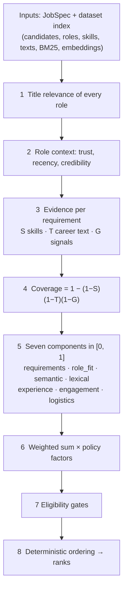
<p class="caption">Figure 6.1 - The ranking engine flowchart. Numbers match the section order of this part.</p>

All of this runs for **every candidate at once** using NumPy arrays (Part 3). For 100,000 candidates the whole function takes about 2.9 seconds on the reference machine once the index is loaded.

## Default component weights

The final score starts as a weighted sum of seven components. Default weights (from `ComponentWeights` in `engine/jd/spec.py`) sum to 1.00:

| Component | Weight | Measures |
|---|---|---|
| `requirements` | 0.34 | How well the evidence covers each job requirement |
| `role_fit` | 0.20 | How related the candidate's current and past job titles are |
| `semantic` | 0.12 | Meaning-level similarity between the job and the candidate's work descriptions |
| `experience` | 0.10 | Years in the band, relevant years, seniority alignment |
| `engagement` | 0.11 | Platform behaviour: activity, responsiveness, reliability |
| `logistics` | 0.08 | Location, notice period, work mode |
| `lexical` | 0.05 | BM25 keyword relevance (as a percentile) |

The recruiter can change these. The engine always **normalises** them (`ComponentWeights.normalized()` divides each by their sum), so only their ratios matter. If a component is unavailable - for example the embedding model is missing - it is removed and the remaining weights are re-normalised, and a note is attached to the run.

## Step 1 - title relevance

**What it measures.** How close a job title is to the role being hired for.

**Why it is necessary.** A title is the hardest part of a profile to fake convincingly and the best single indicator of what someone does all day. It is also used to decide how much to *trust* other evidence (steps 2-3).

**How it is calculated.** Each title is mapped to a *role family* by the taxonomy's ordered patterns. The JobSpec lists target families with weights (usually 1.0). Then

\[
\mathrm{rel}(\text{title}) = \max_{f \in \text{target families}} \; w_f \cdot \mathrm{affinity}\big(f,\ \mathrm{family}(\text{title})\big)
\]

- \(w_f\) - the weight of target family \(f\) in the JobSpec;
- \(\mathrm{affinity}(a, b)\) - the hand-set transferability table in `taxonomy.yaml` (1.0 for the same family).

If the JobSpec has no target families, a fallback uses *Jaccard overlap* of title words: \(|A \cap B| / |A \cup B|\), ignoring words such as "senior".

**Example** (target families `search_ranking: 1.0, ml_engineering: 1.0`, values computed with the real taxonomy):

| Title | Family | rel |
|---|---|---|
| Search Engineer | search_ranking | 1.00 |
| Senior Software Engineer (ML) | ml_engineering | 1.00 |
| Data Scientist | data_science | max(0.75, 0.80) = 0.80 |
| Computer Vision Engineer | computer_vision | max(0.50, 0.65) = 0.65 |
| Data Engineer | data_engineering | 0.45 |
| Backend Engineer | backend | 0.40 |
| Senior Software Engineer | software | 0.35 |
| HR Manager | non_technical | 0.00 |

**Limitations.** The affinity table is hand-set, not learned; unusual titles fall into `non_technical` unless the YAML patterns are extended; a title says nothing about quality.

## Step 2 - role context: recency, trust and credibility

Three quantities are computed per role or per candidate and reused everywhere.

**Recency** of a role that ended \(m\) months before the as-of date (0 for the current role):

\[
\mathrm{recency} = e^{-m/48}, \qquad \mathrm{keep} = 0.5 + 0.5\cdot \mathrm{recency}
\]

`keep` is the fraction of a role's text evidence that survives ageing: a current role keeps 100%, a role that ended 24 months ago keeps \(0.5 + 0.5 e^{-0.5} = 0.803\), and very old roles never drop below 50%.

**Trust** of a role's description:

\[
\mathrm{trust} = 0.3 + 0.7 \cdot \mathrm{rel}(\text{role title})
\]

A description under a fully relevant title is trusted completely (1.0); under an unrelated title it keeps only 30%. The principle - *a description is credible to the extent its job title supports it* - is general. In the reference data it also neutralises descriptions that were shuffled onto unrelated titles.

**Credibility** of a candidate's skill claims:

\[
\mathrm{cred} = 0.5 + 0.5 \cdot \max\big(\mathrm{rel}(\text{current title}),\ \max_{\text{roles}} \mathrm{rel}(\text{role title})\big)
\]

Skills claimed by someone who has never held a related role count at half weight.

Two career summaries are also computed:

\[
\mathrm{career\_rel} = \frac{\sum_r \mathrm{rel}_r \cdot \mathrm{months}_r \cdot \mathrm{recency}_r}{\sum_r \mathrm{months}_r \cdot \mathrm{recency}_r}, \qquad
\mathrm{relevant\_years} = \frac{\sum_r \mathrm{rel}_r \cdot \mathrm{months}_r}{12}
\]

Missing role months are treated as 12 for this weighting.

## Step 3a - skill evidence

**What it measures.** How strongly the candidate's skill list supports a requirement.

**How it is calculated** (`skill_row_strength` in `engine/features/evidence.py`). For each skill row whose name matches one of the requirement's skills (case-insensitive):

\[
u = 1 - e^{-\text{months}/18}, \qquad
c = \text{level} \cdot (0.35 + 0.65\,u), \qquad
e = \begin{cases} 0.5\,c + 0.5\cdot\dfrac{a}{100} & \text{if an assessment score } a \text{ exists}\\[4pt] c & \text{otherwise}\end{cases}
\]

- *level*: beginner 0.25, intermediate 0.5, advanced 0.75, expert 1.0 (missing → 0.5);
- *months*: how long the skill has been used (missing → \(u = 0.6\));
- \(u\): usage, rising from 0 towards 1 with diminishing returns (18 months gives 0.63, 48 months 0.93);
- \(c\): the self-reported claim; even an expert with 0 months gets only \(1 \times 0.35 = 0.35\).

Then the requirement's skill evidence is the **best single matching skill**, scaled by credibility:

\[
S = \mathrm{cred} \cdot \max_{\text{matching skills}} e
\]

**Worked examples** (verified with the real function):

| Skill row | Calculation | e |
|---|---|---|
| Elasticsearch, advanced, 48 months, assessed 84 | \(u = 1-e^{-2.667} = 0.9305\); \(c = 0.75(0.35+0.65 \cdot 0.9305) = 0.7161\); \(e = 0.5 \cdot 0.7161 + 0.5 \cdot 0.84\) | **0.7781** |
| Any skill, expert, 60 months, not assessed | \(u = 0.9643\); \(c = 0.35 + 0.65 \cdot 0.9643\) | **0.9768** |
| Any skill, expert, 0 months, not assessed | \(c = 1 \times 0.35\) | **0.35** |

```python
# runnable
import math
def skill_strength(level, months, assessed=None):
    u = 0.6 if months is None else 1 - math.exp(-months / 18)
    claim = (0.5 if level is None else level) * (0.35 + 0.65 * u)
    return claim if assessed is None else 0.5 * claim + 0.5 * assessed / 100

assert round(skill_strength(0.75, 48, 84), 4) == 0.7781
assert round(skill_strength(1.0, 60), 4) == 0.9768
assert skill_strength(1.0, 0) == 0.35
```

**Why the maximum and not the sum?** The original reference implementation added up skill weights, so every extra keyword raised the score - exactly what keyword stuffers exploit. With the maximum, listing ten synonyms ("Embeddings, Sentence Transformers, Vector Search, …") earns no more than listing the best one. The test `test_adding_synonym_skills_does_not_inflate` in `tests/test_scoring.py` checks this.

**Why blend assessments 50/50?** A platform assessment is independent evidence. It can raise a modest claim or lower an inflated one. Its *absence* is neutral: an unassessed claim is used as-is, not discounted.

**Limitations.** Months-of-use are self-reported too; proficiency labels are coarse; a skill name not in the requirement's list is invisible to this part (text evidence may still find it).

## Step 3b - text evidence

**What it measures.** Whether the candidate's *work descriptions* (or, at lower weight, their summary/headline) talk about the requirement - by exact phrase or by meaning.

**How it is calculated.** For every *unique* text segment (Part 9 explains why unique), two signals are computed:

- a **phrase hit** \(h \in \{0, 1\}\): does any requirement phrase or skill name occur, matched on word boundaries?
- a **semantic similarity** \(s \in [0, 1]\): the calibrated cosine similarity between the segment's embedding and the requirement's semantic sentence (Step 3d).

They are combined with a *noisy-OR* (explained in Step 4):

\[
\mathrm{match} = 1 - (1 - 0.75\,h)(1 - s)
\]

A phrase hit alone is worth 0.75 - strong but not complete, because a word can be a passing mention. Then

\[
\text{role evidence} = \mathrm{match}(\text{description}) \times \mathrm{trust} \times \mathrm{keep}, \qquad
\text{self evidence} = 0.6 \times \max\big(\mathrm{match}(\text{summary}), \mathrm{match}(\text{headline})\big) \times \mathrm{cred}
\]

\[
T = \max\big(\max_{\text{roles}} \text{role evidence},\ \text{self evidence}\big)
\]

Self-description is weighted 0.6 because a summary is a claim, not a record of work.

**Example.** Asha's current role description (Part 7) contains "learning-to-rank", so \(h = 1\) for the ranking requirement; its embedding similarity gives some \(s\). Her title "Search Engineer" has relevance 1, so trust = 1 and keep = 1. Her measured text evidence for *ranking / recommendation systems* is 0.7538. Meera's description says "which listings each shopper sees first" - no phrase hit, so only semantics count, and her title "Senior Software Engineer" has relevance 0.35, so trust = \(0.3 + 0.7 \times 0.35 = 0.545\). Her measured text evidence is 0.3038.

## Step 3c - signal evidence

One requirement in the taxonomy, *open-source contributions*, declares a platform signal: `github_activity_score`. Its evidence is

\[
G = 0.8 \cdot \min\!\big(1,\ \text{github} / 100\big)
\]

(missing → 0). The 0.8 cap says that activity supports, but does not prove, open-source contribution. All other requirements have \(G = 0\).

## Step 3d - embeddings and calibrated cosine similarity

**Embeddings.** An embedding model maps a piece of text to a list of numbers - a *vector* - such that texts with similar meaning get nearby vectors. TalentSignal uses **BAAI/bge-small-en-v1.5**: 33 million parameters, 384-dimensional vectors, MIT licence, run on the CPU from a local folder with network access disabled (`engine/retrieval/embeddings.py`).

**Cosine similarity** measures the angle between two vectors:

\[
\cos(\mathbf{u}, \mathbf{v}) = \frac{\mathbf{u}\cdot\mathbf{v}}{\lVert\mathbf{u}\rVert\,\lVert\mathbf{v}\rVert}
\]

The engine stores *normalised* vectors (length 1), so cosine similarity is just the dot product. Example: \(\mathbf{u} = (0.6, 0.8, 0)\), \(\mathbf{v} = (0.8, 0.6, 0)\): \(\mathbf{u}\cdot\mathbf{v} = 0.48 + 0.48 = 0.96\), and both lengths are 1, so the similarity is 0.96.

**Calibration.** Raw cosine values are not probabilities, and unrelated English sentences already score around 0.4-0.55 with this model. Measured on the reference data with `scripts/calibrate_semantic.py`: unrelated descriptions scored 0.41-0.55 against requirement sentences, explicit matches 0.75-0.85. So the engine maps a cosine \(c\) to

\[
s = \mathrm{clip}\!\left(\frac{c - 0.62}{0.80 - 0.62},\ 0,\ 1\right)
\]

| cosine c | 0.55 | 0.62 | 0.71 | 0.80 | 0.85 |
|---|---|---|---|---|---|
| calibrated s | 0 | 0 | 0.50 | 1 | 1 |

**Why the embeddings are computed once per unique text.** The reference data has only 5,802 unique headlines, summaries, titles and descriptions for 100,000 candidates. Embedding those once at index time (108 seconds on CPU) and looking them up by `text_id` makes semantic evidence affordable. On data with no repetition, this costs the same as embedding every document.

**Limitations.** Similarity can be fooled by style (two generic summaries look alike), the thresholds were set on one dataset (the script lets you re-measure), and the model is small.

## Step 4 - coverage: combining evidence with noisy-OR

**What it measures.** The overall strength of evidence for one requirement.

\[
\mathrm{coverage} = 1 - (1 - S)(1 - T)(1 - G)
\]

**Why this formula.** Think of each source as an independent detector that "fires" with probability \(S\), \(T\), \(G\). The probability that *at least one* fires is one minus the probability that none fires. This "noisy-OR" has three useful properties:

1. it always lies between 0 and 1;
2. corroboration helps: \(S = 0.6, T = 0.5\) gives \(1 - 0.4 \times 0.5 = 0.80\), more than either alone; adding \(G = 0.3\) gives 0.86;
3. a weak source never *reduces* a strong one (unlike an average: averaging 0.9 with 0.1 would give 0.5).

**Example from Part 7.** Asha's *ranking / recommendation systems* coverage: \(S = 0.684\), \(T = 0.7538\), so \(1 - 0.316 \times 0.2462 = 0.9222\) - exactly the engine's value.

**Missing evidence.** If there is no evidence, coverage is 0, which means *not demonstrated*. The explanation lists it as missing, not as a negative finding.

## Step 5 - the seven components

### 5.1 Requirements

\[
\mathrm{requirements} = \frac{\sum_r w_r \cdot \mathrm{coverage}_r}{\sum_r w_r}
\]

the weighted mean over requirements (weights 1.0, 0.5, 0.35 by default). The same mean restricted to must-haves is kept as **mandatory coverage**, used for tie-breaking and for the "must-haves met" count (met ≥ 0.65, partial ≥ 0.30).

### 5.2 Role fit

\[
\mathrm{role\_fit} = 0.65 \cdot \mathrm{rel}(\text{current title}) + 0.35 \cdot \mathrm{career\_rel}
\]

The current role matters most, but a relevant career history still counts.

### 5.3 Semantic

The JobSpec's focus text (title, responsibilities, must-have sentences) is embedded once. For every role description, its calibrated similarity is multiplied by the role's trust and keep, and the best role is taken. Two design decisions, both made from measurements:

- **Summaries are excluded here.** Every summary in the reference pool scored 0.70-0.81 against the long focus text, so they could not tell candidates apart.
- **The calibration window adapts to the query.** A long JD text has a different similarity scale from one-sentence requirement prototypes. The engine embeds 12 fixed, deliberately unrelated "anchor" sentences (accounting, mechanical design, teaching, …) and sets
\[
\mathrm{lo} = \mathrm{clip}\big(\mathrm{median}(\cos(\text{focus}, \text{anchors})) + 0.08,\ 0.5,\ 0.8\big), \quad \mathrm{hi} = \mathrm{lo} + 0.18
\]
For the worked example JD the window was [0.650, 0.830].

### 5.4 Lexical (BM25)

**BM25** is the standard keyword-relevance formula of search engines. For a query \(q\) and document \(d\):

\[
\mathrm{BM25}(q, d) = \sum_{t \in q} \mathrm{idf}(t) \cdot \frac{\mathrm{tf}(t, d)\,(k_1 + 1)}{\mathrm{tf}(t, d) + k_1\left(1 - b + b\,\dfrac{|d|}{\mathrm{avgdl}}\right)}, \qquad
\mathrm{idf}(t) = \ln\!\left(1 + \frac{N - \mathrm{df}(t) + 0.5}{\mathrm{df}(t) + 0.5}\right)
\]

| Symbol | Meaning | TalentSignal value |
|---|---|---|
| \(\mathrm{tf}(t,d)\) | how many times term \(t\) appears in document \(d\) | counts of unigrams and bigrams |
| \(\mathrm{df}(t)\) | how many documents contain \(t\) | |
| \(N\) | number of documents (candidates) | |
| \(\lvert d \rvert\), avgdl | document length and average length | |
| \(k_1\) | term-frequency saturation | 1.2 |
| \(b\) | length normalisation | 0.75 |

*Saturation* means the tenth "ranking" adds far less than the first; *length normalisation* stops long profiles from winning by verbosity.

**Worked example** with three tiny documents and the query "ranking elasticsearch" (avgdl = 5):

| Doc | Text | Length |
|---|---|---|
| A | search ranking engineer search ranking elasticsearch | 6 |
| B | sales executive cloud sales quota | 5 |
| C | ranking marketplace listings shoppers | 4 |

\(\mathrm{idf}(\text{ranking}) = \ln(1 + 1.5/2.5) = 0.470\) (two documents contain it); \(\mathrm{idf}(\text{elasticsearch}) = \ln(1 + 2.5/1.5) = 0.981\). For A, ranking has tf = 2 and the length factor is \(1.2(0.25 + 0.75 \cdot 6/5) = 1.38\), giving \(0.470 \cdot 2 \cdot 2.2 / 3.38 = 0.612\); elasticsearch gives \(0.981 \cdot 2.2 / 2.38 = 0.907\); total **1.519**. C scores **0.512**, B scores **0**.

```python
# runnable
import math
docs = {"A": "search ranking engineer search ranking elasticsearch".split(),
        "B": "sales executive cloud sales quota".split(),
        "C": "ranking marketplace listings shoppers".split()}
N, k1, b = len(docs), 1.2, 0.75
avgdl = sum(map(len, docs.values())) / N
def idf(t):
    df = sum(t in d for d in docs.values())
    return math.log(1 + (N - df + 0.5) / (df + 0.5))
def bm25(query, d):
    s = 0.0
    for t in query:
        tf = d.count(t)
        if tf:
            s += idf(t) * tf * (k1 + 1) / (tf + k1 * (1 - b + b * len(d) / avgdl))
    return s
scores = {k: round(bm25(["ranking", "elasticsearch"], d), 4) for k, d in docs.items()}
assert scores == {"A": 1.5185, "B": 0.0, "C": 0.5119}, scores
```

**How TalentSignal implements it** (`engine/retrieval/bm25.py`). The part of the formula that does not depend on the query is precomputed into a sparse matrix \(W\) (candidates × terms). The query becomes a vector \(q\) holding \(\mathrm{idf}(t) \times\) the term's weight, and all 100,000 scores are one sparse matrix-vector product \(W q\). The query terms are the JobSpec title (weight 0.5) plus every requirement's skills and phrases (weighted by the requirement's weight).

**Normalisation.** BM25 has no fixed scale - its values depend on the query and the corpus. The component is therefore the **percentile among candidates with a positive score** (ties share the same, highest percentile; candidates with no match get 0). In the three-document example, A would get 1.0, C 0.5 and B 0.

**Measured effect.** On the reference job, removing this component changed nothing in the top 100 (all top candidates have percentiles near 1). It is kept at 5% because it helps custom requirements whose words are not in the taxonomy. This is reported honestly in the evaluation.

!!! note "TF-IDF - background, not used in scoring"
    TF-IDF weighs a term by \(\mathrm{tf}(t,d) \cdot \log(N / \mathrm{df}(t))\). The original reference implementation used TF-IDF cosine similarity. TalentSignal does **not** use TF-IDF for scoring; BM25 improves on it with saturation and length normalisation, and embeddings cover meaning. TF-IDF appears in this book only as background.

### 5.5 Experience

Three sub-scores, combined with the missing-aware mean (weights band 0.45, relevant 0.35, seniority 0.20):

**Band fit** for total years \(y\), with JD minimum `lo`, maximum `hi` and ideal band [`ilo`, `ihi`]:

\[
\mathrm{band}(y) = \begin{cases}
0.75\, e^{-(\mathrm{lo} - y)/2} & y < \mathrm{lo}\\
0.75 + 0.25 \frac{y - \mathrm{lo}}{\mathrm{ilo} - \mathrm{lo}} & \mathrm{lo} \le y < \mathrm{ilo}\\
1 & \mathrm{ilo} \le y \le \mathrm{ihi}\\
1 - 0.25 \frac{y - \mathrm{ihi}}{\mathrm{hi} - \mathrm{ihi}} & \mathrm{ihi} < y \le \mathrm{hi}\\
0.75\, e^{-(y - \mathrm{hi})/6} & y > \mathrm{hi}
\end{cases}
\]

For the reference JD (5-9, ideal 6-8): 3 yrs → 0.276, 5 → 0.75, 5.5 → 0.875, 7 → 1, 8.5 → 0.875, 9 → 0.75, 12 → 0.455. Over-qualification decays more slowly (divisor 6) than under-qualification (divisor 2) because the JD calls its band "a range, not a requirement".

**Relevant years:** \(\min(1,\ \mathrm{relevant\_years} / \mathrm{target})\), where the target is the JD's "of which N years" if stated, else 0.6 × the ideal minimum, else 3.

**Seniority alignment:** title seniority (junior 1, senior 3, lead/staff 4, principal/head/director 5; titles without a keyword get a level from years: under 2 → 1, under 5 → 2, under 10 → 3, else 4) minus the JD level \(L\): difference 0 → 1.0, +1 → 0.95, −1 → 0.8, −2 → 0.5, ≤ −3 → 0.3, otherwise 0.85.

### 5.6 Engagement

Missing-aware mean of seven sub-signals (`engagement_parts` in `engine/features/signals.py`):

| Sub-signal | Formula | Weight |
|---|---|---|
| activity recency | \(e^{-\ln 2 \cdot \text{days}/90}\) (half-life 90 days) | 0.25 |
| response rate | value | 0.25 |
| response speed | \(1/(1 + \text{hours}/48)\) | 0.10 |
| open to work | open 1.0, not open 0.4 | 0.15 |
| interview reliability | completion rate | 0.15 |
| offer follow-through | acceptance rate (missing if no offers) | 0.05 |
| recruiter interest | \(1 - e^{-\text{saved}/5}\) | 0.05 |

Days are counted to the **as-of date**: by default the most recent activity date in the dataset, so scores do not drift with the calendar (the reference implementation hard-coded a date). A passive candidate is not unavailable, which is why "not open to work" scores 0.4 rather than 0.

**Numerical example (missing-aware mean).** Meera (Part 7) has no offer history. Her available sub-signals are recency 0.4188, response 0.5, speed 0.8, open 1.0, interviews 0.9, interest 0.5507. The weights of the available signals sum to 0.95, so

\[
\frac{0.25(0.4188) + 0.25(0.5) + 0.10(0.8) + 0.15(1.0) + 0.15(0.9) + 0.05(0.5507)}{0.95} = \frac{0.6222}{0.95} = 0.655
\]

### 5.7 Logistics

Missing-aware mean of location (0.5), notice (0.35) and work mode (0.15).

| Sub-score | Rule |
|---|---|
| Location | preferred city 1.0; acceptable city 0.9; same hiring country 0.75 if willing to relocate (0.6 otherwise, or 0.6/0.4 if the JD does not consider relocation); abroad 0.2/0.1 (willing/not) if no visa sponsorship, else 0.5/0.3. Remote jobs or JDs without location → missing |
| Notice | ≤ ideal → 1; up to acceptable → linear down to 0.7; beyond → \(\max(0.2,\ 0.7\,e^{-(d - \mathrm{acc})/60})\) |
| Work mode | hybrid JD: remote preference 0.6, others 1; onsite JD: hybrid 0.8, remote 0.4; flexible JD: all 1 |

Example: notice of 90 days with ideal 30 and acceptable 60 gives \(0.7 \cdot e^{-30/60} = 0.425\).

!!! caution "One non-neutral default"
    In the location rule, a *missing* `willing_to_relocate` is treated like "not willing" (0.6 instead of 0.75 domestically). This is a small exception to the "missing is neutral" principle, visible in `location_fit()`. It is listed in Book 3's limitations.

## Step 6 - the weighted sum and policy factors

\[
\mathrm{base} = \sum_{c} \tilde w_c \cdot \mathrm{component}_c, \qquad
\mathrm{overall} = \mathrm{clip}\Big(\mathrm{base} \times \prod_{i \in \text{penalised}} \mathrm{factor}_i,\ 0,\ 1\Big)
\]

where \(\tilde w_c\) are the normalised weights. The factors come from **declared conditions** with policy *penalise*. Each condition has a detector that uses only fields present in the profile:

| Condition | Detector (`engine/features/constraints.py` and scorer) |
|---|---|
| consulting-only | every role's company is in the consulting list or its industry is "IT services"/"consulting" |
| research-only | every role is research-like (title family or research words) **and** production evidence < 0.3 |
| non-coding lead | current title says architect/director/head/VP/manager (or family = engineering management) **and** the current role has lasted ≥ 18 months |
| title chasing | ≥ 3 of the last 4 roles lasted ≤ 18 months **and** seniority rose at least twice |
| CV/speech only | CV or speech evidence ≥ 0.5 **and** NLP, IR, ranking and embedding evidence all < 0.3 |
| LLM-wrapper only | LLM-application evidence ≥ 0.5 **and** ML-foundation, IR, ranking, embedding evidence all < 0.3 |
| closed source | no GitHub linked **and** open-source evidence < 0.2 (default policy: show only) |
| work authorization | outside the hiring countries **and** explicitly not willing to relocate |

**Why multiply instead of subtract?** The JD frames these as near-disqualifying. A multiplicative factor scales the whole score, so no amount of keyword overlap can compensate. But unlike the reference implementation's hidden constants, every factor here is visible, sourced to a JD sentence, and editable.

**Why "work authorization" only for those unwilling to relocate.** Penalising everyone abroad would assume they need a visa, which depends on citizenship - and inferring citizenship from location would be inferring a protected characteristic. This rule was narrowed after the first evaluation (see the development log).

## Step 7 - eligibility gates

Some conditions remove a candidate from the shortlist instead of changing the score. The candidate stays inspectable under "Held for review", with the reason:

1. a declared condition with policy **exclude**;
2. a requirement marked **hard** whose coverage is below its minimum (default 0.35);
3. a **hard** experience minimum not met;
4. a **critical integrity finding** when the integrity policy is "exclude" (the default) - see Part 8.

Separating *score* from *eligibility* keeps the score honest: it always reflects the evidence, and the reason for exclusion is stated rather than hidden in a tiny score.

## Step 8 - ordering and tie-breaking

Candidates are sorted by: eligible first; then `overall` descending; then mandatory coverage descending; then engagement descending; then `candidate_id` ascending. Ranks 1, 2, 3, … are given to eligible candidates; held candidates get rank 0. The order is fully deterministic - running the same JobSpec on the same index always gives the same ranking (`test_scores_bounded_and_deterministic`).

A subtle detail: the lexical percentile uses *tie-aware* ranks (`scipy.stats.rankdata(method="max")`), so two identical profiles always receive identical scores. An earlier version used plain `argsort`, which gave identical documents different percentiles depending on their position in the file - a bug found by `test_tie_break_by_candidate_id`.

## How the components interact

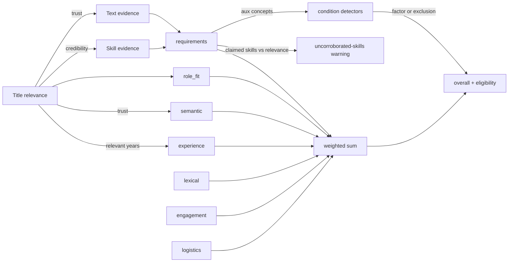
<p class="caption">Figure 6.2 - Scoring component interaction. Title relevance is the hub: it feeds trust, credibility and relevant years into four other components. That is what makes keyword stuffing under an unrelated title ineffective - and also why a relevant person with an under-specific title is under-rated (Part 7).</p>

## Why a weighted score instead of one metric

Each single signal fails somewhere:

| If we ranked only by … | It would fail when … |
|---|---|
| skill lists | anyone stuffs keywords (measured: 0.006 composite) |
| BM25 | people describe the work in their own words; verbose profiles |
| embeddings | two texts share style but not substance; specifics differ ("FAISS" vs "Milvus") |
| title | a strong engineer has a generic title; a weak one has a fashionable title |
| engagement | a highly active person is not qualified |

A weighted combination of bounded, interpretable components fails more gracefully, and its parts can be inspected and adjusted. The ablation study in Part 9 of this book (and in `docs/reports/EVALUATION_REPORT.md`) measures what each part contributes.

!!! note "Summary of Part 6"
    Title relevance determines how far other evidence is trusted. Each requirement's coverage combines the best skill (bounded, assessment-aware, credibility-scaled), title-trusted text evidence (phrases plus calibrated embeddings) and optional signals by noisy-OR. Seven components in [0, 1] are combined by a normalised weighted sum, multiplied by visible policy factors, filtered by explicit eligibility gates, and ordered deterministically.


# A Complete Worked Ranking Example

This part follows one job description and three candidates through the entire engine. **Every number in this part was produced by the real TalentSignal code**: the script `docs/learning/build/worked_example.py` builds a tiny index from the three profiles, parses the job description with `parse_job_description`, scores with `score_pool` and explains with `explain_candidate`, then writes all intermediate values to `worked_example.json`. A second script, `worked_whatif.py`, produces the "what if" variations at the end. You can re-run both and get the same numbers.

## The job and the candidates

The job description is the short *Search Engineer* JD shown in Part 5 (Pune, hybrid, 4-8 years, must-haves: a search engine such as Elasticsearch, ranking/recommendation systems, Python; nice-to-have: learning-to-rank; notice under 30 days preferred).

| | **Asha Rao** (CAND_9000001) | **Ravi Menon** (CAND_9000002) | **Meera Iyer** (CAND_9000003) |
|---|---|---|---|
| Current title | Search Engineer | Sales Executive | Senior Software Engineer |
| Years | 6.0 | 6.0 | 7.0 |
| Location | Pune | Bangalore | Hyderabad |
| Role description | "Owned the ranking layer of our e-commerce search: moved from hand-tuned BM25 boosts in Elasticsearch to a learning-to-rank model trained with LightGBM. Ran offline NDCG evaluation and A/B tests; shipped to production …" | "Enterprise sales of cloud software solutions into the mid-market segment; carried a revenue quota." | "Designed how our marketplace decides which listings each shopper sees first. Rebuilt the ordering logic so the most relevant items surface for every query, measured the impact with controlled experiments …" |
| Skills | Elasticsearch (advanced, 48 mo, **assessed 84**), Python (expert, 72 mo), Learning to Rank (advanced, 30 mo), Ranking Systems (advanced, 36 mo) | Elasticsearch, Python, Learning to Rank, Ranking Systems, Recommendation Systems, Search Infrastructure, BM25 - all **expert, 60 months** | Python (advanced, 60 mo), Java (advanced, 48 mo) |
| Response rate / notice | 0.8 / 30 days | 0.9 / 15 days | 0.5 / 90 days |
| Last active | 2026-05-20 | 2026-05-25 | 2026-02-01 |
| Other | - | - | no GitHub, no offer history |

They represent three archetypes from Part 1: the obvious fit (Asha), the keyword stuffer (Ravi) and the plain-language candidate with a generic title (Meera).

## Step 1 - title relevance and role context

The JobSpec's only target family is `search_ranking` (from the title "Search Engineer").

| | Asha | Ravi | Meera |
|---|---|---|---|
| Title family | search_ranking | non_technical | software |
| Title relevance | 1.00 | 0.00 | 0.35 |
| Description trust \(0.3 + 0.7\,\mathrm{rel}\) | 1.00 | 0.30 | 0.545 |
| Skill credibility \(0.5 + 0.5\,\mathrm{rel}\) | 1.00 | 0.50 | 0.675 |
| Relevant years \(\mathrm{rel} \times\) months / 12 | 6.0 | 0.0 | 2.45 |

Meera's title "Senior Software Engineer" belongs to the general `software` family, whose affinity with `search_ranking` is 0.35. Notice how much this single number will matter.

## Step 2 - evidence per requirement

Each cell shows skill evidence \(S\), text evidence \(T\) and the resulting coverage \(1 - (1-S)(1-T)\) (no requirement here uses signal evidence).

| Requirement (weight) | Asha S / T → cov | Ravi S / T → cov | Meera S / T → cov |
|---|---|---|---|
| Information retrieval (1.0) | 0 / 0.839 → **0.839** | 0.488 / 0 → **0.488** | 0 / 0.247 → **0.247** |
| Vector / hybrid search infra (1.0) | 0.778 / 0.851 → **0.967** | 0.488 / 0 → **0.488** | 0 / 0 → **0** |
| Ranking / recommendation (1.0) | 0.684 / 0.754 → **0.922** | 0.488 / 0.225 → **0.604** | 0 / 0.304 → **0.304** |
| Python (1.0) | 0.988 / 0.75 → **0.997** | 0.488 / 0 → **0.488** | 0.495 / 0 → **0.495** |
| Learning-to-rank models (0.5) | 0.658 / 0.878 → **0.958** | 0.488 / 0 → **0.488** | 0 / 0 → **0** |
| Ranking evaluation (0.35) | 0 / 0.914 → **0.914** | 0 / 0.100 → **0.100** | 0 / 0.097 → **0.097** |

Things to notice, each connected to a formula in Part 6:

- **Asha's Elasticsearch evidence** under *vector / hybrid search infra* is exactly the worked example of the skill formula: advanced, 48 months, assessed 84 gives 0.7781. Her description adds text evidence 0.851, and noisy-OR combines them to 0.967.
- **Ravi's skill evidence is 0.488 everywhere.** Each expert skill used for 60 months would be worth 0.977, but his credibility is 0.5 because no role he has held is related to search. Listing seven skills did not add up: each requirement takes only the best one.
- **Ravi gets a little text evidence (0.225) for ranking** from his sales description - the word overlap and semantic similarity are weak, and his trust is only 0.30.
- **Meera's plain-language description** earns only 0.247-0.304 text evidence. Her description *is* about search ranking, but (a) there is no keyword hit, so only the embedding similarity counts, and (b) her trust is only 0.545 because of her generic title.
- **Meera's Python** (advanced, 60 months) is worth 0.733 before credibility; × 0.675 gives 0.495.

Averaging with the weights (1, 1, 1, 1, 0.5, 0.35; total 4.85) gives the **requirements** component: Asha 0.933, Ravi 0.484, Meera 0.222. Ravi's computation, for example:

\[
\frac{0.488 + 0.488 + 0.604 + 0.488 + 0.5(0.488) + 0.35(0.100)}{4.85} = \frac{2.348}{4.85} = 0.484
\]

## Step 3 - the other components

| Component | Asha | Ravi | Meera | Why |
|---|---|---|---|---|
| role_fit | 1.000 | 0.000 | 0.350 | \(0.65\,\mathrm{rel}_{now} + 0.35\,\mathrm{career\_rel}\) |
| semantic | 0.713 | 0.000 | 0.000 | Description vs JD focus, window [0.650, 0.830], × trust; Meera's similarity fell below the window floor |
| lexical | 0.667 | 1.000 | 0.333 | BM25 percentile among the three; Ravi's stuffed skills contain the most query terms |
| experience | 0.990 | 0.640 | 0.990 | band 1.0 for all; relevant years 1.0 / 0 / 1.0; seniority 0.95 |
| engagement | 0.873 | 0.908 | 0.655 | Meera: inactive 113 days (0.419), response 0.5, no offer history (dropped from the mean) |
| logistics | 1.000 | 0.875 | 0.674 | Pune = preferred; Bangalore/Hyderabad = same country, willing to relocate (0.75); Meera's 90-day notice → 0.425 |

## Step 4 - the weighted sum

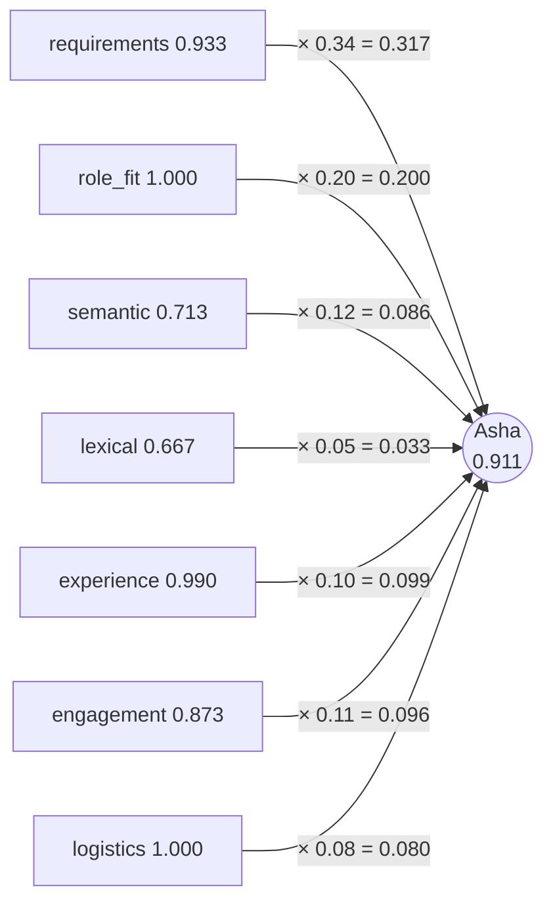
<p class="caption">Figure 7.1 - Asha's overall score as a weighted sum of her seven components (no policy factors apply, so overall = base).</p>

| Component (weight) | Asha points | Ravi points | Meera points |
|---|---|---|---|
| requirements (0.34) | 0.3172 | 0.1646 | 0.0756 |
| role_fit (0.20) | 0.2000 | 0.0000 | 0.0700 |
| semantic (0.12) | 0.0855 | 0.0000 | 0.0000 |
| lexical (0.05) | 0.0333 | 0.0500 | 0.0167 |
| experience (0.10) | 0.0990 | 0.0640 | 0.0990 |
| engagement (0.11) | 0.0960 | 0.0998 | 0.0721 |
| logistics (0.08) | 0.0800 | 0.0700 | 0.0539 |
| **overall** | **0.9111** | **0.4484** | **0.3872** |
| rank | 1 | 2 | 3 |

You can check any column with a calculator; for Meera: \(0.0756 + 0.07 + 0 + 0.0167 + 0.099 + 0.0721 + 0.0539 = 0.3873\) (the engine's 0.3872 differs only by rounding of the displayed components).

## Step 5 - the explanations the engine produced

The summaries below are the engine's own output, validated against each record:

> **Asha** - "Top match: Search Engineer at ShopFast (6.0 yrs) meets 4 of 4 must-haves, with Python (expert) and Elasticsearch (advanced, assessed 84/100). Edges out similarly ranked profiles on requirement coverage."

> **Ravi** - "Weak match: Sales Executive at CloudCo (6.0 yrs) meets 0 of 4 must-haves. Concerns: Job-relevant skills not supported by any related role." (warning flag `uncorroborated_skill_claims`)

> **Meera** - "Weak match: Senior Software Engineer at MarketHub (7.0 yrs) meets 0 of 4 must-haves. Concerns: notice period 90 days (JD prefers <= 30)." Missing information: no platform assessment for key skills, no GitHub, no offer history.

## Why Asha ranks first - and an uncomfortable result

Asha's first place is well supported: her title, verified skill, description and logistics all agree, and every component is high.

The order of Ravi and Meera is the interesting part. **A thoughtful recruiter would put Meera second**: her description is clearly about search ranking. The engine puts her **third, 0.06 below the keyword stuffer**. The decomposition shows exactly why:

1. **Generic title.** "Senior Software Engineer" has relevance 0.35. That lowers her role fit (0.35), her description trust (0.545) and her skill credibility (0.675) all at once - the hub effect shown in Figure 6.2.
2. **No keywords, weak semantics.** Without a phrase hit, her description's evidence depends on embedding similarity, which was moderate and then multiplied by the low trust.
3. **Weaker logistics and engagement.** A 90-day notice and 113 days of inactivity cost her about 0.05 compared with Ravi.
4. **Ravi's stuffing was contained but not neutralised.** Credibility halved his skill evidence, his role fit and semantic are 0, and he carries a warning flag - yet halved evidence across six requirements, a perfect lexical percentile, and excellent engagement still add up to 0.448.

### What the recruiter can change (measured with the real engine)

| Variation (script `worked_whatif.py`) | Asha | Ravi | Meera | Effect |
|---|---|---|---|---|
| Default | 0.911 (1) | 0.448 (2) | 0.387 (3) | - |
| Role-fit weight 0.20 → 0.35 | 0.923 (1) | 0.390 (2) | 0.382 (3) | Gap closes from 0.061 to 0.008 |
| Disable lexical | 0.924 (1) | 0.419 (2) | 0.390 (3) | Gap 0.029 |
| Disable engagement | 0.916 (1) | 0.392 (2) | 0.354 (3) | Gap 0.038 |
| Mark "ranking/recommendation" as **hard** | 0.911 (1) | 0.448 (2) | held for review | Meera's coverage 0.304 < 0.35 → excluded; Ravi's 0.604 passes |

The last row is a warning about blunt tools: a hard gate on a requirement that Meera evidences only in plain language removes *her*, not the stuffer, because the stuffer's self-reported skills still clear the minimum.

### How much this matters in a real pool

In a pool of three, a weak candidate can still be "second". In the 100,000-candidate reference pool the same mechanisms put the best of 431 uncorroborated-skill profiles at rank **9,079**, and in the synthetic adversarial test (Part 9 and Book 3) stuffers with perfect assessments ranked no better than 107th of 560 - behind all 40 strong real profiles. Of the six plain-language profiles in the reference data, all reached the top 100 (ranks 8, 12, 22, 51, 81, 97), helped by relevant titles such as "Staff Machine Learning Engineer". **The weakness is specific: plain-language candidates whose title is generic are under-rated.** Book 3 discusses how to improve it (for example a title-independent semantic floor, or relevance that also learns from descriptions) and the trade-offs, because any change that trusts descriptions more also trusts shuffled or embellished descriptions more.

!!! tip "The lesson of this example"
    A weighted evidence model is transparent enough that you can see *exactly* why a surprising order happened and which knob would change it. That is the main practical benefit of explainability: not that the ranking is always right, but that when it is wrong, a human can tell why and decide what to do.


# Explainability and Integrity

A ranking that cannot be explained cannot be trusted, corrected or defended. This part explains how TalentSignal produces explanations that are tied to evidence, how it prevents explanations from inventing facts, and how it handles profiles that are inconsistent or impossible.

## Why explainable ranking matters

Explanations serve four different people:

| Who | Needs to know | Example question |
|---|---|---|
| Recruiter | Whether to spend time on this candidate | "Which must-haves does she actually meet, and how do we know?" |
| Hiring manager | Whether the shortlist is sensible | "Why is a sales executive in the top three?" |
| Candidate (indirectly) | That they were judged on relevant evidence | "Was I penalised for something irrelevant?" |
| Engineer | Why the system behaved this way | "Which component pushed this candidate up?" |

There is also a practical reason: a score alone gives no way to notice a mistake. In Part 7 the decomposition showed in seconds why a stuffer outranked a plain-language candidate. Without explanations that would have been invisible.

## How explanations are generated

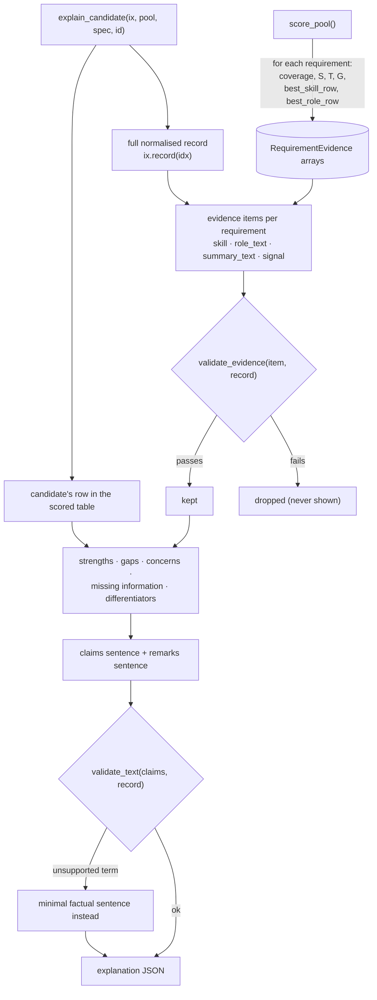
<p class="caption">Figure 8.1 - Candidate evaluation and explainability flow (engine/explanations/explain.py and validator.py).</p>

The crucial design decision is visible at the top of the figure: **explanations are built from the same arrays the score came from.** When `requirement_evidence` computes a requirement's skill evidence, it also records *which skill row* won (`best_skill_row`); for text evidence it records *which role* won (`best_role_row`). The explainer follows those pointers back to the exact skill or role. It does not re-derive or guess.

### The pieces of an explanation

`explain_candidate` returns a dictionary with, among others:

| Key | Content |
|---|---|
| `summary` | Two sentences: a *claims* sentence (facts about the candidate) and a *remarks* sentence (concerns, missing must-haves or a differentiator) |
| `components` | Each component's value, weight and contribution (value × weight) |
| `constraint_factor`, `triggered_constraints` | Policy factors applied and the JD sentence behind each |
| `requirements` | For every requirement: coverage, status (met ≥ 0.65, partial ≥ 0.30, missing), and evidence items |
| `strengths`, `gaps` | Met requirements with their evidence; must-haves not met |
| `concerns` | Factual issues: long notice, low response rate, inactivity, experience outside the band, location, low interview attendance, triggered conditions, integrity warnings |
| `missing_information` | Unknown fields (no assessment, no GitHub, no offer history …), explicitly *not* held against the candidate |
| `differentiators` | Components where the candidate differs most from the ±3 neighbouring ranks |
| `flags` | Integrity findings with their evidence |
| `record` | The candidate's normalised record, for the profile view |

### Evidence items

| Kind | What it says | Example rendering |
|---|---|---|
| `skill` | a skill, its proficiency, months used, assessment (verified or not) | "Elasticsearch (advanced, assessed 84/100)" |
| `role_text` | a role's title and company, whether current, and which phrases matched | "the current role citing 'learning-to-rank' and 'ndcg'" |
| `summary_text` | phrases found in the candidate's own summary/headline | "a summary citing 'semantic search'" |
| `signal` | a platform signal value | "GitHub activity 62/100" |

### Differentiators

To answer "why is this candidate above (or below) similar candidates?", the explainer compares the candidate with the mean of the three candidates above and three below in the ranking:

\[
\Delta_c = \big(\mathrm{component}_c(\text{candidate}) - \overline{\mathrm{component}_c}(\text{neighbours})\big) \times \tilde w_c
\]

The components with the largest \(|\Delta_c|\) (at least 0.002) are reported - for example "Requirement coverage: 87.0 vs 79.7 for nearby ranks".

## Avoiding unsupported claims

Generated text has a well-known failure: it states things that are not true. In hiring this is unacceptable - telling a manager that a candidate "knows LoRA" when the profile never says so could cost someone a job or mislead an employer. TalentSignal applies two independent checks.

**Check 1 - every evidence item is re-verified against the raw record** (`validate_evidence`):

- a skill item must name a skill in the record, with the same proficiency, and any assessment value must match the record's assessment within 0.5;
- a role item must point to a role with the same title and company, and every quoted phrase must literally occur in that role's description;
- a summary item's phrases must occur in the summary or headline;
- a signal item's value must equal the record's value.

Items that fail are dropped before any text is written.

**Check 2 - the claims sentence is scanned for any known skill or technology name** (`validate_text`). Every skill name in the taxonomy is searched for in the sentence; each one found must appear in the candidate's skills or in their profile text. If anything fails, the summary is replaced by a minimal factual sentence ("Weak match: Sales Executive at CloudCo; meets 0 of 4 must-haves.").

Only the *claims* sentence is checked this way. The *remarks* sentence may legitimately name a JD requirement the candidate lacks ("Not evidenced: Python"); flagging that as an unsupported claim was a real false positive found during development and fixed by separating the two sentences.

**Measured result:** 0 unsupported skill mentions in 200 audited explanations (the top 100 plus 100 random candidates of the reference pool), and 100 distinct summaries in the top 100.

## Good and bad explanations

| Bad explanation | Why it is bad | TalentSignal's version |
|---|---|---|
| "Great candidate with strong AI skills." | Generic; no facts; identical for many people | "Top match: Search Engineer at ShopFast (6.0 yrs) meets 4 of 4 must-haves, with Python (expert) and Elasticsearch (advanced, assessed 84/100)." |
| "Expert in LoRA and RAG pipelines." (profile lists neither) | Hallucination | Impossible: `validate_text` would reject the sentence |
| "Rejected: low score." | No reason, no evidence, no recourse | "Held for review: … Concerns: Stated experience does not match career history." plus the flag's evidence |
| "Lacks GitHub - weak open-source profile." | Treats missing data as a negative finding | Listed under *missing information*, "not held against the candidate" |
| A rank-90 candidate described as "outstanding" | Tone contradicts rank | Tone is derived from rank and score: Top / Strong / Good / Partial / Weak match, or "Held for review" |

## Integrity checks

Some profiles are not just weak - they are **internally impossible or inconsistent** as written. The reference dataset contains about 80 deliberately planted examples ("honeypots"), such as "expert in ten skills with zero months of use". TalentSignal runs record-level checks during indexing (`engine/integrity/checks.py`) and one job-dependent check during scoring.

| Check | Severity | Rule | Reference data |
|---|---|---|---|
| `expert_zero_duration` | critical if ≥ 2 skills, else warning | skill marked expert with `duration_months == 0` | 21 candidates |
| `experience_mismatch` | critical if > 3 years, warning if 1.5-3 | stated years vs sum of role months / 12 | 47 |
| `assessment_unlisted_skill` | warning | assessment score for a skill not on the profile | 36 |
| `role_duration_mismatch` | warning | duration differs from the role's dates by > 3 months | 0 |
| `role_dates_reversed`, `future_role_start` | warning | end before start; start after today | 0 |
| `overlapping_roles` | info | two past roles overlap > 6 months | 0 |
| `salary_range_inverted` | info | min > max | 18,865 |
| `activity_before_signup` | info | last active before sign-up | 7,496 |
| `current_title_mismatch` | info | profile title ≠ current role title | 0 |
| `duplicate_profile` | warning | identical content under another id (ignoring id and name) | 0 |
| `uncorroborated_skill_claims` (scoring-time) | warning | ≥ 4 job skills claimed at strength ≥ 0.5 with no role of relevance ≥ 0.3 | 431 for the reference JD |

The two critical checks found **68 candidates** in the reference pool (21 + 47, no overlap) - close to the "about 80" the challenge documentation mentions. The remaining planted cases are not detectable from the data provided. For example, "eight years at a company founded three years ago" cannot be checked because the data contains no company founding dates. The book states this rather than pretending to detect it.

### Severity determines the effect

| Severity | Effect on ranking | Shown as |
|---|---|---|
| critical | Held out of the shortlist **for human review** (integrity policy "exclude", the default); can be switched to "flag" | Red banner with evidence |
| warning | None on the score (except that uncorroborated skills already had reduced credibility) | Amber notice |
| info | None | Data-quality note |

The wording is deliberate. A critical finding means *"this record is impossible as written"*, not *"this person is a fraud"*. The data may be wrong: a typing error, a broken import, a bad merge of two profiles. That is why the system holds the candidate for review rather than deleting them, and shows exactly which fields triggered the finding.

## False positives and false negatives

| | Meaning in integrity checking | Example | Cost |
|---|---|---|---|
| False positive | A legitimate profile is flagged | A person with a long career break: stated 10 years, roles add up to 6.5 → "experience mismatch" critical | A good candidate is held for review unless a human looks |
| False negative | An impossible profile is not flagged | Tenure longer than the company has existed (no founding dates in data) | The candidate may be ranked normally |

The thresholds trade these off. "> 3 years" for experience mismatch was chosen to avoid flagging ordinary rounding and short gaps, at the cost of missing smaller inconsistencies. Because critical findings only *hold* candidates and show evidence, a false positive costs a few minutes of human attention rather than an unfair rejection.

Measured on the synthetic adversarial set: all 30 deliberately impossible profiles were held for review; none of the 40 strong real profiles copied into that set was flagged.

## Why human review matters

TalentSignal is decision support. Three facts make human review essential:

1. **The score is not a probability of hiring success.** It is a weighted summary of evidence on a 0-1 scale. No outcome data was used to calibrate it, so "0.85" does not mean "85% likely to succeed".
2. **The evidence is mostly self-reported.** Assessments help, but most skills and all descriptions are written by the candidate.
3. **Every model has blind spots.** Part 7 showed one: plain-language candidates with generic titles are under-rated.

The product is designed around this: held candidates are always visible, every policy is editable, explanations show evidence, and the footer of every page states that scores summarise evidence and are not hiring probabilities.

!!! note "Summary of Part 8"
    Explanations follow pointers recorded during scoring, are re-verified against the record, and are checked for unsupported terms before display (0 unsupported claims in 200 audited). Integrity checks distinguish critical (held for human review), warning and info findings, never call anything fraud, and state openly which planted cases cannot be detected.


# Performance, Scalability and Measured Quality

A ranking system that is correct but takes an hour is not useful. This part explains how TalentSignal handles 100,000 candidates on a laptop, which optimisations matter and why, what has and has not been measured, and how ranking quality is evaluated without ground truth.

All numbers in this part were measured on one machine: 16 logical CPUs, 15.7 GB RAM, Windows 11, Python 3.14, no GPU. Different hardware gives different numbers.

## The measured numbers

| Operation | Time | Peak memory | Source |
|---|---|---|---|
| Fingerprint 465 MB file (BLAKE2b) | 1.2 s | small | index `meta.json` |
| Parse + normalise 100,000 records | 16.6 s | - | `meta.json` timings |
| Build BM25 index | 1.5 s | - | `meta.json` |
| Embed 5,802 unique text segments | 107.7 s | - | `meta.json` |
| **Cold index build, total** | **137 s** | **1.99 GB** | `scripts/build_index.py` |
| **Warm scoring of 100,000 candidates** | **2.85 s** (mean of 3) | 1.94 GB process | `scripts/run_evaluation.py` |
| Competition ranking step (load, score, explain 100, validate) | 11.9 s / 12.25 s | 1.39-1.41 GB | `scripts/competition_rank.py` |
| Ranking run in the app, top 100, first use | 13 s | - | `scripts/smoke_test.py` |
| Ranking run in the app, all eligible (99,932 rows) | 5.3 s | server peak 1.66 GB | live measurement |
| Results page / filtered page / candidate detail | ~19 / 22 / 16 ms | - | smoke test (100-row run) |
| Results queries on the 99,932-row run | 150-270 ms | - | live measurement |
| Explanation of one candidate | 12.7 ms average | - | evaluation run |

One measurement is worth remembering for honesty: the competition step once took **89.9 s** while a large package installation and the web server were running at the same time. On an idle machine it took 11.9-12.3 s. Performance claims always depend on what else the machine is doing.

## Principle 1 - do expensive work once (precompute)

Figure 2.5 split the work into a one-time *index build* and a per-job *scoring*. Everything that does not depend on the job is done once and saved under `artifacts/indexes/<fingerprint>/`:

- parsing and normalising 465 MB of JSON,
- tokenising text for BM25,
- running the neural network on text (by far the most expensive step),
- integrity checks and the quality report.

Scoring then only does arithmetic on saved arrays. The *fingerprint* (a BLAKE2b hash of every byte) names the index directory, so the same file is never processed twice and a changed file is never matched to a stale index. The reference implementation hashed only the first and last megabyte; an edit in the middle would have gone unnoticed (`test_fingerprint_detects_middle_edit` proves the new behaviour).

## Principle 2 - stream, don't load

The reader processes one JSONL line at a time and immediately reduces it to compact rows (tuples of a few values per role and per skill). The parsed record is then written to `records.jsonl` and discarded. Memory therefore depends on the number of *rows kept* - not on the 465 MB raw size. JSON arrays are the exception (they cannot be streamed with a standard parser) and are capped at 512 MB with a message suggesting JSONL.

Uploads are streamed too: `DatasetService.save_upload` copies the incoming file to disk in 4 MB chunks and stops as soon as the configured limit is exceeded.

## Principle 3 - process unique text, not documents

The single most effective optimisation. In the reference data:

| Text kind | Occurrences | Unique |
|---|---|---|
| Role descriptions | 300,171 | 44 |
| Summaries | 100,000 | 3,241 |
| Headlines | 100,000 | 2,469 |
| All segments embedded | ~500,000 | 5,802 |

During indexing, `_TextTable.add()` gives each distinct text an integer id; candidates and roles store ids. Then:

- **Embeddings** are computed for 5,802 segments instead of ~500,000 - about 108 s instead of roughly two hours at the measured speed of ~65 long texts per second.
- **BM25** tokenises each unique segment once into a matrix \(T\) (segments × terms), builds a sparse *incidence* matrix \(A\) (candidates × segments, counting how often each candidate uses each segment), and gets every candidate's term counts as one sparse product \(A\,T\).
- **Phrase matching and constraint checks** run a regular expression once per unique segment and gather results per role by id. Changing the research-only check from per-role to per-unique-text cut it from 4.2 s to under 0.1 s.

On data where every text is unique, this costs the same as processing each document - so the optimisation is free when it does not help and enormous when it does.

## Principle 4 - sparse matrices

A *sparse matrix* stores only non-zero entries. The reference BM25 matrix is 100,000 candidates × 5,512 terms (unigrams and bigrams; the vocabulary is small because the text is templated - the code allows up to 150,000). Each candidate uses on average 278 terms, so only 27.8 million of the 551 million cells are non-zero (5%). Stored densely in 32-bit floats it would need 100,000 × 5,512 × 4 bytes ≈ 2.2 GB; stored sparsely (SciPy CSR format: values, column indices and row pointers) it takes 213 MB on disk. On real, diverse text the vocabulary would be far larger and the saving far greater. Scoring a query is one sparse matrix-vector product.

## Principle 5 - vectorise and avoid Python loops over rows

Every component is computed for all candidates at once with NumPy. A few patterns recur:

| Pattern | Used for | Example |
|---|---|---|
| `np.bincount(owner, weights=...)` | sum per candidate over roles | career relevance, relevant years |
| `best_per_group(group, values, n)` (one `lexsort`) | maximum per candidate and *which row* achieved it | best skill, best role evidence |
| `np.isin(codes, wanted)` on integer codes | which skill rows match a requirement | skill matching on ~1 M rows |
| `np.where`, `np.select` | piecewise formulas | band fit, notice fit |

Converting skill names to integer codes once (`DatasetIndex.skill_codes`) avoids comparing millions of strings for every requirement.

## Principle 6 - cache what repeats

| Cache | Where | What it saves |
|---|---|---|
| `IndexCache` (LRU, 3 indexes) | `services/datasets.py` | reloading Parquet tables, BM25 and embeddings |
| Pool LRU (2 scored pools) | `services/runs.py` | rescoring when opening candidate details |
| Result-table LRU (6 tables) | `services/runs.py` | re-reading Parquet for each page request |
| Query-embedding memo (≤ 5,000 texts) | `Embedder.encode_queries` | re-encoding requirement sentences and anchors (2.6 s → ~0) |
| Taxonomy `lru_cache` and title-family cache | `engine/taxonomy.py` | regex matching per title |

After a server restart the pool cache is empty. Opening a candidate then triggers a deterministic re-score from the stored JobSpec, which gives identical explanations.

## Principle 7 - never send more than a page

The browser never receives the whole result table. `GET /api/runs/{id}/results` filters, sorts and returns one page (default 50 rows, maximum 200) from the run's Parquet table in the server; the response includes `total` for the pager. The card view lazily fetches each card's explanation. **Virtual scrolling is not implemented** - it is unnecessary because no more than 200 rows are ever rendered at once.

## Where the time and memory go

| Bottleneck | Why | Mitigation in place | Possible next step |
|---|---|---|---|
| Embedding text at index time | neural network on CPU | unique segments only | batch more aggressively; quantised ONNX model; GPU at precompute only |
| Normalising records (Python per record) | per-record dict work | streaming, compact rows | multiprocessing across file chunks |
| Peak memory during build (~2 GB) | lists of role/skill tuples before conversion to DataFrames | - | write tables in chunks (Arrow record batches) |
| Explanations | Python per candidate | only on demand (≈ 13 ms each) | - |
| SQLite writes | single writer | WAL mode, throttled progress writes | - |

## Scaling to one million candidates (not benchmarked)

TalentSignal has been measured at 100,000 candidates only. The following is **reasoning, not measurement**:

- Parsing scales linearly: roughly 170 s for 1 M records at the measured rate.
- Embedding cost depends on *unique* text, which might grow from 5,802 to tens of thousands on real data with diverse descriptions - potentially hours on one CPU. This is the first wall.
- The BM25 matrix scales with total tokens (~2 GB at 10×).
- Build memory would grow roughly 10× (≈ 20 GB) with the current all-in-memory row lists - more than this machine has. Chunked table writing would be required.
- Warm scoring is linear in rows and would be around 30 s; an "all eligible" result table would hold ~1 M rows.

The honest summary: the *design* (precompute, sparse, vectorised, unique-text) extends, but the *implementation* would need chunked index building and probably approximate nearest-neighbour retrieval to pre-select candidates before full scoring. No claim of million-record support is made.

## Measuring quality without ground truth

Speed is easy to measure; quality is not. The challenge's real relevance labels were never available. TalentSignal's evaluation (`scripts/run_evaluation.py`, report in `docs/reports/EVALUATION_REPORT.md`) therefore separates what can be measured *without* labels from what needs labels.

**Label-free measurements**

| Test | Result |
|---|---|
| Keyword stuffers with every job skill at expert, 60 months **and 95/100 assessments** (synthetic, 560-candidate pool) | best rank 107; none in the top 40 |
| Deliberately impossible profiles eligible | 0 of 30 |
| Strong profiles with optional evidence removed (no assessments, GitHub, offer history) | mean score change −0.007, max drop 0.014 |
| Look-alike twins with weak engagement | all 30 rank below their originals |
| Look-alike groups (same headline, summary, title, years) with all-distinct scores | 99.4% |
| Stability: weights × random factor in [0.8, 1.2], 10 trials | 98.9% top-100 overlap, 96% top-10 overlap, Kendall τ 0.88 on the top 50 |
| Unsupported skill mentions in 200 explanations | 0 |

**Proxy-label measurements.** *Proxy labels* are hand-made stand-ins for ground truth: each of the 44 role-description templates was graded 0-5 against the reference JD, then adjusted by conditions the JD states explicitly (`engine/evaluation/proxy_labels.py`). The scorer never reads them - but it reads the same descriptions, so agreement is partly built in. They are useful for comparing variants, not for claiming accuracy.

| System (top 100) | Composite* | NDCG@10 |
|---|---|---|
| TalentSignal | 0.951 | 0.956 |
| Reference implementation (committed CSV) | **0.982** | 1.000 |
| BM25 only | 0.825 | 0.781 |
| Keyword count | 0.006 | 0.000 |

\*Composite = 0.50·NDCG@10 + 0.30·NDCG@50 + 0.15·MAP + 0.05·P@10 (the challenge's formula; Book 3 explains each metric).

The reference implementation scores higher on these proxies. Known contributors: a deliberate fairness change admits relocation-willing candidates abroad (4 in TalentSignal's top 100), behavioural signals the proxy mostly ignores (removing engagement *raises* the proxy composite to 0.967), and lower ranks for two plain-language profiles. TalentSignal does not claim to rank better than the reference; it claims bounded, explainable, configurable ranking with measured robustness.

**Ablations** - removing one part at a time (composite / overlap of top 100 with the full system):

| Removed | Composite | Overlap | Note |
|---|---|---|---|
| nothing | 0.951 | 100% | |
| requirements | 0.892 | 68% | the most important component |
| semantic | 0.885 | 88% | largest NDCG@10 drop (0.956 → 0.845) |
| career-text evidence | 0.940 | 84% | |
| integrity gate | 0.933 | 97% | 3 impossible profiles enter the top 100 |
| constraint policies | 0.943 | 98% | 6 non-relocating candidates abroad enter |
| lexical (BM25) | 0.951 | 100% | no effect on this JD |
| title trust | 0.951 | 97% | no measurable effect on this data (no ML text under unrelated titles) |
| engagement | 0.967 | 95% | proxy ignores availability; kept because the JD requires it |

!!! note "Summary of Part 9"
    Precompute once, stream, process unique text, use sparse matrices, vectorise, cache, and page results. Measured: 137 s cold build, 2.85 s warm scoring, sub-300 ms queries on 100K rows. Quality is measured with label-free robustness tests plus clearly labelled proxy metrics - on which the reference implementation is ahead.


# Security, Fairness and Responsible AI

Hiring software affects people's livelihoods and handles personal data. This part separates, clearly, the safeguards that **exist in the code** from **recommended improvements** that do not.

## Threats a candidate-ranking platform faces

| Threat | Example | Why it matters here |
|---|---|---|
| Malicious upload | a 2 GB file, a ZIP bomb, a file with a misleading extension | uploads are the main input |
| Path traversal | importing `../../secrets.txt` | the import-by-path feature reads server files |
| Cross-site scripting (XSS) | a candidate name `<script>…</script>` shown in the UI | candidate text is untrusted |
| Formula injection | a name `=HYPERLINK("http://evil")` exported to Excel | exports are opened in spreadsheets |
| SQL injection | an id `x' OR '1'='1` | the database stores runs and shortlists |
| Data exposure | one recruiter seeing another's shortlists | a hosted instance may have several users |
| Unfair ranking | penalising missing data, prestige or protected traits | the core ethical risk |

## Safeguards that exist

### Input validation and upload security

| Safeguard | Where | Detail |
|---|---|---|
| Extension allow-list | `DatasetService.save_upload` | `.jsonl .ndjson .txt .json .csv .xlsx .parquet` only; others → 415 |
| Size limit while streaming | `save_upload` | copies 4 MB chunks, aborts and deletes when over `TALENTSIGNAL_MAX_UPLOAD_MB` (default 2048) → 413 |
| Empty file rejected | `save_upload` | → 400 |
| Server-chosen file names | `save_upload` | stored as `<uuid>.<ext>`; the user's filename is only display text, cleaned by `safe_display_name` |
| Path imports restricted | `DatasetService.import_path` | path resolved with `resolve(strict=True)` and must lie inside an allow-listed directory (`is_relative_to`) → 403 otherwise |
| JD upload size | `upload_jd` route | 5 MB limit |
| DOCX zip-bomb guard | `engine/jd/documents.py` | declared uncompressed size of `word/document.xml` must be ≤ 20 MB |
| Record validation | `Normalizer` | types coerced, ranges clipped, control characters stripped, text length capped |
| Request validation | FastAPI + Pydantic | e.g. `page_size` 1-200, `order` must be asc/desc, `flags` from a fixed set, JD text 20-60,000 characters |
| Sort-column allow-list | `RunService.query` | sorting by an unknown column → 422 |

### Output safety

| Safeguard | Where | Detail |
|---|---|---|
| HTML escaping | React (frontend) | all text rendered as text; **no** `dangerouslySetInnerHTML` anywhere |
| PDF report escaping | `services/exports.py` | `xml.sax.saxutils.escape` before reportlab paragraphs |
| Formula-injection protection | `csv_safe` in `core/security.py` | text cells starting with `= + - @ TAB CR` are prefixed with `'` in CSV/XLSX |
| Security headers | `backend/app/main.py` | `Content-Security-Policy: default-src 'self' …`, `X-Content-Type-Options: nosniff`, `X-Frame-Options: DENY`, `Referrer-Policy: no-referrer` |
| Uniform errors | `core/errors.py` | expected errors return `{error: {code, message}}`; unexpected ones are logged with a stack trace and return a generic 500 without internals |

The API tests check several of these directly: oversized and empty uploads, disallowed extensions, path imports outside the allowed folder, formula-injection neutralisation in CSV exports, and the presence of security headers.

### Database safety

All SQL uses parameter placeholders (`?`), never string formatting with user input. Foreign keys with `ON DELETE CASCADE` keep runs and shortlists consistent when a dataset is deleted.

### Network isolation of ranking

The embedding model is loaded only from a local folder with Hugging Face offline mode forced on. In competition mode, `scripts/competition_rank.py` additionally replaces `socket.connect` with a function that raises an error during the ranking step, so any accidental network call fails loudly.

## Authentication and authorization - what exists and what does not

TalentSignal has **no user accounts and no authentication**. What it has is *session separation*: the browser creates a random UUID once (`crypto.randomUUID()`), stores it in `localStorage`, and sends it as `X-Session-Id`. Every dataset upload, run and shortlist is stored with that owner and only returned to the same session (`test_session_isolation`).

This separates history between people using different browsers, which is useful on a shared machine or a demo server. It is **not** security: anyone who learns a session id can act as that session, and anyone who can reach the server can create a new session. The README states plainly that the app must be placed behind real authentication before exposure to untrusted users.

!!! warning "Recommended improvement (not implemented)"
    Add authentication (for example OpenID Connect through an identity provider), map sessions to authenticated users and organisations, add role-based permissions (who may upload, who may delete), audit logging of who viewed which candidate, and HTTPS termination at a reverse proxy.

## Data privacy

| Practice | Status |
|---|---|
| Candidate data stays on the server; no external API receives it | **Exists** - no hosted AI services are called; the embedding model is local |
| Names are display-only, never features | **Exists** |
| Datasets uploaded by a session are visible only to that session | **Exists** |
| Deleting a dataset deletes its uploaded file, its runs and (if unused) its index | **Exists** (`DatasetService.delete`) |
| Logs do not contain candidate text | **Exists by convention** - errors log types and messages, not records |
| Encryption at rest, retention policies, right-to-erasure workflow, consent tracking | **Not implemented** - recommended for production |

## Bias and fairness in candidate ranking

Bias in ranking usually enters through three doors: **features** that encode protected traits or their proxies, **defaults** that punish missing data, and **feedback loops** that reward past visibility. The table lists what the code does about each.

| Concern | What TalentSignal does (verified in code) |
|---|---|
| Protected attributes (gender, age, ethnicity, religion) | The schema contains none; nothing is inferred; names are display-only |
| Prestige proxies | `education.tier` (institution prestige) is **never used**; field of study is displayed and filterable but not scored |
| Location as a proxy for nationality | Location is used only as the JD states it. The work-authorization condition fires only for candidates abroad who **explicitly** will not relocate - penalising everyone abroad would amount to inferring citizenship |
| Missing optional data | Missing values are neutral by construction; measured: removing assessments, GitHub and offer history changed strong profiles' scores by −0.007 on average |
| Closed-source careers | The "no external validation" condition defaults to *show only*, not penalise |
| Popularity feedback loops | Profile views and search appearances are not scored; "saved by recruiters" has only 5% of the engagement component |
| Career gaps | Not explicitly penalised. *However*, a stated experience larger than the sum of listed roles by more than 3 years triggers a critical integrity finding (held for review) - which can affect people with long unlisted gaps. This is a known limitation (Part 8, false positives) |
| Over-qualification | Decays more slowly than under-qualification, and can be adjusted by the recruiter |
| Transparency | Every component, weight, policy and source sentence is visible and editable |

!!! caution "Honest limits"
    Fairness was designed into the features, not *measured* across demographic groups - the data contains no demographic attributes, so group-level outcome audits (for example, selection rates by gender) were not possible. Hand-set parameters (affinity table, calibration windows) embody judgements that could disadvantage people whose careers do not fit the taxonomy's role families. One small non-neutral default exists: a missing "willing to relocate" is treated as not willing in the location sub-score.

## Explainability and human oversight as safeguards

Explainability is itself a fairness tool: a recruiter who can see that a candidate was penalised for a 90-day notice period can decide that it does not matter for this role. TalentSignal supports oversight by design:

- held candidates are kept and shown with reasons ("Held for review" tab);
- every declared condition can be switched to *show only*;
- critical integrity findings can be switched from *hold* to *flag*;
- every score decomposes into weighted components;
- the footer of every page states that scores are not hiring probabilities.

## Responsible use of AI in hiring

Guidelines that follow from everything above, for anyone deploying a system like this:

1. **Use it to prioritise reading, not to reject.** A ranking says whom to look at first.
2. **Review held candidates.** Integrity findings can be false positives.
3. **Check the extracted requirements** before ranking; the parser can mislabel (Part 5's Elasticsearch example).
4. **Do not treat the score as a probability**, and do not compare scores across different job descriptions.
5. **Collect feedback and audit outcomes** before trusting the system more.
6. **Comply with local law** on automated decision-making and candidate data (for example, rights to explanation and to human review); TalentSignal provides the explanations but no legal compliance workflow.

!!! note "Summary of Part 10"
    Existing: upload limits and allow-lists, safe paths, escaping, formula-injection protection, CSP and security headers, parameterised SQL, offline ranking, session separation, fairness-aware features, editable policies and human-review flows. Not existing: authentication, encryption at rest, retention and consent workflows, demographic fairness audits.


# End-to-End System Walkthrough

This final part follows a recruiter through twelve actions and shows, for each one, what happens in the browser, the backend and the engine, with the exact files and functions involved. It ties together everything in the earlier parts.

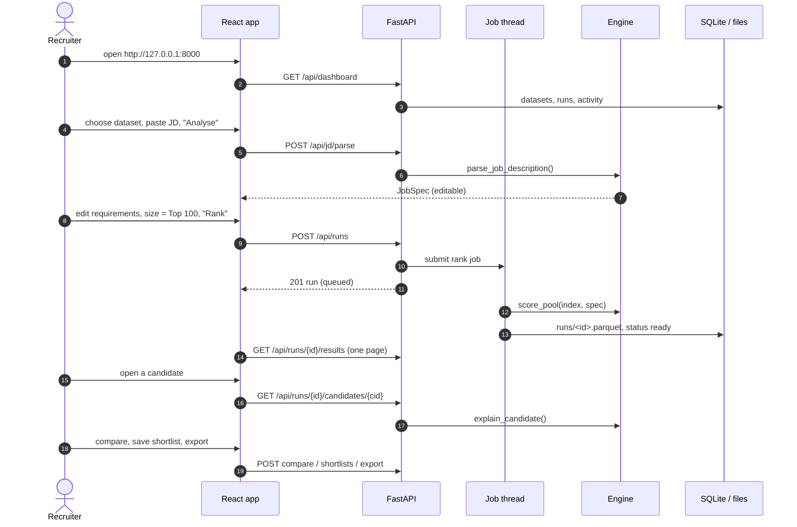
<p class="caption">Figure 11.1 - The complete recruiter journey as a sequence of requests.</p>

## Opening TalentSignal

**What the recruiter sees:** the dashboard - counts of candidates indexed, datasets, runs and shortlists; dataset health; recent runs; recent activity.

**What happens:**

1. The server was started with `uvicorn app.main:app` from `backend/`. `create_app()` (`backend/app/main.py`) installs error handlers, CORS, security headers and the API router, and mounts the built frontend from `frontend/dist`.
2. At start-up the *lifespan* hook calls `build_services()`: it creates the SQLite database (`Database`, `backend/app/database/db.py`), the `JobManager`, and the services; then `DatasetService.register_library()` registers the shared reference dataset and starts indexing it in the background if no index with its fingerprint exists.
3. The browser loads `index.html`; `App.tsx` routes `/` to `DashboardPage`, which calls `api.dashboard()` → `GET /api/dashboard`. `sessionId()` in `services/api.ts` creates or reads the session UUID.
4. If a dataset is still indexing, `usePoll` reloads the dashboard every 2 seconds and shows a progress bar.

## Selecting a candidate dataset

**Options:** use a shared library dataset, upload a file (Datasets page) or import a large file by server path.

**Upload path:** `DatasetsPage` → `uploadDataset()` (an `XMLHttpRequest`, chosen because it reports upload progress) → `POST /api/datasets/upload` → `DatasetService.save_upload()` streams the file to `data/uploads/<uuid>.<ext>` with the size limit → `start_index()` submits an *index* job → `build_index()` (Parts 4 and 9) writes `artifacts/indexes/<fingerprint>/` → the dataset row becomes `ready`. If an index for the same fingerprint already exists it is reused immediately.

**Quality check:** the dataset detail page (`DatasetDetailPage`) shows `quality.json`: rejected rows, repairs, missing-value rates, integrity findings, distributions.

## Uploading or pasting a job description

On the *New ranking* page (`NewRankingPage.tsx`), the recruiter pastes text, loads a bundled preset (`GET /api/jd/presets` lists `engine/resources/jobs/*.txt`) or uploads a `.docx/.txt/.md` file (`POST /api/jd/upload`, 5 MB limit, `extract_text()` in `engine/jd/documents.py`). Clicking **Analyse requirements** calls `POST /api/jd/parse` with the text and the dataset id; the dataset's distinct locations are passed to the parser so city names match real candidate locations.

## Reviewing extracted requirements

`SpecEditor.tsx` renders the returned `JobSpec`: extraction notes (warnings), title and target role families, every requirement with its **source sentence**, the experience band, location and notice, declared conditions with their policies, and the component weights. This is the human checkpoint described in Part 5 - for example, renaming or removing a mislabelled requirement.

## Adjusting weights and constraints

All edits change a local copy of the JobSpec in React state. Nothing is sent until the run starts. Weight sliders show each component's share after normalisation; condition policies offer *Show only*, *Penalise × factor* or *Exclude*; requirements can be marked *Hard*.

## Selecting the shortlist size

A segmented control offers Top 10, 25, 50, 100, 500, 1,000, a custom number, or **All eligible**. The value is sent as `shortlist_size` (an integer, or `null` for all eligible). Every candidate is scored regardless; the size only decides how many eligible candidates are kept in the stored results. Held-for-review candidates are always kept.

## Starting the ranking

`api.createRun()` → `POST /api/runs` → `RunService.create()`:

1. checks the dataset is ready and the size valid;
2. inserts a `runs` row with the JobSpec as JSON (status `queued`);
3. submits a *rank* job to `JobManager` and returns immediately (HTTP 201).

In the job thread, `work()` loads the index from `IndexCache`, calls `score_pool(ix, spec)` (Part 6), builds the **result table** with `_result_table()` (shortlist + held rows, display columns, relevant skills, mean assessment, flag codes, must-haves met), writes `artifacts/runs/<run_id>.parquet`, stores the scored pool in the LRU cache, computes a summary (score histogram, requirements met in the shortlist, weights used, notes) and marks the run `ready`. The browser has meanwhile navigated to `/runs/<id>` and polls `GET /api/runs/{id}` every second, showing the job's progress message.

## Viewing ranked candidates

`RunPage.tsx` shows the run summary (score distribution, requirements met, how scores were composed) and the results. Every change of search text (debounced 300 ms), filter, sort column, page or view triggers `GET /api/runs/{id}/results` with query parameters; `RunService.query()` filters and sorts the Parquet table in pandas and returns one page. Facets (`GET /api/runs/{id}/facets`) populate the filter lists with counts. The *Shortlist / Held for review / All* switch maps to `view=shortlist|held|all`. Table and card layouts render the same rows; cards fetch each candidate's explanation lazily.

## Opening a candidate profile

`CandidatePage.tsx` → `GET /api/runs/{id}/candidates/{cid}` → `RunService.explain()` gets the scored pool from the cache (or deterministically re-scores) and calls `explain_candidate()` (Part 8). The page shows the summary, the score-composition table, differentiators, concerns, missing information, requirement-by-requirement evidence with verified/self-reported markers, integrity findings with evidence, signal breakdowns, career timeline, skills with assessments, and profile details.

## Comparing candidates

Selecting 2-6 rows enables **Compare**, which opens `/runs/{id}/compare?ids=…`. `ComparePage.tsx` calls `POST /api/runs/{id}/compare`; `RunService.compare()` explains each candidate and aligns their requirement coverages and component values into rows. The page highlights the best value per component, colours requirement coverage (met / partial / missing), and marks skills shared by all or unique to one.

## Saving a shortlist

**Save to shortlist** opens a modal: create a new named shortlist or add to an existing one for the same run. `POST /api/shortlists` (or `POST /api/shortlists/{id}/items`) → `ShortlistService` checks that every candidate exists in the run's results, then stores rows in `shortlists` and `shortlist_items`. The shortlist page lets the recruiter write a note per candidate (saved when the text box loses focus), remove candidates, compare them and export them. The navigation rail refreshes through `bus.emit("shortlists")`.

## Exporting results

The **Export** menu calls `download()` in `services/api.ts`, which POSTs to `/api/runs/{id}/export` with `{format, scope, candidate_ids?, include_explanations}` and saves the returned file. `exports.export()` builds a DataFrame from the result table and writes:

| Format | Content |
|---|---|
| CSV | UTF-8 with BOM (opens correctly in Excel), formula-safe cells, optional explanation column (≤ 500 rows) |
| XLSX | styled header, frozen first row, "Run" sheet with metadata and a decision-support note |
| JSON / JSONL / Parquet | the same rows, machine-readable |
| PDF | shortlist report: run metadata, top 50 table, evidence summaries of the top 15 |
| Competition CSV | `POST /api/runs/{id}/export/competition`: exactly 100 rows in the original challenge format, validated before it is returned |

## Where to go next

- **Book 2 - Developer's Implementation & Code Mastery Guide** walks through the code of every module above, documents every API endpoint and database table, and contains exercises.
- **Book 3 - Interview Preparation & Technical Defense Bible** prepares you to explain, calculate, code and defend everything in this book, including its weaknesses.


# Glossary {.appendix}

Terms are defined as they are used in TalentSignal.

| Term | Meaning |
|---|---|
| Ablation | An experiment that removes one part of a system to measure its contribution |
| Affinity (family affinity) | Hand-set number in [0, 1] saying how transferable experience in one role family is to another |
| As-of date | Reference date for "days since active"; by default the newest activity date in the dataset |
| Assessment | A platform-administered skill test score (0-100); treated as verified evidence |
| BM25 | Keyword-relevance formula with term-frequency saturation and length normalisation |
| Calibration | Mapping raw values (e.g. cosine similarity) onto a meaningful scale |
| Component | One of the seven [0, 1] sub-scores combined into the overall score |
| Constraint / declared condition | A condition the JD states (e.g. consulting-only careers) with a policy: show only, penalise, exclude |
| Cosine similarity | Similarity of two vectors as the cosine of the angle between them; equals the dot product for unit vectors |
| Coverage | Strength of evidence for one requirement, combined by noisy-OR |
| Credibility | Factor (0.5-1.0) scaling skill evidence by the relevance of the candidate's titles |
| CSR matrix | Compressed Sparse Row format: stores only non-zero values of a matrix |
| Embedding | A vector representing the meaning of a text, produced by a neural model |
| Engagement | Component built from platform behaviour (activity, responsiveness, reliability) |
| Evidence completeness | Fraction of trust-relevant fields present; displayed, not scored |
| Feature | A number computed for a specific job from processed data, used in scoring |
| Fingerprint | BLAKE2b hash of every byte of a candidate file; names its index directory |
| Held for review | Not in the shortlist because of a gate or critical finding; still inspectable |
| Honeypot | A deliberately impossible profile planted in the reference dataset |
| Index (dataset index) | Directory of precomputed tables, BM25 matrix and embeddings for one candidate file |
| Integrity finding | Result of a consistency check; critical, warning or info |
| JobSpec | Structured, editable representation of a job description (Pydantic model) |
| JSONL | One JSON object per line; streamable |
| Lexical | Based on exact words (as opposed to semantic meaning) |
| Mandatory coverage | Weighted mean coverage over must-have requirements |
| Missing-aware mean | Weighted mean that ignores unavailable values instead of counting them as 0 |
| NDCG | Normalised Discounted Cumulative Gain - a ranking metric emphasising the top positions |
| Noisy-OR | \(1 - \prod(1 - p_i)\): probability that at least one independent source fires |
| Normaliser | `Normalizer` class that validates and repairs records during ingestion |
| Precompute | Work done once per dataset and saved, so per-job work is cheap |
| Proxy labels | Hand-made stand-in relevance labels; not ground truth |
| Recency | \(e^{-m/48}\) for a role that ended \(m\) months ago |
| Role family | Group of job titles matched by taxonomy patterns |
| ScoredPool | Engine output: ordered table of all candidates plus evidence arrays |
| Semantic | Based on meaning rather than exact words |
| Session id | Random UUID per browser used to separate history (not authentication) |
| Taxonomy | The YAML knowledge base of concepts, skills, phrases, role families and affinities |
| Title relevance | How close a job title is to the role being hired for (0-1) |
| Trust | Factor (0.3-1.0) scaling a role description's evidence by its title's relevance |
| Unique segment | A distinct text (headline, summary, title, description) processed once and shared by id |
