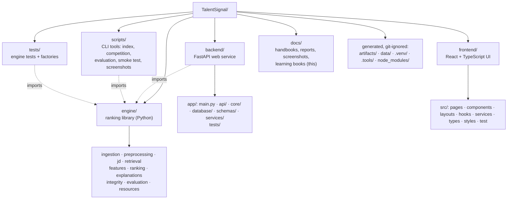
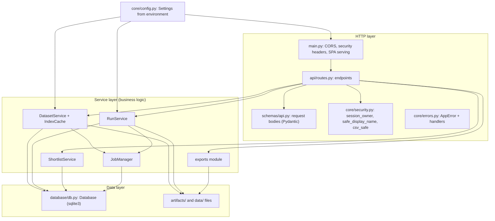
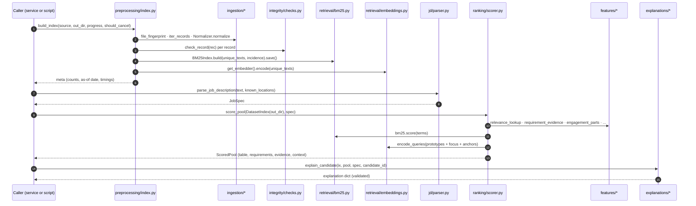
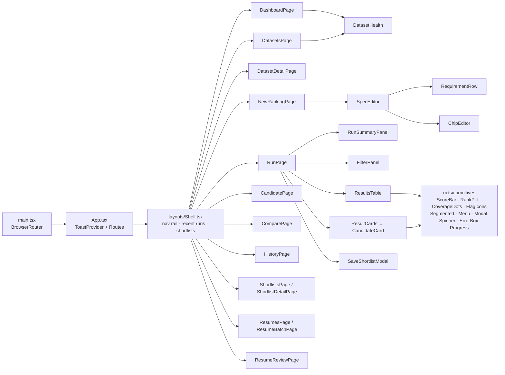
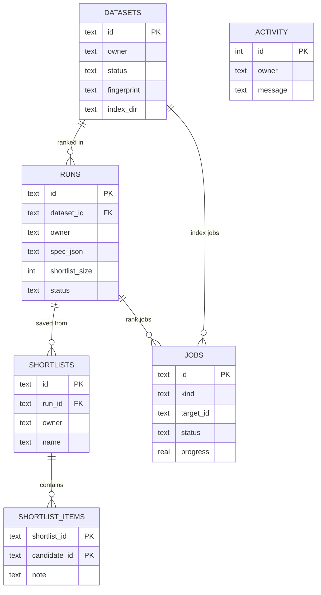
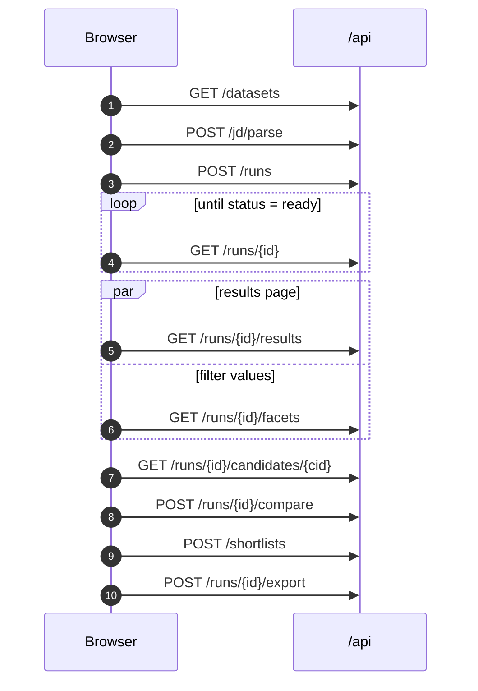
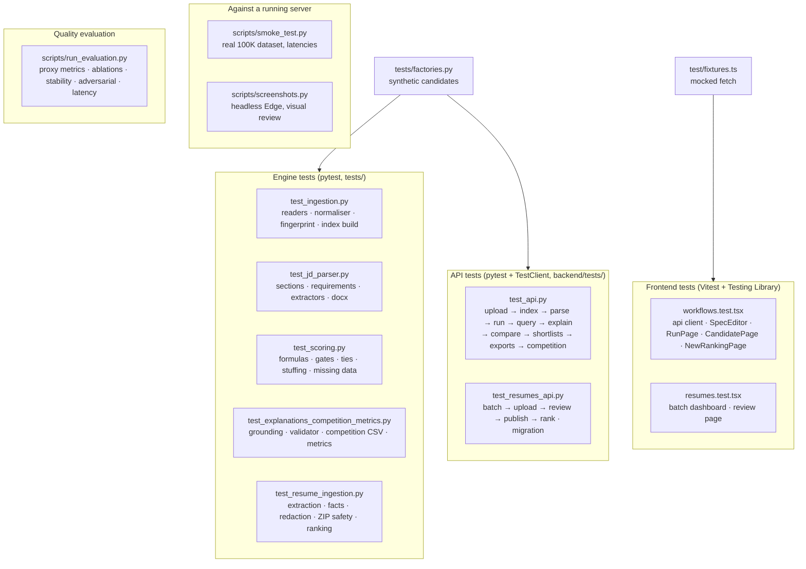
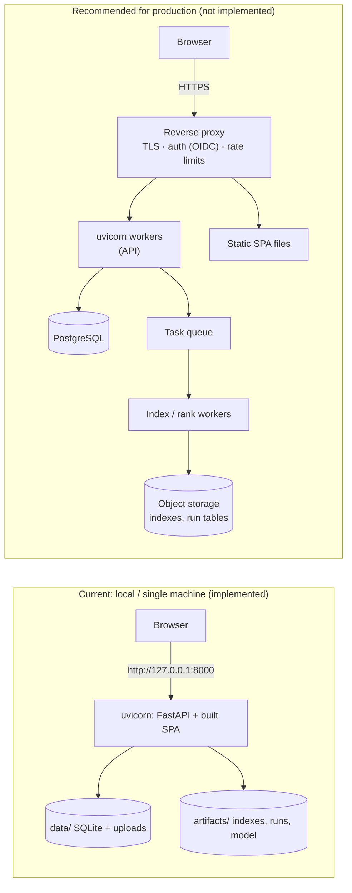

<!-- Generated by docs/learning/build/build.py from docs/learning/src/book2/ - edit the chapter files there. -->

# Repository Structure

This book teaches how the TalentSignal code is built. Book 1 explained *what* the system computes and *why*; here we read the actual source. Code excerpts in this book are **inserted from the real files at build time** (the build script extracts each function or class by name), so they always match the repository at the commit printed on the cover.

## The map


<p class="caption">Figure 1.1 - Repository architecture. Dotted arrows show which parts import the engine; the engine imports none of them.</p>

## Directory by directory

| Directory | Contains | Why it exists | Depends on | Kind |
|---|---|---|---|---|
| `engine/` | The ranking library | Keeps all intelligence independent of the web so it can be tested and reused | NumPy, pandas, SciPy, scikit-learn, sentence-transformers, PyYAML, orjson | source |
| `engine/resources/` | `taxonomy.yaml` (knowledge base), `jobs/*.txt` (bundled JDs) | Domain knowledge as data, editable without code changes | - | data |
| `engine/evaluation/resources/` | `proxy_description_grades.yaml` | Hand-graded proxy labels for evaluation only | - | data |
| `backend/app/` | FastAPI application | HTTP API, persistence, background jobs, exports | `engine`, FastAPI, SQLite, reportlab, openpyxl | source |
| `backend/tests/` | `test_api.py` | End-to-end API tests | pytest, httpx | tests |
| `frontend/src/` | React application | The user interface | React, react-router-dom, lucide-react | source |
| `frontend/dist/` | Built static files | Served by the backend in production mode | produced by `npm run build` | generated |
| `scripts/` | Command-line tools | Index building, competition mode, evaluation, smoke and screenshot tests | `engine` (+ httpx, websocket-client) | source |
| `tests/` | Engine tests and `factories.py` | Fast tests on synthetic records | pytest | tests |
| `docs/` | Handbooks, `ARCHITECTURE.md`, `STATUS.md`, `reports/`, `screenshots/`, `learning/` | Documentation and evidence | - | docs |
| `artifacts/` | `models/`, `indexes/<fingerprint>/`, `runs/<id>.parquet` | Large generated data | produced at run time | generated, ignored |
| `data/` | `talentsignal.sqlite3`, `uploads/` | Application state | produced at run time | generated, ignored |
| `.venv/`, `.tools/`, `node_modules/` | Python environment, portable Node and docs toolchain, JS packages | Reproducible tooling | pinned files | generated, ignored |

## Important top-level files

| File | Purpose |
|---|---|
| `README.md` | Quick start, commands, configuration, measured results, provenance |
| `DEVELOPMENT_LOG.md` | Chronological decisions, measurements and corrections |
| `requirements.txt` / `requirements-dev.txt` | Pinned Python dependencies (runtime / plus test and tool extras) |
| `pyproject.toml` | Project metadata and pytest configuration (`testpaths`, `pythonpath`) |
| `.gitignore`, `.gitattributes` | Ignore generated data; normalise line endings to LF |
| `frontend/package.json`, `vite.config.ts`, `tsconfig.json` | Frontend dependencies, build/dev server (with `/api` proxy) and TypeScript settings |

## Engine modules at a glance

| Module | Main symbols | Role |
|---|---|---|
| `engine/taxonomy.py` | `load_taxonomy`, `Taxonomy`, `Concept`, `RoleFamily` | Load and query the knowledge base |
| `engine/ingestion/readers.py` | `iter_records`, `RawRow`, `unflatten`, `detect_format` | Stream candidate files |
| `engine/ingestion/validation.py` | `Normalizer`, `Issue`, `clean_text` | Validate, repair, report |
| `engine/ingestion/fingerprint.py` | `file_fingerprint` | Full-file BLAKE2b hash |
| `engine/preprocessing/index.py` | `build_index`, `_TextTable`, `Cancelled` | One-time index build |
| `engine/preprocessing/store.py` | `DatasetIndex`, `IndexNotFound` | Lazy reader of an index |
| `engine/jd/spec.py` | `JobSpec`, `Requirement`, `ComponentWeights`, … | The editable job model |
| `engine/jd/parser.py` | `parse_job_description`, `split_sections`, `_ConceptMatcher` | Rule-based JD understanding |
| `engine/jd/documents.py` | `extract_text`, `docx_to_text` | JD documents to text |
| `engine/retrieval/bm25.py` | `BM25Index` | Sparse BM25 |
| `engine/retrieval/embeddings.py` | `get_embedder`, `Embedder` | Offline sentence embeddings |
| `engine/features/*.py` | `requirement_evidence`, `TextMatcher`, `best_per_group`, `engagement_parts`, … | Feature computation |
| `engine/ranking/scorer.py` | `score_pool`, `ScoredPool`, `ScoringOptions` | Scoring orchestration |
| `engine/ranking/competition.py` | `competition_rows`, `write_submission`, `validate_submission` | Competition mode |
| `engine/integrity/checks.py` | `check_record`, `Flag` | Consistency checks |
| `engine/explanations/*.py` | `explain_candidate`, `validate_evidence`, `validate_text` | Grounded explanations |
| `engine/evaluation/*.py` | `evaluate_ranking`, `proxy_labels`, `build_adversarial_file` | Evaluation harness |

## How big is it?

At the commit on the cover the repository contains about 4,600 lines of engine Python, 2,400 lines of backend Python, 3,500 lines of TypeScript/TSX (about 380 of them tests), 300 lines of CSS, 102 automated tests (91 Python, 11 frontend), and nine scripts plus a shared helper (`scripts/_mem.py`). Line counts include comments and docstrings. You can read every important file in a few days; this book tells you in which order.

!!! tip "Recommended reading order of the source"
    `engine/jd/spec.py` → `engine/ranking/scorer.py` (top to bottom) → `engine/features/evidence.py` → `engine/preprocessing/index.py` → `backend/app/services/runs.py` → `backend/app/api/routes.py` → `frontend/src/pages/RunPage.tsx`. Each later part of this book follows roughly that order.


# Backend Implementation

The backend (`backend/app/`) is a FastAPI application. It owns persistence, access separation, background work, query serving and file exports. It contains no ranking logic: every intelligent operation is a call into `engine/`.

## Layers inside the backend


<p class="caption">Figure 2.1 - Backend layers. Routes stay thin; services hold the logic; the database helper and files hold state.</p>

## Application start-up

`backend/app/main.py` adds the project root to `sys.path` (so `import engine` works when running from `backend/`), then builds the application in a factory function. A *factory* lets tests create an app with their own temporary settings.

<p class="src-caption">Source: <code>backend/app/main.py</code> &middot; <code>create_app</code> (inserted from the repository at build time)</p>

```python
def create_app(settings: Settings | None = None, register_library: bool = True) -> FastAPI:
    settings = settings or Settings()
    logging.basicConfig(level=settings.log_level, format="%(asctime)s %(levelname)s %(name)s: %(message)s")

    @asynccontextmanager
    async def lifespan(app: FastAPI):
        services = build_services(settings)
        app.state.services = services
        if register_library:
            services.datasets.register_library()
        log.info("TalentSignal ready (semantic model available: %s)", services.semantic_model_available)
        yield
        services.jobs.shutdown()

    app = FastAPI(title="TalentSignal API", version="1.0.0", lifespan=lifespan)
    install_error_handlers(app)
    app.add_middleware(CORSMiddleware, allow_origins=settings.cors_origins, allow_methods=["*"],
                       allow_headers=["*"], expose_headers=["Content-Disposition"])

    @app.middleware("http")
    async def security_headers(request: Request, call_next):
        response = await call_next(request)
        for k, v in SECURITY_HEADERS.items():
            response.headers.setdefault(k, v)
        return response

    app.include_router(router)

    dist = settings.frontend_dist
    if dist.exists():
        app.mount("/assets", StaticFiles(directory=dist / "assets"), name="assets")

        @app.get("/{full_path:path}", include_in_schema=False)
        async def spa(full_path: str):
            if full_path.startswith("api/"):
                return JSONResponse({"error": {"code": "not_found", "message": "Unknown API route."}}, 404)
            candidate = (dist / full_path).resolve()
            if full_path and candidate.is_file() and candidate.is_relative_to(dist.resolve()):
                return FileResponse(candidate)
            return FileResponse(dist / "index.html")
    return app
```
Points to notice:

- **Lifespan**: services are created when the server starts (`build_services`) and the job pool is shut down when it stops. Shared library datasets are registered at start-up, which may start a background index build.
- **Middleware**: CORS (needed only for the Vite dev server on port 5173) and a small middleware that adds security headers to every response.
- **SPA serving**: if `frontend/dist` exists, `/assets` is served as static files and any other non-API path returns `index.html`, so client-side routes such as `/runs/abc` survive a page refresh. The `is_relative_to(dist)` check prevents `../` path tricks.

`build_services` wires the service objects together:

<p class="src-caption">Source: <code>backend/app/main.py</code> &middot; <code>build_services</code> (inserted from the repository at build time)</p>

```python
def build_services(settings: Settings) -> Services:
    settings.ensure_dirs()
    db = Database(settings.db_path)
    jobs = JobManager(db, settings.job_workers)
    datasets = DatasetService(settings, db, jobs, IndexCache())
    runs = RunService(settings, db, jobs, datasets)
    from engine.retrieval.embeddings import default_model_dir
    return Services(settings, db, jobs, datasets, runs, ShortlistService(db, runs),
                    (default_model_dir() / "config.json").exists(), ResumeService(settings, db, jobs, datasets))
```
## Configuration

`Settings` (`core/config.py`) is a dataclass whose defaults come from environment variables. No secrets exist or are needed.

| Setting | Env variable | Default |
|---|---|---|
| `data_dir` | `TALENTSIGNAL_DATA_DIR` | `TalentSignal/data` |
| `artifacts_dir` | `TALENTSIGNAL_ARTIFACTS_DIR` | `TalentSignal/artifacts` |
| `max_upload_mb` | `TALENTSIGNAL_MAX_UPLOAD_MB` | 2048 |
| `max_jd_upload_mb` | - | 5 |
| `import_dirs` | `TALENTSIGNAL_IMPORT_DIRS` (path-separator list) | `../reference material` |
| `library_datasets` | `TALENTSIGNAL_LIBRARY_DATASETS` | reference `candidates.jsonl` if it exists |
| `cors_origins` | `TALENTSIGNAL_CORS_ORIGINS` | `http://localhost:5173,http://127.0.0.1:5173` |
| `job_workers` | `TALENTSIGNAL_JOB_WORKERS` | 2 |
| `log_level` | `TALENTSIGNAL_LOG_LEVEL` | INFO |

Derived paths: `db_path` = `data/talentsignal.sqlite3`, `uploads_dir`, `indexes_dir` = `artifacts/indexes`, `runs_dir` = `artifacts/runs`.

## Routing and request handling

All endpoints live in `api/routes.py` under the prefix `/api` (the full reference is Part 6). A route function typically does three things: declare and validate inputs, call one service method, return its result.

<p class="src-caption">Source: <code>backend/app/api/routes.py</code> &middot; <code>run_results</code> (inserted from the repository at build time)</p>

```python
@router.get("/runs/{run_id}/results")
def run_results(request: Request, owner: Owner, run_id: str,
                page: int = Query(1, ge=1), page_size: int = Query(50, ge=1, le=200),
                sort: str = "rank", order: str = Query("asc", pattern="^(asc|desc)$"),
                q: str = Query("", max_length=200), view: str = Query("shortlist", pattern="^(shortlist|held|all)$"),
                min_score: float | None = None, max_score: float | None = None,
                min_years: float | None = None, max_years: float | None = None,
                countries: str | None = None, cities: str | None = None, branches: str | None = None,
                skills: str | None = None, flags: str | None = Query(None, pattern="^(none|any|critical|warning)$"),
                min_mandatory: int | None = Query(None, ge=0)):
    split = lambda v: [x for x in v.split(",") if x] if v else None  # noqa: E731
    return services(request).runs.query(
        run_id, owner, page=page, page_size=page_size, sort=sort, order=order, q=q, view=view,
        min_score=min_score, max_score=max_score, min_years=min_years, max_years=max_years,
        countries=split(countries), cities=split(cities), branches=split(branches), skills=split(skills),
        flags=flags, min_mandatory=min_mandatory)
```
FastAPI turns the function parameters into query parameters and validates them: `page` must be ≥ 1, `page_size` 1-200, `order` must match `^(asc|desc)$`, `view` one of three values. Invalid input never reaches the service; it produces a 422 response.

The `owner: Owner` parameter is a **dependency**: `Owner = Annotated[str, Depends(session_owner)]`. Before the route runs, FastAPI calls `session_owner`, which reads the `X-Session-Id` header:

<p class="src-caption">Source: <code>backend/app/core/security.py</code> &middot; <code>session_owner</code> (inserted from the repository at build time)</p>

```python
def session_owner(x_session_id: str | None = Header(default=None)) -> str:
    if not x_session_id or not SESSION_RE.match(x_session_id.lower()):
        raise AppError(400, "invalid_session", "A valid X-Session-Id header (UUID) is required.")
    return x_session_id.lower().replace("-", "")
```
## Request and response models

Request **bodies** are Pydantic models in `schemas/api.py`. The most important one embeds the engine's own `JobSpec`, so the recruiter's edited specification is validated with exactly the same rules the engine uses:

<p class="src-caption">Source: <code>backend/app/schemas/api.py</code> &middot; <code>CreateRunRequest</code> (inserted from the repository at build time)</p>

```python
class CreateRunRequest(BaseModel):
    dataset_id: str
    spec: JobSpec
    # None = all eligible candidates (product mode never hard-codes 100).
    shortlist_size: int | None = Field(default=100, ge=1, le=1_000_000)
    name: str | None = Field(default=None, max_length=160)
```
Responses are plain dictionaries built by the services (FastAPI serialises them to JSON). The TypeScript interfaces in `frontend/src/types/api.ts` document their shapes.

## Error handling

<p class="src-caption">Source: <code>backend/app/core/errors.py</code> &middot; <code>install_error_handlers</code> (inserted from the repository at build time)</p>

```python
def install_error_handlers(app: FastAPI) -> None:
    @app.exception_handler(AppError)
    async def _app_error(_: Request, exc: AppError):
        return JSONResponse({"error": {"code": exc.code, "message": exc.message}}, status_code=exc.status)

    @app.exception_handler(RequestValidationError)
    async def _validation(_: Request, exc: RequestValidationError):
        details = [
            {"field": ".".join(str(p) for p in e.get("loc", [])[1:]), "message": e.get("msg", "")}
            for e in exc.errors()
        ]
        msg = "; ".join(f"{d['field']}: {d['message']}" for d in details[:5]) or "Invalid request."
        return JSONResponse({"error": {"code": "validation_error", "message": msg, "details": details}},
                            status_code=422)

    @app.exception_handler(Exception)
    async def _unexpected(request: Request, exc: Exception):
        log.exception("Unhandled error on %s %s", request.method, request.url.path)
        return JSONResponse({"error": {"code": "internal_error",
                                       "message": "An unexpected error occurred. It has been logged."}},
                            status_code=500)
```
Three handlers give every failure the same shape, `{"error": {"code", "message"}}`:

1. `AppError(status, code, message)` - raised by services for expected problems (`dataset_not_ready`, `file_too_large`, `run_not_found`, …).
2. `RequestValidationError` - FastAPI's validation failures, converted to a readable message plus `details`.
3. Any other exception - logged with its stack trace, returned as a generic 500 that leaks no internals.

## The job manager

Long work (index builds, scoring) runs in background threads. `JobManager.submit` records a job row, creates a cancel event, and schedules a wrapper that updates the job's status around the actual work:

<p class="src-caption">Source: <code>backend/app/services/jobs.py</code> &middot; <code>JobManager.submit</code> (inserted from the repository at build time)</p>

```python
def submit(self, kind: str, target_id: str, owner: str | None, fn: Callable[[JobContext], None],
           on_error: Callable[[str], None] | None = None,
           on_cancel: Callable[[], None] | None = None) -> str:
    job_id = new_id()
    self.db.insert("jobs", {"id": job_id, "owner": owner, "kind": kind, "target_id": target_id,
                            "status": "queued", "progress": 0.0, "message": "Queued", "created_at": now()})
    ev = threading.Event()
    self.cancel_events[job_id] = ev

    def run() -> None:
        if ev.is_set():
            self._finish(job_id, "cancelled", "Cancelled before start")
            if on_cancel:
                on_cancel()
            return
        self.db.update("jobs", job_id, status="running", started_at=now(), message="Starting")
        ctx = JobContext(self.db, job_id, ev)
        try:
            fn(ctx)
            self._finish(job_id, "succeeded", "Done", progress=1.0)
        except JobCancelled:
            self._finish(job_id, "cancelled", "Cancelled")
            if on_cancel:
                on_cancel()
        except Exception as exc:  # noqa: BLE001 - recorded for the user
            log.exception("Job %s (%s) failed", job_id, kind)
            msg = f"{type(exc).__name__}: {exc}"[:500]
            self._finish(job_id, "failed", "Failed", error=msg)
            if on_error:
                on_error(msg)
        finally:
            self.cancel_events.pop(job_id, None)

    self.pool.submit(run)
    return job_id
```
The work function receives a `JobContext`. `progress()` writes at most every 0.5 seconds (so a tight loop does not flood SQLite with writes); `check()` raises `JobCancelled` if the user cancelled.

<p class="src-caption">Source: <code>backend/app/services/jobs.py</code> &middot; <code>JobContext</code> (inserted from the repository at build time)</p>

```python
class JobContext:
    def __init__(self, db: Database, job_id: str, cancel_event: threading.Event):
        self.db = db
        self.job_id = job_id
        self._cancel = cancel_event
        self._last = 0.0

    def progress(self, fraction: float, message: str) -> None:
        t = time.monotonic()
        if t - self._last >= PROGRESS_MIN_INTERVAL_S or fraction >= 1.0:
            self._last = t
            self.db.update("jobs", self.job_id, progress=round(max(0.0, min(1.0, fraction)), 4), message=message[:200])

    def cancelled(self) -> bool:
        return self._cancel.is_set()

    def check(self) -> None:
        if self._cancel.is_set():
            raise JobCancelled()
```
At start-up the manager marks any job that was still `queued` or `running` as failed ("Server restarted while the job was running") - otherwise the UI would show a progress bar that never moves.

## Dataset service and file uploads

<p class="src-caption">Source: <code>backend/app/services/datasets.py</code> &middot; <code>DatasetService.save_upload</code> (inserted from the repository at build time)</p>

```python
def save_upload(self, owner: str, filename: str, stream: BinaryIO) -> dict:
    name = safe_display_name(filename)
    ext = Path(name).suffix.lower()
    if ext not in SUPPORTED_EXTENSIONS:
        raise AppError(415, "unsupported_format",
                       f"Unsupported file type '{ext or '(none)'}'. Supported: {', '.join(SUPPORTED_EXTENSIONS)}")
    limit = self.s.max_upload_mb * 1024 * 1024
    dest = self.s.uploads_dir / f"{new_id()}{ext}"  # server-chosen name; user input never reaches the path
    written = 0
    try:
        with open(dest, "wb") as out:
            while chunk := stream.read(COPY_CHUNK):
                written += len(chunk)
                if written > limit:
                    raise AppError(413, "file_too_large", f"File exceeds the {self.s.max_upload_mb} MB limit.")
                out.write(chunk)
    except AppError:
        dest.unlink(missing_ok=True)
        raise
    if written == 0:
        dest.unlink(missing_ok=True)
        raise AppError(400, "empty_file", "The uploaded file is empty.")
    row = self._create(owner, name, "upload", dest)
    self.start_index(row, owner)
    return self.get(row["id"], owner)
```
Security-relevant details: the extension is checked first; the destination name is a new random id (the user's filename never reaches the file system); the size limit is enforced *while streaming*, so an oversized upload is never fully written; a failed upload deletes its partial file.

Index building is a job. Note the *build-to-temporary-then-rename* pattern: the index is written into `<fingerprint>.building` and only renamed to its final name when complete, so a crash or cancellation can never leave a half-built index that looks valid.

<p class="src-caption">Source: <code>backend/app/services/datasets.py</code> &middot; <code>DatasetService.start_index</code> (inserted from the repository at build time)</p>

```python
def start_index(self, row: dict, owner: str | None) -> str:
    ds_id = row["id"]

    def work(ctx: JobContext) -> None:
        self.db.update("datasets", ds_id, status="indexing", updated_at=now(), error=None)
        ctx.progress(0.01, "Fingerprinting file")
        fp = file_fingerprint(row["source_path"])
        index_dir = self.s.indexes_dir / fp
        try:
            ix = DatasetIndex(index_dir)  # identical file already indexed: reuse it
            ctx.progress(1.0, "Reused existing index")
        except IndexNotFound:
            tmp = index_dir.with_name(index_dir.name + ".building")
            shutil.rmtree(tmp, ignore_errors=True)
            try:
                build_index(row["source_path"], tmp, progress=ctx.progress, should_cancel=ctx.cancelled)
            except Cancelled as exc:
                shutil.rmtree(tmp, ignore_errors=True)
                raise JobCancelled() from exc
            except Exception:
                shutil.rmtree(tmp, ignore_errors=True)
                raise
            shutil.rmtree(index_dir, ignore_errors=True)
            tmp.rename(index_dir)
            ix = DatasetIndex(index_dir)
        self.db.update("datasets", ds_id, status="ready", fingerprint=fp, index_dir=str(index_dir),
                       n_candidates=ix.n, updated_at=now())
        self.db.log_activity(owner, "dataset", f"Dataset '{row['name']}' indexed ({ix.n:,} candidates)", ds_id)

    def failed(msg: str) -> None:
        self.db.update("datasets", ds_id, status="failed", error=msg, updated_at=now())

    def cancelled() -> None:
        self.db.update("datasets", ds_id, status="failed", error="Indexing was cancelled.", updated_at=now())

    return self.jobs.submit("index", ds_id, owner, work, on_error=failed, on_cancel=cancelled)
```
## Run service: business logic of ranking

`RunService.create` inserts the run, submits the rank job and returns immediately. The job calls the engine and then builds the **result table**:

<p class="src-caption">Source: <code>backend/app/services/runs.py</code> &middot; <code>RunService._result_table</code> (inserted from the repository at build time)</p>

```python
def _result_table(self, ix: DatasetIndex, pool: ScoredPool, spec: JobSpec, size: int | None) -> pd.DataFrame:
    t = pool.table
    keep = t[t["eligible"]] if size is None else t[t["eligible"]].head(size)
    held = t[~t["eligible"]]
    res = pd.concat([keep, held], ignore_index=True)
    cand = ix.candidates.set_index("idx")
    disp = cand.loc[res["idx"], DISPLAY_COLS].reset_index(drop=True)
    res = pd.concat([res.reset_index(drop=True), disp], axis=1)

    jd_skills = {s.lower() for r in spec.requirements for s in r.skills}
    res["relevant_skills"] = [
        "|".join(s for s in (sk or "").split("|") if s and s.lower() in jd_skills) for sk in res["skills"]]
    sk = ix.skills
    rel = sk[sk["skill"].str.lower().isin(jd_skills) & sk["assessed"].notna()]
    mean_assessed = rel.groupby("idx")["assessed"].mean()
    res["assessment_mean"] = res["idx"].map(mean_assessed).astype("float32")
    flags = ix.integrity
    sev = flags.groupby("idx")["code"].agg(lambda s: "|".join(sorted(set(s))))
    res["flag_codes"] = res["idx"].map(sev).fillna("")
    res.loc[res["uncorroborated_skills"], "flag_codes"] = (
        res.loc[res["uncorroborated_skills"], "flag_codes"].str.strip("|") + "|uncorroborated_skill_claims"
    ).str.strip("|")
    mand = [r.id for r in pool.requirements if r.importance == "mandatory"]
    res["mandatory_met"] = (res[[f"req_{m}" for m in mand]] >= MET_THRESHOLD).sum(axis=1).astype("int16") \
        if mand else 0
    res["mandatory_total"] = len(mand)
    return res
```
The table contains the shortlist (or all eligible) followed by every held candidate, the engine's component columns, and display columns joined from the index. Pre-computing `relevant_skills`, `assessment_mean`, `flag_codes` and `mandatory_met` once here keeps every later page request cheap.

Query serving is pure pandas filtering on that table (`RunService.query`; excerpted in Part 7 of this book). Explanations need the full scored pool, which is kept in a small LRU cache and recomputed deterministically when missing:

<p class="src-caption">Source: <code>backend/app/services/runs.py</code> &middot; <code>RunService.pool</code> (inserted from the repository at build time)</p>

```python
def pool(self, run_id: str, owner: str) -> tuple[ScoredPool, DatasetIndex, JobSpec]:
    cached = self.pools.get(run_id)
    if cached:
        return cached
    run = self.get(run_id, owner)
    with self._recompute_lock:
        cached = self.pools.get(run_id)
        if cached:
            return cached
        ds = self.datasets.get(run["dataset_id"], owner)
        ix = self.datasets.index(ds)
        spec = JobSpec.model_validate(run["spec"])
        entry = (score_pool(ix, spec), ix, spec)
        self.pools.put(run_id, entry)
        return entry
```
## Exports

`services/exports.py` turns a run's table into files. The format dispatch:

<p class="src-caption">Source: <code>backend/app/services/exports.py</code> &middot; <code>export</code> (inserted from the repository at build time)</p>

```python
def export(runs: RunService, run_id: str, owner: str, fmt: str, scope: str = "shortlist",
           candidate_ids: list[str] | None = None, with_summaries: bool = False) -> tuple[bytes, str, str]:
    if fmt not in FORMATS:
        raise AppError(422, "invalid_format", f"Format must be one of: {', '.join(FORMATS)}.")
    run = runs.get(run_id, owner)
    df = _frame(runs, run_id, owner, scope, candidate_ids, with_summaries)
    stem = f"talentsignal_{run_id[:8]}"
    if fmt == "csv":
        buf = io.StringIO()
        df.map(csv_safe).to_csv(buf, index=False)
        data = buf.getvalue().encode("utf-8-sig")
    elif fmt == "xlsx":
        data = _xlsx(df, run)
    elif fmt == "json":
        data = json.dumps({"run": _run_meta(run), "candidates": json.loads(df.to_json(orient="records"))},
                          indent=1).encode("utf-8")
    elif fmt == "jsonl":
        data = df.to_json(orient="records", lines=True).encode("utf-8")
    elif fmt == "parquet":
        buf = io.BytesIO()
        df.to_parquet(buf, index=False)
        data = buf.getvalue()
    else:
        data = _pdf(runs, run, owner, df)
    return data, FORMATS[fmt], f"{stem}.{fmt}"
```
`csv_safe` neutralises spreadsheet formulas in every text cell of CSV and XLSX exports. The PDF report escapes text before passing it to reportlab. The competition export reuses the engine's `competition_rows` and `validate_submission` and refuses to return an invalid file.

## Dependency management

Backend dependencies are pinned in `requirements.txt` (FastAPI 0.135.3, uvicorn 0.44.0, pydantic 2.12.5, python-multipart 0.0.32, reportlab 5.1.0, openpyxl 3.1.5, and the engine's scientific stack). `torch` must be installed from the CPU wheel index first; otherwise pip may download a multi-gigabyte CUDA build. Book 2, Part 10 gives the exact commands.


# Engine Implementation

The engine is a plain Python package. This part walks through its modules in the order data flows through them, then traces one complete call. For the *mathematics* behind each function, see Book 1, Part 6; here we focus on the code, its inputs and outputs, and its edge cases.

## Execution flow between modules


<p class="caption">Figure 3.1 - Call sequence through the engine for one dataset and one job.</p>

## engine/taxonomy.py - the knowledge base loader

**Responsibility:** load `resources/taxonomy.yaml` into typed objects and answer three questions: which family does a title belong to, how related are two families, what seniority does a title imply.

**Key symbols:** `Concept` (frozen dataclass), `RoleFamily`, `Taxonomy`, `load_taxonomy()` (cached with `functools.lru_cache`, so the YAML is parsed once per process).

<p class="src-caption">Source: <code>engine/taxonomy.py</code> &middot; <code>Taxonomy.family_of</code> (inserted from the repository at build time)</p>

```python
def family_of(self, title: str) -> str:
    """Return the role-family id of a job title (first matching pattern)."""
    key = (title or "").strip().lower()
    cached = self._family_cache.get(key)
    if cached is not None:
        return cached
    family = "non_technical"
    for fam in self.families:
        if any(p.search(key) for p in fam.patterns):
            family = fam.id
            break
    self._family_cache[key] = family
    return family
```
**Edge cases:** the last family's pattern is `.*`, so every title gets *some* family (`non_technical`). Results are memoised per lower-cased title in `_family_cache`, which matters because `family_of` is called for hundreds of thousands of role rows - though `relevance_lookup` already reduces that to one call per *distinct* title.

## engine/ingestion - readers, validation, fingerprint

**`readers.py`** - `iter_records(path)` dispatches on the file extension to a generator. A *generator* (a function containing `yield`) produces one item at a time, which is what makes streaming possible.

<p class="src-caption">Source: <code>engine/ingestion/readers.py</code> &middot; <code>unflatten</code> (inserted from the repository at build time)</p>

```python
def unflatten(row: dict[str, Any]) -> dict[str, Any]:
    """Turn ``{"profile.headline": "x", "skills": "[...]"}`` into nested dicts."""
    out: dict[str, Any] = {}
    for key, value in row.items():
        if key is None:
            continue
        value = _maybe_json(value)
        if value is None:
            continue
        parts = str(key).strip().split(".")
        cur = out
        for p in parts[:-1]:
            nxt = cur.get(p)
            if not isinstance(nxt, dict):
                nxt = {}
                cur[p] = nxt
            cur = nxt
        cur[parts[-1]] = value
    return out
```
`unflatten` is shared by the CSV, XLSX and Parquet readers. It turns dotted column names into nested dictionaries and parses JSON text in cells. Edge cases: an empty string becomes `None` (dropped); a cell whose text starts with `[` but is not valid JSON is kept as text.

**`validation.py`** - `Normalizer` is *stateful* only to remember IDs already seen (duplicate detection). Its `normalize` method returns `(record or None, issues)`:

<p class="src-caption">Source: <code>engine/ingestion/validation.py</code> &middot; <code>Normalizer.normalize</code> (inserted from the repository at build time)</p>

```python
def normalize(self, rec: Any) -> tuple[dict[str, Any] | None, list[Issue]]:
    issues: list[Issue] = []
    if not isinstance(rec, dict):
        return None, [Issue("error", "", "Record is not an object.")]

    cid = rec.get("candidate_id")
    cid = str(cid).strip() if cid is not None else ""
    if not cid or not ID_PATTERN.match(cid):
        return None, [Issue("error", "candidate_id",
                            "Missing or invalid candidate_id (1-64 chars of letters, digits, _ . -).")]
    if cid in self.seen_ids:
        return None, [Issue("error", "candidate_id", f"Duplicate candidate_id '{cid}'; first occurrence kept.")]
    if not REFERENCE_ID_PATTERN.match(cid):
        issues.append(Issue("warning", "candidate_id", "Id does not follow the CAND_XXXXXXX convention."))

    prof_in = rec.get("profile")
    if not isinstance(prof_in, dict):
        return None, [Issue("error", "profile", "Missing profile object.")]
    self.seen_ids.add(cid)

    out: dict[str, Any] = {"candidate_id": cid}
    out["profile"] = _profile(prof_in, issues)
    out["career_history"] = _career(rec.get("career_history"), issues)
    out["education"] = _education(rec.get("education"), issues)
    out["skills"] = _skills(rec.get("skills"), issues)
    out["certifications"] = _list_of_dicts(rec.get("certifications"), ("name", "issuer", "year"))
    out["languages"] = _list_of_dicts(rec.get("languages"), ("language", "proficiency"))
    out["redrob_signals"] = _signals(rec.get("redrob_signals"), issues)

    p = out["profile"]
    if not p["current_title"] and out["career_history"]:
        p["current_title"] = out["career_history"][0]["title"]
        issues.append(Issue("warning", "profile.current_title", "Filled from the most recent role."))
    if p["years_of_experience"] is None and out["career_history"]:
        months = sum(r["duration_months"] or 0 for r in out["career_history"])
        p["years_of_experience"] = round(months / 12, 1)
        issues.append(Issue("warning", "profile.years_of_experience", "Derived from career history."))
    return out, issues
```
Notice the last two blocks: if `current_title` is missing it is filled from the most recent role, and if `years_of_experience` is missing it is derived from role durations - both recorded as warnings, so the quality report shows that a value was *derived*, not stated.

**`fingerprint.py`** - `file_fingerprint(path)` returns `b2-<size>-<blake2b hex>`.

## engine/preprocessing/index.py - building an index

**Responsibility:** one streaming pass that produces every artifact of a dataset index. **Input:** a candidate file path and an output directory; optional `progress(fraction, message)` and `should_cancel()` callbacks (the backend passes the job context's methods). **Output:** the `meta` dictionary; files on disk.

The central helper is the text table, which assigns each distinct text an id:

<p class="src-caption">Source: <code>engine/preprocessing/index.py</code> &middot; <code>_TextTable</code> (inserted from the repository at build time)</p>

```python
@dataclass
class _TextTable:
    ids: dict[str, int] = field(default_factory=dict)
    texts: list[str] = field(default_factory=list)
    kinds: list[str] = field(default_factory=list)

    def add(self, text: str, kind: str) -> int:
        if not text:
            return -1
        key = kind + "\x00" + text
        tid = self.ids.get(key)
        if tid is None:
            tid = len(self.texts)
            self.ids[key] = tid
            self.texts.append(text)
            self.kinds.append(kind)
        return tid
```
The key `kind + "\x00" + text` keeps, for example, a title "Search Engineer" and a skill "Search Engineer" (if one existed) as separate segments.

For each record the builder appends compact tuples to lists (`role_rows`, `skill_rows`, `flag_rows`), records which segments the candidate uses (`incidence_rows`/`incidence_cols`), writes the normalised record to `records.jsonl` and remembers its byte offset. After the pass the lists become DataFrames and Parquet files; the incidence lists become a sparse matrix for `BM25Index.build`; unique non-skill segments are embedded (stored as float16 to halve disk space).

**Common bugs and edge cases handled:** an empty file raises `ValueError("No valid candidate records …")` (reported as a failed dataset); a cancellation raises `Cancelled` at the next 2,000-record checkpoint or between stages; the integrity table keeps an integer `idx` dtype even when there are no findings (a real bug, found by tests, where an empty DataFrame's index column became `object` and broke NumPy indexing later).

## engine/preprocessing/store.py - reading an index

`DatasetIndex` loads lazily: each table is a `functools.cached_property`, read from disk the first time it is used and kept afterwards. Random access to one candidate's full record uses the byte offsets:

<p class="src-caption">Source: <code>engine/preprocessing/store.py</code> &middot; <code>DatasetIndex.record</code> (inserted from the repository at build time)</p>

```python
def record(self, idx: int) -> dict:
    """Full normalised record for row ``idx``."""
    with open(self.dir / "records.jsonl", "rb") as f:
        f.seek(int(self.offsets[idx]))
        return orjson.loads(f.readline())
```
Opening an index whose `format_version` differs from the engine's `INDEX_FORMAT_VERSION` raises `IndexNotFound`, so an old index is rebuilt rather than misread.

## engine/jd - the job model, documents and parser

`spec.py` defines the Pydantic models (Book 1, Part 5 lists every field). One method worth seeing is the weight normalisation used by the scorer:

<p class="src-caption">Source: <code>engine/jd/spec.py</code> &middot; <code>ComponentWeights</code> (inserted from the repository at build time)</p>

```python
class ComponentWeights(BaseModel):
    """Relative influence of each score component. Normalised to sum to 1."""

    requirements: float = Field(0.34, ge=0)
    role_fit: float = Field(0.20, ge=0)
    semantic: float = Field(0.12, ge=0)
    lexical: float = Field(0.05, ge=0)
    experience: float = Field(0.10, ge=0)
    engagement: float = Field(0.11, ge=0)
    logistics: float = Field(0.08, ge=0)

    def normalized(self) -> dict[str, float]:
        raw = self.model_dump()
        total = sum(raw.values())
        if total <= 0:
            raise ValueError("At least one component weight must be positive.")
        return {k: v / total for k, v in raw.items()}
```
`parser.py` is organised as a pipeline of small private functions (`split_sections`, `_ConceptMatcher`, `_extract_experience`, `_extract_location`, `_extract_notice`, `_extract_title`), assembled by `parse_job_description`. The concept matcher compiles one word-boundary regex per term once, then scans sentences:

<p class="src-caption">Source: <code>engine/jd/parser.py</code> &middot; <code>_ConceptMatcher</code> (inserted from the repository at build time)</p>

```python
class _ConceptMatcher:
    def __init__(self, tax: Taxonomy):
        self.patterns: dict[str, list[re.Pattern]] = {}
        for c in tax.concepts.values():
            terms = {s.lower() for s in c.skills} | set(c.phrases)
            self.patterns[c.id] = [_term_regex(t) for t in sorted(terms) if len(t) >= 2]

    def find(self, sentence: str) -> list[str]:
        s = sentence.lower()
        return [cid for cid, pats in self.patterns.items() if any(p.search(s) for p in pats)]
```
**Edge cases:** headings that are really "Key: value" lines; bullets versus numbers that are content ("6-8 years" must not lose its "6-"; this was a real bug fixed during development); concepts mentioned in context sections are ignored.

## engine/retrieval - BM25 and embeddings

`bm25.py` builds the index from unique segments and an incidence matrix, precomputing the query-independent part of BM25 into the stored matrix:

<p class="src-caption">Source: <code>engine/retrieval/bm25.py</code> &middot; <code>BM25Index.build</code> (inserted from the repository at build time)</p>

```python
@classmethod
def build(cls, segment_texts: list[str], incidence: sparse.csr_matrix) -> "BM25Index":
    vec = make_vectorizer()
    seg_tf = vec.fit_transform(segment_texts).tocsr()          # segments x terms
    tf = (incidence @ seg_tf).tocsr().astype(np.float32)       # candidates x terms
    n = tf.shape[0]
    df = np.bincount(tf.indices, minlength=tf.shape[1]).astype(np.float64)
    idf = np.log1p((n - df + 0.5) / (df + 0.5)).astype(np.float32)
    dl = np.asarray(tf.sum(axis=1)).ravel()
    avgdl = float(dl.mean()) if n else 1.0
    norm = K1 * (1 - B + B * dl / max(avgdl, 1e-9))
    rows = np.repeat(np.arange(n), np.diff(tf.indptr))
    data = tf.data
    tf.data = (data * (K1 + 1) / (data + norm[rows])).astype(np.float32)
    vocab = {k: int(v) for k, v in vec.vocabulary_.items()}
    return cls(tf, idf, vocab)
```
Read the last lines carefully: `rows = np.repeat(...)` gives, for every stored non-zero entry, the row (candidate) it belongs to, so the document-length normalisation can be applied to all entries in one vectorised expression. The vocabulary is saved as JSON, not pickled, so loading an index never executes code.

`embeddings.py` wraps sentence-transformers. `get_embedder()` returns a cached `Embedder` or `None` (logging the reason in `last_error`) if the local model is missing. `encode_queries` memoises short query texts:

<p class="src-caption">Source: <code>engine/retrieval/embeddings.py</code> &middot; <code>Embedder.encode_queries</code> (inserted from the repository at build time)</p>

```python
def encode_queries(self, texts: list[str]) -> np.ndarray:
    """Encode short query-side texts with memoisation and length bucketing."""
    missing = [t for t in dict.fromkeys(texts) if t not in self._cache]
    if missing:
        vecs = self.encode(missing, batch_size=8)
        with self._cache_lock:
            if len(self._cache) > 5000:
                self._cache.clear()
            self._cache.update(zip(missing, vecs))
    return np.vstack([self._cache[t] for t in texts]) if texts else np.zeros((0, self.dim), np.float32)
```
## engine/features - the feature functions

| File | Main functions | Returns |
|---|---|---|
| `titles.py` | `title_relevance`, `relevance_lookup`, `family_lookup`, `seniority_lookup` | arrays over a title column (computed once per distinct title) |
| `evidence.py` | `best_per_group`, `skill_row_strength`, `TextMatcher`, `requirement_evidence`, `calibrate_semantic`, `adaptive_bounds` | `RequirementEvidence` per requirement |
| `signals.py` | `engagement_parts`, `experience_parts`, `logistics_parts`, `weighted_available`, `evidence_completeness` | dicts of named sub-score arrays (NaN = missing) |
| `constraints.py` | `consulting_only`, `non_coding_lead`, `title_chasing`, `research_only`, `concept_dominance` | boolean arrays "triggers this condition" |
| `calibration.py` | constants only | - |

The heart of the features is `requirement_evidence`:

<p class="src-caption">Source: <code>engine/features/evidence.py</code> &middot; <code>requirement_evidence</code> (inserted from the repository at build time)</p>

```python
def requirement_evidence(ix: DatasetIndex, req: Requirement, ctx: RoleContext, matcher: TextMatcher,
                         vector: np.ndarray | None, skill_strength: np.ndarray,
                         use_text: bool = True, use_skills: bool = True,
                         use_assessments: bool = True) -> RequirementEvidence:
    n = ix.n
    sk = ix.skills
    codes, vocab = ix.skill_codes
    wanted = [vocab[s.lower()] for s in req.skills if s.lower() in vocab]
    rows = np.flatnonzero(np.isin(codes, wanted)) if (wanted and use_skills) else np.array([], int)
    strength = skill_strength[rows] if use_assessments else skill_row_strength(
        sk["level"].to_numpy()[rows], sk["months"].to_numpy()[rows], np.full(len(rows), np.nan, np.float32))
    cand_of_row = sk["idx"].to_numpy()[rows]
    best_skill, arg = best_per_group(cand_of_row, strength, n)
    best_skill_row = np.where(arg >= 0, rows[np.maximum(arg, 0)], -1) if len(rows) else np.full(n, -1)
    n_matches = np.bincount(cand_of_row, minlength=n).astype(np.int16)
    assessed = sk["assessed"].to_numpy()
    verified = np.zeros(n, dtype=bool)
    has = best_skill_row >= 0
    verified[has] = ~np.isnan(assessed[best_skill_row[has]]) & use_assessments
    skill_ev = best_skill * ctx.credibility

    if use_text:
        phrases = list(req.phrases) + list(req.skills)
        match, _, _ = matcher.match(phrases, vector)
        role_vals = _gather(match, ctx.text_id) * ctx.trust * ctx.recency_keep
        role_ev, role_arg = best_per_group(ctx.cand, role_vals, n)
        self_ev = cal.SELF_DESCRIPTION_WEIGHT * np.maximum(_gather(match, ctx.summary_tid),
                                                           _gather(match, ctx.headline_tid)) * ctx.credibility
        text_ev = np.maximum(role_ev, self_ev)
        from_summary = self_ev > role_ev
    else:
        text_ev = np.zeros(n, np.float32)
        role_arg = np.full(n, -1)
        from_summary = np.zeros(n, bool)

    signal_ev = np.zeros(n, dtype=np.float32)
    if req.signal:
        col = f"sig_{req.signal}"
        if col in ix.candidates.columns:
            signal_ev = np.nan_to_num(ix.candidates[col].to_numpy(dtype=np.float32) / 100.0, nan=0.0)
            signal_ev = np.clip(signal_ev, 0, 1) * 0.8  # activity is supporting, not conclusive, evidence

    coverage = 1.0 - (1.0 - skill_ev) * (1.0 - text_ev) * (1.0 - signal_ev)
    return RequirementEvidence(
        coverage=coverage.astype(np.float32), skill=skill_ev.astype(np.float32), text=text_ev.astype(np.float32),
        signal=signal_ev, best_skill_row=best_skill_row, best_role_row=role_arg,
        text_from_summary=from_summary, verified=verified, n_skill_matches=n_matches,
    )
```
Its inputs are the index, one requirement, the shared `RoleContext`, the `TextMatcher` (unique texts lower-cased once), the requirement's embedding vector and the pre-computed strength of every skill row. Its output `RequirementEvidence` keeps not only the coverage but the *winning skill row* and *winning role row* for every candidate - the pointers explanations later follow.

The missing-aware mean used by three components is short enough to read in full:

<p class="src-caption">Source: <code>engine/features/signals.py</code> &middot; <code>weighted_available</code> (inserted from the repository at build time)</p>

```python
def weighted_available(parts: dict[str, np.ndarray], weights: dict[str, float]) -> np.ndarray:
    num = 0.0
    den = 0.0
    for k, w in weights.items():
        x = parts[k]
        avail = ~np.isnan(x)
        num = num + w * np.where(avail, x, 0.0)
        den = den + w * avail
    out = np.where(den > 0, num / np.maximum(den, 1e-9), 0.5)
    return out.astype(np.float32)
```
## engine/ranking/scorer.py - orchestration

`score_pool` is long (about 250 lines) because it orchestrates every step; it delegates the actual computations to `features/`. Its structure, by comment banner: titles and roles → requirement evidence → semantic → lexical → experience/engagement/logistics → components and weights → constraints → hard requirements → integrity → evidence completeness → sorting and context. Book 2, Part 7 explains the most important passages; the `ScoringOptions` dataclass shows which parts can be switched off for ablations:

<p class="src-caption">Source: <code>engine/ranking/scorer.py</code> &middot; <code>ScoringOptions</code> (inserted from the repository at build time)</p>

```python
@dataclass
class ScoringOptions:
    """Switches used by ablation experiments; defaults = full system."""

    disabled_components: frozenset[str] = frozenset()
    use_assessments: bool = True
    use_text_evidence: bool = True
    use_skill_evidence: bool = True
    use_constraints: bool = True
    use_integrity: bool = True
    use_title_trust: bool = True
```
## engine/explanations - explain and validate

`explain_candidate(ix, pool, spec, candidate_id)` finds the candidate's row in the scored table, loads the record, builds evidence items per requirement with `_requirement_detail`, validates them, and assembles concerns, missing information, differentiators and the two-sentence summary. The validator checks every evidence item against the raw record:

<p class="src-caption">Source: <code>engine/explanations/validator.py</code> &middot; <code>validate_evidence</code> (inserted from the repository at build time)</p>

```python
def validate_evidence(item: dict[str, Any], rec: dict) -> bool:
    kind = item.get("kind")
    if kind == "skill":
        for s in rec["skills"]:
            if s["name"] == item["skill"]:
                if item.get("proficiency") and s.get("proficiency") != item["proficiency"]:
                    return False
                if item.get("assessed") is not None:
                    scores = {k.lower(): v for k, v in rec["redrob_signals"].get("skill_assessment_scores", {}).items()}
                    got = scores.get(s["name"].lower())
                    return got is not None and abs(got - item["assessed"]) < 0.51
                return True
        return False
    if kind in ("role", "role_text"):
        i = item.get("role_index")
        roles = rec["career_history"]
        if i is None or i >= len(roles):
            return False
        r = roles[i]
        if r["title"] != item.get("title") or r["company"] != item.get("company"):
            return False
        desc = r.get("description", "").lower()
        return all(ph.lower() in desc for ph in item.get("phrases", []))
    if kind == "summary_text":
        text = (rec["profile"].get("summary", "") + " " + rec["profile"].get("headline", "")).lower()
        return all(ph.lower() in text for ph in item.get("phrases", []))
    if kind == "signal":
        val = rec["redrob_signals"].get(item["signal"])
        exp = item.get("value")
        if val is None or exp is None:
            return val is None and exp is None
        if isinstance(val, bool) or isinstance(exp, bool):
            return bool(val) == bool(exp)
        return abs(float(val) - float(exp)) < 1e-6
    return False
```
## engine/integrity and engine/evaluation

`integrity/checks.py::check_record(rec, today)` returns a list of `Flag(code, severity, title, detail, evidence)`; Book 1, Part 8 lists all checks. `evaluation/metrics.py` implements DCG, NDCG, precision, average precision, the competition composite, overlap and Kendall τ; `proxy_labels.py` produces the clearly labelled proxy relevance labels; `adversarial.py` writes the synthetic attack dataset.

<p class="src-caption">Source: <code>engine/evaluation/metrics.py</code> &middot; <code>evaluate_ranking</code> (inserted from the repository at build time)</p>

```python
def evaluate_ranking(ranked_ids: list[str], labels: dict[str, int]) -> dict[str, float]:
    """All competition metrics for one ranked list against graded labels."""
    ranked = np.array([labels.get(c, 0) for c in ranked_ids])
    pool = np.fromiter(labels.values(), dtype=np.int64)
    out = {
        "ndcg@10": ndcg(ranked, pool, 10),
        "ndcg@50": ndcg(ranked, pool, 50),
        "map@100": average_precision(ranked, pool, 100),
        "p@10": precision_at(ranked, 10),
        "p@5": precision_at(ranked, 5),
    }
    out["composite"] = 0.50 * out["ndcg@10"] + 0.30 * out["ndcg@50"] + 0.15 * out["map@100"] + 0.05 * out["p@10"]
    return {k: round(v, 4) for k, v in out.items()}
```
## engine/resumes - résumé extraction and parsing

Three modules turn a PDF or DOCX résumé into a candidate record (overview in Book 1, Part 4; full reference in `docs/RESUME_INGESTION.md`). `extract.py` produces an `ExtractedDocument` - lines with page and line numbers - using pypdf for PDFs and plain XML reading for DOCX, with size caps, redaction of personal-attribute lines, and specific error codes (`no_text_layer` for scanned PDFs, `encrypted`, `corrupted`, …). `zipsafe.py` checks archive members before anything is copied and streams each one with a byte limit that does not trust the archive's declared sizes:

<p class="src-caption">Source: <code>engine/resumes/zipsafe.py</code> &middot; <code>copy_member</code> (inserted from the repository at build time)</p>

```python
def copy_member(zf: zipfile.ZipFile, info: zipfile.ZipInfo, out: BinaryIO, limit: int = MAX_RESUME_BYTES) -> int:
    """Stream one member into ``out``; raises ZipArchiveError if it exceeds ``limit``."""
    written = 0
    with zf.open(info) as src:
        while chunk := src.read(COPY_CHUNK):
            written += len(chunk)
            if written > limit:
                raise ZipArchiveError("Entry is larger than declared or exceeds the size limit.")
            out.write(chunk)
    return written
```
`parse.py` splits the lines into sections and returns *facts* (`value`, `status` stated/inferred/missing, `source`, `note`). The last step maps facts onto the existing schema - note what it leaves empty:

<p class="src-caption">Source: <code>engine/resumes/parse.py</code> &middot; <code>to_candidate_record</code> (inserted from the repository at build time)</p>

```python
def to_candidate_record(ex: dict, candidate_id: str, fallback_name: str) -> dict:
    """Map an extraction onto the candidate schema (values only; no contact details)."""
    v = lambda f: f["value"] if f else None  # noqa: E731
    parts = [v(ex["summary"]) or ""]
    if ex["projects"]:
        parts.append("Projects: " + " ".join(
            v(p["title"]) + (": " + " ".join(v(d) for d in p["details"]) if p["details"] else "") + "."
            for p in ex["projects"]))
    if ex["achievements"]:
        parts.append("Achievements: " + "; ".join(v(a) for a in ex["achievements"]) + ".")
    roles = [{
        "company": v(r["company"]) or "", "title": v(r["title"]) or "",
        "start_date": v(r["start_date"]), "end_date": v(r["end_date"]),
        "duration_months": v(r["duration_months"]), "is_current": bool(v(r["is_current"])),
        "industry": "", "company_size": None, "description": v(r["description"]) or "",
    } for r in ex["experience"]]
    title = v(ex["current_title"]) or ""
    return {
        "candidate_id": candidate_id,
        "profile": {
            "anonymized_name": v(ex["identity"]["name"]) or fallback_name,
            "headline": v(ex["identity"]["headline"]) or title,
            "summary": " ".join(p for p in parts if p).strip()[:6000],
            "location": v(ex["identity"]["location"]) or "",
            "country": v(ex["identity"]["country"]) or "",
            "years_of_experience": v(ex["years_of_experience"]),
            "current_title": title,
            "current_company": v(ex["current_company"]) or "",
            "current_company_size": None,
            "current_industry": "",
        },
        "career_history": roles,
        "education": [{
            "institution": v(e["institution"]) or "", "degree": v(e["degree"]) or "",
            "field_of_study": v(e["field_of_study"]) or "", "start_year": v(e["start_year"]),
            "end_year": v(e["end_year"]), "grade": v(e["grade"]), "tier": None,
        } for e in ex["education"]],
        "skills": [{"name": v(s["name"]), "proficiency": v(s["proficiency"]), "endorsements": None,
                    "duration_months": None} for s in ex["skills"]],
        "certifications": [{"name": v(c["name"]), "issuer": v(c["issuer"]) or "", "year": v(c["year"])}
                           for c in ex["certifications"]],
        "languages": [],
        "redrob_signals": {},
    }
```
The output goes through the same `Normalizer` as any dataset row, so a résumé candidate is indistinguishable to the ranking engine from any other record with missing platform signals.

## Why the engine is structured this way

| Choice | Engineering rationale |
|---|---|
| Pure functions over whole arrays in `features/` | Easy to test in isolation; fast (vectorised); no hidden state |
| One orchestrator (`score_pool`) | One place to read the full algorithm in order |
| Evidence objects keep winning-row pointers | Explanations reuse scoring results exactly instead of re-deriving them |
| Lazy, cached index tables | Fast start-up; memory only for what a code path uses |
| Constants in `calibration.py` | Auditable in one file, with the measurements that justify them in its docstring |
| No pickle anywhere in index files | Loading an index cannot execute code |

These reasons are the author's engineering rationale recorded in the development log and docstrings, not later reconstructions.


# Frontend Implementation

The frontend (`frontend/src/`) is a single-page application written in React 18 and TypeScript, built with Vite. "Single-page" means the browser loads one HTML page once; moving between screens changes the URL and the rendered components without reloading.

## Structure and component hierarchy

| Folder | Contents |
|---|---|
| `main.tsx` | Entry point: loads fonts and CSS, mounts `<App/>` inside a `BrowserRouter` |
| `App.tsx` | Route table |
| `layouts/Shell.tsx` | The navigation rail and page frame |
| `pages/` | One component per screen (11 files) |
| `components/` | `ui.tsx` (primitives), `SpecEditor.tsx` (JD review), `Results.tsx` (table, cards, filters) |
| `services/api.ts` | The API client |
| `hooks/useAsync.ts` | `useAsync`, `usePoll`, `useDebounced` |
| `types/api.ts` | TypeScript mirror of the API JSON |
| `styles/app.css` | The design system |
| `test/` | Vitest workflow tests and fixtures |


<p class="caption">Figure 4.1 - Frontend component hierarchy. Pages are rendered inside the Shell's &lt;Outlet/&gt;; shared primitives live in ui.tsx.</p>

## Routing

`App.tsx` declares the routes. All pages are nested under the `Shell` layout route, so the navigation rail stays on screen:

| Path | Page |
|---|---|
| `/` | DashboardPage |
| `/datasets`, `/datasets/:id` | DatasetsPage, DatasetDetailPage |
| `/rank/new` | NewRankingPage (optional `?dataset=<id>`) |
| `/runs/:id` | RunPage |
| `/runs/:id/candidates/:cid` | CandidatePage |
| `/runs/:id/compare?ids=a,b,c` | ComparePage |
| `/history` | HistoryPage |
| `/shortlists`, `/shortlists/:id` | ShortlistsPage, ShortlistDetailPage |
| `/resumes`, `/resumes/:id` | ResumesPage (batches), ResumeBatchPage (processing dashboard, upload, documents, publish) |
| `/resumes/:bid/documents/:did` | ResumeReviewPage (fact badges, source lines, corrections, approve/reject) |
| `*` | "Page not found" |

When the app is served by the backend, unknown paths return `index.html` (Part 2), so a page refresh on `/runs/abc` works.

## API calls

All HTTP goes through `services/api.ts`. The core helper attaches the session header, sends JSON, and converts errors:

<p class="src-caption">Source: <code>frontend/src/services/api.ts</code> &middot; <code>request</code> (inserted from the repository at build time)</p>

```tsx
async function request<T>(method: string, path: string, body?: unknown, raw = false): Promise<T> {
  const headers: Record<string, string> = { "X-Session-Id": sessionId() };
  let payload: BodyInit | undefined;
  if (body instanceof FormData) payload = body;
  else if (body !== undefined) {
    headers["Content-Type"] = "application/json";
    payload = JSON.stringify(body);
  }
  const res = await fetch(`/api${path}`, { method, headers, body: payload });
  if (!res.ok) {
    let code = "http_error";
    let message = `Request failed (${res.status})`;
    try {
      const data = await res.json();
      code = data?.error?.code ?? code;
      message = data?.error?.message ?? message;
    } catch {
      /* non-JSON error body */
    }
    throw new ApiError(res.status, code, message);
  }
  if (raw) return res as unknown as T;
  if (res.status === 204) return undefined as T;
  return (await res.json()) as T;
}
```
Two cases need something other than `fetch`:

- **Uploads with progress** use `XMLHttpRequest`, because `fetch` cannot report upload progress:

<p class="src-caption">Source: <code>frontend/src/services/api.ts</code> &middot; <code>uploadDataset</code> (inserted from the repository at build time)</p>

```tsx
export function uploadDataset(file: File, onProgress: (fraction: number) => void): Promise<Dataset> {
  return new Promise((resolve, reject) => {
    const xhr = new XMLHttpRequest();
    xhr.open("POST", "/api/datasets/upload");
    xhr.setRequestHeader("X-Session-Id", sessionId());
    xhr.upload.onprogress = (e) => e.lengthComputable && onProgress(e.loaded / e.total);
    xhr.onload = () => {
      let data: any = null;
      try {
        data = JSON.parse(xhr.responseText);
      } catch {
        /* ignore */
      }
      if (xhr.status >= 200 && xhr.status < 300) resolve(data as Dataset);
      else reject(new ApiError(xhr.status, data?.error?.code ?? "upload_failed", data?.error?.message ?? "Upload failed"));
    };
    xhr.onerror = () => reject(new ApiError(0, "network", "Network error during upload"));
    const fd = new FormData();
    fd.append("file", file);
    xhr.send(fd);
  });
}
```
- **Downloads** (`download()`) POST the export request, read the response as a binary *Blob*, take the filename from the `Content-Disposition` header and trigger a browser download through a temporary link.

## State management

There is no global store. Each page owns its state; server data is loaded with `useAsync`:

<p class="src-caption">Source: <code>frontend/src/hooks/useAsync.ts</code> &middot; <code>useAsync</code> (inserted from the repository at build time)</p>

```tsx
export function useAsync<T>(loader: () => Promise<T>, deps: unknown[]) {
  const [data, setData] = useState<T | null>(null);
  const [error, setError] = useState<string | null>(null);
  const [loading, setLoading] = useState(true);
  const seq = useRef(0);

  const run = useCallback(() => {
    const my = ++seq.current;
    setLoading(true);
    setError(null);
    loader()
      .then((d) => my === seq.current && setData(d))
      .catch((e: Error) => my === seq.current && setError(e.message))
      .finally(() => my === seq.current && setLoading(false));
    // eslint-disable-next-line react-hooks/exhaustive-deps
  }, deps);

  useEffect(() => {
    run();
  }, [run]);

  return { data, error, loading, reload: run, setData };
}
```
The `seq` counter solves a classic bug: if the user changes a filter twice quickly, two requests are in flight; without the counter, a slow *first* response could overwrite the newer *second* one. Only the latest request's result is applied.

`usePoll(fn, ms, active)` repeats a function on an interval *only while* something is running (an index build or a ranking job), and `useDebounced(value, 300)` delays search-box changes so typing does not send a request per keystroke.

Cross-page refresh uses a tiny event bus on `window` (`bus.emit("runs")`, `bus.on("runs", fn)` in `ui.tsx`): after creating a run, the rail's "Recent runs" list reloads.

## Forms: the requirement editor

`SpecEditor` receives the `JobSpec` and an `onChange` callback; it never mutates the object, it always produces a new one (`{...spec, requirements: [...]}`). This *immutable update* style lets React detect changes cheaply. Notable pieces:

- `RequirementRow` - label, must-have/nice-to-have select (switching to must-have raises the weight to at least 0.8), weight slider, *Hard* checkbox, delete button, and an expandable editor for skills, phrases and the semantic sentence. The source sentence from the JD is shown under the label.
- `ChipEditor` - add values by typing and pressing Enter (comma-separated allowed), remove with ×.
- Condition policies - one select per declared condition (Show only / Penalise / Exclude) with a factor input when penalising.
- Weight sliders - the displayed percentage is each weight divided by the sum, mirroring `ComponentWeights.normalized()` on the server.

## Tables, cards, filters and sorting

`RunPage` owns a `query` object (page, page size, sort, order, view, filters) and the debounced search text. Every change triggers one request for one page:

```tsx
useEffect(() => {
  if (run?.status !== "ready") return;
  let alive = true;
  api.results(id, effective).then((p) => alive && (setPage(p), setLoadErr(null))).catch((e) => alive && setLoadErr(e.message));
  return () => { alive = false; };
}, [id, run?.status, effective]);
```

(The `alive` flag ignores responses that arrive after the component has moved on - the same stale-response problem `useAsync` solves with its counter.)

- **`ResultsTable`** renders sortable headers (`SortHead` toggles ascending/descending and sets `aria-sort` for screen readers), selection checkboxes, rank pills, score bars, must-have coverage dots, up to three relevant skills, experience, assessment mean and integrity icons.
- **`ResultCards`** renders a grid of `CandidateCard`s; each card fetches its own explanation when mounted, so only visible cards cost a request.
- **`FilterPanel`** edits score and experience ranges, minimum must-haves, integrity filter, and multi-select lists for relevant skills, academic branch, country and city, each with counts from the facets endpoint.
- **Pagination** - 25, 50, 100 or 200 rows per page. No more than one page is ever rendered; there is no virtual scrolling because it is not needed at this page size.

## History, shortlists, loading and error states

`HistoryPage` lists runs with client-side search and status/dataset filters, re-run and delete; it polls while any run is in progress. `ShortlistsPage` lists saved shortlists; `ShortlistDetailPage` shows candidates with editable notes (saved on blur), compare and export.

Every data-loading page follows the same three-state pattern:

```tsx
if (loading && !data) return <Spinner label="Loading run" />;
if (error) return <ErrorBox error={error} onRetry={reload} />;
if (!data) return null;
```

Empty states use the `Empty` component with a hint ("No candidates match - try removing a filter."), and mutations report success or failure through the `useToast()` notification.

## Styling and design system

`styles/app.css` defines design tokens as CSS custom properties at the top - colours (`--ink`, `--paper`, `--signal`, `--verified`, `--caution`, `--risk`, `--data`), radii, shadows and fonts (IBM Plex Sans and Mono, bundled locally through `@fontsource` packages so the app works offline) - and semantic classes (`card`, `chip ok|warn|risk|data|signal`, `bar signal|ok|data`, `rank-pill top`, `banner risk|warn|info`, `toolbar`, `pager`). Components use these classes rather than inline colours, so the visual identity changes in one place. Two media queries adapt the layout below 1,100 px and 820 px (stacked columns, a horizontal navigation bar on phones); a `prefers-reduced-motion` rule disables the spinner animation.

## Accessibility notes

Interactive controls are real `<button>`, `<input>` and `<select>` elements with labels or `aria-label`s; segmented controls set `aria-pressed`; progress bars use `role="progressbar"` with values; dialogs use `role="dialog"` and close on Escape; the focus ring uses the signal colour. These were reviewed manually, not with an automated accessibility audit.


# Database and Data Persistence

TalentSignal persists state in two complementary ways: a **SQLite database** for small, related records, and **files** for large tabular data. This part documents both exactly as implemented in `backend/app/database/db.py` and the services.

## The SQLite schema

The schema is a single SQL string, `SCHEMA`, executed with `executescript` every time the `Database` object is created. Every statement uses `CREATE TABLE IF NOT EXISTS`, so start-up is idempotent: an existing database is left as it is, a new one is created. The schema version is stored in a `meta` table (`schema_version = 2` since résumé ingestion; see Migrations).


<p class="caption">Figure 5.1 - Entity-relationship diagram of the actual SQLite schema (key columns only; every column is listed in the table below). Dataset → run → shortlist → item relations use ON DELETE CASCADE. JOBS references datasets and runs by id only (no foreign-key constraint), because one column serves both.</p>

### Tables explained

| Table | One row per | Notes |
|---|---|---|
| `datasets` | registered candidate file | `owner IS NULL` marks shared library datasets visible to all sessions; `index_dir` points to `artifacts/indexes/<fingerprint>` |
| `jobs` | background job | progress 0-1 and a human-readable message, updated by `JobContext.progress` |
| `runs` | ranking run | stores the complete `JobSpec` as JSON so the run can be reproduced, re-run or re-scored after a restart |
| `shortlists` | saved shortlist | belongs to one run |
| `shortlist_items` | candidate in a shortlist | composite primary key `(shortlist_id, candidate_id)` prevents duplicates; `note` holds recruiter comments |
| `activity` | event for the dashboard feed | messages capped at 300 characters |
| `resume_batches` | résumé upload batch | owner-scoped; `last_dataset_id` points to the dataset created by the latest publish |
| `resume_documents` | uploaded résumé (or rejected archive member) | status, error, duplicate links, candidate id, the current record as JSON (`record`data/resumes/<batch>/<doc>.{pdf,docx,json}`), path of the stored original and of the extraction JSON |

### Every column

| Table | Columns (allowed values enforced by `CHECK` constraints in brackets) |
|---|---|
| `datasets` | `id` PK, `owner` (NULL = library), `name`, `source_kind` [upload, path, library], `source_path`, `size_bytes`, `mtime`, `fingerprint`, `status` [pending, indexing, ready, failed], `n_candidates`, `index_dir`, `error`, `created_at`, `updated_at` |
| `jobs` | `id` PK, `owner`, `kind` [index, rank, resume], `target_id`, `status` [queued, running, succeeded, failed, cancelled], `progress` (0-1), `message`, `error`, `created_at`, `started_at`, `finished_at` |
| `runs` | `id` PK, `owner`, `dataset_id` FK → datasets (cascade), `name`, `jd_title`, `spec`data/resumes/<batch>/<doc>.{pdf,docx,json}`, `shortlist_size` (NULL = all eligible), `status` [queued, running, ready, failed, cancelled], `job_id`, `n_candidates`, `n_eligible`, `n_results`, `summary_json`, `error`, `created_at`, `finished_at` |
| `shortlists` | `id` PK, `owner`, `run_id` FK → runs (cascade), `name`, `created_at` |
| `shortlist_items` | `shortlist_id` FK → shortlists (cascade), `candidate_id`, `note`, `added_at`; PK (`shortlist_id`, `candidate_id`) |
| `activity` | `id` INTEGER PK AUTOINCREMENT, `owner`, `kind`, `message`, `ref_id`, `created_at` |
| `resume_batches` | `id` PK, `owner`, `name`, `last_dataset_id`, `created_at`, `updated_at` |
| `resume_documents` | `id` PK, `batch_id` FK → resume_batches (cascade), `owner`, `filename`, `kind`, `size_bytes`, `sha256`, `stored_path`, `status` [queued, processing, needs_review, approved, rejected, failed, duplicate], `error_code`, `error`, `duplicate_of`, `possible_duplicate_of`, `candidate_id`, `display_name`, `title`, `n_pages`, `n_warnings`, `contact_key` (hash, never the raw e-mail), `extraction_path`, `record`data/resumes/<batch>/<doc>.{pdf,docx,json}`, `edited`, `created_at`, `updated_at` |
| `meta` | `key` PK, `value` (holds `schema_version`) |

Timestamps are Unix epoch seconds (`REAL`). Identifiers are random UUID4 hex strings (`new_id()`).

Indexes: `ix_datasets_owner`, `ix_jobs_target`, `ix_runs_owner (owner, created_at)`, `ix_shortlists_owner`, `ix_activity_owner (owner, created_at)`, and for résumés `(batch_id, status)`, `(owner, sha256)`, `(owner, contact_key)`, `(owner, candidate_id)` - matching the queries the services actually run (lists filtered by owner and ordered by time; latest job per target).

## The data-access helper

The `Database` class is intentionally small - no ORM (Object-Relational Mapper). Each thread gets its own connection, configured for concurrency and integrity:

<p class="src-caption">Source: <code>backend/app/database/db.py</code> &middot; <code>Database.conn</code> (inserted from the repository at build time)</p>

```python
@property
def conn(self) -> sqlite3.Connection:
    c = getattr(self._local, "conn", None)
    if c is None:
        c = sqlite3.connect(self.path, timeout=30, check_same_thread=False)
        c.row_factory = sqlite3.Row
        c.execute("PRAGMA journal_mode=WAL")
        c.execute("PRAGMA foreign_keys=ON")
        self._local.conn = c
    return c
```
- `journal_mode=WAL` (write-ahead logging) lets the API read while a background job writes.
- `foreign_keys=ON` makes SQLite enforce the `REFERENCES … ON DELETE CASCADE` clauses (SQLite leaves them off by default).
- `check_same_thread=False` plus *one connection per thread* (via `threading.local`) is a safe combination; a `write_lock` serialises writes.

The helper methods map directly to CRUD (Create, Read, Update, Delete):

| CRUD | Helper | Example use |
|---|---|---|
| Create | `insert(table, row_dict)` | new run, new job, new shortlist |
| Read | `query(sql, params)` → list of dicts; `one(...)` → dict or None | list runs of an owner |
| Update | `update(table, id, **fields)` | job progress, run status |
| Delete | `execute("DELETE FROM … WHERE id = ?", (id,))` | delete a run (cascades) |

<p class="src-caption">Source: <code>backend/app/database/db.py</code> &middot; <code>Database.insert</code> (inserted from the repository at build time)</p>

```python
def insert(self, table: str, row: dict) -> None:
    cols = ", ".join(row)
    qs = ", ".join("?" for _ in row)
    self.execute(f"INSERT INTO {table} ({cols}) VALUES ({qs})", row.values())
```
Table and column names in `insert` and `update` come from code, never from users; all *values* are passed as parameters (`?`), which is what prevents SQL injection.

## Migrations

There is no migration framework, but there is one hand-written migration. New tables are *additive* (`CREATE TABLE IF NOT EXISTS`) and existing databases pick them up automatically. Résumé ingestion also needed a new job kind, and SQLite cannot alter a `CHECK` constraint, so version 1 databases have their `jobs` table rebuilt (create, copy every row, drop, rename) inside one transaction, keyed on `schema_version`:

<p class="src-caption">Source: <code>backend/app/database/db.py</code> &middot; <code>Database._migrate</code> (inserted from the repository at build time)</p>

```python
def _migrate(self, c: sqlite3.Connection) -> None:
    version = int(c.execute("SELECT value FROM meta WHERE key='schema_version'").fetchone()[0])
    if version < 2:
        jobs_sql = c.execute("SELECT sql FROM sqlite_master WHERE type='table' AND name='jobs'").fetchone()[0]
        if "'resume'" not in jobs_sql:
            c.executescript("BEGIN;" + MIGRATE_V1_JOBS + "COMMIT;")
        c.execute("UPDATE meta SET value='2' WHERE key='schema_version'")
        c.commit()
```
A test builds a version-1 database by hand, opens it, and checks that the old job survives, the new kind is accepted, an invalid kind is still rejected and re-opening is idempotent (`test_schema_migration_from_v1`). Writing this test exposed a real bug: a failed write left SQLite's implicit transaction - and its lock - open; `Database.execute` now rolls back on error.

## Persistence in files

| Data | Location | Format | Written by | Read by |
|---|---|---|---|---|
| Uploaded candidate files | `data/uploads/<uuid>.<ext>` | as uploaded | `DatasetService.save_upload` | `build_index` |
| Résumé originals and extractions | `data/resumes/<batch>/<doc>.{pdf,docx,json}`\|.docx\|.json` | original bytes; JSON facts + text | `ResumeService` | review page, original download |
| Published résumé datasets | `data/uploads/<uuid>.jsonl` | JSONL records | `ResumeService.publish` | `build_index` |
| Dataset index | `artifacts/indexes/<fingerprint>/` | Parquet, JSONL, NumPy, sparse NPZ, JSON | `build_index` | `DatasetIndex` |
| Run results | `artifacts/runs/<run_id>.parquet` | Parquet | `RunService` rank job | `RunService.table`, exports |
| Embedding model | `artifacts/models/bge-small-en-v1.5/` | safetensors + JSON | `scripts/download_model.py` | `Embedder` |

## Lifecycles: ranking history, shortlists, datasets

**Ranking history.** A run row is created `queued`, becomes `running`, then `ready` (with counts and a summary) or `failed`/`cancelled` (with an error). `GET /api/runs` lists an owner's runs newest first. Re-running (`POST /api/runs/rerun/{id}`) creates a *new* run with the stored spec; history is never overwritten.

**Shortlists.** `ShortlistService.create` validates that every candidate id exists in the run's result table before inserting. Adding an existing candidate updates its note (`INSERT … ON CONFLICT … DO UPDATE`). Deleting a run cascades to its shortlists and their items.

**Datasets.** Deleting a dataset (`DatasetService.delete`, owner-only; library datasets are read-only) cancels a running index job, deletes its runs' Parquet files, deletes the row (cascading to runs and shortlists), deletes the uploaded file, and deletes the index directory **only if no other dataset row references it** - because two uploads of the same file share one index.

## Data integrity guarantees and gaps

| Guarantee | Mechanism |
|---|---|
| No orphan runs, shortlists or items | foreign keys with cascade |
| No duplicate candidate in a shortlist | composite primary key |
| No half-built index used | build into `.building`, rename when complete; version check on load |
| No stale index for a changed file | directory named by full-file fingerprint |
| Jobs never stuck "running" after a crash | marked failed at start-up |
| **Gap:** a run's Parquet file and its database row are not written in one transaction | if the process dies between the two, the API reports `results_missing` (410) for that run |
| **Gap:** no backups; one hand-written migration, no framework | single-file SQLite; copy `data/` and `artifacts/` to back up |


# API Reference

Every endpoint below exists in `backend/app/api/routes.py`; there are 47 routes (32 for datasets, jobs, JDs, runs and shortlists; 15 for résumé ingestion). All paths start with `/api`. All routes except `GET /api/health` require the header `X-Session-Id: <uuid>`; without it they return **400 `invalid_session`**. Every error response has the shape:

```json
{"error": {"code": "run_not_found", "message": "Run not found."}}
```

(422 validation errors add a `details` list.) The examples use `curl` with a session id stored in `$S`:

```bash
S=6d1c2f0a-3b4e-4c6d-9e8f-001122334455
curl -s -H "X-Session-Id: $S" http://127.0.0.1:8000/api/runs
```


<p class="caption">Figure 6.1 - API communication sequence for a typical ranking session.</p>

## Health and overview

| Method & path | Purpose | Response | Called by |
|---|---|---|---|
| `GET /api/health` | liveness; no session needed | `{"status":"ok","version":"1.0.0","semantic_model":true,"frontend_built":true}` | smoke test, monitoring |
| `GET /api/dashboard` | dashboard data | `{datasets:[…], recent_runs:[… up to 8], activity:[… up to 12], totals:{datasets, ready_datasets, candidates, runs, shortlists}}` | `DashboardPage` |
| `GET /api/taxonomy/concepts` | capabilities for the requirement editor | `[{id, label, category, skills[], phrases[], semantic, signal}]` | `NewRankingPage` → `SpecEditor` |

## Datasets

| Method & path | Request | Success | Errors | Called by |
|---|---|---|---|---|
| `GET /api/datasets` | - | list of dataset objects | - | `DatasetsPage`, `NewRankingPage`, `HistoryPage` |
| `POST /api/datasets/upload` | multipart field `file` | **201** dataset (status `pending`/`indexing`) | 413 `file_too_large`, 415 `unsupported_format`, 400 `empty_file` | `DatasetsPage` (`uploadDataset`) |
| `POST /api/datasets/import-path` | `{"path": "<server path>"}` | **201** dataset | 404 `path_not_found`, 403 `path_not_allowed`, 400 `not_a_file`, 415 | `DatasetsPage` |
| `GET /api/datasets/import-dirs` | - | list of allowed directories | - | `DatasetsPage` |
| `GET /api/datasets/{id}` | - | dataset + `quality` + `meta` when ready | 404 `dataset_not_found` | `DatasetDetailPage` |
| `POST /api/datasets/{id}/reindex` | - | dataset | 409 `already_indexing` | `DatasetDetailPage` |
| `DELETE /api/datasets/{id}` | - | **204** | 403 `read_only` (library), 404 | `DatasetDetailPage` |

A dataset object: `{id, name, source_kind, size_bytes, status, n_candidates, error, created_at, updated_at, fingerprint, shared, job}` where `job` is the latest job (`{id, kind, status, progress, message, error, …}`).

```bash
curl -s -H "X-Session-Id: $S" -F "file=@candidates.jsonl" http://127.0.0.1:8000/api/datasets/upload
```

## Jobs

| Method & path | Success | Errors |
|---|---|---|
| `GET /api/jobs/{id}` | job row | 404 `job_not_found` (also for other sessions' jobs) |
| `POST /api/jobs/{id}/cancel` | `{"cancelling": true}` | 404, 409 `job_finished` |

Called by the dataset and run pages' **Cancel** buttons.

## Job descriptions

| Method & path | Request | Success | Errors | Called by |
|---|---|---|---|---|
| `POST /api/jd/parse` | `{"text": "…" (20-60,000 chars), "dataset_id": "…"?}` | a `JobSpec` | 422 | `NewRankingPage` (Analyse) |
| `POST /api/jd/upload` | multipart `file` (.docx/.txt/.md ≤ 5 MB), query `dataset_id`? | `{"text": "…", "spec": JobSpec}` | 413, 415 `unsupported_document`, 422 `empty_document` | `NewRankingPage` (Upload) |
| `GET /api/jd/presets` | - | `[{id, title, text}]` from `engine/resources/jobs/*.txt` | - | `NewRankingPage` |

```bash
curl -s -H "X-Session-Id: $S" -H "Content-Type: application/json" \
     -d '{"text": "Backend Engineer\nRequirements:\n- 3+ years with Go and REST APIs"}' \
     http://127.0.0.1:8000/api/jd/parse
```

## Runs

| Method & path | Request | Success | Errors | Called by |
|---|---|---|---|---|
| `GET /api/runs?limit=50` | limit 1-500 | runs newest first (with `dataset_name`) | - | `Shell` rail, `HistoryPage` |
| `POST /api/runs` | `{"dataset_id", "spec": JobSpec, "shortlist_size": int ≥ 1 or null, "name"?}` | **201** run (status `queued`) | 404 dataset, 409 `dataset_not_ready`, 422 | `NewRankingPage` |
| `GET /api/runs/{id}` | - | run + `spec` + `summary` + `job` | 404 `run_not_found` | `RunPage` (polled) |
| `DELETE /api/runs/{id}` | - | **204** | 404 | `HistoryPage` |
| `POST /api/runs/rerun/{id}` | - | **201** new run with the same spec and size | 404 | `RunPage`, `HistoryPage` |

`shortlist_size: null` means *all eligible candidates*; the default in the request model is 100.

### GET /api/runs/{id}/results

Query parameters: `page` (≥ 1), `page_size` (1-200), `sort` (`rank`, `overall`, `requirements`, `role_fit`, `semantic`, `experience`, `engagement`, `logistics`, `years_experience`, `mandatory_coverage`, `evidence_completeness`, `name`, `title`, `company`), `order` (`asc`/`desc`), `q` (search in name, title, company, id, skills), `view` (`shortlist`, `held`, `all`), `min_score`/`max_score` (0-1), `min_years`/`max_years`, `countries`, `cities`, `branches`, `skills` (comma-separated; skills = *all of*), `flags` (`none`, `any`, `critical`, `warning`), `min_mandatory`.

Response: `{total, page, page_size, items: [ResultRow]}`. A `ResultRow` includes `rank`, `candidate_id`, `overall`, the seven components, `constraint_factor`, `mandatory_coverage`, `evidence_completeness`, `critical_flag`, `warning_flags`, `eligible`, `ineligible_reason`, display fields (`name`, `title`, `company`, `location`, `city`, `country`, `years_experience`, `fields_of_study`, `highest_degree`), `skills[]`, `relevant_skills[]`, `n_assessments`, `assessment_mean`, `flag_codes[]`, `mandatory_met`, `mandatory_total`, `requirement_coverage{}` and `constraints_triggered[]`.

Errors: 404, 409 `run_not_ready`, 410 `results_missing`, 422 `invalid_sort`. Called by `RunPage` and `ShortlistDetailPage`.

```bash
curl -s -H "X-Session-Id: $S" \
  "http://127.0.0.1:8000/api/runs/$RUN/results?page=1&page_size=20&countries=India&min_years=5&sort=overall&order=desc"
```

### Other run endpoints

| Method & path | Request | Success | Errors | Called by |
|---|---|---|---|---|
| `GET /api/runs/{id}/facets` | query `view` = `shortlist` (default) or `all` | `{countries, cities, branches, skills: [{value,count}], flags:{none,any,critical,warning}, years:{min,max}, score:{min,max}, held_for_review}` | 404, 409 | `RunPage` (filters) |
| `GET /api/runs/{id}/candidates/{cid}` | - | full explanation (Book 1, Part 8) + `record` | 404 `candidate_not_found` | `CandidatePage`, `CandidateCard` |
| `POST /api/runs/{id}/compare` | `{"candidate_ids": [2-6 ids]}` | `{candidates: [explanation…], requirements: [{id,label,importance,values[]}], components: [{id,label,values[]}]}` | 422 `compare_count` | `ComparePage` |
| `POST /api/runs/{id}/export` | `{"format", "scope", "candidate_ids"?, "include_explanations"}` - format one of csv, xlsx, json, jsonl, parquet, pdf; scope `shortlist` (default) or `all` | file download (`Content-Disposition`) | 422 `invalid_format`, 422 `too_many_rows` (explanations > 500) | `RunPage`, `ShortlistDetailPage` |
| `POST /api/runs/{id}/export/competition` | - | CSV, exactly 100 rows | 422 `not_enough_candidates`, 422 `competition_invalid` | `RunPage` |

## Shortlists

| Method & path | Request | Success | Errors | Called by |
|---|---|---|---|---|
| `GET /api/shortlists` | - | `[{id, name, run_id, created_at, jd_title, size}]` | - | `Shell`, `ShortlistsPage`, save modal |
| `POST /api/shortlists` | `{"run_id", "name" (1-120), "candidate_ids": []}` | **201** shortlist with `items` | 404 run, 422 `unknown_candidates` | save modal |
| `GET /api/shortlists/{id}` | - | shortlist + `items: [{candidate_id, note, added_at}]` | 404 | `ShortlistDetailPage` |
| `POST /api/shortlists/{id}/items` | `{"candidate_id", "note"?}` | updated shortlist (adds, or updates the note) | 404, 422 | save modal, note editing |
| `DELETE /api/shortlists/{id}/items/{cid}` | - | updated shortlist | 404 | `ShortlistDetailPage` |
| `DELETE /api/shortlists/{id}` | - | **204** | 404 | `ShortlistDetailPage` |

## Résumé ingestion

| Method & path | Request | Success | Errors | Called by |
|---|---|---|---|---|
| `GET /api/resume-batches` | - | `[batch]` with `counts` per status, latest `job`, `last_dataset` | - | `ResumesPage` |
| `POST /api/resume-batches` | `{"name"}` | **201** batch | 422 | `ResumesPage` |
| `GET /api/resume-batches/{id}` | - | batch | 404 `batch_not_found` | `ResumeBatchPage` (polled while processing) |
| `DELETE /api/resume-batches/{id}` | - | **204**; files removed, published datasets kept | 404 | `ResumeBatchPage` |
| `POST /api/resume-batches/{id}/files` | multipart, field `files` (1-500 PDF/DOCX/ZIP) | **201** `{summary: {received, queued, duplicate, failed, archives}, batch}`; processing starts | 400 `no_files`, 413 `too_many_files`, 413 `batch_full` | upload zone |
| `POST /api/resume-batches/{id}/process` | `{"retry_failed": bool}` | batch | 404 | "Process queue / retry failed" |
| `GET /api/resume-batches/{id}/documents` | `status`, `q`, `limit` (1-500), `offset` | `{total, items: [document row]}` | 422 | documents table |
| `POST /api/resume-batches/{id}/approve-clean` | - | `{approved}` (no warnings, no possible duplicate) | 404 | "Approve all without warnings" |
| `POST /api/resume-batches/{id}/publish` | `{"name"?}` | **201** `{dataset, published}`; indexing starts | 409 `nothing_approved` | publish dialog |
| `GET /api/resume-documents/{id}` | - | row + `extraction` (facts), `record`, `parsed_record`, `edited_fields`, `text_pages`, duplicate links | 404 `document_not_found` | `ResumeReviewPage` |
| `PATCH /api/resume-documents/{id}` | `{"record": candidate record}` | document; record re-validated, id fixed | 409 `not_reviewable`, 422 `invalid_record` | "Save corrections" |
| `POST /api/resume-documents/{id}/approve`, `/reject` | - | document | 409 `not_reviewable` | review page |
| `GET /api/resume-documents/{id}/original` | - | the original file, always as an attachment | 404 `original_missing` | "Original" button |
| `GET /api/resume-documents/by-candidate/{cid}` | - | `{id, batch_id}` | 404 | "Source résumé" link on `CandidatePage` |

All résumé routes are owner-scoped like the rest of the API: another session receives 404.

## Non-API paths

When `frontend/dist` exists, `GET /assets/*` serves built files and any other non-`/api` path returns `index.html`. An unknown `/api/...` path returns 404 with the standard error shape.


# Important Code Explained

This part explains the pieces of code that matter most for understanding and defending TalentSignal. For each piece you get: the problem it solves, what the important statements do, why this approach, what happens if it is removed or changed, alternatives, and complexity. *n* is the number of candidates, *r* the number of role rows (about 3*n*), *k* the number of skill rows (about 10*n*), *u* the number of unique text segments.

## 1. `best_per_group` - "the best row for each candidate"

<p class="src-caption">Source: <code>engine/features/evidence.py</code> &middot; <code>best_per_group</code> (inserted from the repository at build time)</p>

```python
def best_per_group(group: np.ndarray, values: np.ndarray, n: int) -> tuple[np.ndarray, np.ndarray]:
    """Max value per group and the row index achieving it (-1 if none)."""
    best = np.zeros(n, dtype=np.float32)
    arg = np.full(n, -1, dtype=np.int64)
    if len(values) == 0:
        return best, arg
    order = np.lexsort((-values, group))
    g = group[order]
    first = np.ones(len(g), dtype=bool)
    first[1:] = g[1:] != g[:-1]
    sel = order[first]
    best[group[sel]] = values[sel]
    arg[group[sel]] = sel
    return best, arg
```
**Problem.** Many questions have the form "for each candidate, which of their rows has the highest value, and which row is it?" - the best matching skill, the best role description. A Python loop over a million rows would take seconds per requirement.

**How it works.**

1. `np.lexsort((-values, group))` sorts all rows by `group` (the candidate index) and, within a candidate, by value descending (hence `-values`). `lexsort` sorts by the *last* key first.
2. `g = group[order]` lists candidate indices in that order; `first[1:] = g[1:] != g[:-1]` marks the first row of each candidate - which is that candidate's maximum.
3. `sel` are the original positions of those first rows. Their values go into `best`, their positions into `arg`.

Candidates with no rows keep `best = 0` and `arg = -1`.

**Why.** One vectorised sort replaces a loop; it also returns the *argmax*, which explanations need. **If removed** - e.g. replaced by `np.maximum.at` - you would get the maxima but lose which row won, and explanations could no longer point at the exact skill or role. **Alternatives:** `pandas.groupby().idxmax()` (similar complexity, more overhead); a sort-free `np.maximum.at` plus a second pass to find the argmax. **Complexity:** \(O(m \log m)\) time for \(m\) rows, \(O(m + n)\) memory.

## 2. `skill_row_strength` - bounded, assessment-aware skill claims

<p class="src-caption">Source: <code>engine/features/evidence.py</code> &middot; <code>skill_row_strength</code> (inserted from the repository at build time)</p>

```python
def skill_row_strength(level: np.ndarray, months: np.ndarray, assessed: np.ndarray) -> np.ndarray:
    lv = np.where(np.isnan(level), 0.5, level)
    usage = np.where(np.isnan(months), 0.6, 1.0 - np.exp(-np.nan_to_num(months) / cal.SKILL_USAGE_MONTHS))
    claim = lv * (0.35 + 0.65 * usage)
    return np.where(np.isnan(assessed), claim,
                    (1 - cal.ASSESSMENT_WEIGHT) * claim + cal.ASSESSMENT_WEIGHT * assessed / 100.0
                    ).astype(np.float32)
```
**Problem.** Turn (proficiency, months used, optional assessment) into one strength in [0, 1] that cannot be inflated by claiming "expert" without usage.

**Statements.** Missing proficiency becomes 0.5 and missing months a usage of 0.6 (neutral middles). `claim = lv * (0.35 + 0.65 * usage)` caps a zero-usage claim at 35% of its level. `np.where(np.isnan(assessed), claim, 0.5*claim + 0.5*assessed/100)` blends in an assessment only where one exists.

**If changed.** Remove the usage factor and "expert, 0 months" becomes a full-strength claim - exactly the honeypot pattern. Weight assessments 100% and a candidate with a low assessment but long real usage collapses; weight them 0% and verified evidence is wasted. **Complexity:** \(O(k)\), computed once per scoring run for all skill rows.

## 3. `TextMatcher` - phrases and meaning over unique texts

<p class="src-caption">Source: <code>engine/features/evidence.py</code> &middot; <code>TextMatcher</code> (inserted from the repository at build time)</p>

```python
class TextMatcher:
    """Scores unique text segments against phrases and/or a semantic prototype."""

    def __init__(self, ix: DatasetIndex):
        self.ix = ix
        texts = ix.texts
        self.kinds = texts["kind"].to_numpy()
        self.mask = np.isin(self.kinds, TEXT_KINDS_FOR_EVIDENCE)
        self.lower = np.array([t.lower() if m else "" for t, m in zip(texts["text"].tolist(), self.mask)],
                              dtype=object)
        emb = ix.embeddings
        self.emb = emb if emb is not None else None

    def phrase_hits(self, phrases: list[str]) -> np.ndarray:
        terms = sorted({p.lower().strip() for p in phrases if p and len(p.strip()) >= 2}, key=len, reverse=True)
        hits = np.zeros(len(self.lower), dtype=bool)
        if not terms:
            return hits
        pattern = re.compile(r"(?<![a-z0-9])(?:" + "|".join(re.escape(t) for t in terms) + r")(?![a-z0-9])")
        for i in np.flatnonzero(self.mask):
            if pattern.search(self.lower[i]):
                hits[i] = True
        return hits

    def semantic(self, vector: np.ndarray | None, bounds: tuple[float, float] | None = None,
                 kinds: tuple[str, ...] | None = None) -> np.ndarray:
        if vector is None or self.emb is None:
            return np.zeros(len(self.lower), dtype=np.float32)
        cos = self.emb @ vector.astype(np.float32)
        s = calibrate_semantic(cos, *(bounds or (cal.SEM_LO, cal.SEM_HI)))
        mask = self.mask if kinds is None else np.isin(self.kinds, kinds)
        s[~mask] = 0.0
        return s

    def match(self, phrases: list[str], vector: np.ndarray | None) -> tuple[np.ndarray, np.ndarray, np.ndarray]:
        hits = self.phrase_hits(phrases)
        sem = self.semantic(vector)
        m = 1.0 - (1.0 - cal.PHRASE_HIT_STRENGTH * hits) * (1.0 - sem)
        return m.astype(np.float32), hits, sem
```
**Problem.** For each requirement, score every candidate text by exact phrase and by meaning - without processing 300,000 role descriptions.

**Statements.** The constructor lower-cases only the evidence kinds (descriptions, summaries, headlines) once. `phrase_hits` builds *one* alternation regex per requirement, longest terms first, wrapped in `(?<![a-z0-9]) … (?![a-z0-9])` so terms match as whole words, then scans each unique text once. `semantic` is a single matrix-vector product `self.emb @ vector` over all unique texts, then calibration and masking. `match` combines them by noisy-OR.

**Why.** Work is proportional to *u* (5,802 on the reference data), not to *r*. **If the word boundaries were removed**, "rag" would match "storage" and "java" would match "javascript". **Complexity:** phrase matching \(O(u \cdot L)\) where \(L\) is text length; semantics \(O(u \cdot d)\) with \(d = 384\).

## 4. The heart of `score_pool`: combination, policies and ordering

The following passage (from `engine/ranking/scorer.py`) turns component arrays into the overall score:

```python
# excerpt from score_pool (engine/ranking/scorer.py)
weights = spec.weights.normalized()
disabled = set(opt.disabled_components)
if not semantic_ok:
    disabled.add("semantic")
active = {k: v for k, v in weights.items() if k not in disabled}
total_w = sum(active.values())
if total_w <= 0:
    raise ValueError("All score components are disabled.")
active = {k: v / total_w for k, v in active.items()}
base = np.zeros(n, dtype=np.float64)
for k, wk in active.items():
    base += wk * np.asarray(components[k], dtype=np.float64)
```

**Statements.** Normalise the recruiter's weights; drop disabled or unavailable components and *re-normalise* so the remaining weights still sum to 1; accumulate the weighted sum for all candidates at once.

**If the re-normalisation were removed**, disabling the semantic component (12%) would silently cap every score at 0.88 and make runs with and without the model incomparable.

Later in the same function, each declared condition is detected and applied according to its policy:

```python
# excerpt from score_pool (engine/ranking/scorer.py)
for c in spec.constraints:
    det = detectors.get(c.id)
    if det is None:
        continue
    hit = np.asarray(det(), dtype=bool)
    tbl[f"c_{c.id}"] = hit
    if not opt.use_constraints or c.policy == "ignore":
        continue
    if c.policy == "penalize":
        factor = np.where(hit, factor * c.factor, factor)
    elif c.policy == "exclude":
        eligible &= ~hit
        for i in np.flatnonzero(hit):
            reasons[i].append(c.label)
overall = np.clip(base * factor, 0, 1)
```

`detectors` is a dictionary of small lambdas keyed by condition id; a condition with no detector is skipped rather than guessed. The triggered flags are stored as `c_<id>` columns even when the policy is "ignore", so the UI can still show them as concerns.

Finally the deterministic ordering:

```python
# excerpt from score_pool (engine/ranking/scorer.py)
tbl = tbl.sort_values(
    ["eligible", "overall", "mandatory_coverage", "engagement", "candidate_id"],
    ascending=[False, False, False, False, True], kind="mergesort").reset_index(drop=True)
tbl["rank"] = np.where(tbl["eligible"], np.arange(1, n + 1), 0).astype(np.int32)
```

`kind="mergesort"` is a *stable* sort. Ranks are assigned only to eligible rows (which come first), held rows get 0. **Complexity of `score_pool`:** dominated by \(O((r + k)\log(r + k))\) for the per-requirement `best_per_group` sorts, times the number of requirements; measured 2.85 s for 100,000 candidates and 23 requirement/auxiliary concepts.

## 5. `_percentile_positive` - a tie-aware percentile

<p class="src-caption">Source: <code>engine/ranking/scorer.py</code> &middot; <code>_percentile_positive</code> (inserted from the repository at build time)</p>

```python
def _percentile_positive(x: np.ndarray) -> np.ndarray:
    """Percentile of each positive score among positive scores; 0 for no match.

    Ties receive the same (highest) percentile, so identical documents always
    get identical lexical scores regardless of their position in the file.
    """
    out = np.zeros(len(x), dtype=np.float32)
    pos = x > 0
    if pos.any():
        vals = np.round(x[pos].astype(np.float64), 6)
        out[pos] = rankdata(vals, method="max") / pos.sum()
    return out
```
**Problem.** BM25 values have no fixed scale; turn them into [0, 1] so they can be weighted. **Statements.** Only positive scores participate; values are rounded to 6 decimals (so floating-point noise does not split ties); `rankdata(method="max")` gives tied values the same, highest rank. **History.** The first version used `argsort().argsort()`, which gives identical values *different* ranks depending on their position; identical profiles then received different scores. A test (`test_tie_break_by_candidate_id`) exposed it. **Complexity:** \(O(n \log n)\).

## 6. `adaptive_bounds` - calibrating a long query

<p class="src-caption">Source: <code>engine/features/evidence.py</code> &middot; <code>adaptive_bounds</code> (inserted from the repository at build time)</p>

```python
def adaptive_bounds(vector: np.ndarray, anchor_vectors: np.ndarray) -> tuple[float, float]:
    """Per-query calibration window for long, free-form query texts.

    The query's median similarity to a fixed set of unrelated anchor texts is
    taken as its "unrelated" baseline (see calibration.ANCHOR_TEXTS). The
    median is used so that one anchor happening to be related to the query
    cannot move the baseline much.
    """
    base = float(np.median(anchor_vectors @ vector))
    lo = float(np.clip(base + cal.ADAPTIVE_MARGIN, 0.5, 0.8))
    return lo, lo + cal.ADAPTIVE_WIDTH
```
**Problem.** A long JD text has higher baseline similarity to everything than a one-sentence requirement. A fixed window would make every candidate look relevant (or none). **Approach.** Measure how similar the query is to 12 deliberately *unrelated* anchor sentences; the median of those similarities is the "unrelated" baseline; add a margin of 0.08 and use a width of 0.18. The median, not the mean or maximum, makes the baseline robust to one anchor accidentally being related. **Alternative:** z-scores relative to the candidate pool - rejected because a pool full of relevant candidates would then make good matches look average.

## 7. `weighted_available` - missing-aware means

Shown in Part 3. **Why it matters for fairness:** it is the single mechanism that makes missing optional data neutral across engagement, logistics and experience. **If replaced** by `np.nan_to_num(x) * w` summed, every missing signal would count as zero evidence - 64.6% of candidates would lose points for having no GitHub account (if GitHub were an engagement signal) and 59.6% for having no offer history.

## 8. `Normalizer._signals` handling of sentinels

```python
# excerpt from _signals (engine/ingestion/validation.py)
for name, (kind, lo, hi) in SIGNAL_SPEC.items():
    v = sig.get(name)
    if name in MINUS_ONE_IS_MISSING and v is not None:
        try:
            if float(v) < 0:
                v = None
        except (TypeError, ValueError):
            pass
```

**Problem.** The data documentation says `-1` means "no GitHub linked" or "no offers yet". Left as -1, a GitHub score of -1 would be *clipped to 0* by the range check that follows - turning "unknown" into "worst". Converting it to `None` *before* range checking preserves the meaning. This four-line block is a good example of how data semantics, not just types, must be validated.

## 9. `RunService.query` - server-side filtering

<p class="src-caption">Source: <code>backend/app/services/runs.py</code> &middot; <code>RunService.query</code> (inserted from the repository at build time)</p>

```python
def query(self, run_id: str, owner: str, *, page: int = 1, page_size: int = 50, sort: str = "rank",
          order: str = "asc", q: str = "", view: str = "shortlist", min_score: float | None = None,
          max_score: float | None = None, min_years: float | None = None, max_years: float | None = None,
          countries: list[str] | None = None, cities: list[str] | None = None,
          branches: list[str] | None = None, skills: list[str] | None = None,
          flags: str | None = None, min_mandatory: int | None = None) -> dict:
    t = self.table(run_id, owner)
    df = t[t["eligible"]] if view == "shortlist" else t[~t["eligible"]] if view == "held" else t
    if q:
        ql = q.lower()
        hay = (df["name"].fillna("") + " " + df["title"].fillna("") + " " + df["company"].fillna("") + " "
               + df["candidate_id"] + " " + df["skills"].fillna("")).str.lower()
        df = df[hay.str.contains(ql, regex=False)]
    if min_score is not None:
        df = df[df["overall"] >= min_score]
    if max_score is not None:
        df = df[df["overall"] <= max_score]
    if min_years is not None:
        df = df[df["years_experience"] >= min_years]
    if max_years is not None:
        df = df[df["years_experience"] <= max_years]
    if countries:
        df = df[df["country"].isin(countries)]
    if cities:
        df = df[df["city"].isin(cities)]
    if branches:
        pat = "|".join(map(_re_escape, branches))
        df = df[df["fields_of_study"].fillna("").str.contains(pat, regex=True)]
    if skills:
        low = df["skills"].fillna("").str.lower().str.split("|")
        want = {s.lower() for s in skills}
        df = df[low.map(lambda xs: want.issubset(set(xs)))]
    if flags == "none":
        df = df[df["flag_codes"] == ""]
    elif flags == "any":
        df = df[df["flag_codes"] != ""]
    elif flags == "critical":
        df = df[df["critical_flag"]]
    elif flags == "warning":
        df = df[df["warning_flags"] > 0]
    if min_mandatory is not None:
        df = df[df["mandatory_met"] >= min_mandatory]
    if sort not in SORTABLE:
        raise AppError(422, "invalid_sort", f"Cannot sort by '{sort}'.")
    asc = order == "asc"
    if sort == "rank":
        key = df["rank"].where(df["rank"] > 0, np.iinfo(np.int32).max)
        df = df.assign(_k=key).sort_values(["_k", "candidate_id"], ascending=[asc, True]).drop(columns="_k")
    else:
        df = df.sort_values([sort, "candidate_id"], ascending=[asc, True], na_position="last")
    total = len(df)
    page_size = max(1, min(page_size, 200))
    page = max(1, page)
    chunk = df.iloc[(page - 1) * page_size: page * page_size]
    return {"total": total, "page": page, "page_size": page_size, "items": [_row_json(r) for r in chunk.itertuples()]}
```
**Problem.** Let the UI filter, search, sort and page up to ~100,000 rows without sending them to the browser. **Statements.** Choose the view (shortlist, held, all); apply each filter as a boolean mask; validate the sort column against an allow-list; for rank sorting, push held rows (rank 0) to the end with a temporary key; slice one page and convert rows with `_row_json`. **Why pandas and not SQL?** The result table is a Parquet file with ~70 columns of floats per row; loading it once into memory (LRU-cached) and filtering with vectorised masks takes 150-270 ms on 99,932 rows. Storing it in SQLite would need a schema per JobSpec (requirement columns differ between runs). **Complexity:** \(O(N)\) per filter plus \(O(N \log N)\) for sorting.

## 10. `validate_text` - the hallucination guard

<p class="src-caption">Source: <code>engine/explanations/validator.py</code> &middot; <code>validate_text</code> (inserted from the repository at build time)</p>

```python
def validate_text(text: str, rec: dict) -> list[str]:
    """Return known skill/tech names mentioned in ``text`` that the record does not support."""
    skills = {s["name"].lower() for s in rec["skills"]}
    body = _record_text(rec)
    problems = []
    for name, pat in _known_terms():
        if pat.search(text) and name.lower() not in skills and name.lower() not in body:
            problems.append(name)
    return problems
```
**Problem.** Make it impossible for a generated sentence to name a skill the candidate does not have. **Statements.** `_known_terms()` (cached) compiles a word-boundary regex for every skill name in the taxonomy; each one found in the text must appear in the candidate's skill list or profile text. **Limitation.** It only knows the taxonomy's skill names; a fabricated *company* name would not be caught. That is acceptable here because sentences are assembled only from validated evidence items, and this check is a second line of defence.

## 11. `competition_rows` - satisfying an external validator

<p class="src-caption">Source: <code>engine/ranking/competition.py</code> &middot; <code>competition_rows</code> (inserted from the repository at build time)</p>

```python
def competition_rows(ix: DatasetIndex, pool: ScoredPool, spec: JobSpec, n: int = N_ROWS) -> pd.DataFrame:
    top = pool.shortlist(n).copy()
    if len(top) < n:
        raise ValueError(f"Only {len(top)} eligible candidates; the competition format needs exactly {n}.")
    top["score"] = top["overall"].astype(float).round(SCORE_DECIMALS)
    # Ties after rounding are broken by candidate_id ascending, as the
    # official validator requires; otherwise the engine's own order is kept.
    top = top.sort_values(["score", "candidate_id"], ascending=[False, True], kind="mergesort").reset_index(drop=True)
    top["rank"] = range(1, n + 1)
    top["reasoning"] = [
        " ".join(explain_candidate(ix, pool, spec, cid)["summary"].split()) for cid in top["candidate_id"]
    ]
    return top[HEADER]
```
**Problem.** The challenge validator requires exactly 100 rows, non-increasing scores and - when scores are equal - candidate ids in ascending order. The engine's own order breaks ties by mandatory coverage and engagement first, so after rounding scores to 6 decimals two rows might be "equal" but in the wrong id order. **Solution.** Re-sort by `(score desc, candidate_id asc)` with a stable sort *after* rounding. Order changes only among exactly tied rounded scores.

## 12. `useAsync` and stale responses

Shown in Part 4. The `seq` counter is the frontend equivalent of a lock: only the most recent request may update state. Removing it produces a classic, hard-to-reproduce UI bug where results "jump back" to an older filter when the network is slow.

## 13. `DatasetService.delete` - shared resources

<p class="src-caption">Source: <code>backend/app/services/datasets.py</code> &middot; <code>DatasetService.delete</code> (inserted from the repository at build time)</p>

```python
def delete(self, dataset_id: str, owner: str) -> None:
    row = self.get(dataset_id, owner)
    if row["owner"] is None:
        raise AppError(403, "read_only", "Library datasets cannot be deleted from the app.")
    job = self.latest_job(dataset_id)
    if job and job["status"] in ("queued", "running"):
        self.jobs.cancel(job["id"])
    for run in self.db.query("SELECT id FROM runs WHERE dataset_id=?", (dataset_id,)):
        (self.s.runs_dir / f"{run['id']}.parquet").unlink(missing_ok=True)
    self.db.execute("DELETE FROM datasets WHERE id=?", (dataset_id,))
    if row["source_kind"] == "upload":
        Path(row["source_path"]).unlink(missing_ok=True)
    if row["index_dir"] and not self.db.one("SELECT 1 FROM datasets WHERE index_dir=?", (row["index_dir"],)):
        self.cache.drop(row["index_dir"])
        shutil.rmtree(row["index_dir"], ignore_errors=True)
    self.db.log_activity(owner, "dataset", f"Dataset '{row['name']}' deleted", dataset_id)
```
**Problem.** Two uploads of the same file share one index directory (same fingerprint). Deleting one dataset must not destroy the other's index. **Statement to notice:** the index directory is removed only if `SELECT 1 FROM datasets WHERE index_dir=?` finds no remaining row. The in-memory `IndexCache` entry is dropped first so no request uses a deleted directory.


# Engineering Decisions and Alternatives

Every system is a set of trade-offs. This part analyses the major decisions. **Source labels:** "Documented" means the reason is recorded in the repository at the time of the decision (README, `DEVELOPMENT_LOG.md`, `docs/ARCHITECTURE.md`, code docstrings). "Engineering rationale" means a reasonable justification written for this book, not a recorded historical reason.

## Decision summary

| # | Decision | Chosen | Main alternative | Source |
|---|---|---|---|---|
| 1 | Engine/API separation | Engine as a plain library | Logic inside API handlers | Documented |
| 2 | Backend framework | FastAPI + Pydantic | Flask, Django | Documented (stack chosen by the project brief); rationale below |
| 3 | Persistence | SQLite + Parquet files | PostgreSQL, a document DB | Documented |
| 4 | Background work | Thread pool in-process | Celery/RQ + Redis, separate worker processes | Documented |
| 5 | JD understanding | Rule-based parser + human review | LLM extraction | Documented |
| 6 | Semantic model | bge-small-en-v1.5 on unique segments, offline | Larger models, hosted APIs, cross-encoders | Documented (measurements) |
| 7 | Lexical model | BM25 (sparse) | TF-IDF cosine (reference), none | Documented |
| 8 | Scoring model | Weighted, bounded evidence components | Learning-to-rank | Documented |
| 9 | Missing data | Neutral (missing-aware means) | Impute zeros / means | Documented |
| 10 | Disqualifiers | Visible policies (ignore/penalise/exclude) | Hidden multipliers | Documented |
| 11 | Frontend | React + TypeScript + Vite, no UI kit, no global store | Streamlit, Next.js, component library, Redux | Documented (stack from brief); details rationale |
| 12 | Result paging | Server-side pages from Parquet | Send all rows, virtual scrolling | Documented |
| 13 | Identity | Per-browser session id | Real authentication | Documented as a limitation |
| 14 | Packaging | Single process serves API + built SPA | Separate frontend hosting / containers | Engineering rationale |

## 1. Engine as an independent library

**Selected:** `engine/` has no web imports; backend, scripts, tests and competition mode call it.
**Why:** one implementation of the algorithm for every entry point; fast unit tests without HTTP; competition mode must run without a server.
**Alternatives:** logic in route handlers (simpler at first) or a separate ranking microservice (independent scaling).
**Trade-off:** an extra boundary to design (the `JobSpec` model, the `ScoredPool` result).
**When the alternative is better:** a microservice when ranking must scale separately from the API or be written in another language.

## 2. FastAPI and Pydantic

**Selected:** FastAPI for routing, dependency injection (`Depends(session_owner)`) and automatic validation; Pydantic models shared with the engine (`JobSpec`).
**Advantages:** type hints drive validation and documentation; one validation model end to end; good performance.
**Disadvantages:** async features are mostly unused (the heavy work is in threads); Pydantic validation of large nested specs costs a little time.
**Alternatives:** Flask (simpler, more manual validation), Django (batteries included - ORM, admin, auth - heavier than needed).
**When the alternative is better:** Django if user accounts, permissions and an admin interface become central requirements.

## 3. SQLite plus Parquet

**Selected:** SQLite for small relational records; Parquet/NumPy files for large data.
**Advantages:** zero installation and operations; WAL mode supports concurrent reads; columnar files are ideal for vectorised scoring and fast filtering.
**Disadvantages:** a single writer; no network access for multiple servers; no transaction across the database and the Parquet file (Part 5 lists the consequence).
**Alternative:** PostgreSQL (concurrent writers, replication, row-level security). **Better when** several server instances or many concurrent users must share state.

## 4. In-process thread pool for jobs

**Selected:** `ThreadPoolExecutor(max_workers=2)` with job state in SQLite.
**Why:** NumPy, SciPy and PyTorch release Python's global interpreter lock (GIL) during heavy operations, so threads parallelise well; threads share the in-memory `IndexCache`.
**Disadvantages:** jobs die with the server process (they are marked failed at restart); work cannot be spread over machines; a CPU-heavy pure-Python step would block other threads.
**Alternative:** a task queue (Celery or RQ with Redis) and worker processes. **Better when** jobs must survive restarts, run on other machines, or be retried automatically.

## 5. Rule-based JD parser with human review

**Selected:** heading classification, a taxonomy of concepts, regex extractors, and a mandatory review screen.
**Advantages:** offline, free, deterministic, every extraction traceable to a sentence; no risk of an LLM inventing requirements.
**Disadvantages:** limited to concepts in the taxonomy; JD styles that ignore headings are parsed less well; granularity quirks (Book 1, Part 5).
**Alternative:** LLM-based extraction. **Better when** JDs are very diverse and a human review step is kept anyway; the existing `JobSpec` and review UI would accept an LLM's output unchanged.

## 6. Small local embedding model on unique segments

**Selected:** bge-small-en-v1.5 (MIT, 384 dimensions), offline, embedding only unique segments at index time.
**Documented measurements:** about 65 long texts per second on this CPU; 5,802 unique segments embedded in 108 s; calibration windows measured (unrelated 0.41-0.55, matches 0.75-0.85).
**Alternatives:** larger models (better quality, slower), hosted embedding APIs (fast, but send candidate data outside and need network), cross-encoders (most accurate pairwise relevance, far too slow for 100,000 candidates per query).
**When better:** a cross-encoder to re-rank only the top few hundred candidates is a sensible future addition, evaluated with the same harness.

## 7. BM25 instead of TF-IDF

**Selected:** BM25 with \(k_1 = 1.2\), \(b = 0.75\), unigrams and bigrams, English stop words, as a percentile component of 5%.
**Why:** saturation and length normalisation; a standard, well-understood baseline.
**Honest finding:** removing it did not change this JD's top 100; it is kept for custom requirements whose words are outside the taxonomy.

## 8. Weighted evidence model instead of learning-to-rank

**Selected:** seven interpretable components and recruiter-editable weights.
**Why (documented):** there are no relevance labels; training a model on the project's own proxy labels would only teach the model those heuristics.
**Alternative:** a learned ranker (for example LightGBM with a LambdaMART objective) over the same features. **Better when** real outcome or feedback labels exist (shortlisted, interviewed, hired); the component columns are already a feature matrix.

## 9-10. Neutral missing data and visible policies

These are fairness and accountability decisions (Book 1, Part 10). Their costs: neutral missing data means a profile with few signals is not rewarded for completeness - which is intended; visible policies give recruiters power to make harsh choices, which is why defaults are moderate and every choice is shown in the run's spec.

## 11. React, TypeScript, Vite - and no UI kit or global store

**Selected:** React 18 + TypeScript + Vite; hand-written CSS design system; lucide icons; no Redux.
**Engineering rationale:** the reference project's Streamlit UI could not provide multi-page navigation, server-side paging, comparison and fine-grained state; TypeScript catches API-shape mistakes; Vite builds in seconds; a component library would have imposed a generic look; no data needed to be shared across distant components, so a global store would add indirection without benefit.
**When the alternative is better:** a component library when many developers need consistent widgets quickly; a store (or a data-fetching cache such as TanStack Query) when many pages share and mutate the same server data.

## 12-14. Paging, identity, packaging

- **Server-side paging** instead of shipping all rows: constant browser memory, ~150-270 ms queries on 99,932 rows. Virtual scrolling would allow smooth scrolling of all rows but needs all rows in the browser.
- **Session ids instead of authentication:** acceptable for local use and demos; a known blocker for public hosting.
- **One process serves everything:** `uvicorn` serves the API and the built SPA from `frontend/dist`, so deployment is a single command. **Better alternative at scale:** static files on a CDN, the API behind a reverse proxy, workers separate.


# Testing and Debugging

TalentSignal has 102 automated tests (59 engine, 32 API, 11 frontend), an evaluation harness, a live smoke test and a screenshot tool. This part explains what each layer catches, how to run it, and how to debug failures.

## The testing architecture


<p class="caption">Figure 9.1 - Testing architecture: fast synthetic tests at the bottom of the pyramid, live and evaluation checks at the top.</p>

## Running the tests

```bash
# all Python tests (engine + API): about 15-20 seconds
.venv/Scripts/python -m pytest
# one file or one test
.venv/Scripts/python -m pytest tests/test_scoring.py -q
.venv/Scripts/python -m pytest -k "stuffer or synonym" -q
# frontend
cd frontend && npx vitest run
# type check and production build
cd frontend && npx tsc --noEmit && npx vite build
```

`pyproject.toml` sets `testpaths = ["tests", "backend/tests"]` and `pythonpath = [".", "backend", "tests"]`, which is why imports such as `from engine...`, `from app...` and `from factories import ...` work in tests without installation.

## Unit tests and their fixtures

`tests/factories.py` builds schema-conformant synthetic candidates (`candidate(...)`) and a standard pool (`standard_pool()`): a strong ML search engineer, a second strong one, an HR manager with eight stuffed expert skills at a consulting firm, a Java developer, an impossible profile (expert skills with 0 months), a UK candidate unwilling to relocate, and 110 filler candidates. `tests/conftest.py` builds an index from it **without embeddings** (fast and model-independent), plus a small index **with** embeddings that is skipped if the model is missing.

Selected tests and what each protects:

| Test | Guards against |
|---|---|
| `test_fingerprint_detects_middle_edit` | stale indexes after mid-file edits |
| `test_normalizer_missing_and_sentinels_become_none` | treating "-1" or missing as real values |
| `test_hackathon_note_is_ignored` | context sections creating requirements |
| `test_strong_engineer_beats_keyword_stuffer` | keyword stuffing winning |
| `test_adding_synonym_skills_does_not_inflate` | unbounded skill sums |
| `test_missing_optional_data_is_neutral` | penalising missing data |
| `test_tie_break_by_candidate_id` | non-deterministic order; tie-unaware percentiles |
| `test_critical_integrity_is_held_for_review` | impossible profiles in the shortlist; policy switch |
| `test_hard_requirement_gate`, `test_constraint_policy_changes_effect` | gates and policies |
| `test_explanations_are_grounded` | hallucinated evidence for every candidate in the pool |
| `test_validator_catches_fabrication` | the validator itself silently passing |
| `test_competition_csv_is_valid` | format errors; also runs the official bundled validator if present |
| `test_metrics_known_values` | arithmetic errors in NDCG / AP / precision |

## API tests

`backend/tests/test_api.py` creates a real application with `create_app(Settings(...), register_library=False)` pointing at temporary directories, and drives it with FastAPI's `TestClient`. A module-scoped fixture uploads a 116-candidate JSONL (including a formula-injection probe in one name), waits for indexing, parses the reference JD, and creates a 25-candidate run. Tests then check paging and sorting, filters, held candidates, facets, the all-eligible mode, detail and compare, **session isolation** (another session id gets 404), shortlists, **every export format** (CSV formula safety, XLSX header, JSON, JSONL, Parquet magic bytes `PAR1`, PDF magic `%PDF`), competition export, upload limits (415, 413, 400), path-import restriction (403), failed indexing reporting, security headers and dashboard counts.

## Frontend tests

`frontend/src/test/workflows.test.tsx` uses Vitest with jsdom and Testing Library. `mockFetch` (in `fixtures.ts`) replaces `fetch` with a router that returns fixture JSON by URL substring and records calls. The eight tests check that the session id is persisted and sent, that server error messages surface, that the requirement editor changes importance/weights/policies and shows normalised percentages, that filters trigger server requests with the right parameters, that compare is enabled only for 2+ selections, that cards load grounded summaries, that the candidate page shows verified evidence and the "held for review" banner, and that the full new-ranking flow posts `shortlist_size: null` for "All eligible".

## Ranking evaluation and regression testing

`scripts/run_evaluation.py` is the regression test for *quality*: it recomputes proxy metrics, ablations, stability, look-alike separation, an adversarial dataset, explanation grounding and latency, and rewrites `docs/reports/EVALUATION_REPORT.md` and `evaluation_results.json`. Comparing the JSON before and after a change shows its effect. The reference implementation's committed top 100 is read as a fixed baseline. `--quick` skips the adversarial index build.

## Data validation tests

Validation is tested at three levels: unit tests on `Normalizer`; the index build test (`test_index_build_outputs`: 116 valid, 0 rejected, expected integrity codes); and the API test `test_failed_index_is_reported` (a file of invalid JSON becomes a `failed` dataset with the message "No valid candidate records …"). On real data, read `quality.json` (or the dataset page) after every new file.

## Performance testing

| Tool | Measures |
|---|---|
| `scripts/build_index.py` | cold build time per stage, peak memory (written to `meta.json → benchmark`) |
| `scripts/run_evaluation.py` | warm scoring time (3 runs), explanation time, process peak memory |
| `scripts/competition_rank.py` | time-boxed ranking time and peak memory, validity |
| `scripts/smoke_test.py` | API latencies per endpoint against a live server |

Peak memory comes from `scripts/_mem.py::PeakMemory`, which uses the Windows `peak_wset` value when available and otherwise samples RSS every 50 ms.

## Reproducing failures

1. **Re-run the narrowest test** with `-k` and `-x` (stop at first failure) and `-vv`.
2. **Reproduce with a factory**: build a two- or three-candidate JSONL with `tests/factories.candidate(...)`, index it with `embed=False`, and call `score_pool(ix, spec, embedder=None)` in a Python shell. Small pools make component values easy to inspect.
3. **Freeze the date**: scoring uses the dataset's as-of date, so results do not change with the calendar; you can also set `spec.as_of_date`.
4. **Pin the data**: indexes are keyed by fingerprint; a different result usually means a different file.

## Debugging guide

| Symptom | Where to look |
|---|---|
| Run note "Semantic model unavailable" | `engine.retrieval.embeddings.last_error`, server log; check `artifacts/models/bge-small-en-v1.5/config.json`. Beware local files that shadow standard-library modules (a script folder containing `profile.py` once broke PyTorch's import) |
| A candidate ranked surprisingly | `explain_candidate(...)["components"]` and `["requirements"]`; then `pool.evidence[req_id].best_role_row[idx]` → `ix.roles.iloc[row]` |
| Wrong requirement extracted | `split_sections(text)` to see section kinds; the requirement's `source_text` |
| Slow scoring | `python -m cProfile -s cumtime` around `score_pool`; look for per-row Python loops |
| Index not rebuilt after editing data | it *is* a different fingerprint; delete the old directory if disk is short |
| Job stuck | `GET /api/jobs/{id}`; restart marks running jobs failed |
| UI shows stale data | check the request in the browser DevTools Network tab; `useAsync` discards stale responses by design |


# Deployment and Operations

This part explains how to install, run, configure and operate TalentSignal. **Status:** TalentSignal is run locally. It is **not publicly deployed**, and it has no authentication; the production notes below are recommendations, not a description of an existing deployment.

## Environment setup

Requirements: Python 3.11 or newer (tested on 3.14), Node.js 20 or newer (tested on 24.22.3), about 3 GB free disk for the reference dataset's index and the model.

```bash
cd TalentSignal
python -m venv .venv
.venv/Scripts/python -m pip install torch==2.11.0 --index-url https://download.pytorch.org/whl/cpu
.venv/Scripts/python -m pip install -r requirements-dev.txt
.venv/Scripts/python scripts/download_model.py        # one-time, ~130 MB, needs network
cd frontend && npm install && npm run build && cd ..
```

On macOS or Linux use `.venv/bin/python`. If Node.js is not installed system-wide, the project's own setup unpacked a portable, checksum-verified Node into `.tools/node` and prefixed commands with `PATH="$(pwd)/.tools/node:$PATH"`.

**Why install torch first:** without the CPU index URL, pip may resolve a CUDA build of several gigabytes. **Verified:** a clean, isolated virtual environment installed this way passed all 55 Python tests that existed at the time (before résumé ingestion added `pypdf` and 36 tests; those were run in the development environment).

## Running

```bash
# Production-style: one process serves the API and the built UI
cd backend
../.venv/Scripts/python -m uvicorn app.main:app --host 127.0.0.1 --port 8000
# open http://127.0.0.1:8000

# Development: hot reload of the UI
cd frontend && npm run dev          # http://localhost:5173, proxies /api to port 8000
```

At start-up the server registers the reference `candidates.jsonl` (if present) as a shared dataset and indexes it in the background (about two and a half minutes cold, reused afterwards).

## Configuration

All configuration is through environment variables (Part 2 lists them). Examples:

```bash
export TALENTSIGNAL_DATA_DIR=/srv/talentsignal/data
export TALENTSIGNAL_ARTIFACTS_DIR=/srv/talentsignal/artifacts
export TALENTSIGNAL_IMPORT_DIRS=/srv/datasets
export TALENTSIGNAL_MAX_UPLOAD_MB=1024
export TALENTSIGNAL_LOG_LEVEL=INFO
```

There are no secrets in the code or configuration.

## Deployment architecture


<p class="caption">Figure 10.1 - Deployment architecture: what exists (left) and a recommended production shape (right).</p>

Moving from left to right requires real changes: authentication and authorisation, PostgreSQL instead of SQLite for multiple instances, a job queue so work survives restarts and scales out, shared storage for indexes and run tables, and TLS.

## Logs

The backend uses Python `logging`, configured in `create_app` with the format `time level logger: message`. Loggers: `talentsignal` (start-up), `talentsignal.api` (unhandled errors with stack traces), `talentsignal.jobs` (job failures), `talentsignal.datasets`, and `engine.retrieval.embeddings` (model load failures). Logs never include candidate records. uvicorn adds its own access log.

## Operations checklist

| Task | How |
|---|---|
| Back up | copy `data/` (SQLite + uploads) and `artifacts/runs/`; indexes and the model can be rebuilt |
| Free disk | delete unused datasets in the UI (their index is removed if no other dataset uses it) or old `artifacts/indexes/*` directories |
| Rebuild an index | dataset page → *Re-index*, or `python scripts/build_index.py --candidates FILE` |
| Check health | `GET /api/health` (status, version, model availability, UI built) |
| Measure | `scripts/smoke_test.py` against the running server |
| Competition file | `python scripts/competition_rank.py --candidates FILE --out submission.csv` |

## Troubleshooting

| Problem | Fix |
|---|---|
| `ModuleNotFoundError: engine` | start uvicorn from `backend/` (main.py adds the root to the path) or run scripts from the project root |
| Port 8000 in use | `--port 8001` (and update the Vite proxy for development) |
| Page refresh shows 404 in dev | use `npm run dev`, or build the UI and use the backend |
| Upload rejected 413 | raise `TALENTSIGNAL_MAX_UPLOAD_MB`, or import by path |
| "Semantic model unavailable" | run `scripts/download_model.py`; check `TALENTSIGNAL_MODEL_DIR` |
| pip downloads gigabytes of CUDA | install the CPU torch wheel first |
| Index build uses too much memory | ~2 GB for 100,000 candidates; close other programs; larger files need the chunked build listed under improvements |


# Developer Exercises

The exercises increase in difficulty. Try each one before reading the hints and solutions in Appendix A. Always start by running the tests (`.venv/Scripts/python -m pytest`) so you know they pass before your change, and run them again afterwards.

## Level 1 - reading and small changes

**Exercise 1.1 - Trace a number.** Pick any candidate in a run and find, in the code, every step that produced their `logistics` value. Write down the file and function for each step. *Goal: navigate the code from the UI to the engine.*

**Exercise 1.2 - Change a default weight.** Make the default weight of the `engagement` component 0.15 instead of 0.11. Which file? What happens to the other weights' effective shares? Which test, if any, should you update?

**Exercise 1.3 - Add a taxonomy concept.** Add a concept `graph_ml` (label "Graph machine learning", skills `["Graph Neural Networks", "PyTorch Geometric"]`, phrases `["graph neural network", "gnn", "knowledge graph embedding"]`, a semantic sentence). Verify that a JD with "Must have: graph neural networks" now produces a mandatory requirement.

## Level 2 - features across layers

**Exercise 2.1 - New result filter: "open to work only".** Add a query parameter `open_to_work=true` to `GET /api/runs/{id}/results` that keeps only candidates whose `sig_open_to_work_flag` is true, and a checkbox in the filter panel. Add an API test.

**Exercise 2.2 - New export column.** Add the candidate's `highest_degree` to the CSV/XLSX exports.

**Exercise 2.3 - New API endpoint.** Add `GET /api/runs/{id}/summary.txt` that returns a plain-text summary: job title, dataset, counts, and the top 10 candidate ids with scores. Respect session ownership.

**Exercise 2.4 - New frontend component.** On the run page, add a small "Score composition" legend that shows, for the currently selected candidates (when 1-6 are selected), each one's overall score as a mini bar. Reuse `ScoreBar`.

## Level 3 - engine changes with tests

**Exercise 3.1 - New scoring sub-feature: certifications.** Make certifications count as weak skill evidence: a certification whose name contains a requirement phrase (for example "AWS Certified Machine Learning" for an ML requirement) adds evidence of 0.4 to that requirement's skill part. Keep coverage bounded. Write a unit test that shows a certification raises coverage and that ten certifications do not raise it more than one.

**Exercise 3.2 - New ranking test.** Write a test proving that a candidate who is identical to another except for a 90-day notice period ranks lower when the JD prefers 30 days, and equal when the JD states no notice preference.

**Exercise 3.3 - Database field.** Add a `description` (free text) column to `shortlists`, editable through `POST /api/shortlists` and shown on the shortlist page. Consider existing databases.

## Level 4 - design and performance

**Exercise 4.1 - Improve the plain-language weakness.** Book 1, Part 7 showed a plain-language candidate with a generic title ranking below a stuffer in a tiny pool. Propose and implement *one* change, then measure it with `scripts/run_evaluation.py` (composite, top-10 overlap, stuffer rank, plain-language ranks). Keep it only if it helps without hurting stuffing resistance.

**Exercise 4.2 - Faster index build.** Parsing and normalising takes about 17 s for 100,000 records in one process. Design a parallel version (for example splitting the JSONL by byte ranges across processes). What must stay deterministic? Measure before and after.

**Exercise 4.3 - Top-K without a full sort.** `score_pool` sorts all candidates. For a shortlist of 100 out of 1,000,000, sketch how `np.argpartition` could reduce the cost, and why the full sort is still needed for "all eligible" runs and for deterministic tie-breaking.


# Exercise Hints and Solutions {.appendix}

## Level 1

**1.1 - Trace a number.** UI: `RunPage` → `ResultsTable` (or the candidate page's "Logistics signals" panel). API: `GET /api/runs/{id}/candidates/{cid}` → `RunService.explain` → `explain_candidate` → `_signal_breakdown` reads the `log_*` columns. Engine: `score_pool` calls `logistics_parts(cand, spec, tax)` in `engine/features/signals.py`, which calls `location_fit`, `notice_fit` and `work_mode_fit`; `weighted_available(log_parts, LOGISTICS_WEIGHTS)` combines them; the result is stored as `tbl["logistics"]` and multiplied by the normalised weight in the weighted sum. Inputs come from the `sig_*` columns of `candidates.parquet` written by `build_index`.

**1.2 - Change a default weight.** Edit `engagement: float = Field(0.11, ge=0)` in `ComponentWeights` (`engine/jd/spec.py`) to 0.15. The weights now sum to 1.04, so after normalisation engagement's share is \(0.15/1.04 = 14.4\%\) and every other share shrinks by the factor \(1/1.04\). `test_weights_normalize_and_disable` still passes (it checks that normalised weights sum to 1). The worked example numbers in Book 1, Part 7 would change - the scripts in `docs/learning/build/` regenerate them.

**1.3 - Add a concept.** Add under `concepts:` in `engine/resources/taxonomy.yaml`:

```yaml
graph_ml:
  label: Graph machine learning
  category: ml
  skills: [Graph Neural Networks, PyTorch Geometric]
  phrases: [graph neural network, gnn, knowledge graph embedding]
  semantic: Built graph neural network models over relational or knowledge-graph data.
```

Verify:

```python
from engine.jd.parser import parse_job_description
spec = parse_job_description("ML Engineer\nMust have:\n- Experience with graph neural networks in production\n")
assert any(r.id == "graph_ml" and r.importance == "mandatory" for r in spec.requirements)
```

`load_taxonomy` is cached per process - restart the Python process after editing the YAML.

## Level 2

**2.1 - Filter "open to work".** (1) In `routes.py::run_results` add `open_to_work: bool | None = None` and pass it on. (2) In `RunService.query` add the parameter and `if open_to_work: df = df[df["sig_open_to_work_flag"] == True]`. The column is already in the result table because `DISPLAY_COLS` includes `sig_open_to_work_flag`. (3) In `services/api.ts` add `open_to_work?: boolean` to `ResultQuery`; in `FilterPanel` add a checkbox calling `upd({open_to_work: e.target.checked || undefined})`. (4) Test in `backend/tests/test_api.py`: request `?open_to_work=true` and assert `item["sig_open_to_work_flag"] is True` for every returned item. This works because `_row_json` keeps `sig_*` columns (it only removes `eng_`, `log_` and `exp_` columns and regroups `req_` and `c_` columns).

**2.2 - Export column.** Add `"highest_degree"` to `EXPORT_COLUMNS` in `backend/app/services/exports.py`. It is already a result-table column (from `DISPLAY_COLS`). CSV and XLSX pick it up automatically; `csv_safe` already protects it.

**2.3 - Text summary endpoint.** In `routes.py`:

```python
from fastapi.responses import PlainTextResponse

@router.get("/runs/{run_id}/summary.txt", response_class=PlainTextResponse)
def run_summary_text(request: Request, owner: Owner, run_id: str):
    s = services(request)
    run = s.runs.get(run_id, owner)              # 404 for other sessions
    page = s.runs.query(run_id, owner, page=1, page_size=10)
    lines = [f"{run['jd_title']} - {run['dataset_name']}",
             f"scored {run['n_candidates']}, eligible {run['n_eligible']}"]
    lines += [f"{i['rank']:>3}  {i['candidate_id']}  {i['overall']:.3f}" for i in page["items"]]
    return "\n".join(lines)
```

Ownership comes for free because `RunService.get` filters by owner.

**2.4 - Frontend component.** Inside `RunPage`, after the selection toolbar, render (when `selected.size` is 1-6) a small card mapping selected ids to rows found in `page.items`, each with `<ScoreBar value={row.overall} />`. Note that selected candidates on *other* pages are not in `page.items` - either show only those on the current page or keep a `Map` of selected rows when selecting.

## Level 3

**3.1 - Certifications as weak evidence.** Certifications are not in the index tables. Option A (index change): in `build_index`, append certification names as a text segment of kind `"certification"` and store `certification_tids` per candidate; bump `INDEX_FORMAT_VERSION`. Option B (simpler, no index change): read the pipe-joined `candidates["certifications"]` column in `score_pool`. With option B, inside `requirement_evidence`'s caller compute per candidate `cert_hit = any(phrase in cert.lower() for cert in certs.split("|") for phrase in req.phrases)` once per *distinct* certification string (there are few), and combine as a fourth noisy-OR term: `coverage = 1 - (1-S)(1-T)(1-G)(1-0.4*cert_hit)`. Because `cert_hit` is boolean, ten matching certifications still contribute 0.4 - bounded. Test with two factory candidates whose records differ only in `certifications`.

**3.2 - Notice-period test.**

```python
def test_notice_period_matters_only_when_stated(tmp_path, redrob_spec):
    a = candidate("CAND_0000001", signals={"notice_period_days": 15})
    b = candidate("CAND_0000002", signals={"notice_period_days": 90})
    build_index(write_jsonl([a, b], tmp_path / "n.jsonl"), tmp_path / "ix", embed=False)
    ix = DatasetIndex(tmp_path / "ix")
    t = score_pool(ix, redrob_spec, embedder=None).table.set_index("candidate_id")
    assert t.loc["CAND_0000001", "overall"] > t.loc["CAND_0000002", "overall"]
    no_notice = redrob_spec.model_copy(deep=True)
    no_notice.notice.ideal_max_days = None
    t2 = score_pool(ix, no_notice, embedder=None).table.set_index("candidate_id")
    assert abs(t2.loc["CAND_0000001", "overall"] - t2.loc["CAND_0000002", "overall"]) < 1e-6
```

(The second assertion holds because `notice_fit` returns NaN when the JD has no ideal notice, and the missing-aware mean drops it.)

**3.3 - Database field.** `CREATE TABLE IF NOT EXISTS` will **not** add a column to an existing table. Add a migration in `Database.__init__`: extend `Database._migrate`: if `schema_version` is 2, run `ALTER TABLE shortlists ADD COLUMN description TEXT NOT NULL DEFAULT ''` and set the version to 3 (bump `SCHEMA_VERSION`). Also add the column to `SCHEMA` for new databases, accept `description` in `ShortlistCreate`, insert it in `ShortlistService.create`, and display it in `ShortlistDetailPage`.

## Level 4

**4.1 - Plain-language weakness.** Candidate ideas and their trade-offs:

- *Description-informed title relevance*: raise a role's relevance when its description strongly matches the JD (e.g. `rel = max(rel_title, 0.8 × semantic_match)`). Helps plain-language candidates; but descriptions are self-written, and shuffled or embellished descriptions would gain trust. Must be measured against the adversarial set.
- *Lower the trust floor's influence on semantic evidence only*: keeps skill credibility strict while letting meaning count more.
- *Reduce lexical weight or exclude stuffed skill names from the BM25 document when credibility is low*: attacks the stuffer's advantage directly.

Measure with `scripts/run_evaluation.py` and compare `systems`, `plain_language_profiles.ranks` and `adversarial.best_stuffer_rank`. The facet-semantic experiment in `DEVELOPMENT_LOG.md` is an example of a plausible idea that was rejected by measurement.

**4.2 - Parallel index build.** Split the file into N byte ranges aligned to line starts; each worker process normalises its records and returns compact rows plus local text tables; the parent merges text tables (remapping text ids) and concatenates rows *in range order*. Determinism requirements: candidate order (`idx`) must follow file order; duplicate-id detection must be global (merge step), not per worker; text ids must be remapped consistently. Expect the parse stage to speed up roughly with cores until disk I/O dominates; embedding (the larger cost) is unchanged.

**4.3 - Top-K.** `idx = np.argpartition(-overall, K)[:K]` finds the K largest in \(O(n)\), then sort only those K: \(O(n + K \log K)\) instead of \(O(n \log n)\). Two caveats: candidates tied with the K-th score at the boundary must be included before tie-breaking, or the result depends on partition internals; and "all eligible" runs, the held-for-review list and rank numbers for every candidate still require ordering everything. At 100,000 candidates the full sort is a small fraction of the 2.85 s, so this is only worth doing at much larger scale.
