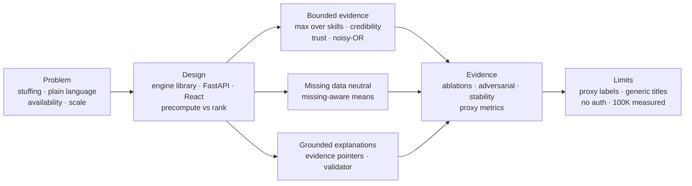
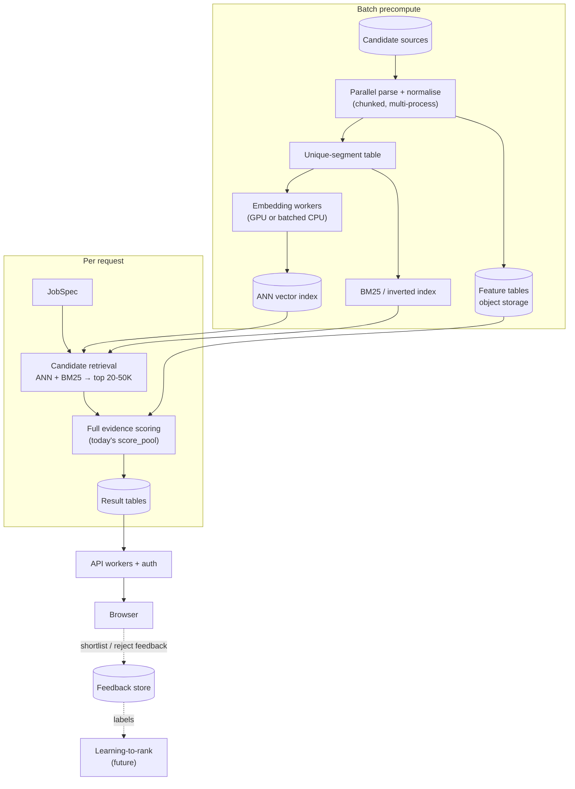
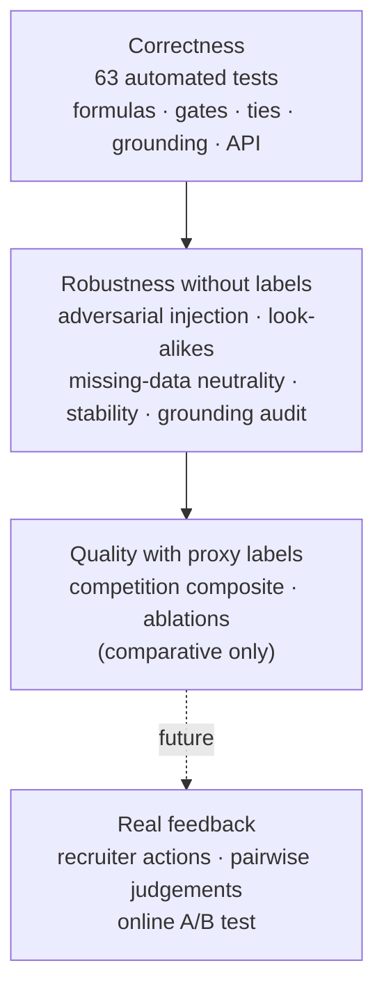

<!-- Generated by docs/learning/build/build.py from docs/learning/src/book3/ - edit the chapter files there. -->

# Explaining the Project

This book prepares you to discuss TalentSignal with an experienced engineer, ML engineer or data scientist. It assumes you have read Book 1 (concepts) and at least skimmed Book 2 (code). Every number quoted here comes from the repository's own measurements; do not quote numbers that are not in `README.md`, `docs/reports/EVALUATION_REPORT.md` or these books.

!!! interview "The golden rule"
    Say what you built, how you know it works, and where it does not. Interviewers trust candidates who volunteer limitations; they distrust candidates who claim perfection.

## The 30-second introduction

> "TalentSignal ranks a pool of candidates against a job description and explains every position. It turns the job description into an editable list of must-haves and nice-to-haves, then scores each candidate on how strongly their skills, platform assessments and actual work history evidence each requirement - trusting work descriptions only as far as the job title supports them - plus experience, availability and logistics. It runs fully offline on a laptop CPU: about three seconds to score 100,000 candidates once the data is indexed."

## The 1-minute introduction

> "Recruiters face pools too large to read, and keyword search fails in both directions: it rewards people who stuff skills lists and misses people who describe the right work in plain language. TalentSignal is a decision-support tool that treats ranking as *evidence aggregation*. A rule-based parser turns the job description into requirements - each traced to the sentence it came from - which the recruiter reviews. For each requirement the engine combines the best matching skill, adjusted for months of use and any platform assessment, with evidence from role descriptions found by phrases and by sentence embeddings. Those are bounded and combined with role relevance, experience, engagement and logistics into a weighted score. Every explanation is built from the exact evidence that produced the score and checked against the candidate's record. It's a FastAPI backend, a React and TypeScript frontend, and a Python engine with 63 automated tests."

## The 2-minute introduction (add these points)

- **Precompute versus rank.** "The expensive work - parsing 465 MB, building a BM25 index, embedding text - happens once per file and is keyed by a full-file hash. Scoring is then vectorised NumPy: 2.85 seconds for 100,000 candidates."
- **The trick that made semantics affordable.** "The reference data has only 44 distinct role descriptions across 300,000 roles, so I embed unique text segments - 5,802 of them - instead of every document."
- **Integrity.** "Impossible profiles, like several 'expert' skills used for zero months, are held for human review rather than silently dropped or labelled fraud."
- **Honest evaluation.** "There was no ground truth, so I measured what I could without labels - keyword stuffers with perfect assessments never reached the top 40 of a 560-candidate adversarial set, impossible profiles were never eligible, 0 unsupported claims in 200 explanations - and used clearly labelled proxy labels for comparisons. On those proxies the original reference implementation actually scores higher than mine, and I can explain why."

## The 5-minute technical explanation

Structure it as *problem → design → three key mechanisms → evidence → limits*.


<p class="caption">Figure 1.1 - The talk track for a technical explanation. Each box is 30-60 seconds.</p>

1. **Problem (30 s).** Large pools, self-reported profiles, keyword stuffing, plain-language candidates, availability.
2. **Design (60 s).** Three layers: React UI, FastAPI service, and an engine library with no web dependencies. Background jobs for indexing and scoring; results stored as Parquet and paged server-side.
3. **Mechanism 1 - bounded evidence (60 s).** "Each requirement takes the *maximum* over matching skills, not the sum, so ten synonyms count once. Skill claims are scaled by credibility - 0.5 if the person never held a related role. Text evidence from a role description is scaled by trust - 0.3 plus 0.7 times that role's title relevance. Skill, text and signal evidence combine by noisy-OR: one minus the product of their complements, which stays in [0, 1] and rewards corroboration."
4. **Mechanism 2 - missing data is neutral (30 s).** "Engagement and logistics use a weighted mean over *available* signals only. Stripping assessments, GitHub and offer history from strong profiles moved their scores by −0.007 on average."
5. **Mechanism 3 - grounded explanations (45 s).** "The scorer records which skill row and which role produced each requirement's evidence; explanations follow those pointers, every item is re-checked against the raw record, and the claims sentence is scanned for any skill name the candidate doesn't have."
6. **Evidence (45 s).** Ablations: removing requirements coverage drops the proxy composite from 0.951 to 0.892; removing semantics drops NDCG@10 from 0.956 to 0.845; removing the integrity gate lets 3 impossible profiles into the top 100.
7. **Limits (30 s).** Proxy labels only; plain-language candidates with generic titles are under-rated; no authentication; benchmarked at 100,000 candidates only.

## The 10-minute architecture walkthrough

Use Book 1, Figure 2.1 as your whiteboard. Draw the browser, the FastAPI process (routes → services → SQLite and engine), and the files (indexes by fingerprint, run results, model). Then trace two flows:

**Flow A - indexing a file.** Upload streamed to disk with a size limit → `start_index` job → `file_fingerprint` (BLAKE2b, every byte) → if an index with that fingerprint exists, reuse it → else `build_index`: `iter_records` streams, `Normalizer` repairs and reports, `check_record` flags integrity issues, `_TextTable` deduplicates text, Parquet tables, BM25 sparse matrix via `A·T`, embeddings for unique segments, `quality.json` → build into `.building`, rename when complete.

**Flow B - ranking.** `POST /api/jd/parse` → `JobSpec` with source sentences → recruiter edits → `POST /api/runs` → job → `score_pool`: title relevance → role context → requirement evidence → seven components → normalised weighted sum → policy factors → eligibility → deterministic sort → result table Parquet → browser polls, then pages through results; candidate detail calls `explain_candidate`.

Close with the decisions you would defend (Part 2 of this book) and what you would change for production (authentication, PostgreSQL, a task queue).

## The detailed ML-engineering explanation

For an ML interviewer, lead with the *modelling choices*, not the stack:

- **Why not learning-to-rank?** No labels. Training on proxy labels would learn the heuristics that made them. The seven components are an LTR-ready feature matrix once feedback exists (LambdaMART would be the first model to try).
- **Why a weighted sum of bounded components?** Interpretability for recruiters, graceful failure (no single feature dominates), easy ablation, and recruiter control. Weights are normalised and re-normalised when a component is unavailable.
- **Retrieval stack.** BM25 (k1 = 1.2, b = 0.75, unigrams and bigrams) as a percentile component; dense similarity with bge-small-en-v1.5 (384-d, CPU, offline). Calibration was *measured*: unrelated text 0.41-0.55, explicit matches 0.75-0.85, so prototypes map [0.62, 0.80] → [0, 1]. Long queries get a per-query window from 12 unrelated anchor sentences.
- **Hybrid design.** Lexical catches exact names (FAISS, Milvus); dense catches paraphrase; structured fields (titles, assessments) catch credibility. Title relevance gates how much each kind of text evidence is trusted.
- **Evaluation.** Label-free robustness tests plus proxy metrics computed with the competition's own composite (0.5·NDCG@10 + 0.3·NDCG@50 + 0.15·MAP + 0.05·P@10), ablations, stability under weight noise (98.9% top-100 overlap), adversarial injection.
- **What you learned from measurement.** A plausible improvement (each must-have as its own semantic query) *lowered* the proxy composite from 0.951 to 0.883 at full weight, so it was removed. BM25 turned out to have no effect on the top 100 for this JD. A tie-unaware percentile was giving identical profiles different scores - found by a test.

!!! tip "Sounding natural"
    Do not recite these paragraphs. Learn the *sequence* (problem, design, mechanisms, evidence, limits) and three numbers you are sure of (2.85 s for 100,000; 0 unsupported claims in 200 explanations; best stuffer rank 107 of 560 with none in the top 40). Fill the rest in your own words.


# Defending the Architecture

Each question below has a model answer written to be spoken, followed by the technical detail you should be ready to add if the interviewer digs deeper.

## Why did you choose this architecture?

**Answer.** "Because the problem has two very different workloads. Indexing a candidate file is expensive and independent of the job; scoring is cheap if indexing is done well. So I split the system into a one-time *precompute* stage and a per-job *ranking* stage, and I put all of the intelligence in a library that the web service, the CLI and the competition script all share."

**Detail.** Cold index build: 137 s for 100,000 candidates. Warm scoring: 2.85 s. The index directory is named by a full-file BLAKE2b fingerprint, so the same file is never indexed twice and a modified file is never matched to a stale index.

## Why separate the ranking engine from the API?

**Answer.** "Three reasons. Testability: 59 engine tests run on synthetic data and generated documents without HTTP. Reuse: competition mode must run without a server and with network blocked. Clarity: one place to read the algorithm, `score_pool`."

**Follow-up - "Isn't that over-engineering for a small project?"** "It costs one boundary: the `JobSpec` model in, a `ScoredPool` out. Both already exist for other reasons - the `JobSpec` is what the recruiter edits, and the scored pool feeds explanations."

## Why FastAPI?

**Answer.** "Its validation is driven by type hints and Pydantic, which matters because the most important input - the edited job specification - is a nested Pydantic model shared with the engine. Validation, OpenAPI documentation and dependency injection (for the session check) come for free."

**When I'd choose differently.** Django if user accounts, permissions and an admin site became central.

## Why React and TypeScript?

**Answer.** "The UI needs multi-page navigation, server-side paging and filtering, a comparison view and an editable form with many interdependent fields. TypeScript mirrors the API shapes in one file (`types/api.ts`), so a backend rename breaks the build instead of failing at run time."

**Follow-up - "Why no Redux or component library?"** "No data is shared across distant components; each page loads its own data with a small hook. A component library would have given a generic look; the design system is about 300 lines of CSS with tokens."

## How does data flow through the system?

**Answer.** Walk Flow A and Flow B from Part 1 of this book. Emphasise three hand-offs: file → index (once), JobSpec → ScoredPool (per run), result table → one page (per request).

## What happens if the dataset grows ten times?

**Answer.** "I have measured 100,000; I have not measured a million, so I'll reason. Parsing and scoring are linear - roughly 170 s to parse and around 30 s to score. The first real wall is memory during the index build: about 2 GB at 100,000, so about 20 GB at a million with the current all-in-memory row lists. I would switch to chunked table writing. The second wall is embedding unique text: on real, diverse data the number of unique descriptions grows with the pool, so embedding could take hours on one CPU; I'd parallelise it or use a GPU only at precompute time. For queries I'd add an approximate-nearest-neighbour pre-selection so full scoring runs on, say, the top 50,000."

!!! warning "Do not overclaim"
    Never say "it scales to millions". Say "it is designed to extend; it is measured at 100,000; here is what would break first."

## What happens if the ranking engine fails?

**Answer.** "Scoring runs inside a background job. Any exception is caught by the job manager, logged with a stack trace, and recorded on the job and the run as `failed` with a message the UI shows. The web server stays up. If the server itself dies mid-job, the job is marked failed on the next start-up, so no progress bar spins forever. If the embedding model is missing, scoring still works: the semantic component is removed, the other weights are re-normalised, and the run carries a visible note."

## How do you avoid duplicate processing?

**Answer.** "At three levels. Files: an index is keyed by the full-file fingerprint and reused. Text: only unique text segments are tokenised and embedded - 5,802 for 100,000 candidates. Queries: requirement sentences and anchor texts are memoised in the embedder. Results: scored pools, result tables and indexes are kept in small LRU caches."

## How would you scale this application?


<p class="caption">Figure 2.1 - A proposed (not implemented) scaled design. The scoring stage is today's engine; everything around it is new.</p>

| Concern | Today | Next step |
|---|---|---|
| Concurrent users | one process, two job threads | several uvicorn workers behind a reverse proxy |
| State | SQLite file | PostgreSQL |
| Background work | in-process threads | a task queue (e.g. Celery or RQ) with dedicated workers |
| Big files | local disk | shared object storage for indexes and run tables |
| Index build | single process, ~2 GB | chunked, multi-process parsing; GPU or batched embedding |
| Candidate count | full scoring of every candidate | ANN pre-selection, then full scoring |
| Security | per-browser session id | OIDC authentication, roles, audit log, TLS |

## Why SQLite and not PostgreSQL?

**Answer.** "Single-node tool, zero operations, WAL mode allows reads during writes. The large data is not in SQLite anyway - it's in Parquet and NumPy files. I'd move to PostgreSQL as soon as there were multiple server instances."

## Why threads and not processes for jobs?

**Answer.** "The heavy work is NumPy, SciPy and PyTorch, which release the GIL during computation, so threads give real parallelism there; and threads share the in-memory index cache. The cost is that jobs die with the process - which is why they are marked failed on restart."

## Why store results as Parquet instead of rows in the database?

**Answer.** "Each run's result table has a different set of requirement columns, up to ~100,000 rows and ~70 columns. A columnar file loaded into pandas and filtered with vectorised masks answers a page in 150-270 ms at that size. In SQLite I'd need a dynamic schema per run or a wide key-value table."


# AI, ML and NLP Questions

Each topic follows the same six steps: **concept from scratch**, **simple example**, **connection to TalentSignal** (marked *Implemented*, *Implemented in evaluation*, or *Related - not used*), **strong interview answer**, **common misconceptions**, **follow-up questions**. Levels: (B) beginner, (I) intermediate, (A) advanced.

## (B) TF-IDF

**Concept.** A way to weigh words in a document: frequent in *this* document (term frequency, tf) but rare across *all* documents (inverse document frequency, idf). \(\mathrm{tfidf}(t, d) = \mathrm{tf}(t, d) \cdot \log(N / \mathrm{df}(t))\).

**Example.** In a pool of profiles, "engineer" appears everywhere (low idf); "pgvector" appears in few (high idf). A profile mentioning pgvector twice gets a high weight for that term.

**TalentSignal.** *Related - not used for scoring.* The original reference implementation used TF-IDF cosine similarity; TalentSignal replaced it with BM25 plus embeddings.

**Strong answer.** "TF-IDF is the classic term weighting. I used BM25 instead because it adds two things TF-IDF lacks: diminishing returns for repeated terms and normalisation for document length - both matter when candidates write very different amounts."

**Misconceptions.** That TF-IDF captures meaning (it does not - "ranking" and "ordering" are unrelated to it); that higher raw TF-IDF always means more relevant (long documents accumulate weight).

**Follow-ups.** *What does the log in idf do?* Compresses the range so very rare terms do not dominate. *How would you use TF-IDF with cosine?* Represent the query and documents as TF-IDF vectors and compare angles.

## (I) BM25

**Concept.** \(\mathrm{BM25} = \sum_t \mathrm{idf}(t) \frac{\mathrm{tf}(k_1+1)}{\mathrm{tf} + k_1(1 - b + b\,|d|/\mathrm{avgdl})}\). \(k_1\) controls saturation (repeated terms add less and less), \(b\) controls length normalisation.

**Example.** With \(k_1 = 1.2\), the first occurrence of a term contributes \(\mathrm{idf} \times 2.2/2.2 = \mathrm{idf}\) (for an average-length document) and the second only about \(0.38 \times\) idf more.

**TalentSignal.** *Implemented* (`engine/retrieval/bm25.py`): unigrams and bigrams, English stop words, \(k_1 = 1.2\), \(b = 0.75\); the query-independent part precomputed into a sparse matrix; scores turned into a tie-aware percentile; 5% weight.

**Strong answer.** "BM25 is the standard lexical baseline. I precompute the saturation term per document, so a query is one sparse matrix-vector product over 100,000 candidates. Because raw BM25 has no fixed scale, the component is the candidate's percentile among matches. Honestly, ablation showed it didn't change this job's top 100 - all top candidates saturate it - so it's kept small, mainly for custom requirements outside the taxonomy."

**Misconceptions.** "BM25 is outdated" - it remains a strong baseline and part of most hybrid systems. "Percentile is the same as normalisation" - it is relative to the pool.

**Follow-ups.** *Why bigrams?* So "vector search" is a feature. *What happens at b = 0?* No length normalisation.

## (B) Cosine similarity

**Concept.** Similarity of two vectors as the cosine of the angle between them: \(\frac{u \cdot v}{\lVert u\rVert \lVert v\rVert}\), from −1 to 1; it ignores length.

**Example.** \(u = (1, 2, 2)\), \(v = (2, 1, 2)\): \(u \cdot v = 8\), both lengths are 3, cosine = \(8/9 = 0.889\).

**TalentSignal.** *Implemented*: embeddings are L2-normalised, so cosine is a dot product (`self.emb @ vector`).

**Strong answer.** "With unit vectors, cosine equals the dot product, so scoring all unique texts against a query is a single matrix-vector multiplication."

**Misconceptions.** That 0.5 means "50% similar" - for sentence embeddings, unrelated texts already score ~0.4-0.55 with this model, which is why calibration was needed.

**Follow-ups.** *Cosine vs Euclidean distance on unit vectors?* \(\lVert u - v\rVert^2 = 2 - 2\cos\), so they rank identically.

## (I) Embeddings and semantic search

**Concept.** A neural model maps text to a dense vector so that texts with similar meaning are close. *Semantic search* retrieves by vector closeness rather than shared words.

**Example.** "Built systems that connect users to the most relevant matches" lands near "search and ranking systems" despite sharing almost no words.

**TalentSignal.** *Implemented* for scoring (not as a retrieval index): bge-small-en-v1.5, 384-d, offline; unique segments embedded at index time; requirement sentences and the JD focus embedded at scoring time; calibrated similarities feed text evidence and the semantic component. *Related - not used:* an approximate-nearest-neighbour index (FAISS etc.); every candidate is scored, so none is needed at 100,000.

**Strong answer.** "Embeddings let me catch plain-language candidates. I calibrate similarities using measured distributions rather than treating them as probabilities, and I weight a description's similarity by how credible its job title makes it."

**Misconceptions.** "Embeddings understand the job" - they measure textual similarity and are fooled by style (all summaries looked alike: 0.70-0.81). "Bigger model is always better" - CPU latency and licence matter.

**Follow-ups.** *Bi-encoder vs cross-encoder?* A bi-encoder embeds query and document separately (fast, precomputable); a cross-encoder reads them together (more accurate, too slow for 100,000 per query) - good for re-ranking a top list. *How would you detect embedding drift?* Monitor similarity distributions over time; re-run the calibration script.

## (I) Vector similarity at scale

**Concept.** Exact similarity against \(n\) vectors costs \(O(n \cdot d)\). Approximate nearest neighbour (ANN) indexes (HNSW graphs, IVF clustering, product quantisation) trade a little recall for much speed.

**TalentSignal.** *Related - not used.* At 5,802 unique segments, an exact matrix product takes milliseconds. ANN would matter for millions of unique texts or for pre-selecting candidates.

**Strong answer.** "I chose exact search because the unique-segment trick made it cheap. At larger scale I would pre-select with an ANN index and then run the full evidence scoring on the shortlist."

## (B) Feature engineering

**Concept.** Turning raw data into numbers a model can combine - here, numbers in [0, 1] with clear meaning.

**TalentSignal.** *Implemented*: title relevance, recency, trust, credibility, skill strength, coverage, band fit, engagement sub-signals, logistics sub-signals. Each is documented with its formula (Book 1, Part 6).

**Strong answer.** "Most of the work was in features that resist manipulation: max-instead-of-sum skill evidence, usage-aware claims, credibility from titles, trust-weighted text evidence."

**Misconception.** "More features always help" - the semantic facet experiment added a feature and *lowered* the proxy score.

## (I) Ranking systems and recommendation systems

**Concept.** A ranking system orders items for a query; a recommender orders items for a user based on behaviour or content. Both are evaluated mostly at the top of the list.

**TalentSignal.** *Implemented:* query-dependent ranking (the JobSpec is the query). *Related - not used:* collaborative filtering (no interaction data).

**Strong answer.** "This is content-based ranking with hand-designed relevance features. Recommender techniques would become relevant once recruiter feedback exists - for example 'recruiters who shortlisted A also shortlisted B'."

## (B) Weighted scoring and normalisation

**Concept.** A weighted sum combines features: \(\sum_c w_c x_c\). *Normalisation* puts features (or weights) on comparable scales.

**TalentSignal.** *Implemented:* every component in [0, 1] on an *absolute* scale where possible; weights normalised to sum to 1 and re-normalised when a component is unavailable; BM25 is the exception (percentile).

**Strong answer.** "I avoided min-max normalisation over the pool because one outlier shifts everyone's score and scores become incomparable between pools. Absolute scales mean a 0.8 coverage means the same in a 50-candidate upload and a 100,000-candidate pool."

**Misconceptions.** That weights are importance in an absolute sense - they are relative shares after normalisation.

**Follow-ups.** *Why multiply policy factors rather than subtract?* A factor scales the whole score so no amount of other evidence compensates for a declared near-disqualifier.

## (B) Precision, recall, precision@k

**Concept.** Precision = relevant retrieved / retrieved. Recall = relevant retrieved / all relevant. Precision@k looks only at the first k results.

**Example.** 10 retrieved, 6 relevant among them, 8 relevant in the pool: precision 0.6, recall 0.75.

**TalentSignal.** *Implemented in evaluation* (`precision_at`, "relevant" = proxy label ≥ 3).

**Strong answer.** "For shortlists, precision at the top matters most - a recruiter reads the first page."

## (I) MAP - mean average precision

**Concept.** Average precision (AP) averages precision@i over the positions i where a relevant item appears, divided by the number of relevant items (TalentSignal uses min(R, k)). MAP averages AP over queries.

**Example.** Relevant items at positions 1 and 5 of the top 5, two relevant items in the pool: \(\mathrm{AP@5} = (1/1 + 2/5)/2 = 0.7\).

**TalentSignal.** *Implemented in evaluation* (`average_precision`); with one job, "MAP" is the AP of that query.

## (I) NDCG

**Concept.** Discounted cumulative gain rewards relevant items more when they are higher: \(\mathrm{DCG@k} = \sum_{i \le k} \frac{2^{rel_i} - 1}{\log_2(i+1)}\). NDCG divides by the DCG of the ideal ordering so the result lies in [0, 1].

**Example.** Ranked labels [3, 2, 0, 1, 3], pool labels [3, 3, 2, 1, 0, 0]: DCG@5 = 12.03, ideal DCG@5 = 13.35, NDCG@5 = 0.901 (worked step by step in Part 4).

**TalentSignal.** *Implemented in evaluation*; the ideal ordering is computed over the **whole labelled pool**, so missing a strong candidate is penalised.

**Strong answer.** "NDCG@10 carries 50% of the competition composite because the first page dominates real use."

**Misconceptions.** That NDCG compares to a perfect list of what *you* returned - it compares to the best possible list from the pool.

## (I) MRR - mean reciprocal rank

**Concept.** \(1/\text{rank of the first relevant result}\), averaged over queries.

**TalentSignal.** *Related - not used.* It suits "find one right answer" tasks; shortlisting wants several good candidates, which NDCG and MAP capture better.

## (A) Evaluation datasets and proxy labels

**Concept.** Ranking evaluation needs relevance judgements. Without them, you can use proxy labels, synthetic tests, or online feedback.

**TalentSignal.** *Implemented:* hand-graded proxy labels for 44 description templates adjusted by JD conditions; label-free adversarial, stability and grounding tests.

**Strong answer.** "Proxy labels are circular to a degree - the scorer reads the same descriptions - so I used them only to compare variants, and relied on label-free tests for robustness claims. With real use I would collect recruiter actions as implicit labels and run an A/B test on shortlist acceptance."

**Follow-ups.** *How would you get real labels cheaply?* Pairwise judgements from recruiters on disagreements between two rankers; implicit feedback (shortlisted, contacted, interviewed) with position-bias correction.

## (A) Bias and fairness

**Concept.** A ranking is unfair if it systematically disadvantages groups for reasons unrelated to the job, through features, proxies, defaults or feedback loops.

**TalentSignal.** *Implemented safeguards:* no protected attributes; institution prestige never used; missing data neutral; work-authorization condition only for explicit non-relocators; popularity signals excluded; editable policies. *Not done:* group-level outcome audits (no demographic data).

**Strong answer.** "I designed against known bias channels and measured what I could - for example that missing optional data doesn't move scores. I can't claim the outcomes are fair across groups, because the data has no group attributes to audit with; in production that audit is essential."

**Misconceptions.** "Removing protected attributes makes a model fair" - proxies (location, school, gaps) can encode them.

## (A) Explainable AI

**Concept.** Making model outputs understandable: global (how the model works) and local (why this output).

**TalentSignal.** *Implemented:* the model is interpretable by construction (weighted bounded components); local explanations are built from the exact evidence used; validated against the record; differentiators against neighbouring ranks.

**Strong answer.** "Post-hoc explainers like SHAP approximate a black box. Here the model itself is the explanation, so the explanation can't disagree with the score - and a validator guarantees no claimed skill is absent from the record."


# Mathematical and Logical Problem Solving

Work each problem on paper before reading the solution. All numbers are verified (the formulas are the ones in the code; results were computed with the project's own functions or reproduced exactly).

## Problem 1 - weighted ranking score

Default weights: requirements 0.34, role_fit 0.20, semantic 0.12, lexical 0.05, experience 0.10, engagement 0.11, logistics 0.08. Candidate X has components (0.80, 1.00, 0.60, 0.90, 0.85, 0.40, 0.70) in that order; candidate Y has (0.70, 0.80, 0.50, 0.70, 1.00, 0.95, 1.00). No policy factors apply. Who ranks first?

**Solution.**

\[
X = 0.34(0.80) + 0.20(1.00) + 0.12(0.60) + 0.05(0.90) + 0.10(0.85) + 0.11(0.40) + 0.08(0.70) = 0.774
\]
\[
Y = 0.34(0.70) + 0.20(0.80) + 0.12(0.50) + 0.05(0.70) + 0.10(1.00) + 0.11(0.95) + 0.08(1.00) = 0.7775
\]

Y ranks first by 0.0035 - X has the stronger evidence, Y the better availability.

## Problem 2 - effect of changing a weight

The recruiter raises engagement from 0.11 to 0.25 (others unchanged). Recompute.

**Solution.** The weights now sum to 1.14 and are normalised by dividing by 1.14. \(X = 0.830 / 1.14 = 0.728\); \(Y = 0.9105 / 1.14 = 0.799\). The gap widens from 0.0035 to 0.071. *Lesson:* because weights are normalised, raising one weight also lowers every other component's share - requirements fall from 34% to 29.8% of the score.

## Problem 3 - cosine similarity

Compute the cosine similarity of \(u = (1, 2, 2)\) and \(v = (2, 1, 2)\), then its calibrated value with the requirement window [0.62, 0.80].

**Solution.** \(u \cdot v = 2 + 2 + 4 = 8\); \(\lVert u \rVert = \lVert v \rVert = 3\); cosine = \(8/9 = 0.889\). Calibrated: \(\mathrm{clip}((0.889 - 0.62)/0.18, 0, 1) = \mathrm{clip}(1.49) = 1\).

## Problem 4 - precision and recall

A shortlist of 10 contains 6 relevant candidates; the pool contains 8 relevant candidates in total. Compute precision@10 and recall.

**Solution.** Precision@10 = 6/10 = 0.6; recall = 6/8 = 0.75. To raise recall to 1 you must include the 2 missing relevant candidates - possibly at the cost of precision.

## Problem 5 - NDCG@5 step by step

Ranked labels: [3, 2, 0, 1, 3]. Pool labels: [3, 3, 2, 1, 0, 0]. Gain \(2^{rel} - 1\), discount \(\log_2(i + 1)\).

| Position i | label | gain | \(\log_2(i+1)\) | contribution |
|---|---|---|---|---|
| 1 | 3 | 7 | 1.000 | 7.000 |
| 2 | 2 | 3 | 1.585 | 1.893 |
| 3 | 0 | 0 | 2.000 | 0.000 |
| 4 | 1 | 1 | 2.322 | 0.431 |
| 5 | 3 | 7 | 2.585 | 2.708 |
| | | | **DCG@5** | **12.031** |

Ideal order of the pool: [3, 3, 2, 1, 0] → \(7 + 7/1.585 + 3/2 + 1/2.322 + 0 = 13.347\). **NDCG@5 = 12.031 / 13.347 = 0.901.** The loss comes from the second "3" sitting at position 5 instead of 2.

```python
# runnable
import math
def dcg(rels, k):
    return sum((2 ** r - 1) / math.log2(i + 2) for i, r in enumerate(rels[:k]))
ranked, pool = [3, 2, 0, 1, 3], [3, 3, 2, 1, 0, 0]
ndcg5 = dcg(ranked, 5) / dcg(sorted(pool, reverse=True), 5)
assert round(ndcg5, 3) == 0.901
```

## Problem 6 - average precision

Same ranking; "relevant" means label ≥ 3. Compute AP@5.

**Solution.** Relevant at positions 1 and 5. Precision@1 = 1/1, precision@5 = 2/5. There are 2 relevant items in the pool, so \(\mathrm{AP@5} = (1 + 0.4)/2 = 0.7\).

## Problem 7 - compare two skill claims

Candidate P lists "FAISS, expert, 0 months". Candidate Q lists "FAISS, advanced, 48 months, assessed 84". Both have fully relevant titles (credibility 1). Which has stronger skill evidence?

**Solution.** P: \(c = 1.0 \times 0.35 = 0.35\). Q: \(u = 1 - e^{-48/18} = 0.9305\), \(c = 0.75 (0.35 + 0.65 \cdot 0.9305) = 0.7161\), blended with the assessment: \(0.5(0.7161) + 0.5(0.84) = 0.7781\). Q's evidence is more than twice P's. (P would also trigger an integrity warning - and a critical finding if two or more expert skills had zero months.)

## Problem 8 - detect a skill-stuffing profile

A "Sales Executive" lists seven search skills, each "expert, 60 months". No role has a relevant title. What is his skill evidence per requirement, and what flag appears?

**Solution.** Each skill's strength is \(0.35 + 0.65(1 - e^{-60/18}) = 0.9768\). Credibility is \(0.5 + 0.5 \times 0 = 0.5\), so skill evidence is \(0.488\) per requirement - and because each requirement takes the *maximum*, seven skills count no more than one. With four or more job skills claimed at strength ≥ 0.5 and no role of relevance ≥ 0.3, the warning `uncorroborated_skill_claims` appears. (This is exactly Ravi in Book 1, Part 7.)

## Problem 9 - why is a candidate ranked incorrectly?

In Book 1's worked example, Meera (plain-language search work, title "Senior Software Engineer") ranks below Ravi (stuffer). Using the component table (requirements 0.222 vs 0.484; role_fit 0.35 vs 0; semantic 0 vs 0; lexical 0.333 vs 1.0; experience 0.99 vs 0.64; engagement 0.655 vs 0.908; logistics 0.674 vs 0.875), identify the three largest weighted differences.

**Solution.** Weighted differences (Meera − Ravi): requirements \(0.34 \times (0.222 - 0.484) = -0.089\); role_fit \(+0.070\); lexical \(0.05 \times (-0.667) = -0.033\); experience \(+0.035\); engagement \(0.11 \times (-0.253) = -0.028\); logistics \(0.08 \times (-0.201) = -0.016\). The largest are requirements (−0.089), role fit (+0.070) and experience (+0.035), followed closely by lexical (−0.033). Root cause: the generic title lowers her description trust (0.545), so plain-language evidence counts little, while Ravi's halved skill evidence still covers every requirement.

## Problem 10 - a data-quality issue

18,865 of 100,000 records have `expected_salary_range_inr_lpa.min > max`. Should the ranking use salary? What should the system do?

**Solution.** Not as a ranking signal: salary is a negotiation matter, and 18.9% of the values are internally inconsistent. TalentSignal records an *info* finding (`salary_range_inverted`), shows it, and does not use salary in any score. The general lesson: check a field's consistency rate before trusting it as a feature.

## Problem 11 - missing-aware mean

Engagement sub-signals for a candidate: recency 0.42 (w 0.25), response 0.50 (0.25), speed 0.80 (0.10), open 1.0 (0.15), interviews 0.90 (0.15), offers *missing* (0.05), interest 0.55 (0.05). Compute engagement. What would a "missing = 0" implementation give?

**Solution.** Available weights sum to 0.95. Numerator: \(0.105 + 0.125 + 0.08 + 0.15 + 0.135 + 0.0275 = 0.6225\). Engagement = 0.6225 / 0.95 = **0.655**. Treating missing as 0 would give 0.6225 / 1.00 = 0.6225 - a penalty of 0.033 for having no prior offers.


# Coding and Data-Structure Problems

These problems are modelled on real engineering problems inside TalentSignal. Each gives the problem, the brute-force idea, an optimised approach, Python code (executed with assertions when this book is built), complexity and edge cases. Try them before reading the code.

## Problem 1 - Duplicate profiles with a hash map

**Problem.** Given candidate records, report every record whose content (ignoring `candidate_id` and name) is identical to an earlier one, as `(duplicate_id, original_id)`.

**Brute force.** Compare every pair: \(O(n^2)\) comparisons of whole records - 5 × 10⁹ for 100,000.

**Optimised.** Serialise each record canonically (sorted keys) without the ignored fields, hash it, and keep a dictionary `hash → first id`. This is what `build_index` does with BLAKE2b.

```python
# runnable
import hashlib, json

def find_duplicates(records):
    first_by_hash, dups = {}, []
    for rec in records:
        content = {k: v for k, v in rec.items() if k not in ("candidate_id", "name")}
        key = hashlib.blake2b(json.dumps(content, sort_keys=True).encode(), digest_size=12).hexdigest()
        if key in first_by_hash:
            dups.append((rec["candidate_id"], first_by_hash[key]))
        else:
            first_by_hash[key] = rec["candidate_id"]
    return dups

recs = [{"candidate_id": "A", "name": "x", "skills": ["Python"]},
        {"candidate_id": "B", "name": "y", "skills": ["Python"]},
        {"candidate_id": "C", "name": "z", "skills": ["Java"]}]
assert find_duplicates(recs) == [("B", "A")]
```

**Complexity.** \(O(n \cdot s)\) time for total serialised size \(s\); \(O(n)\) memory. **Edge cases.** Key order (solved by `sort_keys`); floats such as 1.0 vs 1 (normalise first); hash collisions (negligible with 96-bit digests, but a production system could confirm by comparing content).

## Problem 2 - Deterministic sorting with tie-breaks

**Problem.** Sort candidates by eligible first, score descending, mandatory coverage descending, engagement descending, then id ascending.

**Approach.** A tuple sort key, negating the "descending" numeric fields. Python's sort is stable and compares tuples left to right.

```python
# runnable
def order(cands):
    return sorted(cands, key=lambda c: (not c["eligible"], -c["overall"], -c["mandatory"], -c["engagement"], c["id"]))

cands = [
    {"id": "C3", "eligible": True, "overall": 0.80, "mandatory": 0.9, "engagement": 0.5},
    {"id": "C1", "eligible": True, "overall": 0.80, "mandatory": 0.9, "engagement": 0.5},
    {"id": "C2", "eligible": True, "overall": 0.80, "mandatory": 0.95, "engagement": 0.1},
    {"id": "C0", "eligible": False, "overall": 0.99, "mandatory": 1.0, "engagement": 1.0},
]
assert [c["id"] for c in order(cands)] == ["C2", "C1", "C3", "C0"]
```

**Complexity.** \(O(n \log n)\). **Edge cases.** NaN scores break comparisons (Python treats NaN as unordered) - replace them first; held candidates must stay last even with high scores.

## Problem 3 - Top-K with a heap

**Problem.** Return the K best candidates from a stream of `(score, id)` pairs without sorting everything.

**Brute force.** Collect all, sort, take K: \(O(n \log n)\) time, \(O(n)\) memory.

**Optimised.** Keep a *min-heap* of size K holding the best K seen so far; replace its smallest element when a better one arrives. Ties: prefer the smaller id, so the heap key must make larger ids "smaller" - here we push `(score, negated id order)`.

```python
# runnable
import heapq

def top_k(stream, k):
    heap = []  # min-heap of (score, inverted id) - the root is the worst of the current top K
    for score, cid in stream:
        item = (score, [-ord(ch) for ch in cid])   # smaller id = larger key for ties
        if len(heap) < k:
            heapq.heappush(heap, (item, cid))
        elif item > heap[0][0]:
            heapq.heapreplace(heap, (item, cid))
    return [cid for _, cid in sorted(heap, reverse=True)]

stream = [(0.7, "C5"), (0.9, "C2"), (0.9, "C1"), (0.3, "C4"), (0.8, "C3")]
assert top_k(stream, 3) == ["C1", "C2", "C3"]
```

**Complexity.** \(O(n \log k)\) time, \(O(k)\) memory. **Connection.** TalentSignal sorts all candidates because it must rank everyone for "all eligible" runs and the held list; a heap (or `np.argpartition`) is the right tool when only K are needed from a very large pool (Book 2, Exercise 4.3).

## Problem 4 - Best evidence per group

**Problem.** Given skill rows `(candidate, strength)`, return each candidate's maximum strength and the index of the row that achieved it - in vectorised NumPy.

```python
# runnable
import numpy as np

def best_per_group(group, values, n):
    best = np.zeros(n); arg = np.full(n, -1)
    order = np.lexsort((-values, group))          # by group, then value descending
    g = group[order]
    first = np.ones(len(g), bool); first[1:] = g[1:] != g[:-1]
    sel = order[first]
    best[group[sel]] = values[sel]; arg[group[sel]] = sel
    return best, arg

group = np.array([0, 0, 2, 2, 2]); vals = np.array([0.1, 0.5, 0.3, 0.9, 0.2])
best, arg = best_per_group(group, vals, 4)
assert best.tolist() == [0.5, 0.0, 0.9, 0.0] and arg.tolist() == [1, -1, 3, -1]
```

**Brute force alternative.** A dictionary loop - correct but ~100× slower on a million rows in Python. **Complexity.** \(O(m \log m)\). **Edge cases.** Empty input (TalentSignal returns early); candidates with no rows keep 0 and −1.

## Problem 5 - Whole-word phrase matching

**Problem.** Report which requirement phrases appear in a description as whole words, case-insensitively. "rag" must not match "storage"; "a/b test" must match.

```python
# runnable
import re

def phrase_hits(text, phrases):
    low = text.lower()
    terms = sorted({p.lower() for p in phrases}, key=len, reverse=True)
    pat = re.compile(r"(?<![a-z0-9])(?:" + "|".join(re.escape(t) for t in terms) + r")(?![a-z0-9])")
    return sorted({m.group(0) for m in pat.finditer(low)})

desc = "Built RAG pipelines on object storage; ran an A/B test and NDCG evaluation."
assert phrase_hits(desc, ["rag", "a/b test", "ndcg", "java"]) == ["a/b test", "ndcg", "rag"]
assert phrase_hits("cloud storage engineer", ["rag"]) == []
assert phrase_hits("ran A/B tests weekly", ["a/b test"]) == []      # plural is NOT matched
```

!!! caution "A real limitation this exposes"
    Whole-word matching does not handle plurals or other word forms: "a/b test" does not match "A/B tests". TalentSignal's taxonomy compensates by listing common variants ("a/b test", "a/b testing"), and embedding similarity catches many paraphrases - but a stemmer or lemmatiser would be a more general fix. This was found while verifying this very example.

**Why `re.escape`.** Phrases such as "c++" or "a/b test" contain regex symbols. **Why longest first.** In an alternation the first match wins; "learning to rank" should win over "learning". **Complexity.** Linear in text length per scan; compile the pattern once per requirement, not per text.

## Problem 6 - Streaming JSONL with error reporting

**Problem.** Read candidates line by line; skip blank lines; report malformed lines with their line numbers; never load the whole file.

```python
# runnable
import io, json

def iter_records(fh):
    for line_no, line in enumerate(fh, start=1):
        if not line.strip():
            continue
        try:
            obj = json.loads(line)
        except json.JSONDecodeError as exc:
            yield line_no, None, f"Invalid JSON: {exc.msg}"
            continue
        if not isinstance(obj, dict):
            yield line_no, None, "Each line must be a JSON object."
            continue
        yield line_no, obj, None

data = io.StringIO('{"candidate_id": "A"}\n\n{bad}\n[1, 2]\n{"candidate_id": "B"}\n')
rows = list(iter_records(data))
assert [(r[0], r[1] is not None) for r in rows] == [(1, True), (3, False), (4, False), (5, True)]
```

**Complexity.** \(O(\text{file size})\) time, \(O(\text{longest line})\) memory. **Edge cases.** A UTF-8 byte-order mark at the start; Windows line endings; a final line without a newline - all handled by line iteration and the JSON parser.

## Problem 7 - Missing-aware weighted mean

**Problem.** Combine sub-scores with weights where some values are missing (`None`), so missing values neither help nor hurt; return 0.5 when nothing is available.

```python
# runnable
def weighted_available(parts, weights):
    num = sum(weights[k] * v for k, v in parts.items() if v is not None)
    den = sum(weights[k] for k, v in parts.items() if v is not None)
    return num / den if den > 0 else 0.5

w = {"recency": 0.25, "response": 0.25, "offers": 0.05}
assert weighted_available({"recency": 0.8, "response": 0.6, "offers": None}, w) == 0.7
assert weighted_available({"recency": None, "response": None, "offers": None}, w) == 0.5
```

**Edge cases.** All missing; weights that sum to zero; NaN versus None (the NumPy version in TalentSignal uses NaN and `~np.isnan`).

## Problem 8 - An LRU cache

**Problem.** Cache the most recently used *capacity* scored pools; evict the least recently used. (`RunService` keeps 2 pools and 6 result tables this way.)

```python
# runnable
from collections import OrderedDict

class LRU:
    def __init__(self, capacity):
        self.capacity, self.items = capacity, OrderedDict()
    def get(self, key):
        if key not in self.items:
            return None
        self.items.move_to_end(key)
        return self.items[key]
    def put(self, key, value):
        self.items[key] = value
        self.items.move_to_end(key)
        while len(self.items) > self.capacity:
            self.items.popitem(last=False)

c = LRU(2); c.put("a", 1); c.put("b", 2); c.get("a"); c.put("c", 3)
assert list(c.items) == ["a", "c"]
```

**Complexity.** \(O(1)\) per operation. **Edge cases.** Thread safety - TalentSignal's `_LRU` adds a lock because job threads and request threads use it concurrently.

## Problem 9 - Pagination with filters

**Problem.** Given rows, a filter and a sort key, return page `p` of size `s` plus the total count; clamp invalid inputs.

```python
# runnable
def paginate(rows, page=1, page_size=50, predicate=None, key=None):
    page_size = max(1, min(page_size, 200))
    page = max(1, page)
    filtered = [r for r in rows if predicate is None or predicate(r)]
    if key is not None:
        filtered.sort(key=key)
    start = (page - 1) * page_size
    return {"total": len(filtered), "page": page, "page_size": page_size,
            "items": filtered[start:start + page_size]}

rows = [{"id": i, "country": "India" if i % 2 else "UK"} for i in range(1, 11)]
res = paginate(rows, page=2, page_size=2, predicate=lambda r: r["country"] == "India", key=lambda r: r["id"])
assert res["total"] == 5 and [r["id"] for r in res["items"]] == [5, 7]
assert paginate(rows, page=0, page_size=1000)["page_size"] == 200
```

**Complexity.** \(O(n)\) filter plus \(O(n \log n)\) sort per request; acceptable at 100,000 rows in pandas (150-270 ms). For much larger tables, pre-sorted indexes or a database with keyset pagination ("rows after id X") avoid re-sorting.

## Problem 10 - Percentile with ties

**Problem.** Convert raw scores to percentiles among positive scores, giving ties the same (highest) percentile and non-positive scores 0.

```python
# runnable
def percentile_positive(xs):
    pos = sorted(x for x in xs if x > 0)
    n = len(pos)
    def pct(x):
        if x <= 0:
            return 0.0
        # number of positive values <= x  ("max" tie method)
        lo, hi = 0, n
        while lo < hi:
            mid = (lo + hi) // 2
            if pos[mid] <= x:
                lo = mid + 1
            else:
                hi = mid
        return lo / n
    return [pct(x) for x in xs]

assert percentile_positive([0, 1.5, 0.5, 1.5]) == [0.0, 1.0, 1 / 3, 1.0]
```

**Why it matters.** The first TalentSignal version used `argsort().argsort()`, which gives tied values different ranks; identical profiles then scored differently. **Complexity.** \(O(n \log n)\) (sort plus binary searches).


# Difficult Interviewer Questions

Honest, nuanced answers. None of them claims perfect accuracy or fairness - because the project does not have either.

## How do you know your ranking is better than keyword matching?

"I measured it on two kinds of evidence. Without labels: a pure keyword-count ranker put 98 non-technical people into its top 100, while in a synthetic adversarial set stuffers with every skill at expert and 95/100 assessments never got above rank 107 of 560 in mine, behind all 40 strong real profiles. With proxy labels - clearly not ground truth - keyword count scored 0.006 on the competition composite, BM25 alone 0.825, and TalentSignal 0.951. So it is clearly better than keyword matching. It is *not* clearly better than the original reference implementation, which scored 0.982 on the same proxies."

## What is your evaluation methodology?


<p class="caption">Figure 6.1 - Evaluation methodology layers. The dotted layer does not exist yet.</p>

"Three layers. One: unit and API tests for correctness - 102 tests, including formulas, gates, ties and grounding. Two: label-free robustness experiments - adversarial injection, look-alike separation, missing-data neutrality, stability under ±20% weight noise, explanation grounding. Three: proxy-label metrics with the competition's own composite, used only comparatively, plus ablations of every component. With real users I'd add recruiter feedback as implicit labels and an online A/B test on shortlist acceptance."

## How do you prevent a candidate from manipulating the score?

"I can't prevent it entirely, but I've made the obvious manipulations weak. Listing many skills doesn't add up - each requirement takes the best one. Claiming expert with no months of use is worth only 35%, and several such claims hold the profile for review. Skills under unrelated job titles count half. Descriptions under unrelated titles are trusted at 30%. What remains possible: an attacker who changes their *job title* to something relevant and writes a plausible description gets most of the credit. Titles are hard to verify from a profile alone; that's where assessments, references and humans come in."

## What happens when a candidate has missing information?

"Missing optional data is neutral: engagement and logistics use a weighted mean over the signals that exist, so a missing signal drops out. I measured it: removing assessments, GitHub and offer history from 30 strong profiles moved their scores by −0.007 on average. Missing evidence for a *requirement* shows as 'not demonstrated' and is listed under 'missing information', which the UI explicitly says is not held against the candidate. One exception I'd fix: a missing 'willing to relocate' is treated like 'not willing' in the location sub-score."

## Can your system unfairly penalise career gaps?

"Not directly - there's no gap feature. But indirectly, yes: if someone states ten years of experience and their listed roles add up to six and a half, the 'experience mismatch' check flags it as critical and holds them for review. That catches impossible profiles, but it can also catch long unlisted gaps or roles someone chose not to list. It's a false-positive risk. The mitigations are that the candidate is held for *review*, not rejected, the evidence is shown, and the policy can be switched to 'flag only'."

## How do you handle candidates from different backgrounds?

"The engine never sees protected attributes and doesn't use institution prestige. Location is used only as the job states it, and I narrowed the work-authorization rule so it doesn't assume people abroad need visas. But I can't claim fair *outcomes* across groups, because the data has no demographic attributes to audit with. Career paths that don't map to the taxonomy's role families - say, a researcher who moved into industry with an unusual title - are a real risk of under-rating."

## Why should recruiters trust the ranking?

"They shouldn't trust it blindly - it's decision support. What they *can* trust is that every claim in an explanation is in the candidate's record, because a validator checks it, and that every policy that changed a score is visible and editable. The worked example in my documentation shows a case where the ranking is arguably wrong - a stuffer above a plain-language engineer in a tiny pool - and the explanation shows exactly why. That transparency is the reason to use it."

## Can you explain why candidate A ranks above candidate B?

"Yes, quantitatively. Each overall score is a weighted sum of seven components times any policy factors. The candidate page shows each component's value, weight and points, and the 'what sets this candidate apart' panel compares them with neighbouring ranks. For any pair I can compute the weighted difference per component - for example, in my worked example the stuffer led the plain-language engineer by 0.061, made of −0.089 from requirement coverage in her disfavour, +0.070 role fit in her favour, and smaller differences in lexical, engagement and logistics."

## What are the biggest weaknesses of your current implementation?

1. Evaluation relies on proxy labels; on them the reference implementation is ahead.
2. Plain-language candidates with generic titles are under-rated (title relevance is a hub).
3. The JD parser depends on a hand-built taxonomy; granularity quirks need recruiter fixes.
4. Hand-set parameters: affinity table, calibration windows, component weights.
5. Whole-word phrase matching misses plurals and word forms.
6. No authentication; sessions are not security.
7. Measured at 100,000 candidates only; the index build holds rows in memory (~2 GB).

## How do you stop résumé parsing from inventing qualifications?

"By design and by test. Every extracted value is a fact marked stated, inferred or missing, with the page and line it came from; inferred values carry the rule that produced them. Anything not written - proficiency, skill durations, platform signals - stays empty, and the ranking engine already treats empty as unknown rather than zero. Contact details never enter the candidate record. Then a human reviews every profile before it can be published; bulk approval only takes profiles without warnings. Scanned PDFs fail with `no_text_layer` because there is no OCR - I chose a clear failure over a guess. The tests check statuses, provenance, redaction and that no e-mail or phone reaches an export. What I have not measured is accuracy on real résumés - there was no labelled set - so I say that."

## What would you improve with another month?

"In order: collect recruiter feedback in the UI (shortlist, reject, reason) to get real labels; build a pairwise evaluation set from disagreements between my ranker and the reference; then try learning-to-rank on the existing component features. In parallel: description-informed title relevance to help plain-language candidates - measured against the adversarial set so it doesn't reopen the stuffing hole; lemmatised phrase matching; and authentication."

## What would you change for ten million candidates?

"Precompute would move to a distributed batch job - chunked parsing in parallel, embeddings on GPUs or batched workers, indexes in object storage. Queries couldn't score every candidate; I'd retrieve a few tens of thousands with an approximate-nearest-neighbour index plus BM25, then run the full evidence scoring on that set. State would move to PostgreSQL and jobs to a queue. And I'd measure each step before claiming any of it works."

## What would happen if an interviewer removed one of your scoring components?

"I've measured that. Removing requirement coverage drops the proxy composite from 0.951 to 0.892 and changes 32% of the top 100. Removing semantics drops NDCG@10 from 0.956 to 0.845. Removing the integrity gate lets 3 impossible profiles into the top 100; removing constraint policies lets 6 non-relocating candidates abroad in. Removing BM25 changes nothing for this job, and removing engagement actually *raises* the proxy score to 0.967 - because the proxy labels ignore availability, which the job description explicitly asks for. That last one is a good example of why you can't just optimise the metric you have."


# Limitations and Future Improvements

Everything in **Completed** exists and is tested. Everything in **Proposed** is a suggestion that does not exist in the code.

## Completed (verified in the repository)

Configurable JD parsing with source sentences; bounded evidence scoring with seven components; semantic and lexical relevance; integrity checks; editable policies and gates; grounded, validated explanations; shortlist sizes from 10 to all eligible; FastAPI backend with jobs, persistence, exports and session separation; React frontend with filters, comparison, history and shortlists; competition mode; 63 automated tests; evaluation harness; measured benchmarks at 100,000 candidates.

## Limitations, impact and proposed improvements

| Limitation (where in code) | Why it matters / user impact | Proposed improvement | Trade-off introduced |
|---|---|---|---|
| No ground-truth evaluation; proxy labels only (`engine/evaluation/proxy_labels.py`) | Quality claims are comparative; reference scores higher on proxies | Collect recruiter feedback; pairwise judgements; online A/B test | Needs real users, consent, time; position bias in feedback |
| Title relevance is a hub (`features/titles.py`, trust and credibility in `scorer.py`) | Plain-language candidates with generic titles are under-rated (Book 1, Part 7) | Description-informed relevance, e.g. raise trust when a description strongly matches | Embellished or shuffled descriptions gain trust; must be checked against stuffing tests |
| Hand-set affinity table and calibration (`taxonomy.yaml`, `calibration.py`) | Embedded judgement; may not fit other domains | Learn affinities from feedback; re-run calibration per model and domain | Needs data; risk of overfitting to one organisation |
| Rule-based JD parser and taxonomy coverage (`jd/parser.py`) | Unusual JDs or domains extract poorly; granularity quirks | Optional LLM-assisted extraction behind the existing review screen | Cost, latency, network, possible invented requirements (mitigated by review) |
| Whole-word phrase matching (`TextMatcher.phrase_hits`) | Misses plurals and word forms | Lemmatisation or stemming of both phrases and texts | Over-matching ("ranker" vs "rank"); index rebuild |
| Missing "willing to relocate" treated as not willing (`location_fit`) | Small non-neutral default | Treat missing as neutral (drop from mean) or a middle value | Slightly more lenient location scores |
| Experience-mismatch check flags long unlisted gaps (`integrity/checks.py`) | False positives held for review | Allow a declared career break; raise threshold; show as warning when roles appear incomplete | More false negatives (impossible profiles pass) |
| Lexical percentile is pool-relative (`_percentile_positive`) | Tiny pools give extreme lexical values (Ravi got 1.0 of 3) | Absolute BM25 normalisation (e.g. score / score of an ideal document) | Harder to make comparable across queries |
| No authentication (`core/security.py` session ids) | Unsafe for public hosting | OIDC, roles, audit log, TLS | Operational complexity |
| SQLite and in-process jobs | Single node; jobs die with the process | PostgreSQL, task queue, workers | More infrastructure |
| Index build holds rows in memory (`build_index`) | ~2 GB at 100,000; ~20 GB estimated at 1 M | Chunked Arrow writes, multi-process parsing | Code complexity; deterministic merging |
| Result file and DB row not written atomically (`RunService.create`) | Rare `results_missing` after a crash | Write file to temp name, rename, then commit row | Minor |
| No migration framework (`db.py`; one hand-written v1→v2 migration) | Altering tables needs manual code | Versioned migrations (e.g. Alembic or a small runner) | Another dependency |
| No demographic fairness audit | Fairness is designed, not measured | Audit selection rates where lawful data exists | Privacy and legal constraints |
| No PDF job descriptions | JDs must be pasted or uploaded as DOCX/TXT/MD | Reuse the résumé PDF extractor for JDs | Layout noise in JD text |
| Résumé ingestion has no OCR and rule-based parsing (`engine/resumes/`) | Scanned PDFs fail; unusual layouts need manual correction; accuracy on real résumés not measured | OCR with its own tests; layout-aware PDF reading; a labelled résumé set | OCR errors; more dependencies; privacy of a labelled set |
| Frontend tests mock the API | No automated full-browser E2E | Playwright E2E suite | Slower CI; browser downloads |

!!! note "How to talk about this list"
    Pick two or three items, explain the user impact, propose a fix, and name its trade-off. That is a stronger answer than listing all fifteen.


# Mock Technical Interviews

Three complete rounds. Practise aloud, ideally with someone reading the interviewer's lines. The evaluation criteria at the end of each round are what a fair interviewer would look for.

## Round 1 - Beginner project discussion (20 minutes)

**Q1. Tell me about the project.** *Ideal:* the 1-minute introduction (Part 1). **Follow-up:** "Who is it for?" → "Recruiters choosing whom to read first; it's decision support, not an automatic hiring system."

**Q2. What was the hardest part?** *Ideal:* "Making keyword stuffing ineffective without losing plain-language candidates. Taking the maximum over skills instead of the sum, and scaling evidence by how relevant the job title is, solved the first; embeddings help the second, but not fully - candidates with generic titles are still under-rated." **Follow-up:** "How did you notice?" → "A worked example where a stuffer outranked a plain-language engineer in a three-person pool."

**Q3. What is an embedding?** *Ideal:* "A vector representing a text's meaning; similar meanings are close. I use a small local model, 384 numbers per text, and cosine similarity."

**Q4. What does the score mean?** *Ideal:* "A weighted summary of evidence between 0 and 1 - not a probability of being hired."

**Q5. How did you test it?** *Ideal:* "63 automated tests plus an evaluation script; I can name tests that guard against stuffing, missing data and hallucinated explanations."

**Q6. What would you do differently?** *Ideal:* pick one limitation and its trade-off.

**Evaluation criteria.** Clear problem statement; correct, simple definitions; mentions decision support and limitations unprompted; no inflated claims.

## Round 2 - Intermediate full-stack and ML engineering (45 minutes)

**Q1. Walk me through what happens when the recruiter clicks "Rank candidates".** *Ideal:* `POST /api/runs` → `RunService.create` inserts a queued run and submits a job → `score_pool` in a thread → result table to Parquet → status ready; browser polls `GET /api/runs/{id}`, then fetches one page from `GET /api/runs/{id}/results`. **Follow-up:** "Why not compute in the request?" → latency and timeouts; progress and cancellation.

**Q2. How is the requirement score computed?** *Ideal:* best matching skill (level × usage, blended with assessment) × credibility; text evidence (phrase hit and calibrated similarity, noisy-OR) × trust × recency; coverage by noisy-OR; weighted mean over requirements. **Follow-up:** "Why noisy-OR rather than an average?" → bounded, rewards corroboration, a weak source can't reduce a strong one.

**Q3. How do you avoid sending 100,000 rows to the browser?** *Ideal:* server-side filtering and paging from a cached Parquet table; at most 200 rows; 150-270 ms per query on 99,932 rows.

**Q4. How do you handle stale responses in React?** *Ideal:* request counter in `useAsync`; `alive` flags in effects.

**Q5. How do you handle missing data?** *Ideal:* missing-aware means; measured effect −0.007; one exception (relocation).

**Q6. How did you calibrate cosine similarity?** *Ideal:* measured distributions (unrelated 0.41-0.55, matches 0.75-0.85) → window [0.62, 0.80]; per-query window for the long JD text using unrelated anchor sentences.

**Q7. Compute NDCG@5 for labels [3, 2, 0, 1, 3] against pool [3, 3, 2, 1, 0, 0].** *Ideal:* 0.901 with the steps in Part 4.

**Q8. What does your evaluation say, honestly?** *Ideal:* proxy composite 0.951 vs reference 0.982, the reasons, and the label-free results.

**Evaluation criteria.** Correct end-to-end flow with real component names; formulas stated precisely; trade-offs discussed; numbers quoted accurately; calculation done correctly and explained.

## Round 3 - Advanced system design and ranking-engine defence (60 minutes)

**Q1. Design this for a company with 5 million candidates and 200 recruiters.** *Ideal structure:* requirements (latency per query, freshness of candidate data, privacy, fairness audits) → batch precompute (distributed parsing, GPU embeddings, per-segment caching) → retrieval stage (ANN over description embeddings + BM25, top 20,000-50,000) → full evidence scoring on the candidates → result tables in object storage → API with auth, PostgreSQL, queue → feedback capture → offline/online evaluation loop. **Follow-up:** "Where are the bottlenecks?" → unique-text growth, index rebuilds on data changes (incremental indexing by fingerprint per record), cross-tenant isolation.

**Q2. Your title relevance is a single point of failure. Defend it or change it.** *Ideal:* defend its purpose (credibility under manipulation), concede the plain-language weakness with the measured example, propose description-informed relevance with a guard (only when skills and descriptions agree, and capped), and insist on measuring against the adversarial set before shipping.

**Q3. Why not just train a model?** *Ideal:* no labels; proxies would teach the heuristics back; plan for implicit feedback with position-bias correction; LambdaMART on the seven components first, because it is interpretable via feature importance and easy to compare with the current weights.

**Q4. A recruiter complains: "the top candidate has never worked with Elasticsearch".** *Ideal:* open the explanation; check the requirement's evidence (skill or text?); check the JobSpec (was Elasticsearch a separate requirement, or merged into "vector databases" by the taxonomy?); fix the spec or taxonomy; re-run; if the explanation claimed something absent, that's a validator bug - add a test.

**Q5. Prove your explanations cannot hallucinate.** *Ideal:* they can't claim skills absent from the record because (1) evidence items are built from pointers recorded during scoring, (2) each item is re-verified field by field, (3) the claims sentence is scanned for any taxonomy skill name not in the record, with a fallback sentence. Concede the boundary: the text scan covers taxonomy skill names, not arbitrary words; measured 0 unsupported mentions in 200.

**Q6. How do you make it fair?** *Ideal:* bias channels (features, proxies, defaults, feedback loops) and what the code does for each; what cannot be claimed (no group audit); what production needs (lawful audit data, review workflow, documentation for candidates).

**Q7. What would make you roll back a change?** *Ideal:* a drop in top-10 overlap stability, a rise in stuffer rank, any unsupported claim in the explanation audit, a latency regression, or a proxy improvement that comes only from ignoring a JD requirement (the engagement example).

**Evaluation criteria.** Structured design with stated assumptions; scaling plan tied to measured bottlenecks; ability to defend *and* criticise own design; concrete evaluation and rollback criteria; no invented numbers.


# Resume and Project Presentation

Everything here must stay true to the repository. Do not add user counts, accuracy percentages, deployment claims or company impact that you cannot show.

## A technically accurate project description

> **TalentSignal - explainable candidate ranking platform.** A FastAPI + React/TypeScript application and a Python ranking engine that turns a job description into editable requirements and ranks candidate pools by bounded, evidence-based scoring (skills with usage and assessments, title-trusted career text via BM25 and sentence embeddings, experience, engagement and logistics), with integrity checks and explanations validated against each candidate's record. Runs offline on CPU; scores 100,000 candidates in about 3 seconds after a one-time 2-minute index build.

## Resume bullet examples

Choose three or four; each is backed by a file you can show.

- Built a vectorised evidence-scoring engine (NumPy/SciPy) that ranks 100,000 candidate profiles in 2.85 s on a laptop CPU after a one-time 137 s precompute, by processing 5,802 unique text segments instead of ~500,000 documents.
- Designed manipulation-resistant scoring - max-over-skills evidence, usage-weighted claims and title-based credibility; in a synthetic adversarial test, keyword stuffers with perfect assessments never ranked above 107th of 560.
- Implemented grounded explanations that follow the exact evidence used for scoring and validate every claim against the source record (0 unsupported skill mentions in a 200-explanation audit).
- Built a FastAPI service with background jobs, SQLite/Parquet persistence, server-side paging over ~100,000-row result tables (150-270 ms per query) and six export formats, with upload limits, path allow-listing and spreadsheet formula-injection protection.
- Built an evaluation harness (proxy NDCG/MAP, ablations, weight-perturbation stability, adversarial injection) and used it to reject a feature that reduced ranking quality.
- Built a résumé ingestion pipeline (PDF/DOCX/ZIP) where every extracted value carries a stated/inferred/missing status and its page and line, with recruiter review before ranking; processed 10,000 synthetic résumés in about 3 minutes at under 1 GB peak memory, with zip-bomb, zip-slip and size protections.
- Wrote 102 automated tests (pytest, FastAPI TestClient, Vitest/Testing Library).

!!! warning "Bullets to avoid"
    "Improved hiring accuracy by X%" (never measured), "deployed to production / used by recruiters" (not true), "fair AI" (not audited), "scales to millions" (not benchmarked), "outperforms the baseline" (the reference scores higher on the proxies).

## GitHub README suggestions

The existing `README.md` already has quick start, commands, configuration, measured results and provenance. Improvements worth making:

1. Put two screenshots at the top (results cards and candidate profile) and a 30-second GIF of the ranking flow.
2. Add a "How it works in one diagram" section linking Book 1, Figure 6.1.
3. Add a "Known limitations" section in the README itself, not only in `docs/STATUS.md`.
4. Add a badge-free "Reproduce the numbers" section listing `scripts/run_evaluation.py` and `scripts/smoke_test.py`.
5. State the licence of the repository (none is declared yet) and keep the provenance note about the reference implementation.

## Portfolio description (short)

> I built TalentSignal to explore how to rank people *responsibly*: make every score decomposable, make explanations impossible to fabricate, keep missing data neutral, and measure robustness to manipulation. The most interesting lesson was that the metric I had (proxy labels) disagreed with the job description on availability - optimising it would have made the product worse.

## Demonstration walkthrough (8 minutes)

1. **Dashboard** (30 s) - shared 100,000-candidate dataset, health.
2. **Dataset quality** (1 min) - 68 critical integrity findings; missing-value rates; "missing is neutral".
3. **New ranking** (1.5 min) - load the preset JD, analyse, show must-haves with source sentences and declared conditions; set Top 50.
4. **Results** (1.5 min) - progress, distribution, filters (India, 5+ years, FAISS), card view with summaries, the "Held for review" tab.
5. **Candidate profile** (1.5 min) - score composition table, verified versus self-reported evidence, concerns versus missing information.
6. **Compare and shortlist** (1 min) - compare three; save two with a note; export XLSX and the competition CSV.
7. **Close with evidence** (1 min) - the evaluation report, including where the reference implementation wins.

## Metrics worth measuring before making more claims

| Claim you might want to make | Measurement needed |
|---|---|
| "Saves recruiters time" | time-to-shortlist with and without the tool, in a controlled study |
| "Better shortlists" | recruiter judgements or interview-rate of shortlisted candidates versus a baseline |
| "Fair" | selection-rate ratios across groups, where data is lawfully available |
| "Scales to N" | build time, peak memory and query latency at N |
| "Robust to gaming" | adversarial tests designed by someone other than the author |


# Final Mastery Checklist

Tick each item only when you can explain it aloud, without notes, to someone who asks "why?" twice.

## Problem and product
- [ ] Why keyword search fails in both directions (stuffing, plain language), with the measured keyword-count result.
- [ ] The difference between a search engine, an ATS, a recommender and TalentSignal.
- [ ] Why the score is not a probability, and why TalentSignal is decision support.

## Architecture
- [ ] The three layers and the rule that the engine has no web dependencies.
- [ ] Precompute versus rank; why the index is named by a full-file fingerprint.
- [ ] The request lifecycle of `GET /api/runs/{id}/results`.
- [ ] Background jobs, polling, cancellation, and what happens on restart.
- [ ] Where each kind of data is stored (SQLite, index directory, run Parquet) and why.

## Data
- [ ] The candidate schema and which fields are scored, displayed, or never used.
- [ ] Raw data vs processed data vs features.
- [ ] Why `-1` becomes `None`, and the missing-aware mean.
- [ ] The unique-segment optimisation and its numbers (44 descriptions, 5,802 segments).

## Job understanding
- [ ] Section classification, concept detection, importance weights (1.0 / 0.5 / 0.35).
- [ ] What the experience, location, notice and condition extractors find in the reference JD.
- [ ] Why the review step exists (the Elasticsearch example).

## Ranking mathematics
- [ ] Title relevance, affinity, trust (0.3 + 0.7·rel) and credibility (0.5 + 0.5·rel).
- [ ] Skill strength: level, usage \(1 - e^{-m/18}\), 0.35 floor, assessment blend; why max not sum.
- [ ] Text evidence: phrase hit 0.75, calibrated similarity, noisy-OR, trust and recency.
- [ ] Coverage by noisy-OR and its three properties.
- [ ] BM25 formula, \(k_1\), \(b\), why a percentile, and the ablation result.
- [ ] Embeddings, cosine, calibration windows and the anchor-based per-query window.
- [ ] Experience band piecewise function; engagement and logistics sub-signals.
- [ ] Weighted sum with normalisation and re-normalisation; policy factors; eligibility gates; deterministic ordering.

## Worked example
- [ ] Reproduce Asha's 0.911 from her components and weights.
- [ ] Explain why Ravi (0.448) outranks Meera (0.387), and which changes do and do not fix it.

## Explanations and integrity
- [ ] How evidence pointers make explanations consistent with scores.
- [ ] Both validation layers and the false positive that led to splitting the summary.
- [ ] Integrity checks, severities, the 68 critical findings, and what cannot be detected.
- [ ] False positives vs false negatives with examples.

## Performance
- [ ] The measured numbers: 137 s build / 1.99 GB, 2.85 s scoring, 150-270 ms queries, 12 s competition step.
- [ ] Sparse matrices: why 2.2 GB dense becomes 213 MB.
- [ ] What would break first at 1 million candidates (honestly, not benchmarked).

## Evaluation
- [ ] Precision, recall, AP, NDCG - definitions and a hand calculation.
- [ ] Proxy labels, their circularity, and why label-free tests matter.
- [ ] The systems table, including where the reference implementation wins and why.
- [ ] At least four ablation results.

## Engineering
- [ ] Three code pieces in detail: `best_per_group`, `requirement_evidence`, `RunService.query`.
- [ ] Upload security, path allow-listing, formula injection, CSP, parameterised SQL.
- [ ] Why sessions are not authentication.
- [ ] How to run every test suite and the evaluation, and how to debug a surprising rank.

## Judgement
- [ ] Three limitations, each with user impact, a fix and its trade-off.
- [ ] What you would do with another month, and why in that order.
- [ ] One example where measurement overruled intuition (the rejected facet-semantic experiment).
