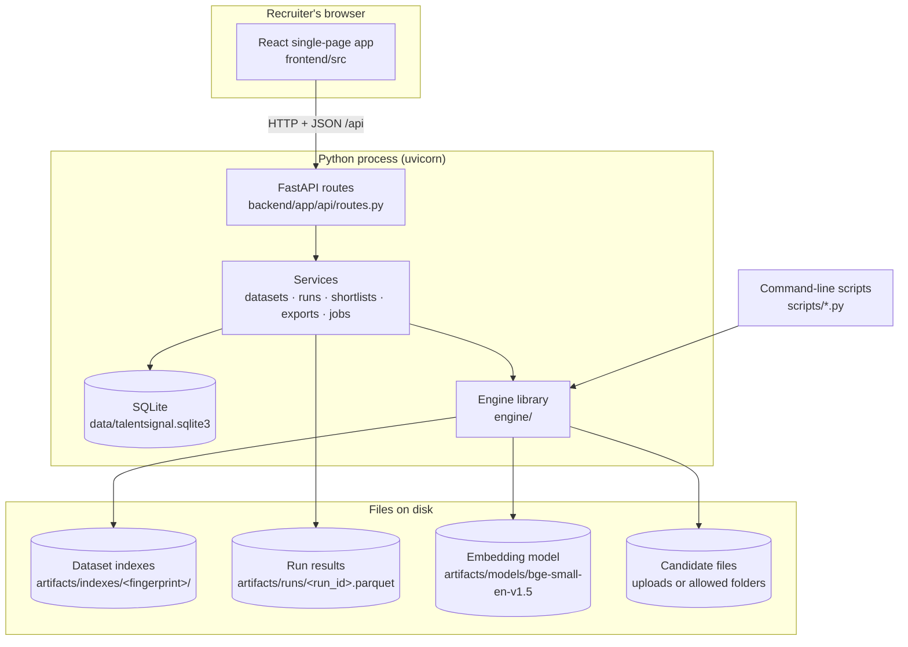
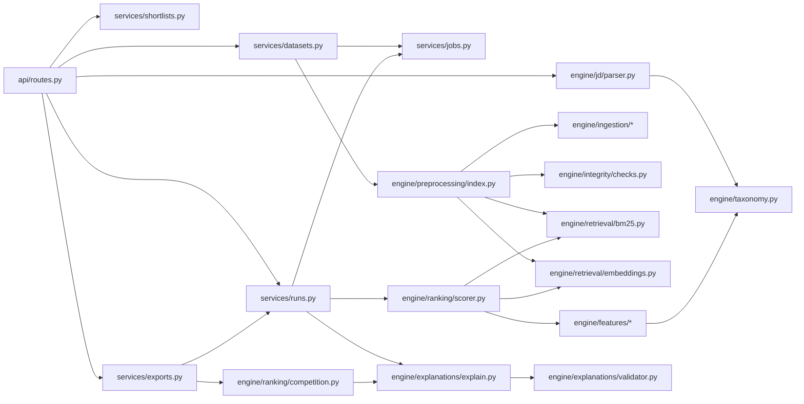
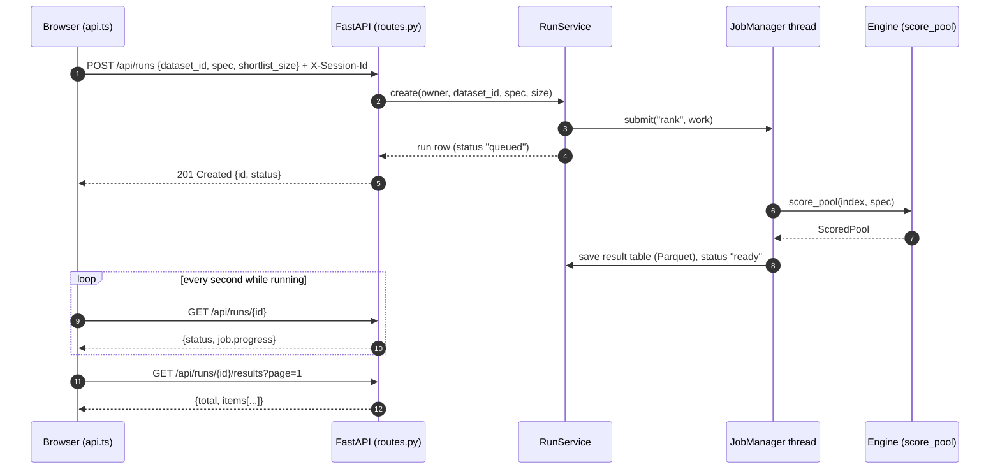
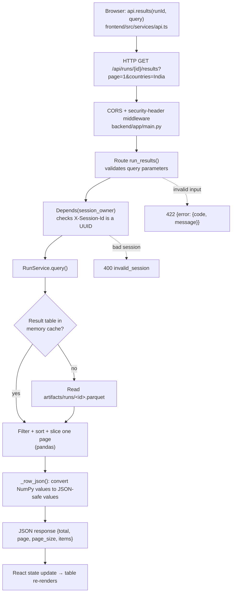
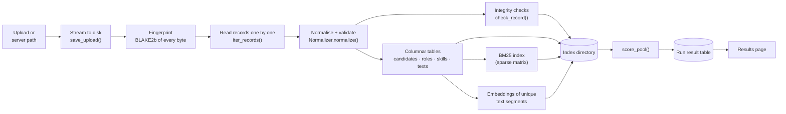
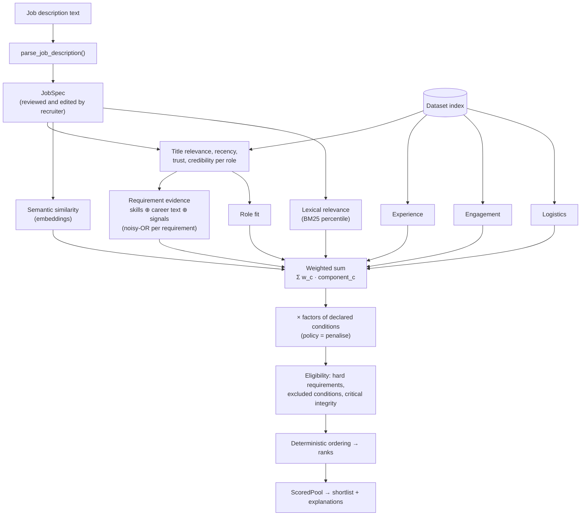

# The Complete Architecture

An *architecture* is the answer to "what are the big pieces, what is each piece responsible for, and how do they talk to each other?". This part gives you that map. Keep it in mind for the rest of the book; every later part zooms into one box of these diagrams.

## The three layers

TalentSignal is split into three layers, each in its own folder:

| Layer | Folder | Language | Responsibility |
|---|---|---|---|
| **Frontend** | `frontend/src/` | TypeScript + React | Everything the recruiter sees and clicks: pages, tables, forms, charts |
| **Backend** | `backend/app/` | Python + FastAPI | A web server: receives requests, stores runs and shortlists, runs long jobs in the background, returns JSON |
| **Engine** | `engine/` | Python (NumPy, pandas, scikit-learn, sentence-transformers) | The intelligence: reading candidate files, understanding the job, scoring, explaining, evaluating |

The most important architectural rule is **the engine knows nothing about the web**. It is a plain Python library. The backend *calls* the engine; the engine never imports anything from the backend. This rule is why the same engine can be used by the web app, by command-line scripts, by the competition mode and by the evaluation harness.

Figure 2.1 - Overall architecture. Boxes are components; cylinders are stored data. Arrows point from the caller to what it uses.

Read the figure from top to bottom. The browser only ever talks to the API over HTTP. The API delegates all real work to *services*. Services store small structured facts (who ran what, when) in SQLite, and call the engine for heavy work. The engine reads candidate files, writes and reads indexes, and loads the embedding model. Command-line scripts bypass the web entirely and call the engine directly.

## Each component: responsibility, inputs, outputs

| Component | Key files | Input | Output | Talks to |
|---|---|---|---|---|
| React app | `frontend/src/App.tsx`, `pages/*.tsx` | User clicks, typed JD text, uploaded files | Pages; HTTP requests | Backend API only |
| API routes | `backend/app/api/routes.py` | HTTP requests with `X-Session-Id` | JSON responses, files | Services |
| Dataset service | `backend/app/services/datasets.py` | Uploaded file stream or a server path | Dataset record; background index job | Engine (`build_index`), SQLite |
| Run service | `backend/app/services/runs.py` | Dataset id, `JobSpec`, shortlist size | Run record; result table (Parquet); explanations | Engine (`score_pool`, `explain_candidate`), SQLite |
| Export service | `backend/app/services/exports.py` | Run id, format | CSV / XLSX / JSON / JSONL / Parquet / PDF bytes | Run service, engine competition module |
| Job manager | `backend/app/services/jobs.py` | A function to run in the background | Job record with progress and status | SQLite |
| Database | `backend/app/database/db.py` | SQL statements | Rows | File `data/talentsignal.sqlite3` |
| Ingestion | `engine/ingestion/*.py` | A candidate file (JSONL, JSON, CSV, XLSX, Parquet) | Normalised records + validation issues | - |
| Index builder | `engine/preprocessing/index.py` | Candidate file | Index directory (tables, BM25, embeddings, quality report) | Ingestion, integrity, retrieval |
| JD parser | `engine/jd/parser.py` | JD text | `JobSpec` (editable requirements and settings) | Taxonomy |
| Scorer | `engine/ranking/scorer.py` | Index + `JobSpec` | `ScoredPool` (every candidate scored and ordered) | Features, retrieval |
| Explainer | `engine/explanations/explain.py` | Scored pool + candidate id | Explanation dictionary | Validator |

## How the components interact

The next diagram shows *which code calls which code* inside the Python process. It is a dependency picture: an arrow from A to B means "A imports or calls B".

Figure 2.2 - Component interaction (import/call dependencies). Backend modules are on the left, engine modules on the right. No engine module points back to the backend.

## How the frontend talks to the backend

The frontend and backend communicate only through **HTTP requests that carry JSON**. Every request includes a header named `X-Session-Id` containing a random identifier the browser generated the first time it opened the app (stored in the browser's `localStorage`). The backend uses that identifier to keep each browser's runs and shortlists separate. It is *not* a login system - Part 10 explains why that matters.

Figure 2.3 - Frontend-to-backend communication when the recruiter starts a ranking. The request returns immediately; the heavy work happens in a background thread while the browser polls for progress.

The key idea is **asynchronous work**. Scoring 100,000 candidates takes a few seconds; building an index takes about two minutes. A web request should not hang that long, so the backend answers immediately with a run whose status is `queued`, does the work in a background thread, and the browser asks for the status once a second (*polling*) until it becomes `ready`.

## The complete request lifecycle

What happens, step by step, when the browser asks for one page of results? This is the most frequent request in the application.

Figure 2.4 - Lifecycle of a results request. Dotted arrows are error paths; every error returns the same JSON shape.

## How candidate data flows through the system

A candidate file travels a long way before a recruiter sees a ranked row. The next diagram follows one file from upload to screen.

Figure 2.5 - Candidate data flow. Everything left of the index directory happens once per file; everything right of it happens once per ranking run.

The split in Figure 2.5 is the **precompute / rank** pattern. Expensive work that does not depend on the job (parsing, cleaning, tokenising, embedding) happens once per candidate file and is saved. Work that depends on the job (scoring) is cheap because it reuses that saved work. On the reference machine, the one-time index build took **137 seconds**; scoring the same 100,000 candidates against a job takes about **2.9 seconds**.

## The ranking pipeline at a glance

Part 6 explains every box in detail. Here is the overview.

Figure 2.6 - Ranking pipeline overview. Seven components are computed for every candidate, combined by a weighted sum, adjusted by declared policies, filtered for eligibility, then ordered.

## Where data is stored, and why in different places

TalentSignal uses three kinds of storage, each chosen for what it holds:

| Storage | What it holds | Why this kind |
|---|---|---|
| SQLite database (`data/talentsignal.sqlite3`) | Datasets, jobs, runs, shortlists, activity - small structured records | Relationships (a shortlist belongs to a run), transactions, zero setup |
| Index directory (`artifacts/indexes/<fingerprint>/`) | Normalised records, Parquet tables, BM25 matrix, embeddings, quality report | Large numeric/columnar data read in bulk by NumPy and pandas |
| Run results (`artifacts/runs/<run_id>.parquet`) | One row per shortlisted (or held) candidate with all component scores | Fast columnar filtering and sorting of up to ~100,000 rows |

The index directory is named after the **fingerprint** of the candidate file - a hash of every byte. Two consequences follow: an identical file is never indexed twice, and a file that changed even by one byte gets a new index instead of silently reusing a stale one.

## How exports fit in

Exports are produced on demand from the run's result table: CSV, XLSX, JSON, JSONL and Parquet copy rows; the PDF report adds explanation summaries for the top candidates; the *competition* export produces exactly 100 rows in the original challenge format and validates them before returning. Part 11 traces an export end to end, and Book 2 documents each format.

!!! note "Summary of Part 2"
    Three layers (frontend, backend, engine) with a strict rule that the engine is a plain library. Communication is HTTP + JSON with a session header. Heavy work runs in background jobs while the browser polls. Data is processed once per file (index) and cheaply per job (scoring). Storage is split by purpose: SQLite for records, Parquet/NumPy files for bulk data.
