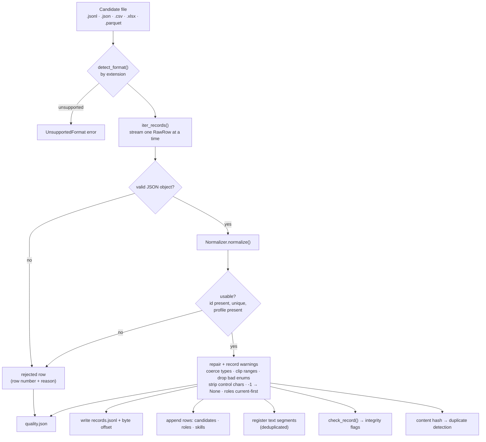

# Understanding Candidate Data

Ranking can only be as good as the data it reads. This part explains what a candidate record contains, how TalentSignal reads and repairs it, and how raw fields become the *features* the scorer uses.

## The candidate record

The reference dataset (`reference material/candidates.jsonl`) contains 100,000 records that follow `candidate_schema.json`. Each record is one JSON object with these top-level parts:

| Part | Type | What it holds |
|---|---|---|
| `candidate_id` | string | Unique identifier, format `CAND_` + 7 digits in the reference data |
| `profile` | object | Name, headline, summary, location, country, years of experience, current title/company/industry |
| `career_history` | list of objects | One entry per job: company, title, dates, duration in months, whether current, industry, description |
| `education` | list | Institution, degree, field of study, years, grade, institution *tier* |
| `skills` | list | Name, self-reported proficiency (beginner/intermediate/advanced/expert), endorsements, months used |
| `certifications` | list | Name, issuer, year |
| `languages` | list | Language and proficiency |
| `redrob_signals` | object | 23 behavioural signals from the platform (see below) |

Here is a real record from the dataset, shortened with `...` where text was cut. The names in the dataset are already synthetic ("anonymized_name").

```json
{
  "candidate_id": "CAND_0000001",
  "profile": {
    "anonymized_name": "Ira Vora",
    "headline": "Backend Engineer | SQL, Spark, Cloud",
    "summary": "Software / data professional with 6.9 years of experience building data pipelines ...",
    "location": "Toronto", "country": "Canada", "years_of_experience": 6.9,
    "current_title": "Backend Engineer", "current_company": "Mindtree",
    "current_company_size": "10001+", "current_industry": "IT Services"
  },
  "career_history": [
    {"company": "Mindtree", "title": "Backend Engineer", "start_date": "2024-03-08", "end_date": null,
     "duration_months": 27, "is_current": true, "industry": "IT Services", "company_size": "10001+",
     "description": "Implemented streaming data pipelines on Kafka and Spark Streaming ..."},
    {"company": "Dunder Mifflin", "title": "Analytics Engineer", "start_date": "2019-07-03",
     "end_date": "2024-01-08", "duration_months": 55, "is_current": false, "...": "..."}
  ],
  "skills": [{"name": "SQL", "proficiency": "advanced", "endorsements": 12, "duration_months": 40}, "..."],
  "redrob_signals": {"last_active_date": "2026-04-30", "recruiter_response_rate": 0.62, "...": "..."}
}
```

## Field by field: what the ranking uses

Not every field is used for ranking, and some are deliberately excluded. This table is the authoritative summary (verified against `engine/ranking/scorer.py` and `engine/features/*.py`).

| Field | Used for | Notes |
|---|---|---|
| `profile.current_title` | Role fit, seniority, title trust | Mapped to a *role family* by `taxonomy.yaml` patterns |
| `career_history[].title` | Career relevance, trust of each role's description | Every role counts, weighted by months and recency |
| `career_history[].description` | Text evidence (phrases + embeddings), holistic semantic match | Trusted in proportion to the role title's relevance |
| `career_history[].duration_months`, dates | Relevant years, recency, integrity checks | Missing months default to 12 for weighting |
| `profile.years_of_experience` | Experience band fit; integrity check | Missing → neutral |
| `profile.summary`, `headline` | Text evidence at reduced weight (0.6 × credibility) | Self-description, not a work record |
| `skills[]` | Skill evidence | Best matching skill only (no summing) |
| `redrob_signals.skill_assessment_scores` | Blended into skill evidence (50/50) | Platform-verified evidence |
| Engagement signals | Engagement component | See next section |
| `profile.location`, `country`, `willing_to_relocate` | Location fit; work-authorization condition | Only as the job states |
| `education[].field_of_study` | Displayed, filterable ("academic branch") | **Not scored** |
| `education[].tier` | Nothing | **Never used** - institution prestige is excluded |
| `profile.anonymized_name` | Display only | Never a feature |
| `languages`, `certifications` | Display only | Not part of any score component |

!!! note "What goes into the keyword index"
    The index builder (`engine/preprocessing/index.py`) adds the *headline, summary, role titles, role descriptions, current title and skill names* to the BM25 documents. Certifications and languages are stored for display (`candidates.parquet` column `certifications`) but are **not** part of the lexical index or any score.

## The 23 platform signals

The `redrob_signals` object contains behaviour recorded by the recruiting platform. The table shows each signal, its range and whether TalentSignal scores it.

| Signal | Range | Used in score? | How |
|---|---|---|---|
| `last_active_date` | date | Yes (engagement) | Half-life decay of 90 days from the dataset's as-of date |
| `recruiter_response_rate` | 0-1 | Yes (engagement) | Used directly |
| `avg_response_time_hours` | ≥ 0 | Yes (engagement) | \(1/(1 + h/48)\) |
| `open_to_work_flag` | bool | Yes (engagement) | Open = 1.0, not open = 0.4 |
| `interview_completion_rate` | 0-1 | Yes (engagement) | Used directly |
| `offer_acceptance_rate` | -1 or 0-1 | Yes (engagement, small) | -1 means "no offers yet" → treated as missing |
| `saved_by_recruiters_30d` | ≥ 0 | Yes (engagement, 5% share) | \(1 - e^{-x/5}\) |
| `skill_assessment_scores` | dict skill → 0-100 | Yes (skill evidence) | Blended with self-reported claim |
| `github_activity_score` | -1 or 0-100 | Only for an open-source requirement | -1 means not linked → missing |
| `notice_period_days` | 0-180 | Yes (logistics) | Piecewise decay |
| `preferred_work_mode` | onsite/hybrid/remote/flexible | Yes (logistics) | Compared to the job's mode |
| `willing_to_relocate` | bool | Yes (logistics; work-authorization) | |
| `verified_email`, `verified_phone`, `linkedin_connected`, `profile_completeness_score` | bool / 0-100 | No - shown as *evidence completeness* | Not a quality signal of the person |
| `signup_date` | date | No - data-quality check only | |
| `profile_views_received_30d`, `search_appearance_30d`, `applications_submitted_30d`, `connection_count`, `endorsements_received` | counts | No | Popularity or volume, not fit |
| `expected_salary_range_inr_lpa` | min/max | No | A negotiation matter, and 18.9% of records have min > max |

Why are popularity signals excluded? If being viewed often made you rank higher, ranking higher would make you viewed more often - a *feedback loop* that entrenches early luck. The only popularity-like signal kept (`saved_by_recruiters_30d`) has a 5% share of the engagement component, which itself has an 11% share of the total.

## What the reference data actually looks like

These facts were measured on the full file during the audit (Book 2, Part 9 shows how to reproduce them):

| Measurement | Value |
|---|---|
| Records | 100,000 (no duplicate IDs, all 23 signals present) |
| File size | 465 MB (487,259,903 bytes) |
| Distinct job titles | 48 |
| Distinct skill names | 133 |
| Career roles | 300,171 |
| **Distinct role descriptions** | **44** |
| Distinct summaries / headlines | 3,241 / 2,469 |
| Current titles that are non-technical | 68.8% |
| Current titles directly in ML/AI/search | 1,179 (1.2%) |
| Candidates outside India | 24.9% |
| GitHub not linked / no offer history | 64.6% / 59.6% |
| Salary minimum above maximum | 18,865 records |
| Last activity before sign-up | 7,496 records |

Two observations shaped the design:

1. **The data is synthetic and heavily templated.** Only 44 different role descriptions are reused across 300,171 roles. TalentSignal exploits this for speed (it processes each *unique* text once) without depending on it for correctness.
2. **Descriptions attached to non-technical titles come from an unrelated pool.** A "HR Manager" role may carry a description about sales or support. This is why description evidence is weighted by how believable the title makes it.

## Raw data, processed data and features

These three words describe three stages. Confusing them causes most data bugs.

| Stage | Definition | Example | Where |
|---|---|---|---|
| **Raw data** | Exactly what was in the file | `"github_activity_score": -1`, `"recruiter_response_rate": "0.7"` (a string in a CSV) | The uploaded file |
| **Processed data** | Cleaned, typed, validated, repaired | `github_activity_score: None` (missing), `recruiter_response_rate: 0.7` (a float) | `records.jsonl` and Parquet tables in the index |
| **Features** | Numbers computed *for a specific job* that the scorer combines | title relevance 1.0, requirement coverage 0.93, engagement 0.87 | Computed by `score_pool` for each run |

Raw and processed data do not depend on the job description; features do. That is exactly the split between the one-time index build and the per-job scoring.

## The ingestion pipeline


<p class="caption">Figure 4.1 - Ingestion pipeline (engine/ingestion and the first half of engine/preprocessing/index.py). Rejected rows never stop the build; they are counted and listed in the quality report.</p>

### Step 1 - streaming readers

`iter_records(path)` in `engine/ingestion/readers.py` chooses a reader by file extension and yields one `RawRow(row, record, error)` at a time.

| Format | How it is read | Notes |
|---|---|---|
| JSONL / NDJSON / TXT | line by line | Fully streamed: memory does not grow with file size |
| JSON | parsed whole | A JSON array cannot be streamed with the standard parser, so it is capped at 512 MB and the error message suggests JSONL |
| CSV | row by row | Nested fields either as dotted columns (`profile.headline`) or as JSON text in a cell (`skills`) |
| XLSX | row by row (openpyxl read-only mode) | Same column conventions as CSV |
| Parquet | in batches of 2,048 rows | Nested columns or JSON text |

The conversion of flat rows back into nested objects is done by `unflatten()`: a column `profile.headline` becomes `record["profile"]["headline"]`, and a cell whose text starts with `[` or `{` is parsed as JSON.

### Step 2 - normalisation and validation

`Normalizer.normalize()` in `engine/ingestion/validation.py` follows one philosophy: **reject only what cannot be used; repair and report everything else.**

A record is **rejected** only if it is not an object, has no usable `candidate_id` (1-64 characters of letters, digits, `_ . -`), repeats an ID already seen in the file, or has no `profile` object. Everything else is repaired with a *warning*:

- strings such as `"0.7"` or `"yes"` are converted to numbers and booleans;
- values outside the documented range are clipped (a response rate of 1.7 becomes 1.0);
- unknown enumeration values (such as an invalid work mode) become `None`;
- control characters are stripped and long text is capped (6,000 characters);
- roles are reordered so the current role comes first, then past roles newest first;
- the documented sentinel `-1` for `github_activity_score` and `offer_acceptance_rate` becomes `None`.

### Step 3 - missing data stays missing

This is one of the most important rules in the project. **A missing value is stored as `None`, never as 0.** Later, every sub-score that combines several signals uses a *missing-aware weighted mean*:

\[
\text{combined} = \frac{\sum_k w_k\, x_k\, a_k}{\sum_k w_k\, a_k}, \qquad a_k = \begin{cases}1 & \text{if } x_k \text{ is available}\\ 0 & \text{if missing}\end{cases}
\]

Here \(w_k\) is the weight of sub-signal \(k\), \(x_k\) its value, and \(a_k\) an availability indicator. A missing signal simply drops out of both the numerator and the denominator, so it neither helps nor hurts. If *nothing* is available the result is 0.5 - "no information". Part 6 gives a numerical example, and Part 7 shows it in action for a candidate with no offer history.

!!! example "Why not fill missing values with 0?"
    64.6% of candidates have no GitHub account linked. If "no GitHub" counted as an activity score of 0, two-thirds of the pool would be penalised for something that says nothing about their ability - and the penalty would fall hardest on people who work on closed-source products. Treating it as unknown avoids that unfairness.

### Step 4 - the quality report

Every index build writes `quality.json`: rows read, valid and rejected (with the first 25 reasons), counts of each repair, the missing rate of every signal, integrity counts by severity, duplicates, unique text segments, top titles, countries and an experience histogram. The Datasets page in the UI renders it, so a recruiter can judge a dataset before trusting its rankings.

## From one record to several tables

The index builder splits each record into rows of separate tables, because the scorer needs to process all roles (or all skills) of all candidates at once.

| Table | One row per | Key columns |
|---|---|---|
| `candidates.parquet` | candidate | `idx`, `candidate_id`, `name`, `title`, `company`, `city`, `country`, `years_experience`, `fields_of_study`, `skills` (pipe-joined), `headline_tid`, `summary_tid`, and every signal as `sig_<name>` |
| `roles.parquet` | career role | `idx` (owner), `order` (0 = current), `title`, `company`, `industry`, `start_date`, `end_date`, `months`, `is_current`, `text_id` (description) |
| `skills.parquet` | (candidate, skill) | `idx`, `skill`, `proficiency`, `level` (0.25-1.0), `months`, `endorsements`, `assessed` (score or NaN) |
| `texts.parquet` | unique text segment | `text`, `kind` (headline / summary / title / description / skill) |
| `integrity.parquet` | integrity finding | `idx`, `code`, `severity`, `title`, `detail`, `evidence` |

`idx` is the candidate's row number (0 to n-1); it links all tables together and is how NumPy arrays are indexed. `text_id` and the `*_tid` columns point into `texts.parquet`, which is the key to the unique-segment optimisation explained in Part 9.

## Data quality issues found, and how each is treated

| Issue (count in reference data) | Treatment |
|---|---|
| Expert skills with 0 months of use (21 candidates with 2+) | Critical integrity finding → held for human review |
| Stated years differ from summed role months by > 3 years (47) | Critical integrity finding → held for human review |
| Assessment for a skill not listed (36) | Warning, shown on the profile |
| Salary min > max (18,865) | Info only - salary is not used |
| Last activity before sign-up (7,496) | Info only |
| Missing GitHub / offer history | Missing, neutral |
| Non-tech title with five or more AI skills (4,179) | No flag by itself; skill credibility halves their skill evidence, and a JD-specific "uncorroborated skills" warning appears when 4+ job skills are claimed with no related role |

Part 8 explains the integrity checks and their severities in detail.
