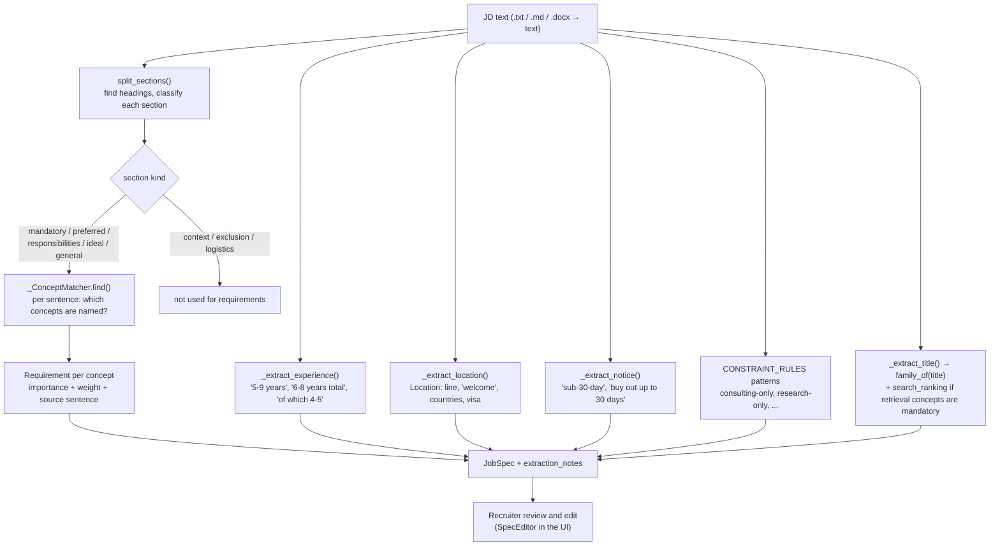

# Job Description Intelligence

The ranking can only be as good as its understanding of the job. This part explains how TalentSignal turns free text into a structured, editable **JobSpec**, and how each part of that JobSpec later influences the score.

## Why a structured representation

A scorer cannot "read" prose. It needs concrete answers: *which capabilities, how important, what experience band, where, how soon, what must be avoided?* TalentSignal's answer is the `JobSpec` class (`engine/jd/spec.py`), a Pydantic model with these parts:

| Field | Type | Meaning |
|---|---|---|
| `title` | str | Role title, e.g. "Senior AI Engineer - Founding Team" |
| `seniority_level` | int | 0 intern … 5 principal/director; 2 if the title has no seniority word |
| `role_families` | dict family → weight | Which kinds of job titles count as relevant (e.g. `ml_engineering: 1.0`) |
| `responsibilities` | list[str] | Lines from the "what you'll do" section |
| `requirements` | list[Requirement] | Each capability: label, skills, phrases, semantic sentence, importance, weight, hard flag, minimum coverage, **source sentence** |
| `experience` | ExperienceSpec | min/max years, ideal band, relevant-years target, hard minimum flag |
| `location` | LocationSpec | preferred and acceptable cities, countries, work mode, relocation, visa sponsorship |
| `notice` | NoticeSpec | ideal and acceptable notice days |
| `constraints` | list[ConstraintSpec] | Declared conditions (e.g. consulting-only careers) with a **policy** and factor |
| `weights` | ComponentWeights | Relative influence of the seven score components |
| `integrity_policy` | "exclude" / "flag" | What happens to critical integrity findings |
| `as_of_date` | date or None | Reference date for recency (default: newest activity date in the dataset) |
| `focus_text` | str | Text compared semantically with candidate work descriptions |
| `extraction_notes` | list[str] | Warnings from the parser, e.g. "no must-have section found" |

The same model is used by the parser (to create it), the UI (to edit it, as JSON), the API (to validate it) and the scorer (to read it). Because it is a Pydantic model, an invalid edit - a weight of 3, a duplicate requirement id - is rejected before any scoring happens.

## The knowledge base: concepts and role families

The parser recognises capabilities through a knowledge base, `engine/resources/taxonomy.yaml`, loaded by `engine/taxonomy.py`. It contains three things:

1. **Concepts** - about 25 capabilities. Each has a label, a list of **skills** (names that appear in skill lists), a list of **phrases** (words that appear in prose), and a one-sentence **semantic** description used by the embedding model.
2. **Role families** - groups of job titles recognised by ordered regular-expression patterns (`search_ranking`, `ml_engineering`, `data_science`, `backend`, … `non_technical`). The first matching pattern wins, so "Senior Software Engineer (ML)" is matched by the ML pattern before the generic software one.
3. **Family affinity** - a symmetric table saying how transferable experience in one family is to another (same family 1.0; ML ↔ search 0.9; backend ↔ ML 0.35; anything ↔ non-technical 0).

An excerpt of one concept:

```yaml
vector_search_infra:
  label: Vector databases / hybrid search infrastructure
  skills: [Pinecone, Weaviate, Qdrant, Milvus, FAISS, pgvector, OpenSearch, Elasticsearch, ...]
  phrases: [vector database, faiss, hybrid search, hybrid retrieval, index refresh, elasticsearch, ...]
  semantic: Ran vector database and hybrid lexical plus dense search infrastructure in production, including index refresh.
```

Because this is *data*, not code, supporting a new domain (say, nursing) is an edit to the YAML file rather than a code change - though Part 11 and Book 3 discuss how far that really goes.

## The parsing pipeline


<p class="caption">Figure 5.1 - Job description processing (engine/jd/parser.py). Every extracted item keeps the sentence it came from.</p>

### Step 1 - turning a document into text

`engine/jd/documents.py` accepts `.txt`, `.md` and `.docx`. A `.docx` file is a ZIP archive of XML; the function `docx_to_text` reads `word/document.xml` directly with regular expressions (no external library), converting paragraph ends to line breaks. Before decompressing, it checks the declared size against a 20 MB limit to block "zip bombs" - tiny files that expand to enormous sizes. PDF job descriptions are **not** supported.

### Step 2 - sectioning

A JD is split into sections at *headings*. The function `_is_heading` treats a line as a heading if it is short (at most 90 characters and 12 words), starts with a capital letter and does not end in sentence punctuation - or if it starts with `#` or ends with `:`. Lines of the form "Key: value" (for example `Experience Required: 5-9 years`) are explicitly **not** headings.

Each heading is classified by keyword rules (`SECTION_RULES`), checked in this order:

| Kind | Example heading keywords |
|---|---|
| exclusion | "do not want", "not a fit", "disqualif", "red flag" |
| preferred | "nice to have", "preferred", "bonus", "won't reject", "we'd like" |
| mandatory | "absolutely need", "must have", "requirement", "qualification" |
| responsibilities | "what you'll", "responsibilit", "day to day", "actually be doing" |
| ideal | "ideal", "between the lines", "imagining" |
| logistics | "location", "notice", "compensation" |
| context | "note", "hackathon", "about us", "culture", "vibe" |

Order matters: "Things we'd like you to have but won't reject you for" contains both preferred keywords and none of the mandatory ones; "Things we explicitly do NOT want" is caught as an exclusion before anything else.

### Step 3 - concept detection and importance

For every sentence in a mandatory, preferred, responsibilities, ideal or general section, `_ConceptMatcher` checks each concept's skill names and phrases with word-boundary regular expressions (so "rag" does not match inside "storage"). A detected concept becomes a requirement with:

| Where it was found | importance | weight |
|---|---|---|
| a must-have section | mandatory | 1.0 |
| a nice-to-have section | preferred | 0.5 |
| anywhere else that is not ignored (responsibilities, ideal profile, general text) | preferred | 0.35 |

If a concept appears in several places, the most important occurrence wins. Context, exclusion and logistics sections are ignored for requirements - this is what stops the reference JD's closing note ("a candidate who has all the AI keywords ... Pinecone ... is not a fit") from creating a Pinecone requirement. The concept `business_functions` only becomes a requirement if it appears in a must-have section.

### Step 4 - targeted extractors

| Extractor | What it looks for | Reference JD result |
|---|---|---|
| `_extract_experience` | `N-M years`, `N+ years`, "of which N"; a second range in the *ideal* section becomes the ideal band; "minimum", "at least", "must" make the minimum hard | min 5, max 9, ideal 6-8, relevant target 4, not hard |
| `_extract_location` | the `Location:` line (cities before `\|`), "welcome/open to" sentences, country words, "don't sponsor ... visa" | preferred Pune, Noida; acceptable Delhi NCR, Hyderabad, Mumbai; India; hybrid; no visa sponsorship |
| `_extract_notice` | "sub-N-day", "notice of N days", "buy out up to N days" | ideal 30, acceptable 60 (30 + 30 buy-out) |
| `CONSTRAINT_RULES` | patterns for declared conditions | 7 conditions + work authorization |
| `_extract_title` | "Job Description:/Title:/Role:" line, else the first short line | "Senior AI Engineer - Founding Team" |

### Step 5 - role families and focus text

The title is mapped to a family with `Taxonomy.family_of`. "Senior AI Engineer" matches `\bai\b` → `ml_engineering`. Because the JD makes retrieval and ranking concepts mandatory, `search_ranking` is added too. If no technical family is found, title relevance falls back to word overlap with the JD title, and a note tells the recruiter.

The **focus text** - used for holistic semantic matching - is the title, the first six responsibility lines and the semantic sentences of the mandatory requirements, capped at 4,000 characters.

## A complete example: the reference job description

Running the parser on the reference JD (`engine/resources/jobs/redrob_senior_ai_engineer.txt`) produces the following (verified by `tests/test_jd_parser.py`).

| Requirement | Importance | Weight | Source sentence (shortened) |
|---|---|---|---|
| Embeddings-based retrieval | must-have | 1.0 | "Production experience with embeddings-based retrieval systems (sentence-transformers, ..." |
| Production deployment to real users | must-have | 1.0 | same sentence ("Production ... deployed to real users") |
| Python | must-have | 1.0 | "Strong Python." |
| Ranking / recommendation systems | must-have | 1.0 | "Hands-on experience designing evaluation frameworks for ranking systems ..." |
| Ranking evaluation (NDCG/MRR/MAP, A/B) | must-have | 1.0 | same sentence |
| Vector databases / hybrid search | must-have | 1.0 | "... handled embedding drift, index refresh, retrieval-quality regression ..." |
| Distributed systems | nice-to-have | 0.5 | "Background in distributed systems or large-scale inference optimization" |
| HR-tech / recruiting | nice-to-have | 0.5 | "Prior exposure to HR-tech, recruiting tech, or marketplace products" |
| LLM applications, LLM fine-tuning | nice-to-have | 0.5 | "LLM fine-tuning experience (LoRA, QLoRA, PEFT)" |
| Learning-to-rank models | nice-to-have | 0.5 | "Experience with learning-to-rank models (XGBoost-based or neural)" |
| Open-source contributions | nice-to-have | 0.5 | "Open-source contributions in the AI/ML space" |
| Information retrieval | mentioned | 0.35 | "Weeks 1-3: Audit what we currently have (it's mostly BM25 ...)" |

Declared conditions extracted, each with its default policy:

| Condition | Default policy | Factor |
|---|---|---|
| Career spent only at IT-services / consulting firms | penalise | × 0.5 |
| Pure research career without production deployment | penalise | × 0.5 |
| Senior lead/architect who no longer writes code | penalise | × 0.65 |
| Frequent job switching while climbing titles | penalise | × 0.75 |
| Computer vision / speech focus without NLP or IR | penalise | × 0.6 |
| AI experience limited to recent LLM-API wrappers | penalise | × 0.75 |
| No external validation of work (closed source) | **show only** | (0.9, unused) |
| Outside the hiring country (no visa sponsorship) | penalise | × 0.5 |

The "closed source" condition defaults to *show only* on purpose: penalising candidates for a missing GitHub account would contradict the rule that missing optional data is neutral.

## A small example, step by step

The worked example in Part 7 uses this short JD:

```text
Search Engineer
Location: Pune, India (Hybrid) | Open to relocation within India
Experience Required: 4-8 years
What you'll do
- Own the ranking of our product search results.
- Run offline evaluation and A/B tests before shipping ranking changes.
Must have:
- Production experience with Elasticsearch or another search engine
- Experience building ranking or recommendation systems
- Strong Python
Nice to have:
- Learning-to-rank models such as LightGBM or XGBoost
Notice period: we prefer sub-30-day notice; we can buy out up to 30 days.
```

The real parser produced (from `docs/learning/build/worked_example.json`):

| Requirement | Importance | Weight | Why |
|---|---|---|---|
| Information retrieval / search relevance | must-have | 1.0 | "search engine" in a must-have line |
| Vector databases / hybrid search infrastructure | must-have | 1.0 | "Elasticsearch" is listed under this concept |
| Ranking / recommendation systems | must-have | 1.0 | "ranking", "recommendation" |
| Python | must-have | 1.0 | "Python" |
| Learning-to-rank models | nice-to-have | 0.5 | "learning-to-rank", "LightGBM", "XGBoost" |
| Ranking evaluation | mentioned | 0.35 | "offline evaluation", "A/B tests" in responsibilities |

Experience 4-8 years (no separate ideal band, so ideal = 4-8), preferred city Pune, country India, hybrid, notice ideal 30 / acceptable 60, role family `search_ranking`, no declared conditions.

!!! warning "A real quirk worth understanding"
    The single sentence about Elasticsearch produced **two** must-haves, and one of them is labelled "Vector databases / hybrid search infrastructure" - a label that sounds wrong for an Elasticsearch requirement. This happens because the taxonomy groups Elasticsearch with vector databases, and "search engine" separately triggers the information-retrieval concept. It is not a bug in the code; it is the granularity of the knowledge base. This is exactly why the recruiter review step exists: the label can be renamed, the duplicate merged or removed, and its weight changed before ranking.

## Recruiter adjustments

In the UI (`frontend/src/components/SpecEditor.tsx`) every extracted item can be changed before ranking:

- rename a requirement, switch must-have / nice-to-have, change its weight (0.05-1.0), mark it **hard**;
- edit the skills (any one counts), phrases searched in career text, and the semantic sentence;
- add a known capability from the taxonomy, or a custom requirement;
- set the experience band and whether the minimum is hard;
- edit preferred/acceptable cities, countries, work mode, notice, visa;
- choose a policy for each declared condition: **show only**, **penalise × factor**, or **exclude**;
- choose what happens to critical integrity findings (hold for review, or rank and flag);
- change the seven component weights (shown normalised to 100%).

## How the JobSpec influences ranking

| JobSpec part | Influences | How |
|---|---|---|
| requirement skills | skill evidence | candidate skills matching any listed name (case-insensitive) |
| requirement phrases | text evidence and BM25 query | word-boundary search in role descriptions and summary; terms of the BM25 query |
| requirement semantic sentence | text evidence | embedding similarity with each unique description and summary |
| requirement weight / importance | requirements component; must-have count; tie-break | weighted mean of coverage; mandatory coverage computed separately |
| `hard` + `min_coverage` (default 0.35) | eligibility | candidates below the minimum are held out of the shortlist |
| role families | role fit, title trust, skill credibility | through title relevance |
| experience | experience component; optional hard gate | band fit, relevant years target |
| location, notice, work mode | logistics component | sub-scores in [0, 1] |
| constraints | factor or exclusion | per policy |
| weights | combination | normalised weighted sum |
| focus text | semantic component | holistic description similarity |

!!! note "Summary of Part 5"
    The parser is deliberately rule-based: offline, deterministic and inspectable. It classifies JD sections, detects capabilities from a knowledge base, extracts experience, location, notice and declared conditions, and records the source sentence for everything. Its output, the JobSpec, is reviewed and edited by the recruiter and is the only thing the scorer reads about the job.
