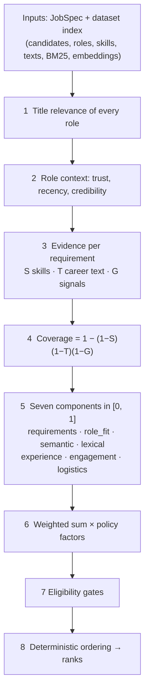
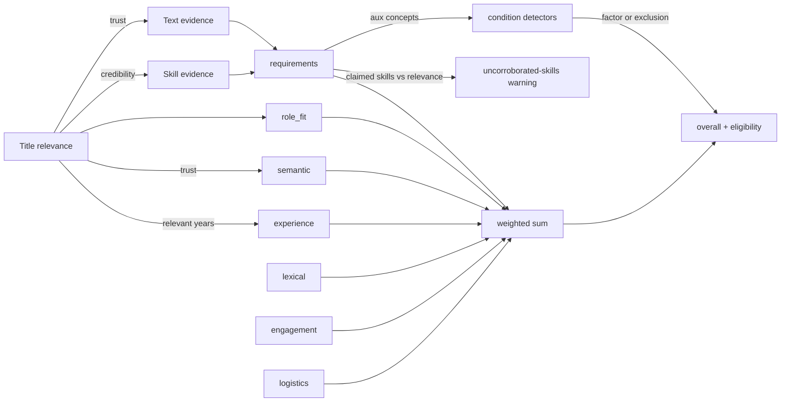

# The Ranking Engine in Depth

This is the most important part of the book. It explains, component by component, exactly how `score_pool` in `engine/ranking/scorer.py` turns a JobSpec and a dataset index into an ordered list. Every formula below is the one in the code; every constant is the value in `engine/features/calibration.py`, `engine/features/signals.py` or `engine/jd/spec.py`. Where a concept is explained as background but **not** implemented, it is labelled so.

## The big picture: evidence, not keywords

TalentSignal treats ranking as **evidence aggregation**. For each thing the job needs, it asks two questions: *how strong is the evidence that this candidate has it?* and *how much should that evidence be trusted?* It then combines several kinds of evidence into seven **components**, each a number between 0 and 1, and combines the components with a **weighted sum**.


<p class="caption">Figure 6.1 - The ranking engine flowchart. Numbers match the section order of this part.</p>

All of this runs for **every candidate at once** using NumPy arrays (Part 3). For 100,000 candidates the whole function takes about 2.9 seconds on the reference machine once the index is loaded.

## Default component weights

The final score starts as a weighted sum of seven components. Default weights (from `ComponentWeights` in `engine/jd/spec.py`) sum to 1.00:

| Component | Weight | Measures |
|---|---|---|
| `requirements` | 0.34 | How well the evidence covers each job requirement |
| `role_fit` | 0.20 | How related the candidate's current and past job titles are |
| `semantic` | 0.12 | Meaning-level similarity between the job and the candidate's work descriptions |
| `experience` | 0.10 | Years in the band, relevant years, seniority alignment |
| `engagement` | 0.11 | Platform behaviour: activity, responsiveness, reliability |
| `logistics` | 0.08 | Location, notice period, work mode |
| `lexical` | 0.05 | BM25 keyword relevance (as a percentile) |

The recruiter can change these. The engine always **normalises** them (`ComponentWeights.normalized()` divides each by their sum), so only their ratios matter. If a component is unavailable - for example the embedding model is missing - it is removed and the remaining weights are re-normalised, and a note is attached to the run.

## Step 1 - title relevance

**What it measures.** How close a job title is to the role being hired for.

**Why it is necessary.** A title is the hardest part of a profile to fake convincingly and the best single indicator of what someone does all day. It is also used to decide how much to *trust* other evidence (steps 2-3).

**How it is calculated.** Each title is mapped to a *role family* by the taxonomy's ordered patterns. The JobSpec lists target families with weights (usually 1.0). Then

\[
\mathrm{rel}(\text{title}) = \max_{f \in \text{target families}} \; w_f \cdot \mathrm{affinity}\big(f,\ \mathrm{family}(\text{title})\big)
\]

- \(w_f\) - the weight of target family \(f\) in the JobSpec;
- \(\mathrm{affinity}(a, b)\) - the hand-set transferability table in `taxonomy.yaml` (1.0 for the same family).

If the JobSpec has no target families, a fallback uses *Jaccard overlap* of title words: \(|A \cap B| / |A \cup B|\), ignoring words such as "senior".

**Example** (target families `search_ranking: 1.0, ml_engineering: 1.0`, values computed with the real taxonomy):

| Title | Family | rel |
|---|---|---|
| Search Engineer | search_ranking | 1.00 |
| Senior Software Engineer (ML) | ml_engineering | 1.00 |
| Data Scientist | data_science | max(0.75, 0.80) = 0.80 |
| Computer Vision Engineer | computer_vision | max(0.50, 0.65) = 0.65 |
| Data Engineer | data_engineering | 0.45 |
| Backend Engineer | backend | 0.40 |
| Senior Software Engineer | software | 0.35 |
| HR Manager | non_technical | 0.00 |

**Limitations.** The affinity table is hand-set, not learned; unusual titles fall into `non_technical` unless the YAML patterns are extended; a title says nothing about quality.

## Step 2 - role context: recency, trust and credibility

Three quantities are computed per role or per candidate and reused everywhere.

**Recency** of a role that ended \(m\) months before the as-of date (0 for the current role):

\[
\mathrm{recency} = e^{-m/48}, \qquad \mathrm{keep} = 0.5 + 0.5\cdot \mathrm{recency}
\]

`keep` is the fraction of a role's text evidence that survives ageing: a current role keeps 100%, a role that ended 24 months ago keeps \(0.5 + 0.5 e^{-0.5} = 0.803\), and very old roles never drop below 50%.

**Trust** of a role's description:

\[
\mathrm{trust} = 0.3 + 0.7 \cdot \mathrm{rel}(\text{role title})
\]

A description under a fully relevant title is trusted completely (1.0); under an unrelated title it keeps only 30%. The principle - *a description is credible to the extent its job title supports it* - is general. In the reference data it also neutralises descriptions that were shuffled onto unrelated titles.

**Credibility** of a candidate's skill claims:

\[
\mathrm{cred} = 0.5 + 0.5 \cdot \max\big(\mathrm{rel}(\text{current title}),\ \max_{\text{roles}} \mathrm{rel}(\text{role title})\big)
\]

Skills claimed by someone who has never held a related role count at half weight.

Two career summaries are also computed:

\[
\mathrm{career\_rel} = \frac{\sum_r \mathrm{rel}_r \cdot \mathrm{months}_r \cdot \mathrm{recency}_r}{\sum_r \mathrm{months}_r \cdot \mathrm{recency}_r}, \qquad
\mathrm{relevant\_years} = \frac{\sum_r \mathrm{rel}_r \cdot \mathrm{months}_r}{12}
\]

Missing role months are treated as 12 for this weighting.

## Step 3a - skill evidence

**What it measures.** How strongly the candidate's skill list supports a requirement.

**How it is calculated** (`skill_row_strength` in `engine/features/evidence.py`). For each skill row whose name matches one of the requirement's skills (case-insensitive):

\[
u = 1 - e^{-\text{months}/18}, \qquad
c = \text{level} \cdot (0.35 + 0.65\,u), \qquad
e = \begin{cases} 0.5\,c + 0.5\cdot\dfrac{a}{100} & \text{if an assessment score } a \text{ exists}\\[4pt] c & \text{otherwise}\end{cases}
\]

- *level*: beginner 0.25, intermediate 0.5, advanced 0.75, expert 1.0 (missing → 0.5);
- *months*: how long the skill has been used (missing → \(u = 0.6\));
- \(u\): usage, rising from 0 towards 1 with diminishing returns (18 months gives 0.63, 48 months 0.93);
- \(c\): the self-reported claim; even an expert with 0 months gets only \(1 \times 0.35 = 0.35\).

Then the requirement's skill evidence is the **best single matching skill**, scaled by credibility:

\[
S = \mathrm{cred} \cdot \max_{\text{matching skills}} e
\]

**Worked examples** (verified with the real function):

| Skill row | Calculation | e |
|---|---|---|
| Elasticsearch, advanced, 48 months, assessed 84 | \(u = 1-e^{-2.667} = 0.9305\); \(c = 0.75(0.35+0.65 \cdot 0.9305) = 0.7161\); \(e = 0.5 \cdot 0.7161 + 0.5 \cdot 0.84\) | **0.7781** |
| Any skill, expert, 60 months, not assessed | \(u = 0.9643\); \(c = 0.35 + 0.65 \cdot 0.9643\) | **0.9768** |
| Any skill, expert, 0 months, not assessed | \(c = 1 \times 0.35\) | **0.35** |

```python
# runnable
import math
def skill_strength(level, months, assessed=None):
    u = 0.6 if months is None else 1 - math.exp(-months / 18)
    claim = (0.5 if level is None else level) * (0.35 + 0.65 * u)
    return claim if assessed is None else 0.5 * claim + 0.5 * assessed / 100

assert round(skill_strength(0.75, 48, 84), 4) == 0.7781
assert round(skill_strength(1.0, 60), 4) == 0.9768
assert skill_strength(1.0, 0) == 0.35
```

**Why the maximum and not the sum?** The original reference implementation added up skill weights, so every extra keyword raised the score - exactly what keyword stuffers exploit. With the maximum, listing ten synonyms ("Embeddings, Sentence Transformers, Vector Search, …") earns no more than listing the best one. The test `test_adding_synonym_skills_does_not_inflate` in `tests/test_scoring.py` checks this.

**Why blend assessments 50/50?** A platform assessment is independent evidence. It can raise a modest claim or lower an inflated one. Its *absence* is neutral: an unassessed claim is used as-is, not discounted.

**Limitations.** Months-of-use are self-reported too; proficiency labels are coarse; a skill name not in the requirement's list is invisible to this part (text evidence may still find it).

## Step 3b - text evidence

**What it measures.** Whether the candidate's *work descriptions* (or, at lower weight, their summary/headline) talk about the requirement - by exact phrase or by meaning.

**How it is calculated.** For every *unique* text segment (Part 9 explains why unique), two signals are computed:

- a **phrase hit** \(h \in \{0, 1\}\): does any requirement phrase or skill name occur, matched on word boundaries?
- a **semantic similarity** \(s \in [0, 1]\): the calibrated cosine similarity between the segment's embedding and the requirement's semantic sentence (Step 3d).

They are combined with a *noisy-OR* (explained in Step 4):

\[
\mathrm{match} = 1 - (1 - 0.75\,h)(1 - s)
\]

A phrase hit alone is worth 0.75 - strong but not complete, because a word can be a passing mention. Then

\[
\text{role evidence} = \mathrm{match}(\text{description}) \times \mathrm{trust} \times \mathrm{keep}, \qquad
\text{self evidence} = 0.6 \times \max\big(\mathrm{match}(\text{summary}), \mathrm{match}(\text{headline})\big) \times \mathrm{cred}
\]

\[
T = \max\big(\max_{\text{roles}} \text{role evidence},\ \text{self evidence}\big)
\]

Self-description is weighted 0.6 because a summary is a claim, not a record of work.

**Example.** Asha's current role description (Part 7) contains "learning-to-rank", so \(h = 1\) for the ranking requirement; its embedding similarity gives some \(s\). Her title "Search Engineer" has relevance 1, so trust = 1 and keep = 1. Her measured text evidence for *ranking / recommendation systems* is 0.7538. Meera's description says "which listings each shopper sees first" - no phrase hit, so only semantics count, and her title "Senior Software Engineer" has relevance 0.35, so trust = \(0.3 + 0.7 \times 0.35 = 0.545\). Her measured text evidence is 0.3038.

## Step 3c - signal evidence

One requirement in the taxonomy, *open-source contributions*, declares a platform signal: `github_activity_score`. Its evidence is

\[
G = 0.8 \cdot \min\!\big(1,\ \text{github} / 100\big)
\]

(missing → 0). The 0.8 cap says that activity supports, but does not prove, open-source contribution. All other requirements have \(G = 0\).

## Step 3d - embeddings and calibrated cosine similarity

**Embeddings.** An embedding model maps a piece of text to a list of numbers - a *vector* - such that texts with similar meaning get nearby vectors. TalentSignal uses **BAAI/bge-small-en-v1.5**: 33 million parameters, 384-dimensional vectors, MIT licence, run on the CPU from a local folder with network access disabled (`engine/retrieval/embeddings.py`).

**Cosine similarity** measures the angle between two vectors:

\[
\cos(\mathbf{u}, \mathbf{v}) = \frac{\mathbf{u}\cdot\mathbf{v}}{\lVert\mathbf{u}\rVert\,\lVert\mathbf{v}\rVert}
\]

The engine stores *normalised* vectors (length 1), so cosine similarity is just the dot product. Example: \(\mathbf{u} = (0.6, 0.8, 0)\), \(\mathbf{v} = (0.8, 0.6, 0)\): \(\mathbf{u}\cdot\mathbf{v} = 0.48 + 0.48 = 0.96\), and both lengths are 1, so the similarity is 0.96.

**Calibration.** Raw cosine values are not probabilities, and unrelated English sentences already score around 0.4-0.55 with this model. Measured on the reference data with `scripts/calibrate_semantic.py`: unrelated descriptions scored 0.41-0.55 against requirement sentences, explicit matches 0.75-0.85. So the engine maps a cosine \(c\) to

\[
s = \mathrm{clip}\!\left(\frac{c - 0.62}{0.80 - 0.62},\ 0,\ 1\right)
\]

| cosine c | 0.55 | 0.62 | 0.71 | 0.80 | 0.85 |
|---|---|---|---|---|---|
| calibrated s | 0 | 0 | 0.50 | 1 | 1 |

**Why the embeddings are computed once per unique text.** The reference data has only 5,802 unique headlines, summaries, titles and descriptions for 100,000 candidates. Embedding those once at index time (108 seconds on CPU) and looking them up by `text_id` makes semantic evidence affordable. On data with no repetition, this costs the same as embedding every document.

**Limitations.** Similarity can be fooled by style (two generic summaries look alike), the thresholds were set on one dataset (the script lets you re-measure), and the model is small.

## Step 4 - coverage: combining evidence with noisy-OR

**What it measures.** The overall strength of evidence for one requirement.

\[
\mathrm{coverage} = 1 - (1 - S)(1 - T)(1 - G)
\]

**Why this formula.** Think of each source as an independent detector that "fires" with probability \(S\), \(T\), \(G\). The probability that *at least one* fires is one minus the probability that none fires. This "noisy-OR" has three useful properties:

1. it always lies between 0 and 1;
2. corroboration helps: \(S = 0.6, T = 0.5\) gives \(1 - 0.4 \times 0.5 = 0.80\), more than either alone; adding \(G = 0.3\) gives 0.86;
3. a weak source never *reduces* a strong one (unlike an average: averaging 0.9 with 0.1 would give 0.5).

**Example from Part 7.** Asha's *ranking / recommendation systems* coverage: \(S = 0.684\), \(T = 0.7538\), so \(1 - 0.316 \times 0.2462 = 0.9222\) - exactly the engine's value.

**Missing evidence.** If there is no evidence, coverage is 0, which means *not demonstrated*. The explanation lists it as missing, not as a negative finding.

## Step 5 - the seven components

### 5.1 Requirements

\[
\mathrm{requirements} = \frac{\sum_r w_r \cdot \mathrm{coverage}_r}{\sum_r w_r}
\]

the weighted mean over requirements (weights 1.0, 0.5, 0.35 by default). The same mean restricted to must-haves is kept as **mandatory coverage**, used for tie-breaking and for the "must-haves met" count (met ≥ 0.65, partial ≥ 0.30).

### 5.2 Role fit

\[
\mathrm{role\_fit} = 0.65 \cdot \mathrm{rel}(\text{current title}) + 0.35 \cdot \mathrm{career\_rel}
\]

The current role matters most, but a relevant career history still counts.

### 5.3 Semantic

The JobSpec's focus text (title, responsibilities, must-have sentences) is embedded once. For every role description, its calibrated similarity is multiplied by the role's trust and keep, and the best role is taken. Two design decisions, both made from measurements:

- **Summaries are excluded here.** Every summary in the reference pool scored 0.70-0.81 against the long focus text, so they could not tell candidates apart.
- **The calibration window adapts to the query.** A long JD text has a different similarity scale from one-sentence requirement prototypes. The engine embeds 12 fixed, deliberately unrelated "anchor" sentences (accounting, mechanical design, teaching, …) and sets
\[
\mathrm{lo} = \mathrm{clip}\big(\mathrm{median}(\cos(\text{focus}, \text{anchors})) + 0.08,\ 0.5,\ 0.8\big), \quad \mathrm{hi} = \mathrm{lo} + 0.18
\]
For the worked example JD the window was [0.650, 0.830].

### 5.4 Lexical (BM25)

**BM25** is the standard keyword-relevance formula of search engines. For a query \(q\) and document \(d\):

\[
\mathrm{BM25}(q, d) = \sum_{t \in q} \mathrm{idf}(t) \cdot \frac{\mathrm{tf}(t, d)\,(k_1 + 1)}{\mathrm{tf}(t, d) + k_1\left(1 - b + b\,\dfrac{|d|}{\mathrm{avgdl}}\right)}, \qquad
\mathrm{idf}(t) = \ln\!\left(1 + \frac{N - \mathrm{df}(t) + 0.5}{\mathrm{df}(t) + 0.5}\right)
\]

| Symbol | Meaning | TalentSignal value |
|---|---|---|
| \(\mathrm{tf}(t,d)\) | how many times term \(t\) appears in document \(d\) | counts of unigrams and bigrams |
| \(\mathrm{df}(t)\) | how many documents contain \(t\) | |
| \(N\) | number of documents (candidates) | |
| \(\lvert d \rvert\), avgdl | document length and average length | |
| \(k_1\) | term-frequency saturation | 1.2 |
| \(b\) | length normalisation | 0.75 |

*Saturation* means the tenth "ranking" adds far less than the first; *length normalisation* stops long profiles from winning by verbosity.

**Worked example** with three tiny documents and the query "ranking elasticsearch" (avgdl = 5):

| Doc | Text | Length |
|---|---|---|
| A | search ranking engineer search ranking elasticsearch | 6 |
| B | sales executive cloud sales quota | 5 |
| C | ranking marketplace listings shoppers | 4 |

\(\mathrm{idf}(\text{ranking}) = \ln(1 + 1.5/2.5) = 0.470\) (two documents contain it); \(\mathrm{idf}(\text{elasticsearch}) = \ln(1 + 2.5/1.5) = 0.981\). For A, ranking has tf = 2 and the length factor is \(1.2(0.25 + 0.75 \cdot 6/5) = 1.38\), giving \(0.470 \cdot 2 \cdot 2.2 / 3.38 = 0.612\); elasticsearch gives \(0.981 \cdot 2.2 / 2.38 = 0.907\); total **1.519**. C scores **0.512**, B scores **0**.

```python
# runnable
import math
docs = {"A": "search ranking engineer search ranking elasticsearch".split(),
        "B": "sales executive cloud sales quota".split(),
        "C": "ranking marketplace listings shoppers".split()}
N, k1, b = len(docs), 1.2, 0.75
avgdl = sum(map(len, docs.values())) / N
def idf(t):
    df = sum(t in d for d in docs.values())
    return math.log(1 + (N - df + 0.5) / (df + 0.5))
def bm25(query, d):
    s = 0.0
    for t in query:
        tf = d.count(t)
        if tf:
            s += idf(t) * tf * (k1 + 1) / (tf + k1 * (1 - b + b * len(d) / avgdl))
    return s
scores = {k: round(bm25(["ranking", "elasticsearch"], d), 4) for k, d in docs.items()}
assert scores == {"A": 1.5185, "B": 0.0, "C": 0.5119}, scores
```

**How TalentSignal implements it** (`engine/retrieval/bm25.py`). The part of the formula that does not depend on the query is precomputed into a sparse matrix \(W\) (candidates × terms). The query becomes a vector \(q\) holding \(\mathrm{idf}(t) \times\) the term's weight, and all 100,000 scores are one sparse matrix-vector product \(W q\). The query terms are the JobSpec title (weight 0.5) plus every requirement's skills and phrases (weighted by the requirement's weight).

**Normalisation.** BM25 has no fixed scale - its values depend on the query and the corpus. The component is therefore the **percentile among candidates with a positive score** (ties share the same, highest percentile; candidates with no match get 0). In the three-document example, A would get 1.0, C 0.5 and B 0.

**Measured effect.** On the reference job, removing this component changed nothing in the top 100 (all top candidates have percentiles near 1). It is kept at 5% because it helps custom requirements whose words are not in the taxonomy. This is reported honestly in the evaluation.

!!! note "TF-IDF - background, not used in scoring"
    TF-IDF weighs a term by \(\mathrm{tf}(t,d) \cdot \log(N / \mathrm{df}(t))\). The original reference implementation used TF-IDF cosine similarity. TalentSignal does **not** use TF-IDF for scoring; BM25 improves on it with saturation and length normalisation, and embeddings cover meaning. TF-IDF appears in this book only as background.

### 5.5 Experience

Three sub-scores, combined with the missing-aware mean (weights band 0.45, relevant 0.35, seniority 0.20):

**Band fit** for total years \(y\), with JD minimum `lo`, maximum `hi` and ideal band [`ilo`, `ihi`]:

\[
\mathrm{band}(y) = \begin{cases}
0.75\, e^{-(\mathrm{lo} - y)/2} & y < \mathrm{lo}\\
0.75 + 0.25 \frac{y - \mathrm{lo}}{\mathrm{ilo} - \mathrm{lo}} & \mathrm{lo} \le y < \mathrm{ilo}\\
1 & \mathrm{ilo} \le y \le \mathrm{ihi}\\
1 - 0.25 \frac{y - \mathrm{ihi}}{\mathrm{hi} - \mathrm{ihi}} & \mathrm{ihi} < y \le \mathrm{hi}\\
0.75\, e^{-(y - \mathrm{hi})/6} & y > \mathrm{hi}
\end{cases}
\]

For the reference JD (5-9, ideal 6-8): 3 yrs → 0.276, 5 → 0.75, 5.5 → 0.875, 7 → 1, 8.5 → 0.875, 9 → 0.75, 12 → 0.455. Over-qualification decays more slowly (divisor 6) than under-qualification (divisor 2) because the JD calls its band "a range, not a requirement".

**Relevant years:** \(\min(1,\ \mathrm{relevant\_years} / \mathrm{target})\), where the target is the JD's "of which N years" if stated, else 0.6 × the ideal minimum, else 3.

**Seniority alignment:** title seniority (junior 1, senior 3, lead/staff 4, principal/head/director 5; titles without a keyword get a level from years: under 2 → 1, under 5 → 2, under 10 → 3, else 4) minus the JD level \(L\): difference 0 → 1.0, +1 → 0.95, −1 → 0.8, −2 → 0.5, ≤ −3 → 0.3, otherwise 0.85.

### 5.6 Engagement

Missing-aware mean of seven sub-signals (`engagement_parts` in `engine/features/signals.py`):

| Sub-signal | Formula | Weight |
|---|---|---|
| activity recency | \(e^{-\ln 2 \cdot \text{days}/90}\) (half-life 90 days) | 0.25 |
| response rate | value | 0.25 |
| response speed | \(1/(1 + \text{hours}/48)\) | 0.10 |
| open to work | open 1.0, not open 0.4 | 0.15 |
| interview reliability | completion rate | 0.15 |
| offer follow-through | acceptance rate (missing if no offers) | 0.05 |
| recruiter interest | \(1 - e^{-\text{saved}/5}\) | 0.05 |

Days are counted to the **as-of date**: by default the most recent activity date in the dataset, so scores do not drift with the calendar (the reference implementation hard-coded a date). A passive candidate is not unavailable, which is why "not open to work" scores 0.4 rather than 0.

**Numerical example (missing-aware mean).** Meera (Part 7) has no offer history. Her available sub-signals are recency 0.4188, response 0.5, speed 0.8, open 1.0, interviews 0.9, interest 0.5507. The weights of the available signals sum to 0.95, so

\[
\frac{0.25(0.4188) + 0.25(0.5) + 0.10(0.8) + 0.15(1.0) + 0.15(0.9) + 0.05(0.5507)}{0.95} = \frac{0.6222}{0.95} = 0.655
\]

### 5.7 Logistics

Missing-aware mean of location (0.5), notice (0.35) and work mode (0.15).

| Sub-score | Rule |
|---|---|
| Location | preferred city 1.0; acceptable city 0.9; same hiring country 0.75 if willing to relocate (0.6 otherwise, or 0.6/0.4 if the JD does not consider relocation); abroad 0.2/0.1 (willing/not) if no visa sponsorship, else 0.5/0.3. Remote jobs or JDs without location → missing |
| Notice | ≤ ideal → 1; up to acceptable → linear down to 0.7; beyond → \(\max(0.2,\ 0.7\,e^{-(d - \mathrm{acc})/60})\) |
| Work mode | hybrid JD: remote preference 0.6, others 1; onsite JD: hybrid 0.8, remote 0.4; flexible JD: all 1 |

Example: notice of 90 days with ideal 30 and acceptable 60 gives \(0.7 \cdot e^{-30/60} = 0.425\).

!!! caution "One non-neutral default"
    In the location rule, a *missing* `willing_to_relocate` is treated like "not willing" (0.6 instead of 0.75 domestically). This is a small exception to the "missing is neutral" principle, visible in `location_fit()`. It is listed in Book 3's limitations.

## Step 6 - the weighted sum and policy factors

\[
\mathrm{base} = \sum_{c} \tilde w_c \cdot \mathrm{component}_c, \qquad
\mathrm{overall} = \mathrm{clip}\Big(\mathrm{base} \times \prod_{i \in \text{penalised}} \mathrm{factor}_i,\ 0,\ 1\Big)
\]

where \(\tilde w_c\) are the normalised weights. The factors come from **declared conditions** with policy *penalise*. Each condition has a detector that uses only fields present in the profile:

| Condition | Detector (`engine/features/constraints.py` and scorer) |
|---|---|
| consulting-only | every role's company is in the consulting list or its industry is "IT services"/"consulting" |
| research-only | every role is research-like (title family or research words) **and** production evidence < 0.3 |
| non-coding lead | current title says architect/director/head/VP/manager (or family = engineering management) **and** the current role has lasted ≥ 18 months |
| title chasing | ≥ 3 of the last 4 roles lasted ≤ 18 months **and** seniority rose at least twice |
| CV/speech only | CV or speech evidence ≥ 0.5 **and** NLP, IR, ranking and embedding evidence all < 0.3 |
| LLM-wrapper only | LLM-application evidence ≥ 0.5 **and** ML-foundation, IR, ranking, embedding evidence all < 0.3 |
| closed source | no GitHub linked **and** open-source evidence < 0.2 (default policy: show only) |
| work authorization | outside the hiring countries **and** explicitly not willing to relocate |

**Why multiply instead of subtract?** The JD frames these as near-disqualifying. A multiplicative factor scales the whole score, so no amount of keyword overlap can compensate. But unlike the reference implementation's hidden constants, every factor here is visible, sourced to a JD sentence, and editable.

**Why "work authorization" only for those unwilling to relocate.** Penalising everyone abroad would assume they need a visa, which depends on citizenship - and inferring citizenship from location would be inferring a protected characteristic. This rule was narrowed after the first evaluation (see the development log).

## Step 7 - eligibility gates

Some conditions remove a candidate from the shortlist instead of changing the score. The candidate stays inspectable under "Held for review", with the reason:

1. a declared condition with policy **exclude**;
2. a requirement marked **hard** whose coverage is below its minimum (default 0.35);
3. a **hard** experience minimum not met;
4. a **critical integrity finding** when the integrity policy is "exclude" (the default) - see Part 8.

Separating *score* from *eligibility* keeps the score honest: it always reflects the evidence, and the reason for exclusion is stated rather than hidden in a tiny score.

## Step 8 - ordering and tie-breaking

Candidates are sorted by: eligible first; then `overall` descending; then mandatory coverage descending; then engagement descending; then `candidate_id` ascending. Ranks 1, 2, 3, … are given to eligible candidates; held candidates get rank 0. The order is fully deterministic - running the same JobSpec on the same index always gives the same ranking (`test_scores_bounded_and_deterministic`).

A subtle detail: the lexical percentile uses *tie-aware* ranks (`scipy.stats.rankdata(method="max")`), so two identical profiles always receive identical scores. An earlier version used plain `argsort`, which gave identical documents different percentiles depending on their position in the file - a bug found by `test_tie_break_by_candidate_id`.

## How the components interact


<p class="caption">Figure 6.2 - Scoring component interaction. Title relevance is the hub: it feeds trust, credibility and relevant years into four other components. That is what makes keyword stuffing under an unrelated title ineffective - and also why a relevant person with an under-specific title is under-rated (Part 7).</p>

## Why a weighted score instead of one metric

Each single signal fails somewhere:

| If we ranked only by … | It would fail when … |
|---|---|
| skill lists | anyone stuffs keywords (measured: 0.006 composite) |
| BM25 | people describe the work in their own words; verbose profiles |
| embeddings | two texts share style but not substance; specifics differ ("FAISS" vs "Milvus") |
| title | a strong engineer has a generic title; a weak one has a fashionable title |
| engagement | a highly active person is not qualified |

A weighted combination of bounded, interpretable components fails more gracefully, and its parts can be inspected and adjusted. The ablation study in Part 9 of this book (and in `docs/reports/EVALUATION_REPORT.md`) measures what each part contributes.

!!! note "Summary of Part 6"
    Title relevance determines how far other evidence is trusted. Each requirement's coverage combines the best skill (bounded, assessment-aware, credibility-scaled), title-trusted text evidence (phrases plus calibrated embeddings) and optional signals by noisy-OR. Seven components in [0, 1] are combined by a normalised weighted sum, multiplied by visible policy factors, filtered by explicit eligibility gates, and ordered deterministically.
