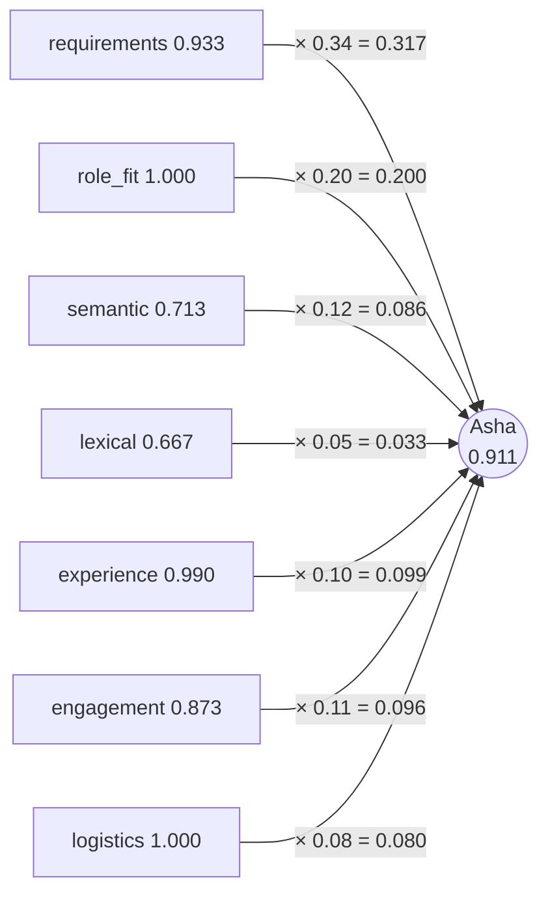

# A Complete Worked Ranking Example

This part follows one job description and three candidates through the entire engine. **Every number in this part was produced by the real TalentSignal code**: the script `docs/learning/build/worked_example.py` builds a tiny index from the three profiles, parses the job description with `parse_job_description`, scores with `score_pool` and explains with `explain_candidate`, then writes all intermediate values to `worked_example.json`. A second script, `worked_whatif.py`, produces the "what if" variations at the end. You can re-run both and get the same numbers.

## The job and the candidates

The job description is the short *Search Engineer* JD shown in Part 5 (Pune, hybrid, 4-8 years, must-haves: a search engine such as Elasticsearch, ranking/recommendation systems, Python; nice-to-have: learning-to-rank; notice under 30 days preferred).

| | **Asha Rao** (CAND_9000001) | **Ravi Menon** (CAND_9000002) | **Meera Iyer** (CAND_9000003) |
|---|---|---|---|
| Current title | Search Engineer | Sales Executive | Senior Software Engineer |
| Years | 6.0 | 6.0 | 7.0 |
| Location | Pune | Bangalore | Hyderabad |
| Role description | "Owned the ranking layer of our e-commerce search: moved from hand-tuned BM25 boosts in Elasticsearch to a learning-to-rank model trained with LightGBM. Ran offline NDCG evaluation and A/B tests; shipped to production …" | "Enterprise sales of cloud software solutions into the mid-market segment; carried a revenue quota." | "Designed how our marketplace decides which listings each shopper sees first. Rebuilt the ordering logic so the most relevant items surface for every query, measured the impact with controlled experiments …" |
| Skills | Elasticsearch (advanced, 48 mo, **assessed 84**), Python (expert, 72 mo), Learning to Rank (advanced, 30 mo), Ranking Systems (advanced, 36 mo) | Elasticsearch, Python, Learning to Rank, Ranking Systems, Recommendation Systems, Search Infrastructure, BM25 - all **expert, 60 months** | Python (advanced, 60 mo), Java (advanced, 48 mo) |
| Response rate / notice | 0.8 / 30 days | 0.9 / 15 days | 0.5 / 90 days |
| Last active | 2026-05-20 | 2026-05-25 | 2026-02-01 |
| Other | - | - | no GitHub, no offer history |

They represent three archetypes from Part 1: the obvious fit (Asha), the keyword stuffer (Ravi) and the plain-language candidate with a generic title (Meera).

## Step 1 - title relevance and role context

The JobSpec's only target family is `search_ranking` (from the title "Search Engineer").

| | Asha | Ravi | Meera |
|---|---|---|---|
| Title family | search_ranking | non_technical | software |
| Title relevance | 1.00 | 0.00 | 0.35 |
| Description trust \(0.3 + 0.7\,\mathrm{rel}\) | 1.00 | 0.30 | 0.545 |
| Skill credibility \(0.5 + 0.5\,\mathrm{rel}\) | 1.00 | 0.50 | 0.675 |
| Relevant years \(\mathrm{rel} \times\) months / 12 | 6.0 | 0.0 | 2.45 |

Meera's title "Senior Software Engineer" belongs to the general `software` family, whose affinity with `search_ranking` is 0.35. Notice how much this single number will matter.

## Step 2 - evidence per requirement

Each cell shows skill evidence \(S\), text evidence \(T\) and the resulting coverage \(1 - (1-S)(1-T)\) (no requirement here uses signal evidence).

| Requirement (weight) | Asha S / T → cov | Ravi S / T → cov | Meera S / T → cov |
|---|---|---|---|
| Information retrieval (1.0) | 0 / 0.839 → **0.839** | 0.488 / 0 → **0.488** | 0 / 0.247 → **0.247** |
| Vector / hybrid search infra (1.0) | 0.778 / 0.851 → **0.967** | 0.488 / 0 → **0.488** | 0 / 0 → **0** |
| Ranking / recommendation (1.0) | 0.684 / 0.754 → **0.922** | 0.488 / 0.225 → **0.604** | 0 / 0.304 → **0.304** |
| Python (1.0) | 0.988 / 0.75 → **0.997** | 0.488 / 0 → **0.488** | 0.495 / 0 → **0.495** |
| Learning-to-rank models (0.5) | 0.658 / 0.878 → **0.958** | 0.488 / 0 → **0.488** | 0 / 0 → **0** |
| Ranking evaluation (0.35) | 0 / 0.914 → **0.914** | 0 / 0.100 → **0.100** | 0 / 0.097 → **0.097** |

Things to notice, each connected to a formula in Part 6:

- **Asha's Elasticsearch evidence** under *vector / hybrid search infra* is exactly the worked example of the skill formula: advanced, 48 months, assessed 84 gives 0.7781. Her description adds text evidence 0.851, and noisy-OR combines them to 0.967.
- **Ravi's skill evidence is 0.488 everywhere.** Each expert skill used for 60 months would be worth 0.977, but his credibility is 0.5 because no role he has held is related to search. Listing seven skills did not add up: each requirement takes only the best one.
- **Ravi gets a little text evidence (0.225) for ranking** from his sales description - the word overlap and semantic similarity are weak, and his trust is only 0.30.
- **Meera's plain-language description** earns only 0.247-0.304 text evidence. Her description *is* about search ranking, but (a) there is no keyword hit, so only the embedding similarity counts, and (b) her trust is only 0.545 because of her generic title.
- **Meera's Python** (advanced, 60 months) is worth 0.733 before credibility; × 0.675 gives 0.495.

Averaging with the weights (1, 1, 1, 1, 0.5, 0.35; total 4.85) gives the **requirements** component: Asha 0.933, Ravi 0.484, Meera 0.222. Ravi's computation, for example:

\[
\frac{0.488 + 0.488 + 0.604 + 0.488 + 0.5(0.488) + 0.35(0.100)}{4.85} = \frac{2.348}{4.85} = 0.484
\]

## Step 3 - the other components

| Component | Asha | Ravi | Meera | Why |
|---|---|---|---|---|
| role_fit | 1.000 | 0.000 | 0.350 | \(0.65\,\mathrm{rel}_{now} + 0.35\,\mathrm{career\_rel}\) |
| semantic | 0.713 | 0.000 | 0.000 | Description vs JD focus, window [0.650, 0.830], × trust; Meera's similarity fell below the window floor |
| lexical | 0.667 | 1.000 | 0.333 | BM25 percentile among the three; Ravi's stuffed skills contain the most query terms |
| experience | 0.990 | 0.640 | 0.990 | band 1.0 for all; relevant years 1.0 / 0 / 1.0; seniority 0.95 |
| engagement | 0.873 | 0.908 | 0.655 | Meera: inactive 113 days (0.419), response 0.5, no offer history (dropped from the mean) |
| logistics | 1.000 | 0.875 | 0.674 | Pune = preferred; Bangalore/Hyderabad = same country, willing to relocate (0.75); Meera's 90-day notice → 0.425 |

## Step 4 - the weighted sum

Figure 7.1 - Asha's overall score as a weighted sum of her seven components (no policy factors apply, so overall = base).

| Component (weight) | Asha points | Ravi points | Meera points |
|---|---|---|---|
| requirements (0.34) | 0.3172 | 0.1646 | 0.0756 |
| role_fit (0.20) | 0.2000 | 0.0000 | 0.0700 |
| semantic (0.12) | 0.0855 | 0.0000 | 0.0000 |
| lexical (0.05) | 0.0333 | 0.0500 | 0.0167 |
| experience (0.10) | 0.0990 | 0.0640 | 0.0990 |
| engagement (0.11) | 0.0960 | 0.0998 | 0.0721 |
| logistics (0.08) | 0.0800 | 0.0700 | 0.0539 |
| **overall** | **0.9111** | **0.4484** | **0.3872** |
| rank | 1 | 2 | 3 |

You can check any column with a calculator; for Meera: \(0.0756 + 0.07 + 0 + 0.0167 + 0.099 + 0.0721 + 0.0539 = 0.3873\) (the engine's 0.3872 differs only by rounding of the displayed components).

## Step 5 - the explanations the engine produced

The summaries below are the engine's own output, validated against each record:

> **Asha** - "Top match: Search Engineer at ShopFast (6.0 yrs) meets 4 of 4 must-haves, with Python (expert) and Elasticsearch (advanced, assessed 84/100). Edges out similarly ranked profiles on requirement coverage."

> **Ravi** - "Weak match: Sales Executive at CloudCo (6.0 yrs) meets 0 of 4 must-haves. Concerns: Job-relevant skills not supported by any related role." (warning flag `uncorroborated_skill_claims`)

> **Meera** - "Weak match: Senior Software Engineer at MarketHub (7.0 yrs) meets 0 of 4 must-haves. Concerns: notice period 90 days (JD prefers <= 30)." Missing information: no platform assessment for key skills, no GitHub, no offer history.

## Why Asha ranks first - and an uncomfortable result

Asha's first place is well supported: her title, verified skill, description and logistics all agree, and every component is high.

The order of Ravi and Meera is the interesting part. **A thoughtful recruiter would put Meera second**: her description is clearly about search ranking. The engine puts her **third, 0.06 below the keyword stuffer**. The decomposition shows exactly why:

1. **Generic title.** "Senior Software Engineer" has relevance 0.35. That lowers her role fit (0.35), her description trust (0.545) and her skill credibility (0.675) all at once - the hub effect shown in Figure 6.2.
2. **No keywords, weak semantics.** Without a phrase hit, her description's evidence depends on embedding similarity, which was moderate and then multiplied by the low trust.
3. **Weaker logistics and engagement.** A 90-day notice and 113 days of inactivity cost her about 0.05 compared with Ravi.
4. **Ravi's stuffing was contained but not neutralised.** Credibility halved his skill evidence, his role fit and semantic are 0, and he carries a warning flag - yet halved evidence across six requirements, a perfect lexical percentile, and excellent engagement still add up to 0.448.

### What the recruiter can change (measured with the real engine)

| Variation (script `worked_whatif.py`) | Asha | Ravi | Meera | Effect |
|---|---|---|---|---|
| Default | 0.911 (1) | 0.448 (2) | 0.387 (3) | - |
| Role-fit weight 0.20 → 0.35 | 0.923 (1) | 0.390 (2) | 0.382 (3) | Gap closes from 0.061 to 0.008 |
| Disable lexical | 0.924 (1) | 0.419 (2) | 0.390 (3) | Gap 0.029 |
| Disable engagement | 0.916 (1) | 0.392 (2) | 0.354 (3) | Gap 0.038 |
| Mark "ranking/recommendation" as **hard** | 0.911 (1) | 0.448 (2) | held for review | Meera's coverage 0.304 < 0.35 → excluded; Ravi's 0.604 passes |

The last row is a warning about blunt tools: a hard gate on a requirement that Meera evidences only in plain language removes *her*, not the stuffer, because the stuffer's self-reported skills still clear the minimum.

### How much this matters in a real pool

In a pool of three, a weak candidate can still be "second". In the 100,000-candidate reference pool the same mechanisms put the best of 431 uncorroborated-skill profiles at rank **9,079**, and in the synthetic adversarial test (Part 9 and Book 3) stuffers with perfect assessments ranked no better than 107th of 560 - behind all 40 strong real profiles. Of the six plain-language profiles in the reference data, all reached the top 100 (ranks 8, 12, 22, 51, 81, 97), helped by relevant titles such as "Staff Machine Learning Engineer". **The weakness is specific: plain-language candidates whose title is generic are under-rated.** Book 3 discusses how to improve it (for example a title-independent semantic floor, or relevance that also learns from descriptions) and the trade-offs, because any change that trusts descriptions more also trusts shuffled or embellished descriptions more.

!!! tip "The lesson of this example"
    A weighted evidence model is transparent enough that you can see *exactly* why a surprising order happened and which knob would change it. That is the main practical benefit of explainability: not that the ranking is always right, but that when it is wrong, a human can tell why and decide what to do.
