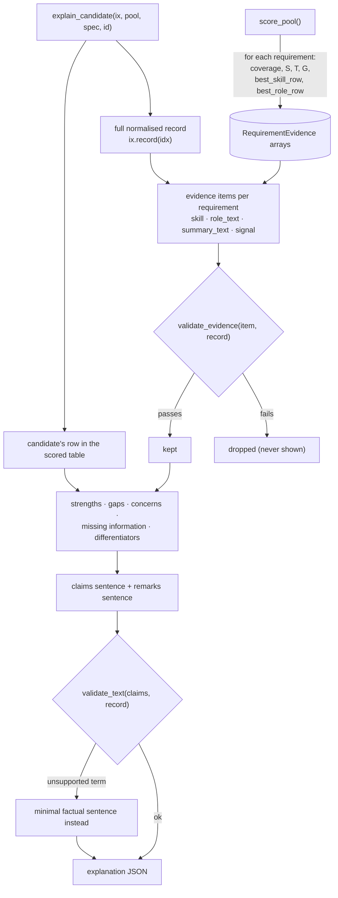

# Explainability and Integrity

A ranking that cannot be explained cannot be trusted, corrected or defended. This part explains how TalentSignal produces explanations that are tied to evidence, how it prevents explanations from inventing facts, and how it handles profiles that are inconsistent or impossible.

## Why explainable ranking matters

Explanations serve four different people:

| Who | Needs to know | Example question |
|---|---|---|
| Recruiter | Whether to spend time on this candidate | "Which must-haves does she actually meet, and how do we know?" |
| Hiring manager | Whether the shortlist is sensible | "Why is a sales executive in the top three?" |
| Candidate (indirectly) | That they were judged on relevant evidence | "Was I penalised for something irrelevant?" |
| Engineer | Why the system behaved this way | "Which component pushed this candidate up?" |

There is also a practical reason: a score alone gives no way to notice a mistake. In Part 7 the decomposition showed in seconds why a stuffer outranked a plain-language candidate. Without explanations that would have been invisible.

## How explanations are generated

Figure 8.1 - Candidate evaluation and explainability flow (engine/explanations/explain.py and validator.py).

The crucial design decision is visible at the top of the figure: **explanations are built from the same arrays the score came from.** When `requirement_evidence` computes a requirement's skill evidence, it also records *which skill row* won (`best_skill_row`); for text evidence it records *which role* won (`best_role_row`). The explainer follows those pointers back to the exact skill or role. It does not re-derive or guess.

### The pieces of an explanation

`explain_candidate` returns a dictionary with, among others:

| Key | Content |
|---|---|
| `summary` | Two sentences: a *claims* sentence (facts about the candidate) and a *remarks* sentence (concerns, missing must-haves or a differentiator) |
| `components` | Each component's value, weight and contribution (value × weight) |
| `constraint_factor`, `triggered_constraints` | Policy factors applied and the JD sentence behind each |
| `requirements` | For every requirement: coverage, status (met ≥ 0.65, partial ≥ 0.30, missing), and evidence items |
| `strengths`, `gaps` | Met requirements with their evidence; must-haves not met |
| `concerns` | Factual issues: long notice, low response rate, inactivity, experience outside the band, location, low interview attendance, triggered conditions, integrity warnings |
| `missing_information` | Unknown fields (no assessment, no GitHub, no offer history …), explicitly *not* held against the candidate |
| `differentiators` | Components where the candidate differs most from the ±3 neighbouring ranks |
| `flags` | Integrity findings with their evidence |
| `record` | The candidate's normalised record, for the profile view |

### Evidence items

| Kind | What it says | Example rendering |
|---|---|---|
| `skill` | a skill, its proficiency, months used, assessment (verified or not) | "Elasticsearch (advanced, assessed 84/100)" |
| `role_text` | a role's title and company, whether current, and which phrases matched | "the current role citing 'learning-to-rank' and 'ndcg'" |
| `summary_text` | phrases found in the candidate's own summary/headline | "a summary citing 'semantic search'" |
| `signal` | a platform signal value | "GitHub activity 62/100" |

### Differentiators

To answer "why is this candidate above (or below) similar candidates?", the explainer compares the candidate with the mean of the three candidates above and three below in the ranking:

\[
\Delta_c = \big(\mathrm{component}_c(\text{candidate}) - \overline{\mathrm{component}_c}(\text{neighbours})\big) \times \tilde w_c
\]

The components with the largest \(|\Delta_c|\) (at least 0.002) are reported - for example "Requirement coverage: 87.0 vs 79.7 for nearby ranks".

## Avoiding unsupported claims

Generated text has a well-known failure: it states things that are not true. In hiring this is unacceptable - telling a manager that a candidate "knows LoRA" when the profile never says so could cost someone a job or mislead an employer. TalentSignal applies two independent checks.

**Check 1 - every evidence item is re-verified against the raw record** (`validate_evidence`):

- a skill item must name a skill in the record, with the same proficiency, and any assessment value must match the record's assessment within 0.5;
- a role item must point to a role with the same title and company, and every quoted phrase must literally occur in that role's description;
- a summary item's phrases must occur in the summary or headline;
- a signal item's value must equal the record's value.

Items that fail are dropped before any text is written.

**Check 2 - the claims sentence is scanned for any known skill or technology name** (`validate_text`). Every skill name in the taxonomy is searched for in the sentence; each one found must appear in the candidate's skills or in their profile text. If anything fails, the summary is replaced by a minimal factual sentence ("Weak match: Sales Executive at CloudCo; meets 0 of 4 must-haves.").

Only the *claims* sentence is checked this way. The *remarks* sentence may legitimately name a JD requirement the candidate lacks ("Not evidenced: Python"); flagging that as an unsupported claim was a real false positive found during development and fixed by separating the two sentences.

**Measured result:** 0 unsupported skill mentions in 200 audited explanations (the top 100 plus 100 random candidates of the reference pool), and 100 distinct summaries in the top 100.

## Good and bad explanations

| Bad explanation | Why it is bad | TalentSignal's version |
|---|---|---|
| "Great candidate with strong AI skills." | Generic; no facts; identical for many people | "Top match: Search Engineer at ShopFast (6.0 yrs) meets 4 of 4 must-haves, with Python (expert) and Elasticsearch (advanced, assessed 84/100)." |
| "Expert in LoRA and RAG pipelines." (profile lists neither) | Hallucination | Impossible: `validate_text` would reject the sentence |
| "Rejected: low score." | No reason, no evidence, no recourse | "Held for review: … Concerns: Stated experience does not match career history." plus the flag's evidence |
| "Lacks GitHub - weak open-source profile." | Treats missing data as a negative finding | Listed under *missing information*, "not held against the candidate" |
| A rank-90 candidate described as "outstanding" | Tone contradicts rank | Tone is derived from rank and score: Top / Strong / Good / Partial / Weak match, or "Held for review" |

## Integrity checks

Some profiles are not just weak - they are **internally impossible or inconsistent** as written. The reference dataset contains about 80 deliberately planted examples ("honeypots"), such as "expert in ten skills with zero months of use". TalentSignal runs record-level checks during indexing (`engine/integrity/checks.py`) and one job-dependent check during scoring.

| Check | Severity | Rule | Reference data |
|---|---|---|---|
| `expert_zero_duration` | critical if ≥ 2 skills, else warning | skill marked expert with `duration_months == 0` | 21 candidates |
| `experience_mismatch` | critical if > 3 years, warning if 1.5-3 | stated years vs sum of role months / 12 | 47 |
| `assessment_unlisted_skill` | warning | assessment score for a skill not on the profile | 36 |
| `role_duration_mismatch` | warning | duration differs from the role's dates by > 3 months | 0 |
| `role_dates_reversed`, `future_role_start` | warning | end before start; start after today | 0 |
| `overlapping_roles` | info | two past roles overlap > 6 months | 0 |
| `salary_range_inverted` | info | min > max | 18,865 |
| `activity_before_signup` | info | last active before sign-up | 7,496 |
| `current_title_mismatch` | info | profile title ≠ current role title | 0 |
| `duplicate_profile` | warning | identical content under another id (ignoring id and name) | 0 |
| `uncorroborated_skill_claims` (scoring-time) | warning | ≥ 4 job skills claimed at strength ≥ 0.5 with no role of relevance ≥ 0.3 | 431 for the reference JD |

The two critical checks found **68 candidates** in the reference pool (21 + 47, no overlap) - close to the "about 80" the challenge documentation mentions. The remaining planted cases are not detectable from the data provided. For example, "eight years at a company founded three years ago" cannot be checked because the data contains no company founding dates. The book states this rather than pretending to detect it.

### Severity determines the effect

| Severity | Effect on ranking | Shown as |
|---|---|---|
| critical | Held out of the shortlist **for human review** (integrity policy "exclude", the default); can be switched to "flag" | Red banner with evidence |
| warning | None on the score (except that uncorroborated skills already had reduced credibility) | Amber notice |
| info | None | Data-quality note |

The wording is deliberate. A critical finding means *"this record is impossible as written"*, not *"this person is a fraud"*. The data may be wrong: a typing error, a broken import, a bad merge of two profiles. That is why the system holds the candidate for review rather than deleting them, and shows exactly which fields triggered the finding.

## False positives and false negatives

| | Meaning in integrity checking | Example | Cost |
|---|---|---|---|
| False positive | A legitimate profile is flagged | A person with a long career break: stated 10 years, roles add up to 6.5 → "experience mismatch" critical | A good candidate is held for review unless a human looks |
| False negative | An impossible profile is not flagged | Tenure longer than the company has existed (no founding dates in data) | The candidate may be ranked normally |

The thresholds trade these off. "> 3 years" for experience mismatch was chosen to avoid flagging ordinary rounding and short gaps, at the cost of missing smaller inconsistencies. Because critical findings only *hold* candidates and show evidence, a false positive costs a few minutes of human attention rather than an unfair rejection.

Measured on the synthetic adversarial set: all 30 deliberately impossible profiles were held for review; none of the 40 strong real profiles copied into that set was flagged.

## Why human review matters

TalentSignal is decision support. Three facts make human review essential:

1. **The score is not a probability of hiring success.** It is a weighted summary of evidence on a 0-1 scale. No outcome data was used to calibrate it, so "0.85" does not mean "85% likely to succeed".
2. **The evidence is mostly self-reported.** Assessments help, but most skills and all descriptions are written by the candidate.
3. **Every model has blind spots.** Part 7 showed one: plain-language candidates with generic titles are under-rated.

The product is designed around this: held candidates are always visible, every policy is editable, explanations show evidence, and the footer of every page states that scores summarise evidence and are not hiring probabilities.

!!! note "Summary of Part 8"
    Explanations follow pointers recorded during scoring, are re-verified against the record, and are checked for unsupported terms before display (0 unsupported claims in 200 audited). Integrity checks distinguish critical (held for human review), warning and info findings, never call anything fraud, and state openly which planted cases cannot be detected.
