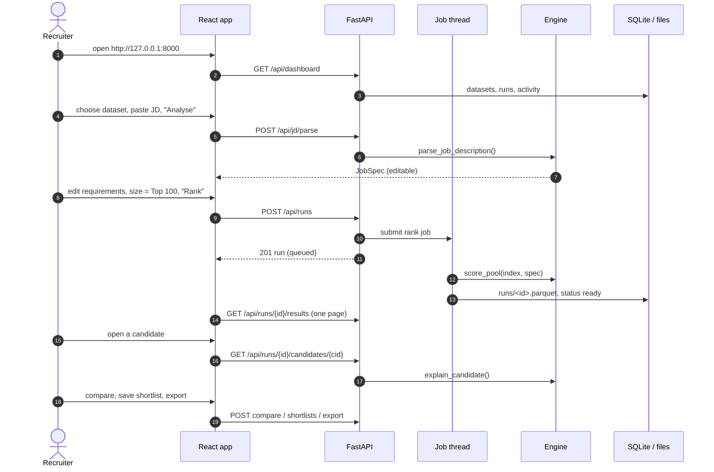

# End-to-End System Walkthrough

This final part follows a recruiter through twelve actions and shows, for each one, what happens in the browser, the backend and the engine, with the exact files and functions involved. It ties together everything in the earlier parts.

Figure 11.1 - The complete recruiter journey as a sequence of requests.

## Opening TalentSignal

**What the recruiter sees:** the dashboard - counts of candidates indexed, datasets, runs and shortlists; dataset health; recent runs; recent activity.

**What happens:**

1. The server was started with `uvicorn app.main:app` from `backend/`. `create_app()` (`backend/app/main.py`) installs error handlers, CORS, security headers and the API router, and mounts the built frontend from `frontend/dist`.
2. At start-up the *lifespan* hook calls `build_services()`: it creates the SQLite database (`Database`, `backend/app/database/db.py`), the `JobManager`, and the services; then `DatasetService.register_library()` registers the shared reference dataset and starts indexing it in the background if no index with its fingerprint exists.
3. The browser loads `index.html`; `App.tsx` routes `/` to `DashboardPage`, which calls `api.dashboard()` → `GET /api/dashboard`. `sessionId()` in `services/api.ts` creates or reads the session UUID.
4. If a dataset is still indexing, `usePoll` reloads the dashboard every 2 seconds and shows a progress bar.

## Selecting a candidate dataset

**Options:** use a shared library dataset, upload a file (Datasets page) or import a large file by server path.

**Upload path:** `DatasetsPage` → `uploadDataset()` (an `XMLHttpRequest`, chosen because it reports upload progress) → `POST /api/datasets/upload` → `DatasetService.save_upload()` streams the file to `data/uploads/<uuid>.<ext>` with the size limit → `start_index()` submits an *index* job → `build_index()` (Parts 4 and 9) writes `artifacts/indexes/<fingerprint>/` → the dataset row becomes `ready`. If an index for the same fingerprint already exists it is reused immediately.

**Quality check:** the dataset detail page (`DatasetDetailPage`) shows `quality.json`: rejected rows, repairs, missing-value rates, integrity findings, distributions.

## Uploading or pasting a job description

On the *New ranking* page (`NewRankingPage.tsx`), the recruiter pastes text, loads a bundled preset (`GET /api/jd/presets` lists `engine/resources/jobs/*.txt`) or uploads a `.docx/.txt/.md` file (`POST /api/jd/upload`, 5 MB limit, `extract_text()` in `engine/jd/documents.py`). Clicking **Analyse requirements** calls `POST /api/jd/parse` with the text and the dataset id; the dataset's distinct locations are passed to the parser so city names match real candidate locations.

## Reviewing extracted requirements

`SpecEditor.tsx` renders the returned `JobSpec`: extraction notes (warnings), title and target role families, every requirement with its **source sentence**, the experience band, location and notice, declared conditions with their policies, and the component weights. This is the human checkpoint described in Part 5 - for example, renaming or removing a mislabelled requirement.

## Adjusting weights and constraints

All edits change a local copy of the JobSpec in React state. Nothing is sent until the run starts. Weight sliders show each component's share after normalisation; condition policies offer *Show only*, *Penalise × factor* or *Exclude*; requirements can be marked *Hard*.

## Selecting the shortlist size

A segmented control offers Top 10, 25, 50, 100, 500, 1,000, a custom number, or **All eligible**. The value is sent as `shortlist_size` (an integer, or `null` for all eligible). Every candidate is scored regardless; the size only decides how many eligible candidates are kept in the stored results. Held-for-review candidates are always kept.

## Starting the ranking

`api.createRun()` → `POST /api/runs` → `RunService.create()`:

1. checks the dataset is ready and the size valid;
2. inserts a `runs` row with the JobSpec as JSON (status `queued`);
3. submits a *rank* job to `JobManager` and returns immediately (HTTP 201).

In the job thread, `work()` loads the index from `IndexCache`, calls `score_pool(ix, spec)` (Part 6), builds the **result table** with `_result_table()` (shortlist + held rows, display columns, relevant skills, mean assessment, flag codes, must-haves met), writes `artifacts/runs/<run_id>.parquet`, stores the scored pool in the LRU cache, computes a summary (score histogram, requirements met in the shortlist, weights used, notes) and marks the run `ready`. The browser has meanwhile navigated to `/runs/<id>` and polls `GET /api/runs/{id}` every second, showing the job's progress message.

## Viewing ranked candidates

`RunPage.tsx` shows the run summary (score distribution, requirements met, how scores were composed) and the results. Every change of search text (debounced 300 ms), filter, sort column, page or view triggers `GET /api/runs/{id}/results` with query parameters; `RunService.query()` filters and sorts the Parquet table in pandas and returns one page. Facets (`GET /api/runs/{id}/facets`) populate the filter lists with counts. The *Shortlist / Held for review / All* switch maps to `view=shortlist|held|all`. Table and card layouts render the same rows; cards fetch each candidate's explanation lazily.

## Opening a candidate profile

`CandidatePage.tsx` → `GET /api/runs/{id}/candidates/{cid}` → `RunService.explain()` gets the scored pool from the cache (or deterministically re-scores) and calls `explain_candidate()` (Part 8). The page shows the summary, the score-composition table, differentiators, concerns, missing information, requirement-by-requirement evidence with verified/self-reported markers, integrity findings with evidence, signal breakdowns, career timeline, skills with assessments, and profile details.

## Comparing candidates

Selecting 2-6 rows enables **Compare**, which opens `/runs/{id}/compare?ids=…`. `ComparePage.tsx` calls `POST /api/runs/{id}/compare`; `RunService.compare()` explains each candidate and aligns their requirement coverages and component values into rows. The page highlights the best value per component, colours requirement coverage (met / partial / missing), and marks skills shared by all or unique to one.

## Saving a shortlist

**Save to shortlist** opens a modal: create a new named shortlist or add to an existing one for the same run. `POST /api/shortlists` (or `POST /api/shortlists/{id}/items`) → `ShortlistService` checks that every candidate exists in the run's results, then stores rows in `shortlists` and `shortlist_items`. The shortlist page lets the recruiter write a note per candidate (saved when the text box loses focus), remove candidates, compare them and export them. The navigation rail refreshes through `bus.emit("shortlists")`.

## Exporting results

The **Export** menu calls `download()` in `services/api.ts`, which POSTs to `/api/runs/{id}/export` with `{format, scope, candidate_ids?, include_explanations}` and saves the returned file. `exports.export()` builds a DataFrame from the result table and writes:

| Format | Content |
|---|---|
| CSV | UTF-8 with BOM (opens correctly in Excel), formula-safe cells, optional explanation column (≤ 500 rows) |
| XLSX | styled header, frozen first row, "Run" sheet with metadata and a decision-support note |
| JSON / JSONL / Parquet | the same rows, machine-readable |
| PDF | shortlist report: run metadata, top 50 table, evidence summaries of the top 15 |
| Competition CSV | `POST /api/runs/{id}/export/competition`: exactly 100 rows in the original challenge format, validated before it is returned |

## Where to go next

- **Book 2 - Developer's Implementation & Code Mastery Guide** walks through the code of every module above, documents every API endpoint and database table, and contains exercises.
- **Book 3 - Interview Preparation & Technical Defense Bible** prepares you to explain, calculate, code and defend everything in this book, including its weaknesses.
