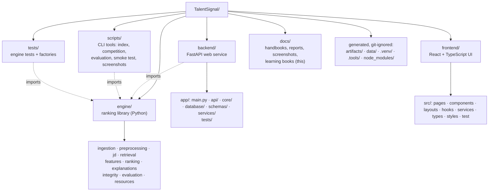

# Repository Structure

This book teaches how the TalentSignal code is built. Book 1 explained *what* the system computes and *why*; here we read the actual source. Code excerpts in this book are **inserted from the real files at build time** (the build script extracts each function or class by name), so they always match the repository at the commit printed on the cover.

## The map

Figure 1.1 - Repository architecture. Dotted arrows show which parts import the engine; the engine imports none of them.

## Directory by directory

| Directory | Contains | Why it exists | Depends on | Kind |
|---|---|---|---|---|
| `engine/` | The ranking library | Keeps all intelligence independent of the web so it can be tested and reused | NumPy, pandas, SciPy, scikit-learn, sentence-transformers, PyYAML, orjson | source |
| `engine/resources/` | `taxonomy.yaml` (knowledge base), `jobs/*.txt` (bundled JDs) | Domain knowledge as data, editable without code changes | - | data |
| `engine/evaluation/resources/` | `proxy_description_grades.yaml` | Hand-graded proxy labels for evaluation only | - | data |
| `backend/app/` | FastAPI application | HTTP API, persistence, background jobs, exports | `engine`, FastAPI, SQLite, reportlab, openpyxl | source |
| `backend/tests/` | `test_api.py` | End-to-end API tests | pytest, httpx | tests |
| `frontend/src/` | React application | The user interface | React, react-router-dom, lucide-react | source |
| `frontend/dist/` | Built static files | Served by the backend in production mode | produced by `npm run build` | generated |
| `scripts/` | Command-line tools | Index building, competition mode, evaluation, smoke and screenshot tests | `engine` (+ httpx, websocket-client) | source |
| `tests/` | Engine tests and `factories.py` | Fast tests on synthetic records | pytest | tests |
| `docs/` | Handbooks, `ARCHITECTURE.md`, `STATUS.md`, `reports/`, `screenshots/`, `learning/` | Documentation and evidence | - | docs |
| `artifacts/` | `models/`, `indexes/<fingerprint>/`, `runs/<id>.parquet` | Large generated data | produced at run time | generated, ignored |
| `data/` | `talentsignal.sqlite3`, `uploads/` | Application state | produced at run time | generated, ignored |
| `.venv/`, `.tools/`, `node_modules/` | Python environment, portable Node and docs toolchain, JS packages | Reproducible tooling | pinned files | generated, ignored |

## Important top-level files

| File | Purpose |
|---|---|
| `README.md` | Quick start, commands, configuration, measured results, provenance |
| `DEVELOPMENT_LOG.md` | Chronological decisions, measurements and corrections |
| `requirements.txt` / `requirements-dev.txt` | Pinned Python dependencies (runtime / plus test and tool extras) |
| `pyproject.toml` | Project metadata and pytest configuration (`testpaths`, `pythonpath`) |
| `.gitignore`, `.gitattributes` | Ignore generated data; normalise line endings to LF |
| `frontend/package.json`, `vite.config.ts`, `tsconfig.json` | Frontend dependencies, build/dev server (with `/api` proxy) and TypeScript settings |

## Engine modules at a glance

| Module | Main symbols | Role |
|---|---|---|
| `engine/taxonomy.py` | `load_taxonomy`, `Taxonomy`, `Concept`, `RoleFamily` | Load and query the knowledge base |
| `engine/ingestion/readers.py` | `iter_records`, `RawRow`, `unflatten`, `detect_format` | Stream candidate files |
| `engine/ingestion/validation.py` | `Normalizer`, `Issue`, `clean_text` | Validate, repair, report |
| `engine/ingestion/fingerprint.py` | `file_fingerprint` | Full-file BLAKE2b hash |
| `engine/preprocessing/index.py` | `build_index`, `_TextTable`, `Cancelled` | One-time index build |
| `engine/preprocessing/store.py` | `DatasetIndex`, `IndexNotFound` | Lazy reader of an index |
| `engine/jd/spec.py` | `JobSpec`, `Requirement`, `ComponentWeights`, … | The editable job model |
| `engine/jd/parser.py` | `parse_job_description`, `split_sections`, `_ConceptMatcher` | Rule-based JD understanding |
| `engine/jd/documents.py` | `extract_text`, `docx_to_text` | JD documents to text |
| `engine/retrieval/bm25.py` | `BM25Index` | Sparse BM25 |
| `engine/retrieval/embeddings.py` | `get_embedder`, `Embedder` | Offline sentence embeddings |
| `engine/features/*.py` | `requirement_evidence`, `TextMatcher`, `best_per_group`, `engagement_parts`, … | Feature computation |
| `engine/ranking/scorer.py` | `score_pool`, `ScoredPool`, `ScoringOptions` | Scoring orchestration |
| `engine/ranking/competition.py` | `competition_rows`, `write_submission`, `validate_submission` | Competition mode |
| `engine/integrity/checks.py` | `check_record`, `Flag` | Consistency checks |
| `engine/explanations/*.py` | `explain_candidate`, `validate_evidence`, `validate_text` | Grounded explanations |
| `engine/evaluation/*.py` | `evaluate_ranking`, `proxy_labels`, `build_adversarial_file` | Evaluation harness |

## How big is it?

At the commit on the cover the repository contains about 4,600 lines of engine Python, 2,400 lines of backend Python, 3,500 lines of TypeScript/TSX (about 380 of them tests), 300 lines of CSS, 102 automated tests (91 Python, 11 frontend), and nine scripts plus a shared helper (`scripts/_mem.py`). Line counts include comments and docstrings. You can read every important file in a few days; this book tells you in which order.

!!! tip "Recommended reading order of the source"
    `engine/jd/spec.py` → `engine/ranking/scorer.py` (top to bottom) → `engine/features/evidence.py` → `engine/preprocessing/index.py` → `backend/app/services/runs.py` → `backend/app/api/routes.py` → `frontend/src/pages/RunPage.tsx`. Each later part of this book follows roughly that order.
