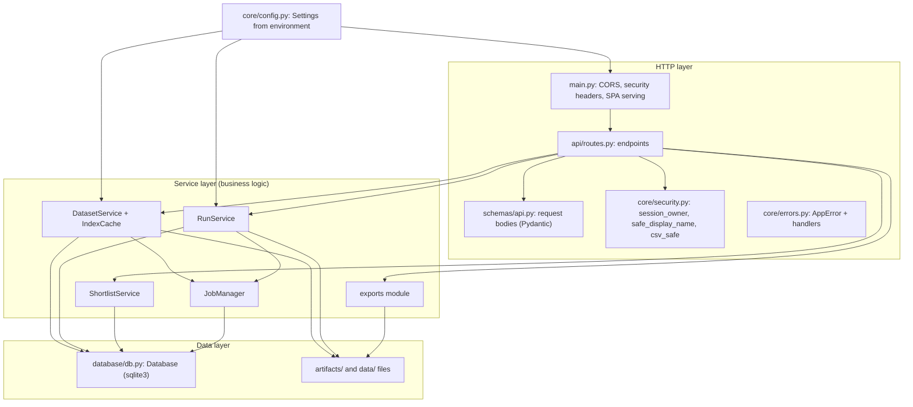

# Backend Implementation

The backend (`backend/app/`) is a FastAPI application. It owns persistence, access separation, background work, query serving and file exports. It contains no ranking logic: every intelligent operation is a call into `engine/`.

## Layers inside the backend

Figure 2.1 - Backend layers. Routes stay thin; services hold the logic; the database helper and files hold state.

## Application start-up

`backend/app/main.py` adds the project root to `sys.path` (so `import engine` works when running from `backend/`), then builds the application in a factory function. A *factory* lets tests create an app with their own temporary settings.

#@include backend/app/main.py::create_app

Points to notice:

- **Lifespan**: services are created when the server starts (`build_services`) and the job pool is shut down when it stops. Shared library datasets are registered at start-up, which may start a background index build.
- **Middleware**: CORS (needed only for the Vite dev server on port 5173) and a small middleware that adds security headers to every response.
- **SPA serving**: if `frontend/dist` exists, `/assets` is served as static files and any other non-API path returns `index.html`, so client-side routes such as `/runs/abc` survive a page refresh. The `is_relative_to(dist)` check prevents `../` path tricks.

`build_services` wires the service objects together:

#@include backend/app/main.py::build_services

## Configuration

`Settings` (`core/config.py`) is a dataclass whose defaults come from environment variables. No secrets exist or are needed.

| Setting | Env variable | Default |
|---|---|---|
| `data_dir` | `TALENTSIGNAL_DATA_DIR` | `TalentSignal/data` |
| `artifacts_dir` | `TALENTSIGNAL_ARTIFACTS_DIR` | `TalentSignal/artifacts` |
| `max_upload_mb` | `TALENTSIGNAL_MAX_UPLOAD_MB` | 2048 |
| `max_jd_upload_mb` | - | 5 |
| `import_dirs` | `TALENTSIGNAL_IMPORT_DIRS` (path-separator list) | `../reference material` |
| `library_datasets` | `TALENTSIGNAL_LIBRARY_DATASETS` | reference `candidates.jsonl` if it exists |
| `cors_origins` | `TALENTSIGNAL_CORS_ORIGINS` | `http://localhost:5173,http://127.0.0.1:5173` |
| `job_workers` | `TALENTSIGNAL_JOB_WORKERS` | 2 |
| `log_level` | `TALENTSIGNAL_LOG_LEVEL` | INFO |

Derived paths: `db_path` = `data/talentsignal.sqlite3`, `uploads_dir`, `indexes_dir` = `artifacts/indexes`, `runs_dir` = `artifacts/runs`.

## Routing and request handling

All endpoints live in `api/routes.py` under the prefix `/api` (the full reference is Part 6). A route function typically does three things: declare and validate inputs, call one service method, return its result.

#@include backend/app/api/routes.py::run_results

FastAPI turns the function parameters into query parameters and validates them: `page` must be ≥ 1, `page_size` 1-200, `order` must match `^(asc|desc)$`, `view` one of three values. Invalid input never reaches the service; it produces a 422 response.

The `owner: Owner` parameter is a **dependency**: `Owner = Annotated[str, Depends(session_owner)]`. Before the route runs, FastAPI calls `session_owner`, which reads the `X-Session-Id` header:

#@include backend/app/core/security.py::session_owner

## Request and response models

Request **bodies** are Pydantic models in `schemas/api.py`. The most important one embeds the engine's own `JobSpec`, so the recruiter's edited specification is validated with exactly the same rules the engine uses:

#@include backend/app/schemas/api.py::CreateRunRequest

Responses are plain dictionaries built by the services (FastAPI serialises them to JSON). The TypeScript interfaces in `frontend/src/types/api.ts` document their shapes.

## Error handling

#@include backend/app/core/errors.py::install_error_handlers

Three handlers give every failure the same shape, `{"error": {"code", "message"}}`:

1. `AppError(status, code, message)` - raised by services for expected problems (`dataset_not_ready`, `file_too_large`, `run_not_found`, …).
2. `RequestValidationError` - FastAPI's validation failures, converted to a readable message plus `details`.
3. Any other exception - logged with its stack trace, returned as a generic 500 that leaks no internals.

## The job manager

Long work (index builds, scoring) runs in background threads. `JobManager.submit` records a job row, creates a cancel event, and schedules a wrapper that updates the job's status around the actual work:

#@include backend/app/services/jobs.py::JobManager.submit

The work function receives a `JobContext`. `progress()` writes at most every 0.5 seconds (so a tight loop does not flood SQLite with writes); `check()` raises `JobCancelled` if the user cancelled.

#@include backend/app/services/jobs.py::JobContext

At start-up the manager marks any job that was still `queued` or `running` as failed ("Server restarted while the job was running") - otherwise the UI would show a progress bar that never moves.

## Dataset service and file uploads

#@include backend/app/services/datasets.py::DatasetService.save_upload

Security-relevant details: the extension is checked first; the destination name is a new random id (the user's filename never reaches the file system); the size limit is enforced *while streaming*, so an oversized upload is never fully written; a failed upload deletes its partial file.

Index building is a job. Note the *build-to-temporary-then-rename* pattern: the index is written into `<fingerprint>.building` and only renamed to its final name when complete, so a crash or cancellation can never leave a half-built index that looks valid.

#@include backend/app/services/datasets.py::DatasetService.start_index

## Run service: business logic of ranking

`RunService.create` inserts the run, submits the rank job and returns immediately. The job calls the engine and then builds the **result table**:

#@include backend/app/services/runs.py::RunService._result_table

The table contains the shortlist (or all eligible) followed by every held candidate, the engine's component columns, and display columns joined from the index. Pre-computing `relevant_skills`, `assessment_mean`, `flag_codes` and `mandatory_met` once here keeps every later page request cheap.

Query serving is pure pandas filtering on that table (`RunService.query`; excerpted in Part 7 of this book). Explanations need the full scored pool, which is kept in a small LRU cache and recomputed deterministically when missing:

#@include backend/app/services/runs.py::RunService.pool

## Exports

`services/exports.py` turns a run's table into files. The format dispatch:

#@include backend/app/services/exports.py::export

`csv_safe` neutralises spreadsheet formulas in every text cell of CSV and XLSX exports. The PDF report escapes text before passing it to reportlab. The competition export reuses the engine's `competition_rows` and `validate_submission` and refuses to return an invalid file.

## Dependency management

Backend dependencies are pinned in `requirements.txt` (FastAPI 0.135.3, uvicorn 0.44.0, pydantic 2.12.5, python-multipart 0.0.32, reportlab 5.1.0, openpyxl 3.1.5, and the engine's scientific stack). `torch` must be installed from the CPU wheel index first; otherwise pip may download a multi-gigabyte CUDA build. Book 2, Part 10 gives the exact commands.
