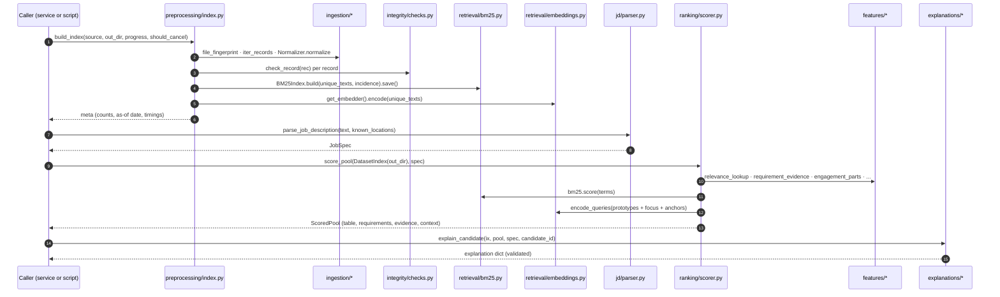

# Engine Implementation

The engine is a plain Python package. This part walks through its modules in the order data flows through them, then traces one complete call. For the *mathematics* behind each function, see Book 1, Part 6; here we focus on the code, its inputs and outputs, and its edge cases.

## Execution flow between modules

Figure 3.1 - Call sequence through the engine for one dataset and one job.

## engine/taxonomy.py - the knowledge base loader

**Responsibility:** load `resources/taxonomy.yaml` into typed objects and answer three questions: which family does a title belong to, how related are two families, what seniority does a title imply.

**Key symbols:** `Concept` (frozen dataclass), `RoleFamily`, `Taxonomy`, `load_taxonomy()` (cached with `functools.lru_cache`, so the YAML is parsed once per process).

#@include engine/taxonomy.py::Taxonomy.family_of

**Edge cases:** the last family's pattern is `.*`, so every title gets *some* family (`non_technical`). Results are memoised per lower-cased title in `_family_cache`, which matters because `family_of` is called for hundreds of thousands of role rows - though `relevance_lookup` already reduces that to one call per *distinct* title.

## engine/ingestion - readers, validation, fingerprint

**`readers.py`** - `iter_records(path)` dispatches on the file extension to a generator. A *generator* (a function containing `yield`) produces one item at a time, which is what makes streaming possible.

#@include engine/ingestion/readers.py::unflatten

`unflatten` is shared by the CSV, XLSX and Parquet readers. It turns dotted column names into nested dictionaries and parses JSON text in cells. Edge cases: an empty string becomes `None` (dropped); a cell whose text starts with `[` but is not valid JSON is kept as text.

**`validation.py`** - `Normalizer` is *stateful* only to remember IDs already seen (duplicate detection). Its `normalize` method returns `(record or None, issues)`:

#@include engine/ingestion/validation.py::Normalizer.normalize

Notice the last two blocks: if `current_title` is missing it is filled from the most recent role, and if `years_of_experience` is missing it is derived from role durations - both recorded as warnings, so the quality report shows that a value was *derived*, not stated.

**`fingerprint.py`** - `file_fingerprint(path)` returns `b2-<size>-<blake2b hex>`.

## engine/preprocessing/index.py - building an index

**Responsibility:** one streaming pass that produces every artifact of a dataset index. **Input:** a candidate file path and an output directory; optional `progress(fraction, message)` and `should_cancel()` callbacks (the backend passes the job context's methods). **Output:** the `meta` dictionary; files on disk.

The central helper is the text table, which assigns each distinct text an id:

#@include engine/preprocessing/index.py::_TextTable

The key `kind + "\x00" + text` keeps, for example, a title "Search Engineer" and a skill "Search Engineer" (if one existed) as separate segments.

For each record the builder appends compact tuples to lists (`role_rows`, `skill_rows`, `flag_rows`), records which segments the candidate uses (`incidence_rows`/`incidence_cols`), writes the normalised record to `records.jsonl` and remembers its byte offset. After the pass the lists become DataFrames and Parquet files; the incidence lists become a sparse matrix for `BM25Index.build`; unique non-skill segments are embedded (stored as float16 to halve disk space).

**Common bugs and edge cases handled:** an empty file raises `ValueError("No valid candidate records …")` (reported as a failed dataset); a cancellation raises `Cancelled` at the next 2,000-record checkpoint or between stages; the integrity table keeps an integer `idx` dtype even when there are no findings (a real bug, found by tests, where an empty DataFrame's index column became `object` and broke NumPy indexing later).

## engine/preprocessing/store.py - reading an index

`DatasetIndex` loads lazily: each table is a `functools.cached_property`, read from disk the first time it is used and kept afterwards. Random access to one candidate's full record uses the byte offsets:

#@include engine/preprocessing/store.py::DatasetIndex.record

Opening an index whose `format_version` differs from the engine's `INDEX_FORMAT_VERSION` raises `IndexNotFound`, so an old index is rebuilt rather than misread.

## engine/jd - the job model, documents and parser

`spec.py` defines the Pydantic models (Book 1, Part 5 lists every field). One method worth seeing is the weight normalisation used by the scorer:

#@include engine/jd/spec.py::ComponentWeights

`parser.py` is organised as a pipeline of small private functions (`split_sections`, `_ConceptMatcher`, `_extract_experience`, `_extract_location`, `_extract_notice`, `_extract_title`), assembled by `parse_job_description`. The concept matcher compiles one word-boundary regex per term once, then scans sentences:

#@include engine/jd/parser.py::_ConceptMatcher

**Edge cases:** headings that are really "Key: value" lines; bullets versus numbers that are content ("6-8 years" must not lose its "6-"; this was a real bug fixed during development); concepts mentioned in context sections are ignored.

## engine/retrieval - BM25 and embeddings

`bm25.py` builds the index from unique segments and an incidence matrix, precomputing the query-independent part of BM25 into the stored matrix:

#@include engine/retrieval/bm25.py::BM25Index.build

Read the last lines carefully: `rows = np.repeat(...)` gives, for every stored non-zero entry, the row (candidate) it belongs to, so the document-length normalisation can be applied to all entries in one vectorised expression. The vocabulary is saved as JSON, not pickled, so loading an index never executes code.

`embeddings.py` wraps sentence-transformers. `get_embedder()` returns a cached `Embedder` or `None` (logging the reason in `last_error`) if the local model is missing. `encode_queries` memoises short query texts:

#@include engine/retrieval/embeddings.py::Embedder.encode_queries

## engine/features - the feature functions

| File | Main functions | Returns |
|---|---|---|
| `titles.py` | `title_relevance`, `relevance_lookup`, `family_lookup`, `seniority_lookup` | arrays over a title column (computed once per distinct title) |
| `evidence.py` | `best_per_group`, `skill_row_strength`, `TextMatcher`, `requirement_evidence`, `calibrate_semantic`, `adaptive_bounds` | `RequirementEvidence` per requirement |
| `signals.py` | `engagement_parts`, `experience_parts`, `logistics_parts`, `weighted_available`, `evidence_completeness` | dicts of named sub-score arrays (NaN = missing) |
| `constraints.py` | `consulting_only`, `non_coding_lead`, `title_chasing`, `research_only`, `concept_dominance` | boolean arrays "triggers this condition" |
| `calibration.py` | constants only | - |

The heart of the features is `requirement_evidence`:

#@include engine/features/evidence.py::requirement_evidence

Its inputs are the index, one requirement, the shared `RoleContext`, the `TextMatcher` (unique texts lower-cased once), the requirement's embedding vector and the pre-computed strength of every skill row. Its output `RequirementEvidence` keeps not only the coverage but the *winning skill row* and *winning role row* for every candidate - the pointers explanations later follow.

The missing-aware mean used by three components is short enough to read in full:

#@include engine/features/signals.py::weighted_available

## engine/ranking/scorer.py - orchestration

`score_pool` is long (about 250 lines) because it orchestrates every step; it delegates the actual computations to `features/`. Its structure, by comment banner: titles and roles → requirement evidence → semantic → lexical → experience/engagement/logistics → components and weights → constraints → hard requirements → integrity → evidence completeness → sorting and context. Book 2, Part 7 explains the most important passages; the `ScoringOptions` dataclass shows which parts can be switched off for ablations:

#@include engine/ranking/scorer.py::ScoringOptions

## engine/explanations - explain and validate

`explain_candidate(ix, pool, spec, candidate_id)` finds the candidate's row in the scored table, loads the record, builds evidence items per requirement with `_requirement_detail`, validates them, and assembles concerns, missing information, differentiators and the two-sentence summary. The validator checks every evidence item against the raw record:

#@include engine/explanations/validator.py::validate_evidence

## engine/integrity and engine/evaluation

`integrity/checks.py::check_record(rec, today)` returns a list of `Flag(code, severity, title, detail, evidence)`; Book 1, Part 8 lists all checks. `evaluation/metrics.py` implements DCG, NDCG, precision, average precision, the competition composite, overlap and Kendall τ; `proxy_labels.py` produces the clearly labelled proxy relevance labels; `adversarial.py` writes the synthetic attack dataset.

#@include engine/evaluation/metrics.py::evaluate_ranking

## Why the engine is structured this way

| Choice | Engineering rationale |
|---|---|
| Pure functions over whole arrays in `features/` | Easy to test in isolation; fast (vectorised); no hidden state |
| One orchestrator (`score_pool`) | One place to read the full algorithm in order |
| Evidence objects keep winning-row pointers | Explanations reuse scoring results exactly instead of re-deriving them |
| Lazy, cached index tables | Fast start-up; memory only for what a code path uses |
| Constants in `calibration.py` | Auditable in one file, with the measurements that justify them in its docstring |
| No pickle anywhere in index files | Loading an index cannot execute code |

These reasons are the author's engineering rationale recorded in the development log and docstrings, not later reconstructions.
