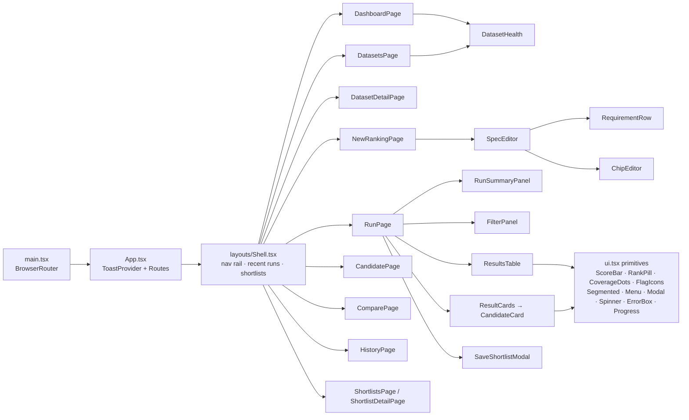

# Frontend Implementation

The frontend (`frontend/src/`) is a single-page application written in React 18 and TypeScript, built with Vite. "Single-page" means the browser loads one HTML page once; moving between screens changes the URL and the rendered components without reloading.

## Structure and component hierarchy

| Folder | Contents |
|---|---|
| `main.tsx` | Entry point: loads fonts and CSS, mounts `<App/>` inside a `BrowserRouter` |
| `App.tsx` | Route table |
| `layouts/Shell.tsx` | The navigation rail and page frame |
| `pages/` | One component per screen (9 files) |
| `components/` | `ui.tsx` (primitives), `SpecEditor.tsx` (JD review), `Results.tsx` (table, cards, filters) |
| `services/api.ts` | The API client |
| `hooks/useAsync.ts` | `useAsync`, `usePoll`, `useDebounced` |
| `types/api.ts` | TypeScript mirror of the API JSON |
| `styles/app.css` | The design system |
| `test/` | Vitest workflow tests and fixtures |


<p class="caption">Figure 4.1 - Frontend component hierarchy. Pages are rendered inside the Shell's &lt;Outlet/&gt;; shared primitives live in ui.tsx.</p>

## Routing

`App.tsx` declares the routes. All pages are nested under the `Shell` layout route, so the navigation rail stays on screen:

| Path | Page |
|---|---|
| `/` | DashboardPage |
| `/datasets`, `/datasets/:id` | DatasetsPage, DatasetDetailPage |
| `/rank/new` | NewRankingPage (optional `?dataset=<id>`) |
| `/runs/:id` | RunPage |
| `/runs/:id/candidates/:cid` | CandidatePage |
| `/runs/:id/compare?ids=a,b,c` | ComparePage |
| `/history` | HistoryPage |
| `/shortlists`, `/shortlists/:id` | ShortlistsPage, ShortlistDetailPage |
| `*` | "Page not found" |

When the app is served by the backend, unknown paths return `index.html` (Part 2), so a page refresh on `/runs/abc` works.

## API calls

All HTTP goes through `services/api.ts`. The core helper attaches the session header, sends JSON, and converts errors:

#@include frontend/src/services/api.ts::request

Two cases need something other than `fetch`:

- **Uploads with progress** use `XMLHttpRequest`, because `fetch` cannot report upload progress:

#@include frontend/src/services/api.ts::uploadDataset

- **Downloads** (`download()`) POST the export request, read the response as a binary *Blob*, take the filename from the `Content-Disposition` header and trigger a browser download through a temporary link.

## State management

There is no global store. Each page owns its state; server data is loaded with `useAsync`:

#@include frontend/src/hooks/useAsync.ts::useAsync

The `seq` counter solves a classic bug: if the user changes a filter twice quickly, two requests are in flight; without the counter, a slow *first* response could overwrite the newer *second* one. Only the latest request's result is applied.

`usePoll(fn, ms, active)` repeats a function on an interval *only while* something is running (an index build or a ranking job), and `useDebounced(value, 300)` delays search-box changes so typing does not send a request per keystroke.

Cross-page refresh uses a tiny event bus on `window` (`bus.emit("runs")`, `bus.on("runs", fn)` in `ui.tsx`): after creating a run, the rail's "Recent runs" list reloads.

## Forms: the requirement editor

`SpecEditor` receives the `JobSpec` and an `onChange` callback; it never mutates the object, it always produces a new one (`{...spec, requirements: [...]}`). This *immutable update* style lets React detect changes cheaply. Notable pieces:

- `RequirementRow` - label, must-have/nice-to-have select (switching to must-have raises the weight to at least 0.8), weight slider, *Hard* checkbox, delete button, and an expandable editor for skills, phrases and the semantic sentence. The source sentence from the JD is shown under the label.
- `ChipEditor` - add values by typing and pressing Enter (comma-separated allowed), remove with ×.
- Condition policies - one select per declared condition (Show only / Penalise / Exclude) with a factor input when penalising.
- Weight sliders - the displayed percentage is each weight divided by the sum, mirroring `ComponentWeights.normalized()` on the server.

## Tables, cards, filters and sorting

`RunPage` owns a `query` object (page, page size, sort, order, view, filters) and the debounced search text. Every change triggers one request for one page:

```tsx
useEffect(() => {
  if (run?.status !== "ready") return;
  let alive = true;
  api.results(id, effective).then((p) => alive && (setPage(p), setLoadErr(null))).catch((e) => alive && setLoadErr(e.message));
  return () => { alive = false; };
}, [id, run?.status, effective]);
```

(The `alive` flag ignores responses that arrive after the component has moved on - the same stale-response problem `useAsync` solves with its counter.)

- **`ResultsTable`** renders sortable headers (`SortHead` toggles ascending/descending and sets `aria-sort` for screen readers), selection checkboxes, rank pills, score bars, must-have coverage dots, up to three relevant skills, experience, assessment mean and integrity icons.
- **`ResultCards`** renders a grid of `CandidateCard`s; each card fetches its own explanation when mounted, so only visible cards cost a request.
- **`FilterPanel`** edits score and experience ranges, minimum must-haves, integrity filter, and multi-select lists for relevant skills, academic branch, country and city, each with counts from the facets endpoint.
- **Pagination** - 25, 50, 100 or 200 rows per page. No more than one page is ever rendered; there is no virtual scrolling because it is not needed at this page size.

## History, shortlists, loading and error states

`HistoryPage` lists runs with client-side search and status/dataset filters, re-run and delete; it polls while any run is in progress. `ShortlistsPage` lists saved shortlists; `ShortlistDetailPage` shows candidates with editable notes (saved on blur), compare and export.

Every data-loading page follows the same three-state pattern:

```tsx
if (loading && !data) return <Spinner label="Loading run" />;
if (error) return <ErrorBox error={error} onRetry={reload} />;
if (!data) return null;
```

Empty states use the `Empty` component with a hint ("No candidates match - try removing a filter."), and mutations report success or failure through the `useToast()` notification.

## Styling and design system

`styles/app.css` defines design tokens as CSS custom properties at the top - colours (`--ink`, `--paper`, `--signal`, `--verified`, `--caution`, `--risk`, `--data`), radii, shadows and fonts (IBM Plex Sans and Mono, bundled locally through `@fontsource` packages so the app works offline) - and semantic classes (`card`, `chip ok|warn|risk|data|signal`, `bar signal|ok|data`, `rank-pill top`, `banner risk|warn|info`, `toolbar`, `pager`). Components use these classes rather than inline colours, so the visual identity changes in one place. Two media queries adapt the layout below 1,100 px and 820 px (stacked columns, a horizontal navigation bar on phones); a `prefers-reduced-motion` rule disables the spinner animation.

## Accessibility notes

Interactive controls are real `<button>`, `<input>` and `<select>` elements with labels or `aria-label`s; segmented controls set `aria-pressed`; progress bars use `role="progressbar"` with values; dialogs use `role="dialog"` and close on Escape; the focus ring uses the signal colour. These were reviewed manually, not with an automated accessibility audit.
