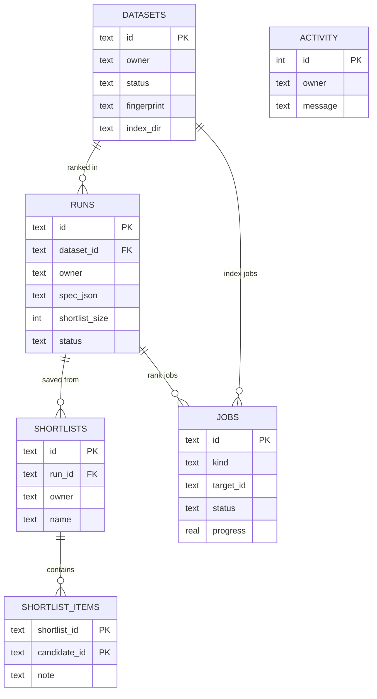

# Database and Data Persistence

TalentSignal persists state in two complementary ways: a **SQLite database** for small, related records, and **files** for large tabular data. This part documents both exactly as implemented in `backend/app/database/db.py` and the services.

## The SQLite schema

The schema is a single SQL string, `SCHEMA`, executed with `executescript` every time the `Database` object is created. Every statement uses `CREATE TABLE IF NOT EXISTS`, so start-up is idempotent: an existing database is left as it is, a new one is created. The schema version is stored in a `meta` table (`schema_version = 2` since résumé ingestion; see Migrations).

Figure 5.1 - Entity-relationship diagram of the actual SQLite schema (key columns only; every column is listed in the table below). Dataset → run → shortlist → item relations use ON DELETE CASCADE. JOBS references datasets and runs by id only (no foreign-key constraint), because one column serves both.

### Tables explained

| Table | One row per | Notes |
|---|---|---|
| `datasets` | registered candidate file | `owner IS NULL` marks shared library datasets visible to all sessions; `index_dir` points to `artifacts/indexes/<fingerprint>` |
| `jobs` | background job | progress 0-1 and a human-readable message, updated by `JobContext.progress` |
| `runs` | ranking run | stores the complete `JobSpec` as JSON so the run can be reproduced, re-run or re-scored after a restart |
| `shortlists` | saved shortlist | belongs to one run |
| `shortlist_items` | candidate in a shortlist | composite primary key `(shortlist_id, candidate_id)` prevents duplicates; `note` holds recruiter comments |
| `activity` | event for the dashboard feed | messages capped at 300 characters |
| `resume_batches` | résumé upload batch | owner-scoped; `last_dataset_id` points to the dataset created by the latest publish |
| `resume_documents` | uploaded résumé (or rejected archive member) | status, error, duplicate links, candidate id, the current record as JSON (`record_json`), path of the stored original and of the extraction JSON |

### Every column

| Table | Columns (allowed values enforced by `CHECK` constraints in brackets) |
|---|---|
| `datasets` | `id` PK, `owner` (NULL = library), `name`, `source_kind` [upload, path, library], `source_path`, `size_bytes`, `mtime`, `fingerprint`, `status` [pending, indexing, ready, failed], `n_candidates`, `index_dir`, `error`, `created_at`, `updated_at` |
| `jobs` | `id` PK, `owner`, `kind` [index, rank, resume], `target_id`, `status` [queued, running, succeeded, failed, cancelled], `progress` (0-1), `message`, `error`, `created_at`, `started_at`, `finished_at` |
| `runs` | `id` PK, `owner`, `dataset_id` FK → datasets (cascade), `name`, `jd_title`, `spec_json`, `shortlist_size` (NULL = all eligible), `status` [queued, running, ready, failed, cancelled], `job_id`, `n_candidates`, `n_eligible`, `n_results`, `summary_json`, `error`, `created_at`, `finished_at` |
| `shortlists` | `id` PK, `owner`, `run_id` FK → runs (cascade), `name`, `created_at` |
| `shortlist_items` | `shortlist_id` FK → shortlists (cascade), `candidate_id`, `note`, `added_at`; PK (`shortlist_id`, `candidate_id`) |
| `activity` | `id` INTEGER PK AUTOINCREMENT, `owner`, `kind`, `message`, `ref_id`, `created_at` |
| `resume_batches` | `id` PK, `owner`, `name`, `last_dataset_id`, `created_at`, `updated_at` |
| `resume_documents` | `id` PK, `batch_id` FK → resume_batches (cascade), `owner`, `filename`, `kind`, `size_bytes`, `sha256`, `stored_path`, `status` [queued, processing, needs_review, approved, rejected, failed, duplicate], `error_code`, `error`, `duplicate_of`, `possible_duplicate_of`, `candidate_id`, `display_name`, `title`, `n_pages`, `n_warnings`, `contact_key` (hash, never the raw e-mail), `extraction_path`, `record_json`, `edited`, `created_at`, `updated_at` |
| `meta` | `key` PK, `value` (holds `schema_version`) |

Timestamps are Unix epoch seconds (`REAL`). Identifiers are random UUID4 hex strings (`new_id()`).

Indexes: `ix_datasets_owner`, `ix_jobs_target`, `ix_runs_owner (owner, created_at)`, `ix_shortlists_owner`, `ix_activity_owner (owner, created_at)`, and for résumés `(batch_id, status)`, `(owner, sha256)`, `(owner, contact_key)`, `(owner, candidate_id)` - matching the queries the services actually run (lists filtered by owner and ordered by time; latest job per target).

## The data-access helper

The `Database` class is intentionally small - no ORM (Object-Relational Mapper). Each thread gets its own connection, configured for concurrency and integrity:

#@include backend/app/database/db.py::Database.conn

- `journal_mode=WAL` (write-ahead logging) lets the API read while a background job writes.
- `foreign_keys=ON` makes SQLite enforce the `REFERENCES … ON DELETE CASCADE` clauses (SQLite leaves them off by default).
- `check_same_thread=False` plus *one connection per thread* (via `threading.local`) is a safe combination; a `write_lock` serialises writes.

The helper methods map directly to CRUD (Create, Read, Update, Delete):

| CRUD | Helper | Example use |
|---|---|---|
| Create | `insert(table, row_dict)` | new run, new job, new shortlist |
| Read | `query(sql, params)` → list of dicts; `one(...)` → dict or None | list runs of an owner |
| Update | `update(table, id, **fields)` | job progress, run status |
| Delete | `execute("DELETE FROM … WHERE id = ?", (id,))` | delete a run (cascades) |

#@include backend/app/database/db.py::Database.insert

Table and column names in `insert` and `update` come from code, never from users; all *values* are passed as parameters (`?`), which is what prevents SQL injection.

## Migrations

There is no migration framework, but there is one hand-written migration. New tables are *additive* (`CREATE TABLE IF NOT EXISTS`) and existing databases pick them up automatically. Résumé ingestion also needed a new job kind, and SQLite cannot alter a `CHECK` constraint, so version 1 databases have their `jobs` table rebuilt (create, copy every row, drop, rename) inside one transaction, keyed on `schema_version`:

#@include backend/app/database/db.py::Database._migrate

A test builds a version-1 database by hand, opens it, and checks that the old job survives, the new kind is accepted, an invalid kind is still rejected and re-opening is idempotent (`test_schema_migration_from_v1`). Writing this test exposed a real bug: a failed write left SQLite's implicit transaction - and its lock - open; `Database.execute` now rolls back on error.

## Persistence in files

| Data | Location | Format | Written by | Read by |
|---|---|---|---|---|
| Uploaded candidate files | `data/uploads/<uuid>.<ext>` | as uploaded | `DatasetService.save_upload` | `build_index` |
| Résumé originals and extractions | `data/resumes/<batch>/<doc>.{pdf,docx,json}` | original bytes; JSON facts + text | `ResumeService` | review page, original download |
| Published résumé datasets | `data/uploads/<uuid>.jsonl` | JSONL records | `ResumeService.publish` | `build_index` |
| Dataset index | `artifacts/indexes/<fingerprint>/` | Parquet, JSONL, NumPy, sparse NPZ, JSON | `build_index` | `DatasetIndex` |
| Run results | `artifacts/runs/<run_id>.parquet` | Parquet | `RunService` rank job | `RunService.table`, exports |
| Embedding model | `artifacts/models/bge-small-en-v1.5/` | safetensors + JSON | `scripts/download_model.py` | `Embedder` |

## Lifecycles: ranking history, shortlists, datasets

**Ranking history.** A run row is created `queued`, becomes `running`, then `ready` (with counts and a summary) or `failed`/`cancelled` (with an error). `GET /api/runs` lists an owner's runs newest first. Re-running (`POST /api/runs/rerun/{id}`) creates a *new* run with the stored spec; history is never overwritten.

**Shortlists.** `ShortlistService.create` validates that every candidate id exists in the run's result table before inserting. Adding an existing candidate updates its note (`INSERT … ON CONFLICT … DO UPDATE`). Deleting a run cascades to its shortlists and their items.

**Datasets.** Deleting a dataset (`DatasetService.delete`, owner-only; library datasets are read-only) cancels a running index job, deletes its runs' Parquet files, deletes the row (cascading to runs and shortlists), deletes the uploaded file, and deletes the index directory **only if no other dataset row references it** - because two uploads of the same file share one index.

## Data integrity guarantees and gaps

| Guarantee | Mechanism |
|---|---|
| No orphan runs, shortlists or items | foreign keys with cascade |
| No duplicate candidate in a shortlist | composite primary key |
| No half-built index used | build into `.building`, rename when complete; version check on load |
| No stale index for a changed file | directory named by full-file fingerprint |
| Jobs never stuck "running" after a crash | marked failed at start-up |
| **Gap:** a run's Parquet file and its database row are not written in one transaction | if the process dies between the two, the API reports `results_missing` (410) for that run |
| **Gap:** no backups; one hand-written migration, no framework | single-file SQLite; copy `data/` and `artifacts/` to back up |
