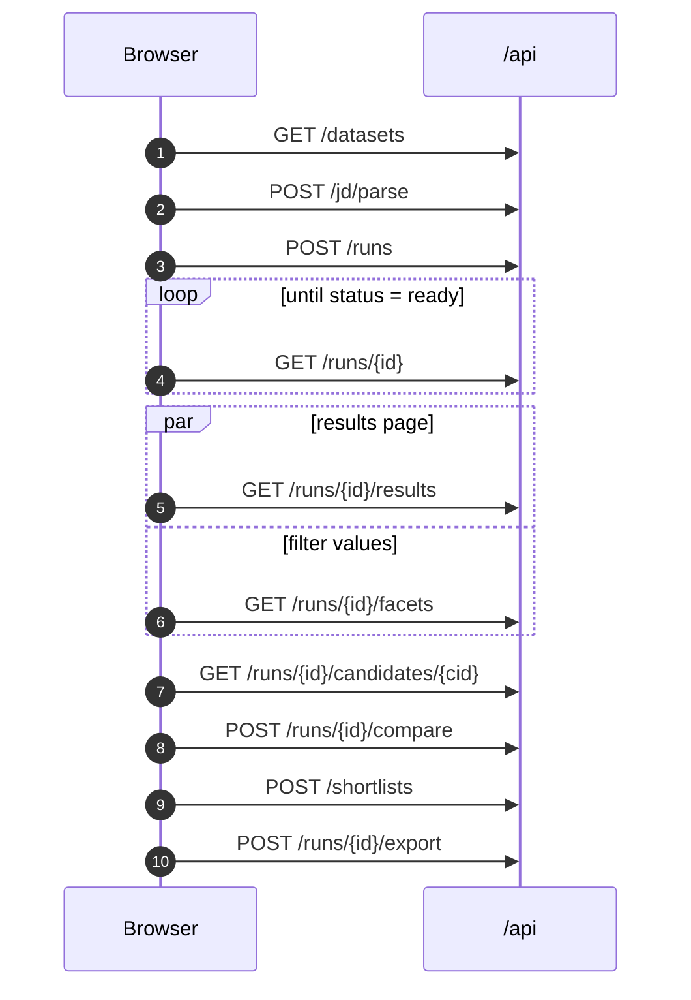

# API Reference

Every endpoint below exists in `backend/app/api/routes.py`; there are 32 routes. All paths start with `/api`. All routes except `GET /api/health` require the header `X-Session-Id: <uuid>`; without it they return **400 `invalid_session`**. Every error response has the shape:

```json
{"error": {"code": "run_not_found", "message": "Run not found."}}
```

(422 validation errors add a `details` list.) The examples use `curl` with a session id stored in `$S`:

```bash
S=6d1c2f0a-3b4e-4c6d-9e8f-001122334455
curl -s -H "X-Session-Id: $S" http://127.0.0.1:8000/api/runs
```


<p class="caption">Figure 6.1 - API communication sequence for a typical ranking session.</p>

## Health and overview

| Method & path | Purpose | Response | Called by |
|---|---|---|---|
| `GET /api/health` | liveness; no session needed | `{"status":"ok","version":"1.0.0","semantic_model":true,"frontend_built":true}` | smoke test, monitoring |
| `GET /api/dashboard` | dashboard data | `{datasets:[…], recent_runs:[… up to 8], activity:[… up to 12], totals:{datasets, ready_datasets, candidates, runs, shortlists}}` | `DashboardPage` |
| `GET /api/taxonomy/concepts` | capabilities for the requirement editor | `[{id, label, category, skills[], phrases[], semantic, signal}]` | `NewRankingPage` → `SpecEditor` |

## Datasets

| Method & path | Request | Success | Errors | Called by |
|---|---|---|---|---|
| `GET /api/datasets` | - | list of dataset objects | - | `DatasetsPage`, `NewRankingPage`, `HistoryPage` |
| `POST /api/datasets/upload` | multipart field `file` | **201** dataset (status `pending`/`indexing`) | 413 `file_too_large`, 415 `unsupported_format`, 400 `empty_file` | `DatasetsPage` (`uploadDataset`) |
| `POST /api/datasets/import-path` | `{"path": "<server path>"}` | **201** dataset | 404 `path_not_found`, 403 `path_not_allowed`, 400 `not_a_file`, 415 | `DatasetsPage` |
| `GET /api/datasets/import-dirs` | - | list of allowed directories | - | `DatasetsPage` |
| `GET /api/datasets/{id}` | - | dataset + `quality` + `meta` when ready | 404 `dataset_not_found` | `DatasetDetailPage` |
| `POST /api/datasets/{id}/reindex` | - | dataset | 409 `already_indexing` | `DatasetDetailPage` |
| `DELETE /api/datasets/{id}` | - | **204** | 403 `read_only` (library), 404 | `DatasetDetailPage` |

A dataset object: `{id, name, source_kind, size_bytes, status, n_candidates, error, created_at, updated_at, fingerprint, shared, job}` where `job` is the latest job (`{id, kind, status, progress, message, error, …}`).

```bash
curl -s -H "X-Session-Id: $S" -F "file=@candidates.jsonl" http://127.0.0.1:8000/api/datasets/upload
```

## Jobs

| Method & path | Success | Errors |
|---|---|---|
| `GET /api/jobs/{id}` | job row | 404 `job_not_found` (also for other sessions' jobs) |
| `POST /api/jobs/{id}/cancel` | `{"cancelling": true}` | 404, 409 `job_finished` |

Called by the dataset and run pages' **Cancel** buttons.

## Job descriptions

| Method & path | Request | Success | Errors | Called by |
|---|---|---|---|---|
| `POST /api/jd/parse` | `{"text": "…" (20-60,000 chars), "dataset_id": "…"?}` | a `JobSpec` | 422 | `NewRankingPage` (Analyse) |
| `POST /api/jd/upload` | multipart `file` (.docx/.txt/.md ≤ 5 MB), query `dataset_id`? | `{"text": "…", "spec": JobSpec}` | 413, 415 `unsupported_document`, 422 `empty_document` | `NewRankingPage` (Upload) |
| `GET /api/jd/presets` | - | `[{id, title, text}]` from `engine/resources/jobs/*.txt` | - | `NewRankingPage` |

```bash
curl -s -H "X-Session-Id: $S" -H "Content-Type: application/json" \
     -d '{"text": "Backend Engineer\nRequirements:\n- 3+ years with Go and REST APIs"}' \
     http://127.0.0.1:8000/api/jd/parse
```

## Runs

| Method & path | Request | Success | Errors | Called by |
|---|---|---|---|---|
| `GET /api/runs?limit=50` | limit 1-500 | runs newest first (with `dataset_name`) | - | `Shell` rail, `HistoryPage` |
| `POST /api/runs` | `{"dataset_id", "spec": JobSpec, "shortlist_size": int ≥ 1 or null, "name"?}` | **201** run (status `queued`) | 404 dataset, 409 `dataset_not_ready`, 422 | `NewRankingPage` |
| `GET /api/runs/{id}` | - | run + `spec` + `summary` + `job` | 404 `run_not_found` | `RunPage` (polled) |
| `DELETE /api/runs/{id}` | - | **204** | 404 | `HistoryPage` |
| `POST /api/runs/rerun/{id}` | - | **201** new run with the same spec and size | 404 | `RunPage`, `HistoryPage` |

`shortlist_size: null` means *all eligible candidates*; the default in the request model is 100.

### GET /api/runs/{id}/results

Query parameters: `page` (≥ 1), `page_size` (1-200), `sort` (`rank`, `overall`, `requirements`, `role_fit`, `semantic`, `experience`, `engagement`, `logistics`, `years_experience`, `mandatory_coverage`, `evidence_completeness`, `name`, `title`, `company`), `order` (`asc`/`desc`), `q` (search in name, title, company, id, skills), `view` (`shortlist`, `held`, `all`), `min_score`/`max_score` (0-1), `min_years`/`max_years`, `countries`, `cities`, `branches`, `skills` (comma-separated; skills = *all of*), `flags` (`none`, `any`, `critical`, `warning`), `min_mandatory`.

Response: `{total, page, page_size, items: [ResultRow]}`. A `ResultRow` includes `rank`, `candidate_id`, `overall`, the seven components, `constraint_factor`, `mandatory_coverage`, `evidence_completeness`, `critical_flag`, `warning_flags`, `eligible`, `ineligible_reason`, display fields (`name`, `title`, `company`, `location`, `city`, `country`, `years_experience`, `fields_of_study`, `highest_degree`), `skills[]`, `relevant_skills[]`, `n_assessments`, `assessment_mean`, `flag_codes[]`, `mandatory_met`, `mandatory_total`, `requirement_coverage{}` and `constraints_triggered[]`.

Errors: 404, 409 `run_not_ready`, 410 `results_missing`, 422 `invalid_sort`. Called by `RunPage` and `ShortlistDetailPage`.

```bash
curl -s -H "X-Session-Id: $S" \
  "http://127.0.0.1:8000/api/runs/$RUN/results?page=1&page_size=20&countries=India&min_years=5&sort=overall&order=desc"
```

### Other run endpoints

| Method & path | Request | Success | Errors | Called by |
|---|---|---|---|---|
| `GET /api/runs/{id}/facets` | query `view` = `shortlist` (default) or `all` | `{countries, cities, branches, skills: [{value,count}], flags:{none,any,critical,warning}, years:{min,max}, score:{min,max}, held_for_review}` | 404, 409 | `RunPage` (filters) |
| `GET /api/runs/{id}/candidates/{cid}` | - | full explanation (Book 1, Part 8) + `record` | 404 `candidate_not_found` | `CandidatePage`, `CandidateCard` |
| `POST /api/runs/{id}/compare` | `{"candidate_ids": [2-6 ids]}` | `{candidates: [explanation…], requirements: [{id,label,importance,values[]}], components: [{id,label,values[]}]}` | 422 `compare_count` | `ComparePage` |
| `POST /api/runs/{id}/export` | `{"format", "scope", "candidate_ids"?, "include_explanations"}` - format one of csv, xlsx, json, jsonl, parquet, pdf; scope `shortlist` (default) or `all` | file download (`Content-Disposition`) | 422 `invalid_format`, 422 `too_many_rows` (explanations > 500) | `RunPage`, `ShortlistDetailPage` |
| `POST /api/runs/{id}/export/competition` | - | CSV, exactly 100 rows | 422 `not_enough_candidates`, 422 `competition_invalid` | `RunPage` |

## Shortlists

| Method & path | Request | Success | Errors | Called by |
|---|---|---|---|---|
| `GET /api/shortlists` | - | `[{id, name, run_id, created_at, jd_title, size}]` | - | `Shell`, `ShortlistsPage`, save modal |
| `POST /api/shortlists` | `{"run_id", "name" (1-120), "candidate_ids": []}` | **201** shortlist with `items` | 404 run, 422 `unknown_candidates` | save modal |
| `GET /api/shortlists/{id}` | - | shortlist + `items: [{candidate_id, note, added_at}]` | 404 | `ShortlistDetailPage` |
| `POST /api/shortlists/{id}/items` | `{"candidate_id", "note"?}` | updated shortlist (adds, or updates the note) | 404, 422 | save modal, note editing |
| `DELETE /api/shortlists/{id}/items/{cid}` | - | updated shortlist | 404 | `ShortlistDetailPage` |
| `DELETE /api/shortlists/{id}` | - | **204** | 404 | `ShortlistDetailPage` |

## Non-API paths

When `frontend/dist` exists, `GET /assets/*` serves built files and any other non-`/api` path returns `index.html`. An unknown `/api/...` path returns 404 with the standard error shape.
