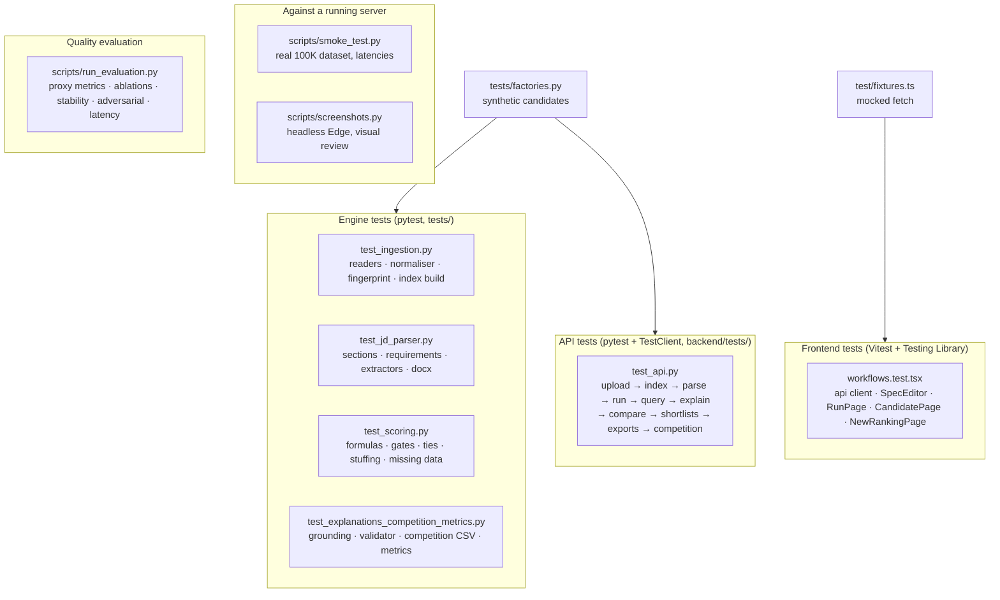

# Testing and Debugging

TalentSignal has 63 automated tests (34 engine, 21 API, 8 frontend), an evaluation harness, a live smoke test and a screenshot tool. This part explains what each layer catches, how to run it, and how to debug failures.

## The testing architecture


<p class="caption">Figure 9.1 - Testing architecture: fast synthetic tests at the bottom of the pyramid, live and evaluation checks at the top.</p>

## Running the tests

```bash
# all Python tests (engine + API): about 15-20 seconds
.venv/Scripts/python -m pytest
# one file or one test
.venv/Scripts/python -m pytest tests/test_scoring.py -q
.venv/Scripts/python -m pytest -k "stuffer or synonym" -q
# frontend
cd frontend && npx vitest run
# type check and production build
cd frontend && npx tsc --noEmit && npx vite build
```

`pyproject.toml` sets `testpaths = ["tests", "backend/tests"]` and `pythonpath = [".", "backend", "tests"]`, which is why imports such as `from engine...`, `from app...` and `from factories import ...` work in tests without installation.

## Unit tests and their fixtures

`tests/factories.py` builds schema-conformant synthetic candidates (`candidate(...)`) and a standard pool (`standard_pool()`): a strong ML search engineer, a second strong one, an HR manager with eight stuffed expert skills at a consulting firm, a Java developer, an impossible profile (expert skills with 0 months), a UK candidate unwilling to relocate, and 110 filler candidates. `tests/conftest.py` builds an index from it **without embeddings** (fast and model-independent), plus a small index **with** embeddings that is skipped if the model is missing.

Selected tests and what each protects:

| Test | Guards against |
|---|---|
| `test_fingerprint_detects_middle_edit` | stale indexes after mid-file edits |
| `test_normalizer_missing_and_sentinels_become_none` | treating "-1" or missing as real values |
| `test_hackathon_note_is_ignored` | context sections creating requirements |
| `test_strong_engineer_beats_keyword_stuffer` | keyword stuffing winning |
| `test_adding_synonym_skills_does_not_inflate` | unbounded skill sums |
| `test_missing_optional_data_is_neutral` | penalising missing data |
| `test_tie_break_by_candidate_id` | non-deterministic order; tie-unaware percentiles |
| `test_critical_integrity_is_held_for_review` | impossible profiles in the shortlist; policy switch |
| `test_hard_requirement_gate`, `test_constraint_policy_changes_effect` | gates and policies |
| `test_explanations_are_grounded` | hallucinated evidence for every candidate in the pool |
| `test_validator_catches_fabrication` | the validator itself silently passing |
| `test_competition_csv_is_valid` | format errors; also runs the official bundled validator if present |
| `test_metrics_known_values` | arithmetic errors in NDCG / AP / precision |

## API tests

`backend/tests/test_api.py` creates a real application with `create_app(Settings(...), register_library=False)` pointing at temporary directories, and drives it with FastAPI's `TestClient`. A module-scoped fixture uploads a 116-candidate JSONL (including a formula-injection probe in one name), waits for indexing, parses the reference JD, and creates a 25-candidate run. Tests then check paging and sorting, filters, held candidates, facets, the all-eligible mode, detail and compare, **session isolation** (another session id gets 404), shortlists, **every export format** (CSV formula safety, XLSX header, JSON, JSONL, Parquet magic bytes `PAR1`, PDF magic `%PDF`), competition export, upload limits (415, 413, 400), path-import restriction (403), failed indexing reporting, security headers and dashboard counts.

## Frontend tests

`frontend/src/test/workflows.test.tsx` uses Vitest with jsdom and Testing Library. `mockFetch` (in `fixtures.ts`) replaces `fetch` with a router that returns fixture JSON by URL substring and records calls. The eight tests check that the session id is persisted and sent, that server error messages surface, that the requirement editor changes importance/weights/policies and shows normalised percentages, that filters trigger server requests with the right parameters, that compare is enabled only for 2+ selections, that cards load grounded summaries, that the candidate page shows verified evidence and the "held for review" banner, and that the full new-ranking flow posts `shortlist_size: null` for "All eligible".

## Ranking evaluation and regression testing

`scripts/run_evaluation.py` is the regression test for *quality*: it recomputes proxy metrics, ablations, stability, look-alike separation, an adversarial dataset, explanation grounding and latency, and rewrites `docs/reports/EVALUATION_REPORT.md` and `evaluation_results.json`. Comparing the JSON before and after a change shows its effect. The reference implementation's committed top 100 is read as a fixed baseline. `--quick` skips the adversarial index build.

## Data validation tests

Validation is tested at three levels: unit tests on `Normalizer`; the index build test (`test_index_build_outputs`: 116 valid, 0 rejected, expected integrity codes); and the API test `test_failed_index_is_reported` (a file of invalid JSON becomes a `failed` dataset with the message "No valid candidate records …"). On real data, read `quality.json` (or the dataset page) after every new file.

## Performance testing

| Tool | Measures |
|---|---|
| `scripts/build_index.py` | cold build time per stage, peak memory (written to `meta.json → benchmark`) |
| `scripts/run_evaluation.py` | warm scoring time (3 runs), explanation time, process peak memory |
| `scripts/competition_rank.py` | time-boxed ranking time and peak memory, validity |
| `scripts/smoke_test.py` | API latencies per endpoint against a live server |

Peak memory comes from `scripts/_mem.py::PeakMemory`, which uses the Windows `peak_wset` value when available and otherwise samples RSS every 50 ms.

## Reproducing failures

1. **Re-run the narrowest test** with `-k` and `-x` (stop at first failure) and `-vv`.
2. **Reproduce with a factory**: build a two- or three-candidate JSONL with `tests/factories.candidate(...)`, index it with `embed=False`, and call `score_pool(ix, spec, embedder=None)` in a Python shell. Small pools make component values easy to inspect.
3. **Freeze the date**: scoring uses the dataset's as-of date, so results do not change with the calendar; you can also set `spec.as_of_date`.
4. **Pin the data**: indexes are keyed by fingerprint; a different result usually means a different file.

## Debugging guide

| Symptom | Where to look |
|---|---|
| Run note "Semantic model unavailable" | `engine.retrieval.embeddings.last_error`, server log; check `artifacts/models/bge-small-en-v1.5/config.json`. Beware local files that shadow standard-library modules (a script folder containing `profile.py` once broke PyTorch's import) |
| A candidate ranked surprisingly | `explain_candidate(...)["components"]` and `["requirements"]`; then `pool.evidence[req_id].best_role_row[idx]` → `ix.roles.iloc[row]` |
| Wrong requirement extracted | `split_sections(text)` to see section kinds; the requirement's `source_text` |
| Slow scoring | `python -m cProfile -s cumtime` around `score_pool`; look for per-row Python loops |
| Index not rebuilt after editing data | it *is* a different fingerprint; delete the old directory if disk is short |
| Job stuck | `GET /api/jobs/{id}`; restart marks running jobs failed |
| UI shows stale data | check the request in the browser DevTools Network tab; `useAsync` discards stale responses by design |
