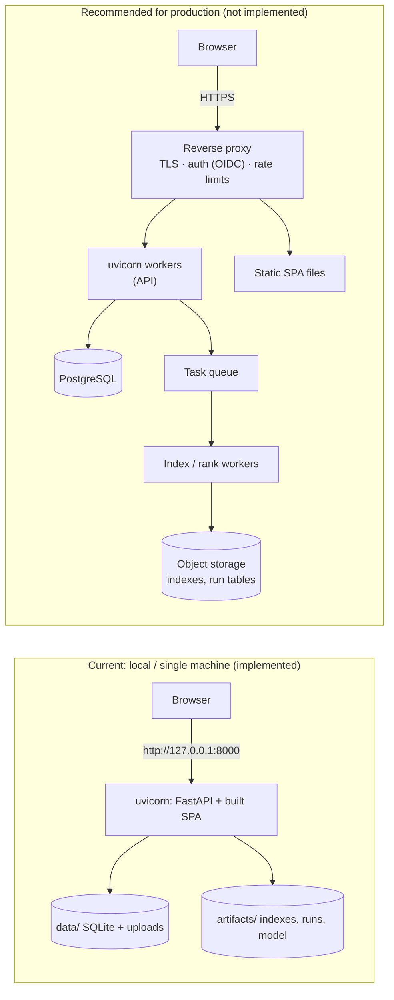

# Deployment and Operations

This part explains how to install, run, configure and operate TalentSignal. **Status:** TalentSignal is run locally. It is **not publicly deployed**, and it has no authentication; the production notes below are recommendations, not a description of an existing deployment.

## Environment setup

Requirements: Python 3.11 or newer (tested on 3.14), Node.js 20 or newer (tested on 24.22.3), about 3 GB free disk for the reference dataset's index and the model.

```bash
cd TalentSignal
python -m venv .venv
.venv/Scripts/python -m pip install torch==2.11.0 --index-url https://download.pytorch.org/whl/cpu
.venv/Scripts/python -m pip install -r requirements-dev.txt
.venv/Scripts/python scripts/download_model.py        # one-time, ~130 MB, needs network
cd frontend && npm install && npm run build && cd ..
```

On macOS or Linux use `.venv/bin/python`. If Node.js is not installed system-wide, the project's own setup unpacked a portable, checksum-verified Node into `.tools/node` and prefixed commands with `PATH="$(pwd)/.tools/node:$PATH"`.

**Why install torch first:** without the CPU index URL, pip may resolve a CUDA build of several gigabytes. **Verified:** a clean, isolated virtual environment installed this way passed all 55 Python tests that existed at the time (before résumé ingestion added `pypdf` and 36 tests; those were run in the development environment).

## Running

```bash
# Production-style: one process serves the API and the built UI
cd backend
../.venv/Scripts/python -m uvicorn app.main:app --host 127.0.0.1 --port 8000
# open http://127.0.0.1:8000

# Development: hot reload of the UI
cd frontend && npm run dev          # http://localhost:5173, proxies /api to port 8000
```

At start-up the server registers the reference `candidates.jsonl` (if present) as a shared dataset and indexes it in the background (about two and a half minutes cold, reused afterwards).

## Configuration

All configuration is through environment variables (Part 2 lists them). Examples:

```bash
export TALENTSIGNAL_DATA_DIR=/srv/talentsignal/data
export TALENTSIGNAL_ARTIFACTS_DIR=/srv/talentsignal/artifacts
export TALENTSIGNAL_IMPORT_DIRS=/srv/datasets
export TALENTSIGNAL_MAX_UPLOAD_MB=1024
export TALENTSIGNAL_LOG_LEVEL=INFO
```

There are no secrets in the code or configuration.

## Deployment architecture


<p class="caption">Figure 10.1 - Deployment architecture: what exists (left) and a recommended production shape (right).</p>

Moving from left to right requires real changes: authentication and authorisation, PostgreSQL instead of SQLite for multiple instances, a job queue so work survives restarts and scales out, shared storage for indexes and run tables, and TLS.

## Logs

The backend uses Python `logging`, configured in `create_app` with the format `time level logger: message`. Loggers: `talentsignal` (start-up), `talentsignal.api` (unhandled errors with stack traces), `talentsignal.jobs` (job failures), `talentsignal.datasets`, and `engine.retrieval.embeddings` (model load failures). Logs never include candidate records. uvicorn adds its own access log.

## Operations checklist

| Task | How |
|---|---|
| Back up | copy `data/` (SQLite + uploads) and `artifacts/runs/`; indexes and the model can be rebuilt |
| Free disk | delete unused datasets in the UI (their index is removed if no other dataset uses it) or old `artifacts/indexes/*` directories |
| Rebuild an index | dataset page → *Re-index*, or `python scripts/build_index.py --candidates FILE` |
| Check health | `GET /api/health` (status, version, model availability, UI built) |
| Measure | `scripts/smoke_test.py` against the running server |
| Competition file | `python scripts/competition_rank.py --candidates FILE --out submission.csv` |

## Troubleshooting

| Problem | Fix |
|---|---|
| `ModuleNotFoundError: engine` | start uvicorn from `backend/` (main.py adds the root to the path) or run scripts from the project root |
| Port 8000 in use | `--port 8001` (and update the Vite proxy for development) |
| Page refresh shows 404 in dev | use `npm run dev`, or build the UI and use the backend |
| Upload rejected 413 | raise `TALENTSIGNAL_MAX_UPLOAD_MB`, or import by path |
| "Semantic model unavailable" | run `scripts/download_model.py`; check `TALENTSIGNAL_MODEL_DIR` |
| pip downloads gigabytes of CUDA | install the CPU torch wheel first |
| Index build uses too much memory | ~2 GB for 100,000 candidates; close other programs; larger files need the chunked build listed under improvements |
