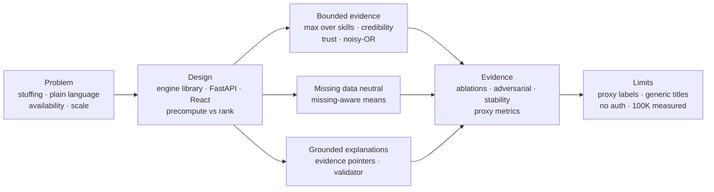

# Explaining the Project

This book prepares you to discuss TalentSignal with an experienced engineer, ML engineer or data scientist. It assumes you have read Book 1 (concepts) and at least skimmed Book 2 (code). Every number quoted here comes from the repository's own measurements; do not quote numbers that are not in `README.md`, `docs/reports/EVALUATION_REPORT.md` or these books.

!!! interview "The golden rule"
    Say what you built, how you know it works, and where it does not. Interviewers trust candidates who volunteer limitations; they distrust candidates who claim perfection.

## The 30-second introduction

> "TalentSignal ranks a pool of candidates against a job description and explains every position. It turns the job description into an editable list of must-haves and nice-to-haves, then scores each candidate on how strongly their skills, platform assessments and actual work history evidence each requirement - trusting work descriptions only as far as the job title supports them - plus experience, availability and logistics. It runs fully offline on a laptop CPU: about three seconds to score 100,000 candidates once the data is indexed."

## The 1-minute introduction

> "Recruiters face pools too large to read, and keyword search fails in both directions: it rewards people who stuff skills lists and misses people who describe the right work in plain language. TalentSignal is a decision-support tool that treats ranking as *evidence aggregation*. A rule-based parser turns the job description into requirements - each traced to the sentence it came from - which the recruiter reviews. For each requirement the engine combines the best matching skill, adjusted for months of use and any platform assessment, with evidence from role descriptions found by phrases and by sentence embeddings. Those are bounded and combined with role relevance, experience, engagement and logistics into a weighted score. Every explanation is built from the exact evidence that produced the score and checked against the candidate's record. It's a FastAPI backend, a React and TypeScript frontend, and a Python engine with 63 automated tests."

## The 2-minute introduction (add these points)

- **Precompute versus rank.** "The expensive work - parsing 465 MB, building a BM25 index, embedding text - happens once per file and is keyed by a full-file hash. Scoring is then vectorised NumPy: 2.85 seconds for 100,000 candidates."
- **The trick that made semantics affordable.** "The reference data has only 44 distinct role descriptions across 300,000 roles, so I embed unique text segments - 5,802 of them - instead of every document."
- **Integrity.** "Impossible profiles, like several 'expert' skills used for zero months, are held for human review rather than silently dropped or labelled fraud."
- **Honest evaluation.** "There was no ground truth, so I measured what I could without labels - keyword stuffers with perfect assessments never reached the top 40 of a 560-candidate adversarial set, impossible profiles were never eligible, 0 unsupported claims in 200 explanations - and used clearly labelled proxy labels for comparisons. On those proxies the original reference implementation actually scores higher than mine, and I can explain why."

## The 5-minute technical explanation

Structure it as *problem → design → three key mechanisms → evidence → limits*.

Figure 1.1 - The talk track for a technical explanation. Each box is 30-60 seconds.

1. **Problem (30 s).** Large pools, self-reported profiles, keyword stuffing, plain-language candidates, availability.
2. **Design (60 s).** Three layers: React UI, FastAPI service, and an engine library with no web dependencies. Background jobs for indexing and scoring; results stored as Parquet and paged server-side.
3. **Mechanism 1 - bounded evidence (60 s).** "Each requirement takes the *maximum* over matching skills, not the sum, so ten synonyms count once. Skill claims are scaled by credibility - 0.5 if the person never held a related role. Text evidence from a role description is scaled by trust - 0.3 plus 0.7 times that role's title relevance. Skill, text and signal evidence combine by noisy-OR: one minus the product of their complements, which stays in [0, 1] and rewards corroboration."
4. **Mechanism 2 - missing data is neutral (30 s).** "Engagement and logistics use a weighted mean over *available* signals only. Stripping assessments, GitHub and offer history from strong profiles moved their scores by −0.007 on average."
5. **Mechanism 3 - grounded explanations (45 s).** "The scorer records which skill row and which role produced each requirement's evidence; explanations follow those pointers, every item is re-checked against the raw record, and the claims sentence is scanned for any skill name the candidate doesn't have."
6. **Evidence (45 s).** Ablations: removing requirements coverage drops the proxy composite from 0.951 to 0.892; removing semantics drops NDCG@10 from 0.956 to 0.845; removing the integrity gate lets 3 impossible profiles into the top 100.
7. **Limits (30 s).** Proxy labels only; plain-language candidates with generic titles are under-rated; no authentication; benchmarked at 100,000 candidates only.

## The 10-minute architecture walkthrough

Use Book 1, Figure 2.1 as your whiteboard. Draw the browser, the FastAPI process (routes → services → SQLite and engine), and the files (indexes by fingerprint, run results, model). Then trace two flows:

**Flow A - indexing a file.** Upload streamed to disk with a size limit → `start_index` job → `file_fingerprint` (BLAKE2b, every byte) → if an index with that fingerprint exists, reuse it → else `build_index`: `iter_records` streams, `Normalizer` repairs and reports, `check_record` flags integrity issues, `_TextTable` deduplicates text, Parquet tables, BM25 sparse matrix via `A·T`, embeddings for unique segments, `quality.json` → build into `.building`, rename when complete.

**Flow B - ranking.** `POST /api/jd/parse` → `JobSpec` with source sentences → recruiter edits → `POST /api/runs` → job → `score_pool`: title relevance → role context → requirement evidence → seven components → normalised weighted sum → policy factors → eligibility → deterministic sort → result table Parquet → browser polls, then pages through results; candidate detail calls `explain_candidate`.

Close with the decisions you would defend (Part 2 of this book) and what you would change for production (authentication, PostgreSQL, a task queue).

## The detailed ML-engineering explanation

For an ML interviewer, lead with the *modelling choices*, not the stack:

- **Why not learning-to-rank?** No labels. Training on proxy labels would learn the heuristics that made them. The seven components are an LTR-ready feature matrix once feedback exists (LambdaMART would be the first model to try).
- **Why a weighted sum of bounded components?** Interpretability for recruiters, graceful failure (no single feature dominates), easy ablation, and recruiter control. Weights are normalised and re-normalised when a component is unavailable.
- **Retrieval stack.** BM25 (k1 = 1.2, b = 0.75, unigrams and bigrams) as a percentile component; dense similarity with bge-small-en-v1.5 (384-d, CPU, offline). Calibration was *measured*: unrelated text 0.41-0.55, explicit matches 0.75-0.85, so prototypes map [0.62, 0.80] → [0, 1]. Long queries get a per-query window from 12 unrelated anchor sentences.
- **Hybrid design.** Lexical catches exact names (FAISS, Milvus); dense catches paraphrase; structured fields (titles, assessments) catch credibility. Title relevance gates how much each kind of text evidence is trusted.
- **Evaluation.** Label-free robustness tests plus proxy metrics computed with the competition's own composite (0.5·NDCG@10 + 0.3·NDCG@50 + 0.15·MAP + 0.05·P@10), ablations, stability under weight noise (98.9% top-100 overlap), adversarial injection.
- **What you learned from measurement.** A plausible improvement (each must-have as its own semantic query) *lowered* the proxy composite from 0.951 to 0.883 at full weight, so it was removed. BM25 turned out to have no effect on the top 100 for this JD. A tie-unaware percentile was giving identical profiles different scores - found by a test.

!!! tip "Sounding natural"
    Do not recite these paragraphs. Learn the *sequence* (problem, design, mechanisms, evidence, limits) and three numbers you are sure of (2.85 s for 100,000; 0 unsupported claims in 200 explanations; best stuffer rank 107 of 560 with none in the top 40). Fill the rest in your own words.
