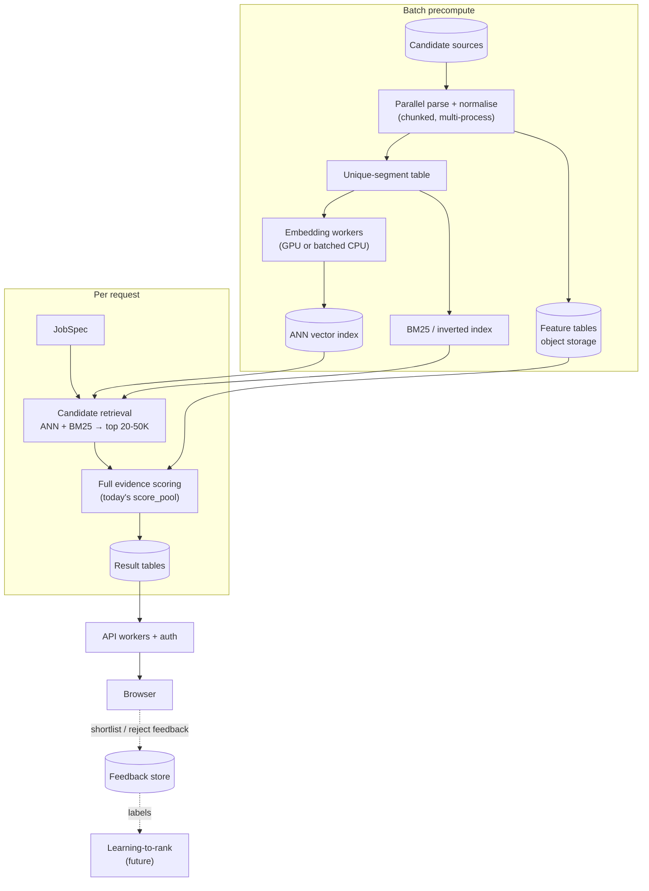

# Defending the Architecture

Each question below has a model answer written to be spoken, followed by the technical detail you should be ready to add if the interviewer digs deeper.

## Why did you choose this architecture?

**Answer.** "Because the problem has two very different workloads. Indexing a candidate file is expensive and independent of the job; scoring is cheap if indexing is done well. So I split the system into a one-time *precompute* stage and a per-job *ranking* stage, and I put all of the intelligence in a library that the web service, the CLI and the competition script all share."

**Detail.** Cold index build: 137 s for 100,000 candidates. Warm scoring: 2.85 s. The index directory is named by a full-file BLAKE2b fingerprint, so the same file is never indexed twice and a modified file is never matched to a stale index.

## Why separate the ranking engine from the API?

**Answer.** "Three reasons. Testability: 59 engine tests run on synthetic data and generated documents without HTTP. Reuse: competition mode must run without a server and with network blocked. Clarity: one place to read the algorithm, `score_pool`."

**Follow-up - "Isn't that over-engineering for a small project?"** "It costs one boundary: the `JobSpec` model in, a `ScoredPool` out. Both already exist for other reasons - the `JobSpec` is what the recruiter edits, and the scored pool feeds explanations."

## Why FastAPI?

**Answer.** "Its validation is driven by type hints and Pydantic, which matters because the most important input - the edited job specification - is a nested Pydantic model shared with the engine. Validation, OpenAPI documentation and dependency injection (for the session check) come for free."

**When I'd choose differently.** Django if user accounts, permissions and an admin site became central.

## Why React and TypeScript?

**Answer.** "The UI needs multi-page navigation, server-side paging and filtering, a comparison view and an editable form with many interdependent fields. TypeScript mirrors the API shapes in one file (`types/api.ts`), so a backend rename breaks the build instead of failing at run time."

**Follow-up - "Why no Redux or component library?"** "No data is shared across distant components; each page loads its own data with a small hook. A component library would have given a generic look; the design system is about 300 lines of CSS with tokens."

## How does data flow through the system?

**Answer.** Walk Flow A and Flow B from Part 1 of this book. Emphasise three hand-offs: file → index (once), JobSpec → ScoredPool (per run), result table → one page (per request).

## What happens if the dataset grows ten times?

**Answer.** "I have measured 100,000; I have not measured a million, so I'll reason. Parsing and scoring are linear - roughly 170 s to parse and around 30 s to score. The first real wall is memory during the index build: about 2 GB at 100,000, so about 20 GB at a million with the current all-in-memory row lists. I would switch to chunked table writing. The second wall is embedding unique text: on real, diverse data the number of unique descriptions grows with the pool, so embedding could take hours on one CPU; I'd parallelise it or use a GPU only at precompute time. For queries I'd add an approximate-nearest-neighbour pre-selection so full scoring runs on, say, the top 50,000."

!!! warning "Do not overclaim"
    Never say "it scales to millions". Say "it is designed to extend; it is measured at 100,000; here is what would break first."

## What happens if the ranking engine fails?

**Answer.** "Scoring runs inside a background job. Any exception is caught by the job manager, logged with a stack trace, and recorded on the job and the run as `failed` with a message the UI shows. The web server stays up. If the server itself dies mid-job, the job is marked failed on the next start-up, so no progress bar spins forever. If the embedding model is missing, scoring still works: the semantic component is removed, the other weights are re-normalised, and the run carries a visible note."

## How do you avoid duplicate processing?

**Answer.** "At three levels. Files: an index is keyed by the full-file fingerprint and reused. Text: only unique text segments are tokenised and embedded - 5,802 for 100,000 candidates. Queries: requirement sentences and anchor texts are memoised in the embedder. Results: scored pools, result tables and indexes are kept in small LRU caches."

## How would you scale this application?

Figure 2.1 - A proposed (not implemented) scaled design. The scoring stage is today's engine; everything around it is new.

| Concern | Today | Next step |
|---|---|---|
| Concurrent users | one process, two job threads | several uvicorn workers behind a reverse proxy |
| State | SQLite file | PostgreSQL |
| Background work | in-process threads | a task queue (e.g. Celery or RQ) with dedicated workers |
| Big files | local disk | shared object storage for indexes and run tables |
| Index build | single process, ~2 GB | chunked, multi-process parsing; GPU or batched embedding |
| Candidate count | full scoring of every candidate | ANN pre-selection, then full scoring |
| Security | per-browser session id | OIDC authentication, roles, audit log, TLS |

## Why SQLite and not PostgreSQL?

**Answer.** "Single-node tool, zero operations, WAL mode allows reads during writes. The large data is not in SQLite anyway - it's in Parquet and NumPy files. I'd move to PostgreSQL as soon as there were multiple server instances."

## Why threads and not processes for jobs?

**Answer.** "The heavy work is NumPy, SciPy and PyTorch, which release the GIL during computation, so threads give real parallelism there; and threads share the in-memory index cache. The cost is that jobs die with the process - which is why they are marked failed on restart."

## Why store results as Parquet instead of rows in the database?

**Answer.** "Each run's result table has a different set of requirement columns, up to ~100,000 rows and ~70 columns. A columnar file loaded into pandas and filtered with vectorised masks answers a page in 150-270 ms at that size. In SQLite I'd need a dynamic schema per run or a wide key-value table."
