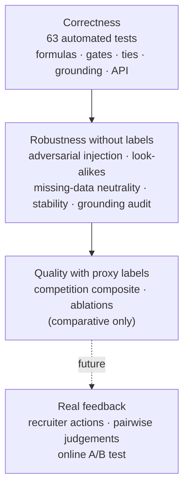

# Difficult Interviewer Questions

Honest, nuanced answers. None of them claims perfect accuracy or fairness - because the project does not have either.

## How do you know your ranking is better than keyword matching?

"I measured it on two kinds of evidence. Without labels: a pure keyword-count ranker put 98 non-technical people into its top 100, while in a synthetic adversarial set stuffers with every skill at expert and 95/100 assessments never got above rank 107 of 560 in mine, behind all 40 strong real profiles. With proxy labels - clearly not ground truth - keyword count scored 0.006 on the competition composite, BM25 alone 0.825, and TalentSignal 0.951. So it is clearly better than keyword matching. It is *not* clearly better than the original reference implementation, which scored 0.982 on the same proxies."

## What is your evaluation methodology?

Figure 6.1 - Evaluation methodology layers. The dotted layer does not exist yet.

"Three layers. One: unit and API tests for correctness - 102 tests, including formulas, gates, ties and grounding. Two: label-free robustness experiments - adversarial injection, look-alike separation, missing-data neutrality, stability under ±20% weight noise, explanation grounding. Three: proxy-label metrics with the competition's own composite, used only comparatively, plus ablations of every component. With real users I'd add recruiter feedback as implicit labels and an online A/B test on shortlist acceptance."

## How do you prevent a candidate from manipulating the score?

"I can't prevent it entirely, but I've made the obvious manipulations weak. Listing many skills doesn't add up - each requirement takes the best one. Claiming expert with no months of use is worth only 35%, and several such claims hold the profile for review. Skills under unrelated job titles count half. Descriptions under unrelated titles are trusted at 30%. What remains possible: an attacker who changes their *job title* to something relevant and writes a plausible description gets most of the credit. Titles are hard to verify from a profile alone; that's where assessments, references and humans come in."

## What happens when a candidate has missing information?

"Missing optional data is neutral: engagement and logistics use a weighted mean over the signals that exist, so a missing signal drops out. I measured it: removing assessments, GitHub and offer history from 30 strong profiles moved their scores by −0.007 on average. Missing evidence for a *requirement* shows as 'not demonstrated' and is listed under 'missing information', which the UI explicitly says is not held against the candidate. One exception I'd fix: a missing 'willing to relocate' is treated like 'not willing' in the location sub-score."

## Can your system unfairly penalise career gaps?

"Not directly - there's no gap feature. But indirectly, yes: if someone states ten years of experience and their listed roles add up to six and a half, the 'experience mismatch' check flags it as critical and holds them for review. That catches impossible profiles, but it can also catch long unlisted gaps or roles someone chose not to list. It's a false-positive risk. The mitigations are that the candidate is held for *review*, not rejected, the evidence is shown, and the policy can be switched to 'flag only'."

## How do you handle candidates from different backgrounds?

"The engine never sees protected attributes and doesn't use institution prestige. Location is used only as the job states it, and I narrowed the work-authorization rule so it doesn't assume people abroad need visas. But I can't claim fair *outcomes* across groups, because the data has no demographic attributes to audit with. Career paths that don't map to the taxonomy's role families - say, a researcher who moved into industry with an unusual title - are a real risk of under-rating."

## Why should recruiters trust the ranking?

"They shouldn't trust it blindly - it's decision support. What they *can* trust is that every claim in an explanation is in the candidate's record, because a validator checks it, and that every policy that changed a score is visible and editable. The worked example in my documentation shows a case where the ranking is arguably wrong - a stuffer above a plain-language engineer in a tiny pool - and the explanation shows exactly why. That transparency is the reason to use it."

## Can you explain why candidate A ranks above candidate B?

"Yes, quantitatively. Each overall score is a weighted sum of seven components times any policy factors. The candidate page shows each component's value, weight and points, and the 'what sets this candidate apart' panel compares them with neighbouring ranks. For any pair I can compute the weighted difference per component - for example, in my worked example the stuffer led the plain-language engineer by 0.061, made of −0.089 from requirement coverage in her disfavour, +0.070 role fit in her favour, and smaller differences in lexical, engagement and logistics."

## What are the biggest weaknesses of your current implementation?

1. Evaluation relies on proxy labels; on them the reference implementation is ahead.
2. Plain-language candidates with generic titles are under-rated (title relevance is a hub).
3. The JD parser depends on a hand-built taxonomy; granularity quirks need recruiter fixes.
4. Hand-set parameters: affinity table, calibration windows, component weights.
5. Whole-word phrase matching misses plurals and word forms.
6. No authentication; sessions are not security.
7. Measured at 100,000 candidates only; the index build holds rows in memory (~2 GB).

## How do you stop résumé parsing from inventing qualifications?

"By design and by test. Every extracted value is a fact marked stated, inferred or missing, with the page and line it came from; inferred values carry the rule that produced them. Anything not written - proficiency, skill durations, platform signals - stays empty, and the ranking engine already treats empty as unknown rather than zero. Contact details never enter the candidate record. Then a human reviews every profile before it can be published; bulk approval only takes profiles without warnings. Scanned PDFs fail with `no_text_layer` because there is no OCR - I chose a clear failure over a guess. The tests check statuses, provenance, redaction and that no e-mail or phone reaches an export. What I have not measured is accuracy on real résumés - there was no labelled set - so I say that."

## What would you improve with another month?

"In order: collect recruiter feedback in the UI (shortlist, reject, reason) to get real labels; build a pairwise evaluation set from disagreements between my ranker and the reference; then try learning-to-rank on the existing component features. In parallel: description-informed title relevance to help plain-language candidates - measured against the adversarial set so it doesn't reopen the stuffing hole; lemmatised phrase matching; and authentication."

## What would you change for ten million candidates?

"Precompute would move to a distributed batch job - chunked parsing in parallel, embeddings on GPUs or batched workers, indexes in object storage. Queries couldn't score every candidate; I'd retrieve a few tens of thousands with an approximate-nearest-neighbour index plus BM25, then run the full evidence scoring on that set. State would move to PostgreSQL and jobs to a queue. And I'd measure each step before claiming any of it works."

## What would happen if an interviewer removed one of your scoring components?

"I've measured that. Removing requirement coverage drops the proxy composite from 0.951 to 0.892 and changes 32% of the top 100. Removing semantics drops NDCG@10 from 0.956 to 0.845. Removing the integrity gate lets 3 impossible profiles into the top 100; removing constraint policies lets 6 non-relocating candidates abroad in. Removing BM25 changes nothing for this job, and removing engagement actually *raises* the proxy score to 0.967 - because the proxy labels ignore availability, which the job description explicitly asks for. That last one is a good example of why you can't just optimise the metric you have."
